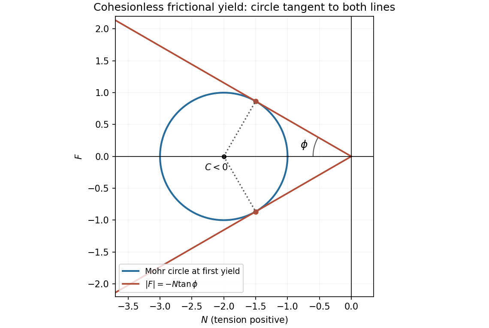

<h1 id="3/b/solution">Solution</h1>

↑ **Parent:** [B](../b.md)

The [Mohr circle](../../../../mohr-s-circle.md) has center $C=(\tau_{xx}+\tau_{yy})/2$ on the normal-[stress](../../../../stress.md) axis and radius $R=\sqrt{(\tau_{xx}-\tau_{yy})^2/4+\tau_{xy}^2}$. In the compressive regime $C<0$, yield occurs when the circle first touches either [friction](../../../../friction.md) line $F=\pm(-N)\tan\phi$. The perpendicular distance of its center from either line is $|C|\sin\phi$. Tangency therefore gives $R^2=C^2\sin^2\phi$, or $C^2-R^2=C^2\cos^2\phi$. But $C^2-R^2=\tau_{xx}\tau_{yy}-\tau_{xy}^2$. Thus

$$
\boxed{4(\tau_{xx}\tau_{yy}-\tau_{xy}^2)=(\tau_{xx}+\tau_{yy})^2\cos^2\phi.}
$$

The compressive sign restriction remains part of this equivalence: squaring alone would also produce algebraic branches that do not represent cohesionless compressive [friction](../../../../friction.md).

**[Figure 1](#3/b/image-mohr-circle-tangency-to-the-cohesionless-friction-envelope-in-tension-positive-coordinates). Mohr-circle tangency to the cohesionless friction envelope in tension-positive coordinates**.

## ↑ Ancestors (12)

1. [B](../b.md)
2. [3](../../3.md)
3. [2009](../../../2009-split.md)
4. [Past exam of the elasticity and plasticity course of the University of Oxford](../../../split.md)
5. [Elasticity and plasticity course of the University of Oxford](../../../../elasticity-and-plasticity-course-of-the-university-of-oxford.md)
6. [Year 4 of the mathematics course of the University of Oxford](../../../../year-4-of-the-mathematics-course-of-the-university-of-oxford.md)
7. [Mathematics course of the University of Oxford](../../../../mathematics-course-of-the-university-of-oxford.md)
8. [Undergraduate course of the University of Oxford](../../../../undergraduate-course-of-the-university-of-oxford.md)
9. [Course of the University of Oxford](../../../../course-of-the-university-of-oxford.md)
10. [University of Oxford](../../../../university-of-oxford-split.md)
11. [List of universities](../../../../list-of-universities.md)
12. [Codex Wiki](../../../../split.md)
