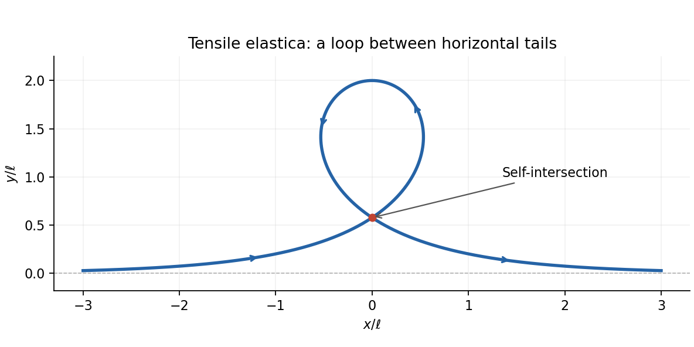

# 2011

↑ **Parent:** [Past exam of the elasticity and plasticity course of the University of Oxford](../past-exam-of-the-elasticity-and-plasticity-course-of-the-university-of-oxford.md)

Source release: [Oxford examination archive release thread](https://www.whatdotheyknow.com/request/maths_past_papers_3), Part C bundle pages 430–433. The cover cross-lists Mathematics and Mathematics and Statistics, both at Part C, Wednesday 8 June 2011, 2.30pm–4.00pm.

Answer availability checked on 28 October 2026: bounded official Oxford searches by exact year, course, module and formal code found no exact-paper answers advertised. The [official contemporary Part C course document](https://www.maths.ox.ac.uk/system/files/attachments/PartC%202011-12.pdf) confirms the course identity; it does not advertise answers to this paper. No later-year answer-release policy was assumed to cover 2011.

**Table of contents**

- [1](#1)
  - [a](#1/a)
    - [Solution](#1/a/solution)
  - [b](#1/b)
    - [Solution](#1/b/solution)
  - [c](#1/c)
    - [Solution](#1/c/solution)
  - [d](#1/d)
    - [Solution](#1/d/solution)
  - [e](#1/e)
    - [Solution](#1/e/solution)
  - [f](#1/f)
    - [Solution](#1/f/solution)
  - [g](#1/g)
    - [Solution](#1/g/solution)
  - [h](#1/h)
    - [Solution](#1/h/solution)
  - [i](#1/i)
    - [Solution](#1/i/solution)
- [2](#2)
  - [a](#2/a)
    - [Solution](#2/a/solution)
  - [b](#2/b)
    - [Solution](#2/b/solution)
  - [c](#2/c)
    - [Solution](#2/c/solution)
  - [d](#2/d)
    - [Solution](#2/d/solution)
  - [e](#2/e)
    - [Solution](#2/e/solution)
  - [f](#2/f)
    - [Solution](#2/f/solution)
  - [g](#2/g)
    - [Solution](#2/g/solution)
  - [h](#2/h)
    - [Solution](#2/h/solution)
- [3](#3)
  - [a](#3/a)
    - [Solution](#3/a/solution)
  - [b](#3/b)
    - [Solution](#3/b/solution)
  - [c](#3/c)
    - [Solution](#3/c/solution)
  - [d](#3/d)
    - [Solution](#3/d/solution)

## 1

↑ **Parent:** [2011](2011.md)

<h3 id="1/a">a</h3>

↑ **Parent:** [1](#1)

<h4 id="1/a/solution">Solution</h4>

↑ **Parent:** [A](#1/a)

The [deformation gradient](../continuum-mechanics.md#deformation-gradient) is the [derivative](../calculus.md#derivative) of the [deformation map](../continuum-mechanics.md#deformation-map) with respect to the [reference configuration](../continuum-mechanics.md#reference-configuration) coordinates, at fixed time:

$$
\boxed{F_{iA}(X,t)=\frac{\partial x_i}{\partial X_A}(X,t),\qquad dx=F\,dX.}
$$

Its [determinant](../multilinear-algebra.md#determinant) $J=\det F$ is the local ratio of current to reference [volume](../geometry-and-topology.md#volume): $dv=J\,dV$ for an orientation-preserving [deformation in continuum mechanics](../continuum-mechanics.md#deformation-mechanics). Thus [elastic incompressibility](../continuum-mechanics.md#elastic-incompressibility) is the pointwise constraint $\boxed{J=1}$, rather than a requirement that each individual [principal stretch](../continuum-mechanics.md#principal-stretch) be one.

<h3 id="1/b">b</h3>

↑ **Parent:** [1](#1)

<h4 id="1/b/solution">Solution</h4>

↑ **Parent:** [B](#1/b)

Choose the outward [unit normal](../differential-geometry.md#unit-normal) $n$ to the [boundary](../topology.md#boundary-of-a-set) of the chosen current material subbody. The [traction](../continuum-mechanics.md#traction) $t(x,n)$ is the contact [force](../force.md) exerted on that subbody per unit current [area](../differential-geometry.md#surface-area) at the [boundary](../topology.md#boundary-of-a-set) point. Reversing the subbody side reverses $n$ and $t$.

By [Cauchy's stress theorem](../continuum-mechanics.md#cauchy-s-stress-theorem), the dependence on $n$ is linear. With the usual column-vector convention the [Cauchy stress tensor](../continuum-mechanics.md#cauchy-stress-tensor) satisfies

$$
\boxed{t(x,n)=\tau(x)n,\qquad t_i=\tau_{ij}n_j.}
$$

The same point has different [traction](../continuum-mechanics.md#traction) vectors on differently oriented planes, but a single [Cauchy stress tensor](../continuum-mechanics.md#cauchy-stress-tensor) encodes all of them. In the absence of body couples, [conservation of angular momentum](../momentum.md#conservation-of-angular-momentum) makes $\tau$ symmetric.

<h3 id="1/c">c</h3>

↑ **Parent:** [1](#1)

<h4 id="1/c/solution">Solution</h4>

↑ **Parent:** [C](#1/c)

In the [current configuration](../continuum-mechanics.md#current-configuration), [balance of linear momentum](../continuum-mechanics.md#balance-of-linear-momentum) is the [Cauchy momentum equation](../continuum-mechanics.md#cauchy-momentum-equation)

$$
\boxed{\operatorname{div}_x\tau+\rho b=\rho\left(\partial_t v+(v\cdot\nabla_x)v\right).}
$$

Here $\tau$ is the [Cauchy stress tensor](../continuum-mechanics.md#cauchy-stress-tensor), $\rho$ is current [mass density](../fluid-mechanics.md#density), $b$ is [body force](../fluid-mechanics.md#body-force) per unit [mass](../classical-mechanics.md#mass), and $v(x,t)$ is the [velocity](../classical-mechanics.md#velocity) of the material particle currently at $x$. The expression in parentheses is the [material acceleration](../continuum-mechanics.md#material-acceleration). The [divergence](../multivariable-calculus.md#divergence) is taken in current spatial coordinates, with $(\operatorname{div}\tau)_i=\partial_j\tau_{ij}$.

Equivalently the right side is $\rho\partial_t^2x(X,t)$ evaluated at the particle, because this is the same [material acceleration](../continuum-mechanics.md#material-acceleration) in [Lagrangian coordinates](../continuum-mechanics.md#lagrangian-coordinate). For the subsequent static inflation with negligible [body force](../fluid-mechanics.md#body-force), the equation reduces to $\operatorname{div}\tau=0$.

<h3 id="1/d">d</h3>

↑ **Parent:** [1](#1)

<h4 id="1/d/solution">Solution</h4>

↑ **Parent:** [D](#1/d)

Write $B=A+H$ for the reference outer radius and $b=a+h$ for the current outer radius. The inner material normal is $-e_r$. A fluid [pressure](../pressure.md) $P$ applies [traction](../continuum-mechanics.md#traction) $-Pn=Pe_r$ there, so the radial [Cauchy stress tensor](../continuum-mechanics.md#cauchy-stress-tensor) component must be negative:

$$
\boxed{t_r(a)=-P,\qquad t_r(b)=0.}
$$

The second condition uses zero external gauge [pressure](../pressure.md). Both faces also have zero shear [traction](../continuum-mechanics.md#traction); the axisymmetric diagonal [stress](../continuum-mechanics.md#stress) field satisfies those conditions automatically. The axial constraint is [plane strain](../continuum-mechanics.md#plane-strain), so supports may supply an axial reaction; it does not imply zero axial [stress](../continuum-mechanics.md#stress).

<h3 id="1/e">e</h3>

↑ **Parent:** [1](#1)

<h4 id="1/e/solution">Solution</h4>

↑ **Parent:** [E](#1/e)

For the axisymmetric [deformation map](../continuum-mechanics.md#deformation-map), take $\theta=\Theta$, $z=Z$, and $r=r(R)$. A reference cylindrical shell of unit axial length has [volume](../geometry-and-topology.md#volume) $2\pi R\,dR$, and the corresponding current shell has [volume](../geometry-and-topology.md#volume) $2\pi r\,dr$. [Elastic incompressibility](../continuum-mechanics.md#elastic-incompressibility) therefore gives $r\,dr=R\,dR$.

Integrating from the inner surface, where $r(A)=a$, gives $r^2-a^2=R^2-A^2$. The positive radius is consequently

$$
\boxed{r(R)=\sqrt{R^2+a^2-A^2},\qquad A\leq R\leq B.}
$$

The outer surface is not an additional independent unknown: $\boxed{b=\sqrt{B^2+a^2-A^2}}$, and hence $h=b-a$.

<h3 id="1/f">f</h3>

↑ **Parent:** [1](#1)

<h4 id="1/f/solution">Solution</h4>

↑ **Parent:** [F](#1/f)

Use orthonormal cylindrical bases in the [reference configuration](../continuum-mechanics.md#reference-configuration) and [current configuration](../continuum-mechanics.md#current-configuration). The [deformation gradient](../continuum-mechanics.md#deformation-gradient) maps a radial increment $dR$ to $r'dR$, an azimuthal arc $R\,d\Theta$ to $r\,d\Theta$, and an axial increment $dZ$ to itself. Therefore

$$
\boxed{F=r' e_r\otimes E_R+\frac rR e_\theta\otimes E_\Theta+e_z\otimes E_Z.}
$$

Differentiating the radius relation gives $r'=R/r$. Its three [principal stretches](../continuum-mechanics.md#principal-stretch) are

$$
\boxed{\lambda_r=\frac Rr,\qquad\lambda_\theta=\frac rR,\qquad\lambda_z=1.}
$$

Their product is one, as required by [elastic incompressibility](../continuum-mechanics.md#elastic-incompressibility). The symbols called “strains” in the source are these stretch ratios; engineering [strain](../continuum-mechanics.md#strain) would instead subtract one. The axial stretch is one because this is [plane strain](../continuum-mechanics.md#plane-strain).

<h3 id="1/g">g</h3>

↑ **Parent:** [1](#1)

<h4 id="1/g/solution">Solution</h4>

↑ **Parent:** [G](#1/g)

The multiplier enforcing [elastic incompressibility](../continuum-mechanics.md#elastic-incompressibility) contributes an arbitrary hydrostatic [stress](../continuum-mechanics.md#stress). Denote it by $q(r)$ to distinguish it from the applied [pressure](../pressure.md) $P$. For the [neo-Hookean solid](../elasticity-physics.md#neo-hookean-solid), the [Cauchy stress tensor](../continuum-mechanics.md#cauchy-stress-tensor) is $\tau=-qI+\mu FF^T$. Thus its principal components are

$$
\boxed{t_r=-q+\mu\lambda_r^2=-q+\mu\frac{R^2}{r^2},\qquad
t_\theta=-q+\mu\lambda_\theta^2=-q+\mu\frac{r^2}{R^2}.}
$$

The axial component is $t_z=-q+\mu$, despite the unit axial stretch. The quantity $q$ is a [Lagrange multiplier](../mathematical-optimization.md#lagrange-multiplier) determined together with equilibrium and the [traction](../continuum-mechanics.md#traction) conditions; it is not obtained by differentiating the reduced stretch [energy](../energy.md) while ignoring its constraint.

In particular the [stress](../continuum-mechanics.md#stress) difference eliminates this multiplier:

$$
\boxed{t_\theta-t_r=\mu\left(\frac{r^2}{R^2}-\frac{R^2}{r^2}\right).}
$$

<h3 id="1/h">h</h3>

↑ **Parent:** [1](#1)

<h4 id="1/h/solution">Solution</h4>

↑ **Parent:** [H](#1/h)

The radial equilibrium equation gives $dt_r/dr=(t_\theta-t_r)/r$. Set $C=a^2-A^2$, so that $R^2=r^2-C$. Substitution of the [neo-Hookean solid](../elasticity-physics.md#neo-hookean-solid) [stress](../continuum-mechanics.md#stress) difference eliminates both $q$ and $t_\theta$:

$$
\boxed{\frac{dt_r}{dr}=\frac\mu r\left[\frac{r^2}{r^2-C}-\frac{r^2-C}{r^2}\right]
=\frac{\mu C(2r^2-C)}{r^3(r^2-C)},\qquad a<r<b.}
$$

This is a first-order [ordinary differential equation](../differential-equation.md#ordinary-differential-equation) for the radial [stress](../continuum-mechanics.md#stress), parametrized by the unknown inner radius. For inflation $C>0$, its right side is positive, so $t_r$ increases from the negative inner [pressure](../pressure.md) to zero at the outer surface. The denominator stays positive because $r^2-C=R^2\geq A^2>0$.

<h3 id="1/i">i</h3>

↑ **Parent:** [1](#1)

<h4 id="1/i/solution">Solution</h4>

↑ **Parent:** [I](#1/i)

Integrate the radial equilibrium equation across the thickness, retaining the [integral](../integral.md) rather than evaluating its [antiderivative](../integral.md#antiderivative). The [traction](../continuum-mechanics.md#traction) conditions give $t_r(b)-t_r(a)=P$. Hence $a$ must satisfy

$$
\boxed{P=\mu\int_a^{\sqrt{(A+H)^2+a^2-A^2}}
\frac1r\left[\frac{r^2}{r^2-a^2+A^2}-\frac{r^2-a^2+A^2}{r^2}\right]\,dr.}
$$

All endpoints and coefficients here depend only on $a$ and the specified material and reference geometry. This is the required implicit [pressure](../pressure.md)–radius relation for [inflation and extension of an incompressible tube](../elasticity-physics.md#inflation-and-extension-of-an-incompressible-tube) with unit axial stretch. In particular $a=A$ gives zero integrand and $P=0$. Once an admissible root is selected, the radial [stress](../continuum-mechanics.md#stress) follows by integrating from the outer face, $t_r(r)=-\int_r^b(dt_r/ds)\,ds$, and the remaining [stress](../continuum-mechanics.md#stress) components follow from the [constitutive equation](../continuum-mechanics.md#constitutive-equation).

## 2

↑ **Parent:** [2011](2011.md)

<h3 id="2/a">a</h3>

↑ **Parent:** [2](#2)

<h4 id="2/a/solution">Solution</h4>

↑ **Parent:** [A](#2/a)

Substituting the sinusoidal [plane wave](../wave-function.md#plane-wave) into the [Navier-Cauchy equation](../elasticity-physics.md#navier-cauchy-equation) gives $\Delta u=-u$, $u_{tt}=-c^2u$, and $\nabla\operatorname{div}u=-k(k\cdot a)\sin(k\cdot X-ct)$ because $|k|=1$. Equality of the amplitudes is therefore

$$
\boxed{\rho c^2a=\mu a+(\lambda+\mu)k(k\cdot a).}
$$

This is an [eigenvalue problem](../linear-operator-theory.md#eigenvalue-problem) for the [acoustic tensor](../elasticity-physics.md#acoustic-tensor) $\mu I+(\lambda+\mu)k\otimes k$. Choosing a nonzero [amplitude](../wave.md#wave-amplitude) parallel to $k$ gives $\rho c^2=\lambda+2\mu$; choosing any nonzero [amplitude](../wave.md#wave-amplitude) perpendicular to $k$ gives $\rho c^2=\mu$. For positive [mass density](../fluid-mechanics.md#density) and stable [Lamé parameters](../elasticity-physics.md#lame-parameter), both squared speeds are positive. These choices construct nonzero solutions explicitly, proving existence.

<h3 id="2/b">b</h3>

↑ **Parent:** [2](#2)

<h4 id="2/b/solution">Solution</h4>

↑ **Parent:** [B](#2/b)

Resolve each [amplitude](../wave.md#wave-amplitude) by the [orthogonal projections](../hilbert-space.md#orthogonal-projection)

$$
a_L=(a\cdot k)k,\qquad a_T=a-(a\cdot k)k.
$$

The [acoustic tensor](../elasticity-physics.md#acoustic-tensor) acts by $\lambda+2\mu$ on the longitudinal line and by $\mu$ on its perpendicular plane. Thus

$$
\boxed{c_L=\sqrt{\frac{\lambda+2\mu}{\rho}},\qquad c_T=\sqrt{\frac\mu\rho}.}
$$

The longitudinal component is a [longitudinal wave](../wave.md#longitudinal-wave), while the two independent transverse polarizations are [transverse waves](../wave.md#transverse-wave). Each projection obeys its own [wave equation](../wave-equation.md), and [superposition](../vector-space.md#superposition-principle) adds the corresponding solutions.

A general planar disturbance is therefore a sum of the two types. For a single sinusoid with a common speed, both projections cannot be nonzero unless the two speeds coincide: projecting the [eigenvalue equation](../linear-operator-theory.md#eigenvalue-equation) gives $(\rho c^2-\lambda-2\mu)a_L=0$ and $(\rho c^2-\mu)a_T=0$. This distinguishes [superposition](../vector-space.md#superposition-principle) of [waves](../wave.md) with different speeds from a mixed polarization traveling rigidly at one speed.

<h3 id="2/c">c</h3>

↑ **Parent:** [2](#2)

<h4 id="2/c/solution">Solution</h4>

↑ **Parent:** [C](#2/c)

Divide the [Navier-Cauchy equation](../elasticity-physics.md#navier-cauchy-equation) by [mass density](../fluid-mechanics.md#density). Since $\mu/\rho=c_T^2$ and $(\lambda+\mu)/\rho=c_L^2-c_T^2$, it becomes

$$
\boxed{u_{tt}=c_T^2\Delta u+(c_L^2-c_T^2)\nabla\operatorname{div}u.}
$$

Equivalently, using the [vector calculus](../multivariable-calculus.md#vector-calculus) identity $\Delta u=\nabla\operatorname{div}u-\nabla\times(\nabla\times u)$,

$$
\boxed{u_{tt}=c_L^2\nabla\operatorname{div}u-c_T^2\nabla\times(\nabla\times u).}
$$

The [divergence](../multivariable-calculus.md#divergence) and [curl](../multivariable-calculus.md#curl) consequently propagate at $c_L$ and $c_T$, respectively.

<h3 id="2/d">d</h3>

↑ **Parent:** [2](#2)

<h4 id="2/d/solution">Solution</h4>

↑ **Parent:** [D](#2/d)

Use the complex [amplitude](../wave.md#wave-amplitude) and take its [real part](../complex-analysis.md#real-part) at the end; the equations are linear with real coefficients. Let $M=\lambda+2\mu$, $\omega=kc$, and $v=(A,B)^T$. The differential operators on this [exponential function](../calculus.md#exponential-function) are $\partial_X=ik$, $\partial_Y=-b$, and $\partial_t=-i\omega$. Substitution gives

$$
\begin{pmatrix}
\mu b^2-Mk^2+\rho k^2c^2&-i(\lambda+\mu)kb\\
-i(\lambda+\mu)kb&Mb^2-\mu k^2+\rho k^2c^2
\end{pmatrix}\binom AB=0.
$$

The [determinant](../multilinear-algebra.md#determinant) factors as

$$
\mu M\left[b^2-k^2+\frac{\rho k^2c^2}{M}\right]
\left[b^2-k^2+\frac{\rho k^2c^2}{\mu}\right].
$$

Consequently choose the positive decay roots

$$
\boxed{b_1=k\sqrt{1-c^2/c_L^2},\qquad b_2=k\sqrt{1-c^2/c_T^2}.}
$$

The [Rayleigh wave decay exponents](../wave-equation.md#rayleigh-wave-decay-exponents) must both give strict decay into the half-space. A genuine nonzero [Rayleigh wave](../wave-equation.md#rayleigh-wave) combines both, as the free-surface equations below also show. Thus $b_1,b_2>0$ requires $\boxed{0<c<\min(c_T,c_L)}$. In a stable ordinary isotropic solid $c_T<c_L$, so it is slower even than the [transverse wave](../wave.md#transverse-wave). The roots depend on the candidate speed as well as the material constants and [wavenumber](../wave-equation.md#wavenumber); the speed is fixed by the [boundary condition](../differential-equation.md#boundary-condition).

<h3 id="2/e">e</h3>

↑ **Parent:** [2](#2)

<h4 id="2/e/solution">Solution</h4>

↑ **Parent:** [E](#2/e)

For the $b_1$ root the [elastic wave polarization](../elasticity-physics.md#elastic-wave-polarization) is parallel to the complex [derivative](../calculus.md#derivative) vector $(ik,-b_1)$, giving

$$
\boxed{B_1=\frac{i b_1}{k}A_1.}
$$

For the $b_2$ root the field has zero [divergence](../multivariable-calculus.md#divergence), $ikA_2-b_2B_2=0$, giving

$$
\boxed{B_2=\frac{ik}{b_2}A_2.}
$$

These relations also follow by inserting each decay root into either row of the [matrix](../vector-space.md#matrix). The complete decaying [displacement field](../elasticity-physics.md#displacement-field-mechanics) has complex components

$$
U(Y)=A_1e^{-b_1Y}+A_2e^{-b_2Y},\qquad
V(Y)=\frac{ib_1}{k}A_1e^{-b_1Y}+\frac{ik}{b_2}A_2e^{-b_2Y},
$$

multiplied by $e^{ik(X-ct)}$, followed by the [real part](../complex-analysis.md#real-part). The first constituent is irrotational and the second is divergence-free; both are needed to cancel the two surface [tractions](../continuum-mechanics.md#traction).

<h3 id="2/f">f</h3>

↑ **Parent:** [2](#2)

<h4 id="2/f/solution">Solution</h4>

↑ **Parent:** [F](#2/f)

The material occupies $Y\geq0$, so its outward [unit normal](../differential-geometry.md#unit-normal) at the surface is $n=-e_Y$. A free surface has zero [traction](../continuum-mechanics.md#traction), $\tau n=0$. Therefore

$$
\boxed{\tau_{XY}(X,0,t)=0,\qquad\tau_{YY}(X,0,t)=0,\qquad\tau_{ZY}(X,0,t)=0.}
$$

The third condition is automatic for the two-dimensional [displacement field](../elasticity-physics.md#displacement-field-mechanics) with zero third component and no dependence on the third coordinate. The first two impose zero shear and normal [stress](../continuum-mechanics.md#stress) at the free surface.

<h3 id="2/g">g</h3>

↑ **Parent:** [2](#2)

<h4 id="2/g/solution">Solution</h4>

↑ **Parent:** [G](#2/g)

Write the in-plane [displacement field](../elasticity-physics.md#displacement-field-mechanics) as $(u,v)$. The [infinitesimal strain tensor](../continuum-mechanics.md#infinitesimal-strain-tensor) gives $2e_{XY}=u_Y+v_X$, $e_{YY}=v_Y$, and $\operatorname{tr}e=u_X+v_Y$. The two nontrivial zero-[traction](../continuum-mechanics.md#traction) conditions become

$$
\boxed{u_Y+v_X=0,\qquad\lambda u_X+(\lambda+2\mu)v_Y=0\quad(Y=0).}
$$

Equivalently for the [complex amplitudes](../wave.md#complex-amplitude) they are $U'(0)+ikV(0)=0$ and $ik\lambda U(0)+(\lambda+2\mu)V'(0)=0$. Because the [constitutive equation](../continuum-mechanics.md#constitutive-equation) is real and linear, vanishing of these complex [amplitudes](../wave.md#wave-amplitude) enforces the conditions at every position and time.

<h3 id="2/h">h</h3>

↑ **Parent:** [2](#2)

<h4 id="2/h/solution">Solution</h4>

↑ **Parent:** [H](#2/h)

Substituting both profiles into the shear [traction](../continuum-mechanics.md#traction) condition gives

$$
2b_1A_1+\frac{b_2^2+k^2}{b_2}A_2=0.
$$

For the normal [traction](../continuum-mechanics.md#traction), use $Mb_1^2=Mk^2-\rho k^2c^2$ and $b_2^2+k^2=k^2(2-c^2/c_T^2)$. Removing the common nonzero factors yields the second equation. Thus

$$
\boxed{\begin{pmatrix}
2b_1&(b_2^2+k^2)/b_2\\
(b_2^2+k^2)/k&2k
\end{pmatrix}\binom{A_1}{A_2}=0.}
$$

A nonzero [displacement field](../elasticity-physics.md#displacement-field-mechanics) requires the [determinant](../multilinear-algebra.md#determinant) to vanish:

$$
\boxed{(b_2^2+k^2)^2=4k^2b_1b_2.}
$$

Let $s=c^2/c_T^2$ and $\eta=c_T^2/c_L^2$. Cancelling $k^4$ gives the [Rayleigh secular equation](../wave-equation.md#rayleigh-secular-equation)

$$
\boxed{(2-s)^2=4\sqrt{1-s}\sqrt{1-\eta s},\qquad0<s<1.}
$$

Squaring and excluding the zero root gives $s^3-8s^2+(24-16\eta)s-16(1-\eta)=0$; any candidate must still satisfy the unsquared equation and the decay inequalities. For stable isotropic elasticity $0<\eta<3/4$, this cubic has one root in $(0,1)$: its values at zero and one have opposite signs, and its strictly negative second [derivative](../calculus.md#derivative) on this interval prevents a second crossing back to a positive final value. Both sides of the unsquared equation are positive there, so this root is valid.

The root $s=0$ of the squared equation is not a propagating surface [wave](../wave.md): at $c=0$, the two roots coincide, and the null combination $A_2=-A_1$ in this representation produces zero [displacement field](../elasticity-physics.md#displacement-field-mechanics). As a numerical example, $\lambda=\mu$ gives $\eta=1/3$ and $c\simeq0.9194c_T$. The surface-wave speed is independent of $k$ in this homogeneous half-space model.

## 3

↑ **Parent:** [2011](2011.md)

<h3 id="3/a">a</h3>

↑ **Parent:** [3](#3)

<h4 id="3/a/solution">Solution</h4>

↑ **Parent:** [A](#3/a)

Let $s$ be [arc length](../riemannian-geometry.md#arc-length), so [inextensibility](../mathematical-biology.md#inextensible-filament) makes $r'=d_3$ a [unit tangent vector](../tangent-vector.md#unit-tangent-vector). The [curvature](../differential-geometry.md#curvature) is $\kappa=\theta'$, hence $m'=EI\theta''e_z$ for uniform [bending stiffness](../elasticity-physics.md#bending-stiffness). [Balance of linear momentum](../continuum-mechanics.md#balance-of-linear-momentum) in static equilibrium gives a constant resultant $n=Fe_x+Ge_y$.

Taking the [cross product](../vector-space.md#cross-product) directly,

$$
d_3\times n=(\cos\theta\,e_x+\sin\theta\,e_y)\times(Fe_x+Ge_y)
=(G\cos\theta-F\sin\theta)e_z.
$$

The scalar component of [conservation of angular momentum](../momentum.md#conservation-of-angular-momentum) therefore becomes

$$
\boxed{EI\theta''+G\cos\theta-F\sin\theta=0.}
$$

Together with $x'=\cos\theta$ and $y'=\sin\theta$, this [Euler elastica](../elasticity-physics.md#euler-elastica) equation determines the centerline once the appropriate [boundary conditions](../differential-equation.md#boundary-condition) are supplied.

<h3 id="3/b">b</h3>

↑ **Parent:** [3](#3)

<h4 id="3/b/solution">Solution</h4>

↑ **Parent:** [B](#3/b)

Put $P=-F>0$. With $G=0$, the [Euler elastica](../elasticity-physics.md#euler-elastica) equation is $EI\theta''+P\sin\theta=0$. [Linearization](../algebra.md#linearization) about the straight configuration gives $EI\theta''+P\theta=0$. Under the [boundary conditions](../differential-equation.md#boundary-condition) explicitly stated, $\theta(0)=\theta(L)=0$, a nonzero solution requires

$$
\boxed{P_n=EI\left(\frac{n\pi}{L}\right)^2,\qquad
\theta_n(s)=C\sin\frac{n\pi s}{L},\qquad n=1,2,\ldots.}
$$

Thus **with only the stated [boundary conditions](../differential-equation.md#boundary-condition)**, the first critical compressive force is $\boxed{F_c=-\pi^2EI/L^2}$. The corresponding linear transverse [displacement field](../elasticity-physics.md#displacement-field-mechanics), with $y(0)=0$, is

$$
y_n(s)=\frac{CL}{n\pi}\left(1-\cos\frac{n\pi s}{L}\right),
$$

and $x(s)=s$ to first order. These are the successive small-amplitude [buckling](../elasticity-physics.md#buckling) modes. The nonlinear branches retain the [simple pendulum](../simple-pendulum.md) equation; if the angular amplitude is $\theta_m$ and $m=\sin(\theta_m/2)$, fitting $n$ half-periods into the rod gives $P=4EI n^2K(m)^2/L^2$, which tends to $P_n$ as $m\downarrow0$. Here $K$ is the [complete elliptic integral of the first kind](../complex-analysis.md#complete-elliptic-integral-of-the-first-kind), with $m$ its modulus, not its squared parameter.

**[Endpoint position compatibility for the Euler elastica](../elasticity-physics.md#endpoint-position-compatibility-for-the-euler-elastica) adds a condition when fully fixed clamps have equal transverse height.** If the word “clamped” also imposes $y(L)=y(0)$, then $\int_0^L\theta_n\,ds=0$. With $G=0$, this retains only even $n=2j$, yielding

$$
\boxed{P_j=4j^2\pi^2EI/L^2,\qquad P_{\rm first}=4\pi^2EI/L^2.}
$$

The same exclusion is exact on the nonlinear branches: integrating the elastica equation gives $P\int\sin\theta\,ds=-EI[\theta'(L)-\theta'(0)]$, and an odd number of half-periods reverses the nonzero endpoint slope. Hence odd $n$ changes the endpoint height. The conventional fixed-clamp first [Euler buckling](../elasticity-physics.md#euler-s-critical-load) load is the second boxed value, whereas the source's explicitly listed [boundary conditions](../differential-equation.md#boundary-condition) alone give the first. Additional clamped modes with a nonzero transverse reaction require releasing the imposed $G=0$. Load-controlled buckling also permits axial shortening; an exactly inextensible rod whose endpoint separation is fixed equal to its full length has no room to buckle.

<h3 id="3/c">c</h3>

↑ **Parent:** [3](#3)

<h4 id="3/c/solution">Solution</h4>

↑ **Parent:** [C](#3/c)

Set $\ell=\sqrt{EI/F}$. The [Euler elastica](../elasticity-physics.md#euler-elastica) equation becomes $\theta''=\ell^{-2}\sin\theta$. Multiplying by $\theta'$ gives the [first integral](../differential-equation.md#first-integral)

$$
\frac{EI}{2}(\theta')^2+F\cos\theta=C.
$$

Straight asymptotic ends require $\theta'\to0$ and a horizontal tangent, so $C=F$. This is the [separatrix](../dynamical-systems.md#separatrix) of a [simple pendulum](../simple-pendulum.md) with its angle shifted by $\pi$. A nonconstant solution moves from $\theta=0$ to $2\pi$, with the same physical tangent at both ends, taking infinite [arc length](../riemannian-geometry.md#arc-length) to approach either limit. One explicit representative is

$$
\boxed{\theta(s)=4\arctan e^{s/\ell}.}
$$

Using $\cos\theta=1-2\operatorname{sech}^2(s/\ell)$ and $\sin\theta=-2\operatorname{sech}(s/\ell)\tanh(s/\ell)$ and integrating $r'=(\cos\theta,\sin\theta)$ gives the [tensile elastica loop](../elasticity-physics.md#tensile-elastica-loop)

$$
\boxed{x(s)=s-2\ell\tanh(s/\ell),\qquad y(s)=2\ell\operatorname{sech}(s/\ell).}
$$

This solution is nontrivial, tends to horizontal straight tails, and has finite excess [bending energy](../elasticity-physics.md#bending-energy). It is also necessarily self-intersecting. Indeed $y$ is even and $x$ is odd. For $z>0$, let $f(z)=z-2\tanh z$. Near zero $f(z)<0$, while $f(2)>0$, so there is a root $z_*\in(0,2)$. At the two distinct parameters $s=\pm\ell z_*$, both points have $x=0$ and the same $y>0$. Numerically $z_*\simeq1.91501$.

Any nonconstant smooth solution with the same straight asymptotic conditions has this [first integral](../differential-equation.md#first-integral). Between consecutive horizontal orientations, separating variables gives the displayed solution up to translation, reflection, and reversal. It cannot pass through a straight equilibrium at a finite parameter, by uniqueness of the [ordinary differential equation](../differential-equation.md#ordinary-differential-equation). Thus all such nontrivial branches have the same loop crossing. This is an ideal zero-thickness rod solution; a physical rod with self-contact excluded cannot realize the crossing without adding contact forces.

**[Figure 1](#3/c/image-the-tensile-elastica-loop-and-its-self-intersection). The tensile elastica loop and its self-intersection**.

<h3 id="3/d">d</h3>

↑ **Parent:** [3](#3)

<h4 id="3/d/solution">Solution</h4>

↑ **Parent:** [D](#3/d)

Take the clamp at $s=0$ with $x(0)=y(0)=\theta(0)=0$. An end [force](../force.md) without an applied end moment gives the free-end condition $\theta'(1)=0$. With $F=0$, the [Euler elastica](../elasticity-physics.md#euler-elastica) equation is $EI\theta''+G\cos\theta=0$. For $|G|/(EI)\ll1$, $\theta$ is small, so the leading equation is

$$
EI\theta''=-G.
$$

Integrating with the two [boundary conditions](../differential-equation.md#boundary-condition) gives

$$
\boxed{\theta(s)=\frac G{EI}\left(s-\frac{s^2}{2}\right).}
$$

To first order, $x'=\cos\theta=1+O(G^2)$ and $y'=\sin\theta=\theta+O(G^3)$. Hence

$$
\boxed{x(s)=s+O(G^2),\qquad
y(s)=\frac{G}{6EI}s^2(3-s)+O(G^3),\quad0\leq s\leq1.}
$$

Equivalently $y(x)=Gx^2(3-x)/(6EI)$ at leading order, the familiar [cantilever](../elasticity-physics.md#cantilever) response. Because $G<0$, the deflection is downward. The free-end [displacement field](../elasticity-physics.md#displacement-field-mechanics) and slope are $y(1)=G/(3EI)$ and $\theta(1)=G/(2EI)$. The remainder notation holds with fixed positive $EI$ and nondimensional unit rod length.

## ↑ Ancestors (9)

1. [Past exam of the elasticity and plasticity course of the University of Oxford](../past-exam-of-the-elasticity-and-plasticity-course-of-the-university-of-oxford.md)
2. [Elasticity and plasticity course of the University of Oxford](../university-of-oxford.md#elasticity-and-plasticity-course-of-the-university-of-oxford)
3. [Year 4 of the mathematics course of the University of Oxford](../university-of-oxford.md#year-4-of-the-mathematics-course-of-the-university-of-oxford)
4. [Mathematics course of the University of Oxford](../university-of-oxford.md#mathematics-course-of-the-university-of-oxford)
5. [Undergraduate course of the University of Oxford](../university-of-oxford.md#undergraduate-course-of-the-university-of-oxford)
6. [Course of the University of Oxford](../university-of-oxford.md#course-of-the-university-of-oxford)
7. [University of Oxford](../university-of-oxford.md)
8. [List of universities](../README.md#list-of-universities)
9. [Codex Wiki](../README.md)
