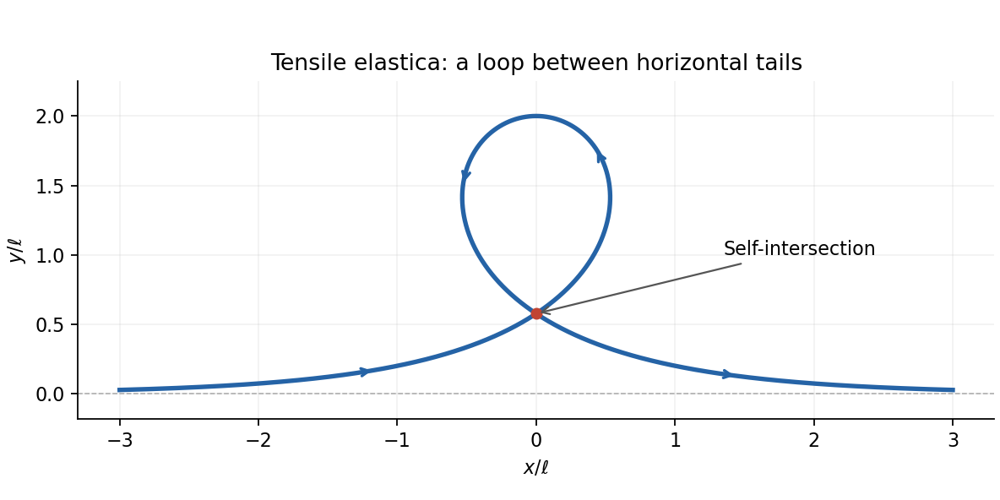

<h1 id="3/c/solution">Solution</h1>

↑ **Parent:** [C](../c.md)

Set $\ell=\sqrt{EI/F}$. The [Euler elastica](../../../../euler-elastica.md) equation becomes $\theta''=\ell^{-2}\sin\theta$. Multiplying by $\theta'$ gives the [first integral](../../../../first-integral.md)

$$
\frac{EI}{2}(\theta')^2+F\cos\theta=C.
$$

Straight asymptotic ends require $\theta'\to0$ and a horizontal tangent, so $C=F$. This is the [separatrix](../../../../separatrix.md) of a [simple pendulum](../../../../simple-pendulum-split.md) with its angle shifted by $\pi$. A nonconstant solution moves from $\theta=0$ to $2\pi$, with the same physical tangent at both ends, taking infinite [arc length](../../../../arc-length.md) to approach either limit. One explicit representative is

$$
\boxed{\theta(s)=4\arctan e^{s/\ell}.}
$$

Using $\cos\theta=1-2\operatorname{sech}^2(s/\ell)$ and $\sin\theta=-2\operatorname{sech}(s/\ell)\tanh(s/\ell)$ and integrating $r'=(\cos\theta,\sin\theta)$ gives the [tensile elastica loop](../../../../tensile-elastica-loop.md)

$$
\boxed{x(s)=s-2\ell\tanh(s/\ell),\qquad y(s)=2\ell\operatorname{sech}(s/\ell).}
$$

This solution is nontrivial, tends to horizontal straight tails, and has finite excess [bending energy](../../../../bending-energy.md). It is also necessarily self-intersecting. Indeed $y$ is even and $x$ is odd. For $z>0$, let $f(z)=z-2\tanh z$. Near zero $f(z)<0$, while $f(2)>0$, so there is a root $z_*\in(0,2)$. At the two distinct parameters $s=\pm\ell z_*$, both points have $x=0$ and the same $y>0$. Numerically $z_*\simeq1.91501$.

Any nonconstant smooth solution with the same straight asymptotic conditions has this [first integral](../../../../first-integral.md). Between consecutive horizontal orientations, separating variables gives the displayed solution up to translation, reflection, and reversal. It cannot pass through a straight equilibrium at a finite parameter, by uniqueness of the [ordinary differential equation](../../../../ordinary-differential-equation.md). Thus all such nontrivial branches have the same loop crossing. This is an ideal zero-thickness rod solution; a physical rod with self-contact excluded cannot realize the crossing without adding contact forces.

**[Figure 1](#3/c/image-the-tensile-elastica-loop-and-its-self-intersection). The tensile elastica loop and its self-intersection**.

## ↑ Ancestors (12)

1. [C](../c.md)
2. [3](../../3.md)
3. [2011](../../../2011-split.md)
4. [Past exam of the elasticity and plasticity course of the University of Oxford](../../../split.md)
5. [Elasticity and plasticity course of the University of Oxford](../../../../elasticity-and-plasticity-course-of-the-university-of-oxford.md)
6. [Year 4 of the mathematics course of the University of Oxford](../../../../year-4-of-the-mathematics-course-of-the-university-of-oxford.md)
7. [Mathematics course of the University of Oxford](../../../../mathematics-course-of-the-university-of-oxford.md)
8. [Undergraduate course of the University of Oxford](../../../../undergraduate-course-of-the-university-of-oxford.md)
9. [Course of the University of Oxford](../../../../course-of-the-university-of-oxford.md)
10. [University of Oxford](../../../../university-of-oxford-split.md)
11. [List of universities](../../../../list-of-universities.md)
12. [Codex Wiki](../../../../split.md)
