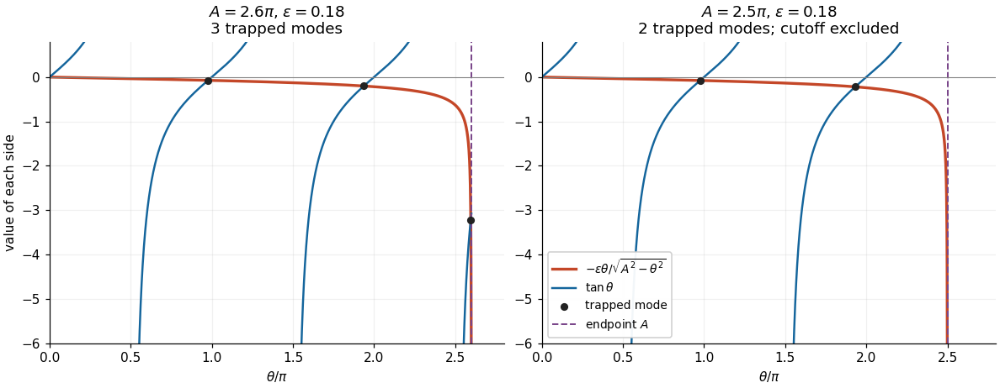

# 2023

↑ **Parent:** [Past exam of the elasticity and plasticity course of the University of Oxford](../past-exam-of-the-elasticity-and-plasticity-course-of-the-university-of-oxford.md)

Original solutions to every part of the [elasticity and plasticity course of the University of Oxford](../university-of-oxford.md#elasticity-and-plasticity-course-of-the-university-of-oxford) Part C examination, held on 30 May 2023. Source: [released examination PDF, bundle pages 317–320; paper pages 1–4](https://www.whatdotheyknow.com/request/request_for_mathematics_examinat/response/3129786/attach/3/FOI%20202507%20740%20Data.pdf#page=317). Numbering follows the original paper. In Question 1(c), the printed count needs a strict-cutoff qualification: at $ak=(n-1/2)\pi$ the newly counted state has no exterior [exponential decay](../analysis.md#exponential-decay) and must be excluded. The solution includes that correction and the exceptional small-parameter balances. In Question 3(d), purely [elastic unloading](../continuum-mechanics.md#elastic-unloading) is valid only until [reverse yielding](../continuum-mechanics.md#reverse-yielding) begins.

**Table of contents**

- [1](#1)
  - [a](#1/a)
    - [Solution](#1/a/solution)
  - [b](#1/b)
    - [Solution](#1/b/solution)
  - [c](#1/c)
    - [Solution](#1/c/solution)
- [2](#2)
  - [a](#2/a)
    - [Solution](#2/a/solution)
  - [b](#2/b)
    - [Solution](#2/b/solution)
  - [c](#2/c)
    - [i](#2/c/i)
      - [Solution](#2/c/i/solution)
    - [ii](#2/c/ii)
      - [Solution](#2/c/ii/solution)
    - [iii](#2/c/iii)
      - [Solution](#2/c/iii/solution)
    - [iv](#2/c/iv)
      - [Solution](#2/c/iv/solution)
- [3](#3)
  - [a](#3/a)
    - [Solution](#3/a/solution)
  - [b](#3/b)
    - [Solution](#3/b/solution)
  - [c](#3/c)
    - [Solution](#3/c/solution)
  - [d](#3/d)
    - [Solution](#3/d/solution)

## 1

↑ **Parent:** [2023](2023.md)

<h3 id="1/a">a</h3>

↑ **Parent:** [1](#1)

<h4 id="1/a/solution">Solution</h4>

↑ **Parent:** [A](#1/a)

For [antiplane shear](../elasticity-physics.md#antiplane-shear), the [displacement field](../elasticity-physics.md#displacement-field-mechanics) is $\mathbf u=(0,0,w(x,y,t))$, independent of $z$. Its [divergence](../multivariable-calculus.md#divergence) is zero. Consequently the only possibly nonzero components of the [stress tensor](../continuum-mechanics.md#cauchy-stress-tensor) are the [shear stresses](../viscous-fluid-flow.md#shear-stress)

$$
\tau_{xz}=\tau_{zx}=\mu w_x,\qquad
\tau_{yz}=\tau_{zy}=\mu w_y.
$$

The $x$ and $y$ components of the [Navier-Cauchy equation](../elasticity-physics.md#navier-cauchy-equation) vanish identically. Its $z$ component gives $\rho w_{tt}=\partial_x(\mu w_x)+\partial_y(\mu w_y)$. Each material has constant [shear modulus](../elasticity-physics.md#shear-modulus) and [mass density](../fluid-mechanics.md#density), so the required [wave equation](../wave-equation.md) and [wave speeds](../wave-equation.md#wave-speed) are

$$
\boxed{w_{j,tt}=c_j^2(w_{j,xx}+w_{j,yy}),\qquad
c_j=\sqrt{\frac{\mu_j}{\rho_j}},\quad j=1,2.}
$$

At a [perfectly bonded elastic interface](../elasticity-physics.md#perfectly-bonded-elastic-interface), both the [displacement field](../elasticity-physics.md#displacement-field-mechanics) and the [traction](../continuum-mechanics.md#traction) are continuous. Using the same normal $\mathbf e_y$ on both sides, the only nonzero [traction](../continuum-mechanics.md#traction) component is $\tau_{zy}$. Thus the interface [boundary conditions](../differential-equation.md#boundary-condition) are

$$
\boxed{w_1(x,h,t)=w_2(x,h,t),\qquad
\mu_1w_{1,y}(x,h,t)=\mu_2w_{2,y}(x,h,t).}
$$

[Continuity](../calculus.md#continuous-function) of “stress” here means [continuity](../calculus.md#continuous-function) of [traction](../continuum-mechanics.md#traction); it does not require equality of the full [stress tensors](../continuum-mechanics.md#cauchy-stress-tensor). The rigid plate supplies the remaining [boundary condition](../differential-equation.md#boundary-condition) $w_1(x,0,t)=0$.

<h3 id="1/b">b</h3>

↑ **Parent:** [1](#1)

<h4 id="1/b/solution">Solution</h4>

↑ **Parent:** [B](#1/b)

Substitution of the proposed [normal mode](../wave-equation.md#normal-mode) into the [wave equation](../wave-equation.md) gives the [ordinary differential equations](../differential-equation.md#ordinary-differential-equation)

$$
f_j''+k^2\left(\frac{c^2}{c_j^2}-1\right)f_j=0.
$$

A nonzero exterior [displacement field](../elasticity-physics.md#displacement-field-mechanics) has [exponential decay](../analysis.md#exponential-decay) at infinity only when $c<c_2$. With

$$
\ell=k\sqrt{1-c^2/c_2^2}>0,
$$

its [wave amplitude](../wave.md#wave-amplitude) is $f_2(y)=D e^{-\ell(y-h)}$. At $c=c_2$ the exterior [wave amplitude](../wave.md#wave-amplitude) is affine and cannot decay; at $c>c_2$ it is oscillatory and cannot decay. Setting the exterior [wave amplitude](../wave.md#wave-amplitude) identically zero would impose both $f_1(h)=0$ and $f_1'(h)=0$, forcing the entire [normal mode](../wave-equation.md#normal-mode) to vanish.

We also need $c>c_1$. Indeed, if $c<c_1$, the rigid [boundary condition](../differential-equation.md#boundary-condition) gives $f_1(y)=A\sinh(qy)$ with $q=k\sqrt{1-c^2/c_1^2}>0$. At the interface,

$$
\frac{f_1'(h)}{f_1(h)}=q\coth(qh)>0,
\qquad
\frac{f_2'(h)}{f_2(h)}=-\ell<0,
$$

which contradicts [continuity](../calculus.md#continuous-function) of [traction](../continuum-mechanics.md#traction) because both values of the [shear modulus](../elasticity-physics.md#shear-modulus) are positive. At $c=c_1$, the layer [wave amplitude](../wave.md#wave-amplitude) is $Ay$ and the same contradiction follows from $f_1'(h)/f_1(h)=1/h>0$.

Therefore $c_1<c<c_2$. Define the positive transverse [wavenumber](../wave-equation.md#wavenumber)

$$
m=k\sqrt{c^2/c_1^2-1}.
$$

The rigid [boundary condition](../differential-equation.md#boundary-condition) now gives $f_1(y)=A\sin(my)$. The interface [boundary conditions](../differential-equation.md#boundary-condition) give

$$
D=A\sin(mh),\qquad
\mu_1mA\cos(mh)=-\mu_2\ell A\sin(mh).
$$

Neither $\sin(mh)$ nor $\cos(mh)$ can vanish for a nontrivial [normal mode](../wave-equation.md#normal-mode) with $m,\ell>0$. Dividing therefore gives the [rigid-backed shear-wave dispersion](../elasticity-physics.md#rigid-backed-shear-wave-dispersion) relation:

$$
\boxed{\frac{c^2}{c_1^2}=1+\frac{m^2}{k^2},\qquad
\frac{c^2}{c_2^2}=1-\frac{\ell^2}{k^2},\qquad
\tan(mh)=-\frac{\mu_1m}{\mu_2\ell}.}
$$

Conversely, positive $m,\ell$ satisfying these relations generate a nonzero [normal mode](../wave-equation.md#normal-mode) through the [wave amplitudes](../wave.md#wave-amplitude) above. Its physical [displacement field](../elasticity-physics.md#displacement-field-mechanics) is the real part of the complex expression.

<h3 id="1/c">c</h3>

↑ **Parent:** [1](#1)

<h4 id="1/c/solution">Solution</h4>

↑ **Parent:** [C](#1/c)

Eliminating the [phase velocity](../dispersion-relation.md#phase-velocity) from the first two relations yields

$$
\ell^2=k^2\left(1-\frac{c_1^2}{c_2^2}\right)-\frac{c_1^2}{c_2^2}m^2.
$$

With $\theta=mh$, put

$$
\boxed{a=h\sqrt{\frac{c_2^2}{c_1^2}-1}
=h\sqrt{\frac{\mu_2\rho_1}{\mu_1\rho_2}-1},\qquad
\epsilon=\frac{\mu_1c_2}{\mu_2c_1}
=\sqrt{\frac{\mu_1\rho_1}{\mu_2\rho_2}}.}
$$

Then $\ell=(c_1/(c_2h))\sqrt{a^2k^2-\theta^2}$. The [dispersion relation](../dispersion-relation.md) becomes

$$
\boxed{\tan\theta=-\frac{\epsilon\theta}{\sqrt{A^2-\theta^2}},\qquad
0<\theta<A,\qquad A=ak.}
$$

Here $a>0$ follows from $c_1<c_2$. The parameter $a$ has dimensions of length; $A$ and $\epsilon$ are dimensionless.

For the [strict mode count for a rigid-backed elastic layer](../elasticity-physics.md#strict-mode-count-for-a-rigid-backed-elastic-layer), consider

$$
g(\theta)=-\frac{\epsilon\theta}{\sqrt{A^2-\theta^2}},\qquad
g'(\theta)=-\frac{\epsilon A^2}{(A^2-\theta^2)^{3/2}}<0.
$$

The right side is negative, so intersections occur only on the negative branches of the [tangent](../geometry-and-topology.md#tangent),

$$
p_n<\theta<n\pi,\qquad p_n=(n-\tfrac12)\pi,\quad n=1,2,\ldots.
$$

On each such branch $\tan\theta-g(\theta)$ is strictly increasing. If $p_n<A$, its limit at $p_n^+$ is negative infinity. At the other end of the available interval, it is positive: either $\theta\to n\pi^-$ with $n\pi

**[Figure 1](#1/c/image-intersections-of-the-negative-tangent-branches-with-the-interface-loading-curve-a-branch-beginning-exactly-at-the-cutoff-contributes-no-trapped-mode). Intersections of the negative tangent branches with the interface loading curve. A branch beginning exactly at the cutoff contributes no trapped mode.**

Thus the exact answer, including all cutoff values, is

$$
\boxed{N=\#\{n\geq1:(n-\tfrac12)\pi<A\}
=\left\lceil\frac{A}{\pi}-\frac12\right\rceil.}
$$

Away from $A=(n-1/2)\pi$, this equals the printed [floor function](../calculus.md#floor-function) expression $\lfloor A/\pi+1/2\rfloor$. At $A=(n-1/2)\pi$, the printed expression is one too large: the $n$th interval is empty and the limiting state has $\ell=0$, contradicting [exponential decay](../analysis.md#exponential-decay). This exception is present in the native paper, rather than introduced by transcription.

Now hold $A$ fixed and let $\epsilon\to0^+$. Neglecting the right side gives $\theta_n\simeq n\pi$ and hence the candidate [phase velocities](../dispersion-relation.md#phase-velocity)

$$
\boxed{c_n\simeq c_1\sqrt{1+\frac{n^2\pi^2}{k^2h^2}}.}
$$

The [zero](../polynomial.md#zero-of-a-function) $\theta=0$ is excluded: it would require $c=c_1$, already ruled out. For every $n\pi<A$, the candidate is a valid leading [asymptotic expansion](../asymptotic-expansion.md). A first correction, obtained by expanding the [tangent](../geometry-and-topology.md#tangent) about $n\pi$, is

$$
\theta_n=n\pi-\frac{\epsilon n\pi}{\sqrt{A^2-n^2\pi^2}}+O(\epsilon^2).
$$

The [big O notation](../real-analysis.md#big-o-notation) here assumes a fixed positive gap between $n\pi$ and $A$. In particular, when $A>N\pi$, all $N$ leading approximations are valid. The [phase velocity](../dispersion-relation.md#phase-velocity) increases strictly with $\theta$, so only the last branch can cause an endpoint difficulty.

If $(N-1/2)\pi<A<N\pi$, the formal last [equation root](../polynomial.md#root-of-an-equation) $N\pi$ lies outside the allowed interval. The actual last [equation root](../polynomial.md#root-of-an-equation) approaches $A$, where the small factor $\epsilon$ is balanced by the vanishing denominator. This is a [singular perturbation](../singular-perturbation.md). For fixed $A$ strictly inside that interval, write $\theta_N=A-\delta$. Since $\tan A<0$,

$$
\tan A\sim-\frac{\epsilon A}{\sqrt{2A\delta}},\qquad
\boxed{\delta\sim\frac{\epsilon^2A}{2\tan^2A},\quad
\theta_N=A-\frac{\epsilon^2A}{2\tan^2A}+O(\epsilon^4).}
$$

The valid [endpoint approximation for a rigid-backed shear mode](../singular-perturbation.md#endpoint-approximation-for-a-rigid-backed-shear-mode) consequently gives

$$
\boxed{c_N=c_2\left[1-\frac{\epsilon^2}{2\tan^2A}
\left(1-\frac{c_1^2}{c_2^2}\right)+O(\epsilon^4)\right].}
$$

Here we used $c^2=c_1^2(1+\theta^2/(kh)^2)$ and $A^2/(kh)^2=c_2^2/c_1^2-1$. Thus this [normal mode](../wave-equation.md#normal-mode) approaches the upper [wave speed](../wave-equation.md#wave-speed) from below; it does not approach the inadmissible value obtained from $\theta=N\pi>A$.

There is a further exceptional fixed value $A=N\pi$. Put $\theta_N=A-\delta$ again. Now $\tan(A-\delta)\sim-\delta$, so the balance changes to

$$
\delta\sqrt{2A\delta}\sim\epsilon A,\qquad
\boxed{\delta\sim\left(\frac{\epsilon^2A}{2}\right)^{1/3},\qquad
c_N\sim c_2\left[1-\left(1-\frac{c_1^2}{c_2^2}\right)\frac{\delta}{A}\right].}
$$

In the last formula the bracket specifies the first nonzero correction. The zeroth-order candidate $c_N=c_2$ is correct as a limit but misses this correction and the positive exterior [exponential decay](../analysis.md#exponential-decay) rate. More generally, close to $A=N\pi$, let $\Delta=A-N\pi$ and $\theta_N=N\pi-\delta$. For $|\Delta|,\delta\ll1$, a transition approximation valid on both sides is

$$
\boxed{\delta^2(\Delta+\delta)\simeq\frac{\epsilon^2N\pi}{2},\qquad
\delta>0,\quad\Delta+\delta>0,\qquad
c_N\simeq c_1\sqrt{1+\frac{(N\pi-\delta)^2}{(kh)^2}}.}
$$

It recovers the $\epsilon^{2/3}$ balance at $\Delta=0$ and the ordinary expansion above the transition. The fixed-endpoint formula involving $\tan A$ should be used when $A$ is below, and bounded away from, $N\pi$.

## 2

↑ **Parent:** [2023](2023.md)

<h3 id="2/a">a</h3>

↑ **Parent:** [2](#2)

<h4 id="2/a/solution">Solution</h4>

↑ **Parent:** [A](#2/a)

Work to first order in the [slope](../euclidean-geometry.md#slope) $w'$ and take $B$ constant. The [elastic beam](../elasticity-physics.md#elastic-beam) is slender, its cross-sections remain plane and normal to its centreline, transverse shear deformation is neglected, and the loading is quasi-static. There are no distributed couples. In a non-contact interval the distributed [force](../force.md) is $-p\mathbf e_z$ and there is no axial distributed [force](../force.md). These are the assumptions of the small-deformation [Euler-Bernoulli beam equation](../elasticity-physics.md#euler-bernoulli-beam-equation), with an optional prescribed [tension](../force.md#tension) retained in transverse [force balance](../force.md#force-balance).

Choose the internal section resultant on the right face of a segment as

$$
\mathbf F=T\mathbf e_x+(Tw'+N)\mathbf e_z,
$$

where $N$ is the [transverse shear force](../elasticity-physics.md#transverse-shear-force), and take the section [bending moment](../elasticity-physics.md#bending-moment) as $M\mathbf e_y$. Longitudinal and transverse [force balance](../force.md#force-balance) on a segment of length $dx$ give $T'=0$ and $(Tw'+N)'=p$. Balancing the [torques](../momentum.md#torque) about its left end gives $M'=N$: the [torque](../momentum.md#torque) from the transverse section resultant is $-N\,dx\,\mathbf e_y$. Therefore

$$
\boxed{T'=0,\qquad Tw''+N'=p,\qquad M'=N.}
$$

With this positive-$y$ [bending moment](../elasticity-physics.md#bending-moment) convention, the linear relation between [bending moment](../elasticity-physics.md#bending-moment) and [curvature](../differential-geometry.md#curvature) is $M=-Bw''$. Thus $N=-Bw'''$, and substitution gives

$$
\boxed{Bw''''-Tw''+p=0.}
$$

The [tension](../force.md#tension) need not be small compared with the transverse restoring terms, but products arising solely from finite deformation, such as the change of axial extension proportional to $(w')^2$, are outside this linear model. A separate axial constitutive constraint would be required to determine an unknown [tension](../force.md#tension) from fixed end positions.

In an open contact interval, the upward distributed [normal contact force](../continuum-mechanics.md#normal-contact-force) is $R$. At this order the smooth obstacle supplies no axial [force](../force.md); its vertical resultant changes the downward load to $p-R$. Hence

$$
\boxed{Bw''''-Tw''+p=R.}
$$

For nonadhesive [unilateral beam contact](../continuum-mechanics.md#unilateral-beam-contact), the obstacle can push but cannot pull, so $R\geq0$. The accompanying constraints are $w\geq f$ and $(w-f)R=0$. A negative $R$ would require adhesion and would invalidate the proposed contact region. If $f$ is four times differentiable, the distributed [normal contact force](../continuum-mechanics.md#normal-contact-force) inside an open contact interval is $R=Bf''''-Tf''+p$.

<h3 id="2/b">b</h3>

↑ **Parent:** [2](#2)

<h4 id="2/b/solution">Solution</h4>

↑ **Parent:** [B](#2/b)

The [jump conditions](../differential-equation.md#jump-condition) express a connected [elastic beam](../elasticity-physics.md#elastic-beam) with no concentrated horizontal [force](../force.md) or applied couple. [Continuity](../calculus.md#continuous-function) of [tension](../force.md#tension), $[T]=0$, follows from horizontal [force balance](../force.md#force-balance). [Continuity](../calculus.md#continuous-function) of the [displacement field](../elasticity-physics.md#displacement-field-mechanics) and [slope](../euclidean-geometry.md#slope), $[w]=[w']=0$, excludes a break or a kink; a kink would also have unbounded bending [elastic energy](../elasticity-physics.md#elastic-energy) in this model. [Continuity](../calculus.md#continuous-function) of the [bending moment](../elasticity-physics.md#bending-moment) in the absence of a point couple gives $[Bw'']=0$, or $[w'']=0$ for constant $B$.

The only allowed discontinuous section resultant is the [transverse shear force](../elasticity-physics.md#transverse-shear-force). Integrating vertical [force balance](../force.md#force-balance) through an upward [point force](../force.md#point-force) $R_i$ gives $[N]=-R_i$. Since $N=-Bw'''$, this is precisely

$$
\boxed{[Bw''']=R_i.}
$$

The same sign follows by integrating $Bw''''-Tw''+p=R_i\delta(x-x_i)$, where $\delta$ is the [Dirac delta function](../distribution-theory.md#dirac-delta-function) and the regular terms have vanishing integrals over a shrinking interval. For nonadhesive [unilateral beam contact](../continuum-mechanics.md#unilateral-beam-contact), the required constraint is

$$
\boxed{R_i\geq0.}
$$

A negative [point force](../force.md#point-force) would pull the [elastic beam](../elasticity-physics.md#elastic-beam) towards the obstacle. At an endpoint where $R_i=0$, the third [derivative](../calculus.md#derivative) is continuous as well.

<h3 id="2/c">c</h3>

↑ **Parent:** [2](#2)

<h4 id="2/c/i">i</h4>

↑ **Parent:** [C](#2/c)

<h5 id="2/c/i/solution">Solution</h5>

↑ **Parent:** [I](#2/c/i)

With zero [tension](../force.md#tension) and zero distributed load, a free interval satisfies $w''''=0$. Before contact the entire [elastic beam](../elasticity-physics.md#elastic-beam) is free, so $w$ is a cubic [polynomial](../polynomial.md). The four end [boundary conditions](../differential-equation.md#boundary-condition) determine it uniquely. Reflection $x\mapsto-x$ preserves those [boundary conditions](../differential-equation.md#boundary-condition), so the unique solution is an [even function](../calculus.md#even-function) and its odd terms vanish. Direct substitution gives

$$
\boxed{w(x)=\frac{\alpha}{2L}(x^2-L^2).}
$$

For $\alpha\geq0$, its minimum occurs at $x=0$ and is $-\alpha L/2$. The constraint $w\geq-H$ is therefore satisfied exactly when $\alpha\leq2H/L$. The first contact is at the midpoint:

$$
\boxed{\alpha_{\mathrm{first}}=\frac{2H}{L}.}
$$

At equality the [normal contact force](../continuum-mechanics.md#normal-contact-force) is still zero. The uniqueness used here can also be checked by integrating $v''''v$ for the difference of two solutions with homogeneous [clamped boundary conditions](../differential-equation.md#clamped-boundary-condition), which gives $\int_{-L}^L(v'')^2\,dx=0$ and hence $v=0$.

<h4 id="2/c/ii">ii</h4>

↑ **Parent:** [C](#2/c)

<h5 id="2/c/ii/solution">Solution</h5>

↑ **Parent:** [Ii](#2/c/ii)

Seek an [even function](../calculus.md#even-function) with isolated contact at $x=0$. On $0\leq x\leq L$, the contact and reflection conditions impose $w(0)=-H$ and $w'(0)=0$, while the free interval still has $w''''=0$. Write

$$
w(x)=-H+A_2x^2+A_3x^3.
$$

The two end [boundary conditions](../differential-equation.md#boundary-condition) give

$$
A_2L^2+A_3L^3=H,\qquad
2A_2L+3A_3L^2=\alpha,
$$

and therefore the full [displacement field](../elasticity-physics.md#displacement-field-mechanics) is

$$
\boxed{w(x)=-H+\frac{3H-\alpha L}{L^2}x^2
+\frac{\alpha L-2H}{L^3}|x|^3.}
$$

The [jump condition](../differential-equation.md#jump-condition) at zero gives the upward [point force](../force.md#point-force)

$$
\boxed{R_0=B[w''']_0=\frac{12B}{L^3}(\alpha L-2H).}
$$

It is nonnegative precisely when $\alpha\geq2H/L$. In that range $A_3\geq0$. Nonpenetration near zero requires $A_2\geq0$, equivalently $\alpha\leq3H/L$. Conversely, when both inequalities hold,

$$
w(x)+H=x^2(A_2+A_3|x|)\geq0,
$$

with strict inequality away from zero. Thus this is an admissible isolated-contact solution throughout

$$
\boxed{\frac{2H}{L}\leq\alpha\leq\frac{3H}{L}.}
$$

At the upper endpoint the contact [curvature](../differential-geometry.md#curvature) $w''(0)=2A_2$ vanishes, and the profile remains above the obstacle for $x\ne0$ because $A_3>0$. Increasing $\alpha$ further would make $A_2<0$, forcing penetration near zero. An interval of contact must then develop.

The admissible solution is unique within this linear model: the bending [elastic energy](../elasticity-physics.md#elastic-energy) $B\int(w'')^2/2$ is strictly convex on the [convex set](../convex-set.md) of admissible profiles with the prescribed end data. Integration by parts shows that a solution with nonnegative contact [point forces](../force.md#point-force) satisfies the corresponding minimum condition, since every admissible variation lifts a point already on the obstacle. Reflection therefore justifies the assumed [even function](../calculus.md#even-function) also after contact.

<h4 id="2/c/iii">iii</h4>

↑ **Parent:** [C](#2/c)

<h5 id="2/c/iii/solution">Solution</h5>

↑ **Parent:** [Iii](#2/c/iii)

Let the contact interval be $[-s,s]$, where $w=-H$. Its [slope](../euclidean-geometry.md#slope) and [curvature](../differential-geometry.md#curvature) vanish. [Continuity](../calculus.md#continuous-function) of the [displacement field](../elasticity-physics.md#displacement-field-mechanics), [slope](../euclidean-geometry.md#slope) and [bending moment](../elasticity-physics.md#bending-moment) at $x=s$ gives

$$
w(s)=-H,\qquad w'(s)=0,\qquad w''(s)=0.
$$

On the free interval $s<x<L$, the cubic [polynomial](../polynomial.md) satisfying these three conditions is $w=-H+C(x-s)^3$. Put $d=L-s$. The end [boundary conditions](../differential-equation.md#boundary-condition) become

$$
Cd^3=H,\qquad3Cd^2=\alpha.
$$

Consequently

$$
\boxed{d=\frac{3H}{\alpha},\qquad
s=L-\frac{3H}{\alpha},\qquad
C=\frac{H}{d^3}.}
$$

This requires $\alpha\geq3H/L$, with $s=0$ at the transition. The full [displacement field](../elasticity-physics.md#displacement-field-mechanics) is

$$
\boxed{w(x)=
\begin{cases}
-H,&|x|\leq s,\\
-H+H\left(\dfrac{|x|-s}{L-s}\right)^3,&s\leq|x|\leq L.
\end{cases}}
$$

It satisfies nonpenetration. In the open contact interval the distributed [normal contact force](../continuum-mechanics.md#normal-contact-force) is $R=Bw''''=0$, since the obstacle is flat and $p=T=0$. The [normal contact force](../continuum-mechanics.md#normal-contact-force) is concentrated at the two endpoints. At $x=s$, $w'''$ jumps from zero to $6H/d^3$; at $x=-s$, it jumps from $-6H/d^3$ to zero. Both upward [point forces](../force.md#point-force) are therefore

$$
\boxed{R_{-s}=R_s=\frac{6BH}{d^3}>0.}
$$

At $s=0$ they merge into the single midpoint [point force](../force.md#point-force) of the preceding regime. These formulae belong to the small-[slope](../euclidean-geometry.md#slope) model; interpreting arbitrarily large $\alpha$ as a finite physical rotation would exceed its assumptions.

<h4 id="2/c/iv">iv</h4>

↑ **Parent:** [C](#2/c)

<h5 id="2/c/iv/solution">Solution</h5>

↑ **Parent:** [Iv](#2/c/iv)

The net upward [force](../force.md) is the sum of the contact [point forces](../force.md#point-force), since the distributed [normal contact force](../continuum-mechanics.md#normal-contact-force) vanishes in every regime here. Before contact it is zero. During isolated contact it is $R_0=12B(\alpha L-2H)/L^3$. For an interval of contact it is $R_{-s}+R_s=12BH/d^3$, with $d=3H/\alpha$. Therefore

$$
\boxed{F_{\mathrm{up}}(\alpha)=
\begin{cases}
0,&0\leq\alpha\leq2H/L,\\
\dfrac{12B}{L^2}\left(\alpha-\dfrac{2H}{L}\right),
&2H/L\leq\alpha\leq3H/L,\\
\dfrac{4B\alpha^3}{9H^2},&\alpha\geq3H/L.
\end{cases}}
$$

The formulae agree at both transitions. At $\alpha=3H/L$ they give $12BH/L^3$, and their first [derivatives](../calculus.md#derivative) also agree there. As a check on the sign and normalization, integrating the [Euler-Bernoulli beam equation](../elasticity-physics.md#euler-bernoulli-beam-equation) over the whole [elastic beam](../elasticity-physics.md#elastic-beam) gives $F_{\mathrm{up}}=B(w'''(L^-)-w'''(-L^+))$, which yields the same values.

## 3

↑ **Parent:** [2023](2023.md)

<h3 id="3/a">a</h3>

↑ **Parent:** [3](#3)

<h4 id="3/a/solution">Solution</h4>

↑ **Parent:** [A](#3/a)

Assume homogeneous [Lamé parameters](../elasticity-physics.md#lame-parameter), with $\mu>0$ and positive [bulk modulus](../elasticity-physics.md#bulk-modulus) $K=\lambda+2\mu/3$. For [spherical symmetry](../geometry-and-topology.md#spherical-symmetry), write $q=\tau_{rr}$ and $t=\tau_{\theta\theta}=\tau_{\phi\phi}$. Radial [force balance](../force.md#force-balance) is $q'+2(q-t)/r=0$. The given [linear elasticity](../elasticity-physics.md#linear-elasticity) relations imply

$$
q-t=2\mu\left(u'-\frac ur\right),\qquad
q'=(\lambda+2\mu)u''+2\lambda\left(\frac{u'}r-\frac{u}{r^2}\right).
$$

Substitution into radial [force balance](../force.md#force-balance) gives

$$
0=(\lambda+2\mu)\left(u''+\frac{2u'}r-\frac{2u}{r^2}\right)
=\frac{d}{dr}\left[(\lambda+2\mu)\left(u'+\frac{2u}r\right)\right].
$$

Thus

$$
\boxed{\frac{d}{dr}\left[(\lambda+2\mu)\left(u'+\frac{2u}r\right)\right]=0.}
$$

The [volumetric strain](../continuum-mechanics.md#volumetric-strain) is $e=u'+2u/r$, and the [trace](../linear-algebra.md#matrix-trace) of the [stress tensor](../continuum-mechanics.md#cauchy-stress-tensor) is

$$
q+2t=(3\lambda+2\mu)e.
$$

Since $\lambda+2\mu=K+4\mu/3>0$ is constant, $e'=0$. The [radial elastic compatibility](../elasticity-physics.md#radial-elastic-compatibility) condition follows:

$$
\boxed{\frac{d}{dr}(\tau_{rr}+\tau_{\theta\theta}+\tau_{\phi\phi})=0.}
$$

This condition is local to a region governed by homogeneous [linear elasticity](../elasticity-physics.md#linear-elasticity); it is not a constitutive condition for a plastically deforming region.

<h3 id="3/b">b</h3>

↑ **Parent:** [3](#3)

<h4 id="3/b/solution">Solution</h4>

↑ **Parent:** [B](#3/b)

In the completely elastic exterior, [radial elastic compatibility](../elasticity-physics.md#radial-elastic-compatibility) makes $q+2t$ constant. The far-field [stress](../continuum-mechanics.md#stress) vanishes, so $q+2t=0$ and $t=-q/2$. Radial [force balance](../force.md#force-balance) then gives $q'+3q/r=0$, whence $q=C/r^3$. The [pressure](../pressure.md) [boundary condition](../differential-equation.md#boundary-condition) is $q(a)=-P$: positive applied [pressure](../pressure.md) is compressive. Therefore

$$
\boxed{\tau_{rr}=-P\frac{a^3}{r^3},\qquad
\tau_{\theta\theta}=\tau_{\phi\phi}=\frac P2\frac{a^3}{r^3}.}
$$

For completeness, the corresponding radial [displacement field](../elasticity-physics.md#displacement-field-mechanics) is $u=Pa^3/(4\mu r^2)$, which gives these components through [Hooke's law](../elasticity-physics.md#hooke-s-law) and decays at infinity.

The [Tresca yield criterion](../continuum-mechanics.md#tresca-yield-criterion) becomes

$$
f(r)=\frac12|q-t|=\frac{3P}{4}\frac{a^3}{r^3}.
$$

For $P\geq0$ this is largest at the cavity wall and decreases strictly with radius when $P>0$. The first [yield point](../continuum-mechanics.md#yield-point) is therefore at $r=a$, where $3P/4=\tau_Y$. Hence

$$
\boxed{P_c=\frac43\tau_Y,\qquad r_{\mathrm{first}}=a.}
$$

The normalization matters: $\tau_Y$ in this paper is a shear [yield stress](../rheology.md#yield-stress), rather than the uniaxial [yield strength](../engineering.md#yield-strength).

<h3 id="3/c">c</h3>

↑ **Parent:** [3](#3)

<h4 id="3/c/solution">Solution</h4>

↑ **Parent:** [C](#3/c)

During increasing [pressure](../pressure.md), the elastic solution reaches the [Tresca yield criterion](../continuum-mechanics.md#tresca-yield-criterion) with $t-q>0$. In the plastic shell of a material with [perfect plasticity](../continuum-mechanics.md#perfect-plasticity), this sign is retained and

$$
t-q=2\tau_Y.
$$

Radial [force balance](../force.md#force-balance) becomes $q'-4\tau_Y/r=0$. Integrating from the cavity wall, where $q(a)=-P$, gives

$$
q=-P+4\tau_Y\log(r/a),\qquad t=q+2\tau_Y,
\qquad a<r<s.
$$

Outside the plastic shell, [radial elastic compatibility](../elasticity-physics.md#radial-elastic-compatibility) and vanishing far-field [stress](../continuum-mechanics.md#stress) again give $q=-C/r^3$ and $t=C/(2r^3)$. At the advancing plastic front $r=s$, the [Tresca yield criterion](../continuum-mechanics.md#tresca-yield-criterion) gives $3C/(4s^3)=\tau_Y$, so $C=P_cs^3$. [Continuity](../calculus.md#continuous-function) of radial [traction](../continuum-mechanics.md#traction) now gives

$$
-P+4\tau_Y\log(s/a)=-P_c.
$$

Thus

$$
\boxed{s=a\exp\left(\frac{P-P_c}{4\tau_Y}\right).}
$$

The complete [stress](../continuum-mechanics.md#stress) field of this [spherical elastoplastic cavity](../continuum-mechanics.md#spherical-elastoplastic-cavity) is

$$
\boxed{\tau_{rr}=
\begin{cases}
-P+4\tau_Y\log(r/a),&a\leq r\leq s,\\
-P_c(s/r)^3,&r\geq s,
\end{cases}
\qquad
\tau_{\theta\theta}=\tau_{\phi\phi}=
\begin{cases}
-P+4\tau_Y\log(r/a)+2\tau_Y,&a\leq r\leq s,\\
\tfrac12P_c(s/r)^3,&r\geq s.
\end{cases}}
$$

At $s$, the tangential [stress](../continuum-mechanics.md#stress) also matches because $-P_c+2\tau_Y=P_c/2$. Outside $s$, the function in the [Tresca yield criterion](../continuum-mechanics.md#tresca-yield-criterion) is $\tau_Y(s/r)^3<\tau_Y$, which verifies that the remaining material is elastic. As $P\downarrow P_c$, $s\downarrow a$ and the solution joins the entirely elastic regime. The radius $a$ is the fixed reference radius of the small-[strain](../continuum-mechanics.md#strain) model used by the paper.

<h3 id="3/d">d</h3>

↑ **Parent:** [3](#3)

<h4 id="3/d/solution">Solution</h4>

↑ **Parent:** [D](#3/d)

Let

$$
s_m=a\exp\left(\frac{P_m-P_c}{4\tau_Y}\right),\qquad
\Delta=P_m-P,\qquad0\leq\Delta\leq P_m.
$$

At maximum [pressure](../pressure.md), the [stress](../continuum-mechanics.md#stress) is the field from part (c) with $P=P_m$ and $s=s_m$. Under the assumed [elastic unloading](../continuum-mechanics.md#elastic-unloading), previously accumulated plastic [strain](../continuum-mechanics.md#strain) is frozen. Therefore it is the [stress](../continuum-mechanics.md#stress) increment, rather than the total [stress](../continuum-mechanics.md#stress), that satisfies homogeneous [linear elasticity](../elasticity-physics.md#linear-elasticity) and [radial elastic compatibility](../elasticity-physics.md#radial-elastic-compatibility). Applying the [superposition principle](../vector-space.md#superposition-principle), a [pressure](../pressure.md) change $-\Delta$ produces the elastic increments

$$
\delta q=\Delta\frac{a^3}{r^3},\qquad
\delta t=-\frac{\Delta}{2}\frac{a^3}{r^3}.
$$

They have zero far-field [stress](../continuum-mechanics.md#stress) and change the wall [traction](../continuum-mechanics.md#traction) from $-P_m$ to $-P$. These increments are the same in the formerly plastic and formerly elastic regions because their elastic [Lamé parameters](../elasticity-physics.md#lame-parameter) agree. Adding them to the maximum-load field gives

$$
\boxed{q(r;P)=
\begin{cases}
-P_m+4\tau_Y\log(r/a)+\Delta(a/r)^3,&a\leq r\leq s_m,\\
-P_c(s_m/r)^3+\Delta(a/r)^3,&r\geq s_m,
\end{cases}}
$$

and

$$
\boxed{t(r;P)=\tau_{\phi\phi}(r;P)=
\begin{cases}
-P_m+4\tau_Y\log(r/a)+2\tau_Y-\tfrac12\Delta(a/r)^3,&a\leq r\leq s_m,\\
\tfrac12P_c(s_m/r)^3-\tfrac12\Delta(a/r)^3,&r\geq s_m.
\end{cases}}
$$

These formulae retain $s_m$: it records the plastic loading history and is not the instantaneous loading-front formula with $P$ substituted for $P_m$. If the entire return is elastic, setting $\Delta=P_m$ gives the [residual stress](../continuum-mechanics.md#residual-stress) after removal of the applied [pressure](../pressure.md).

To check admissibility, examine the signed difference of the [principal stresses](../continuum-mechanics.md#principal-stress) in the formerly plastic shell:

$$
D(r)=q-t=-2\tau_Y+\frac{3\Delta}{2}\left(\frac ar\right)^3.
$$

It immediately moves into the interior of the [Tresca yield criterion](../continuum-mechanics.md#tresca-yield-criterion) when unloading starts. It can next reach the opposite limit $D=+2\tau_Y$. For fixed $\Delta>0$, $D$ is largest at $r=a$ and stays above $-2\tau_Y$. At the wall,

$$
-2\tau_Y+\frac32\Delta=2\tau_Y
\quad\Longleftrightarrow\quad
\Delta=\frac83\tau_Y=2P_c.
$$

There is no earlier violation in the outer region. Indeed,

$$
D(r)=D(s_m)\left(\frac{s_m}{r}\right)^3,\qquad r\geq s_m,
$$

so its magnitude is no larger than $|D(s_m)|$, which has already been controlled by the shell calculation. Hence the first [reverse yielding](../continuum-mechanics.md#reverse-yielding) occurs at the cavity wall, with

$$
\boxed{\Delta_{\mathrm{reverse}}=2P_c=\frac83\tau_Y,\qquad
P_{\mathrm{reverse}}=P_m-2P_c.}
$$

If $P_c<P_m<2P_c$, the [stress](../continuum-mechanics.md#stress) stays within the [yield surface](../rheology.md#yield-surface) throughout unloading to zero. If $P_m=2P_c$, it reaches reverse yield exactly at $P=0$; further unloading would produce reverse plastic deformation. If $P_m>2P_c$, reverse plastic deformation starts while the applied [pressure](../pressure.md) is still positive. Thus

$$
\boxed{\text{reverse yielding before zero pressure occurs iff }P_m>\frac83\tau_Y.}
$$

If “yield again while unloaded” includes first touching the [yield surface](../rheology.md#yield-surface) at the final endpoint, the corresponding condition is $P_m\geq8\tau_Y/3$. The displayed [elastic unloading](../continuum-mechanics.md#elastic-unloading) fields are physically valid only for $0\leq\Delta\leq\min(P_m,2P_c)$; beyond that interval a new reverse-plastic region must be solved for. Continuing the elastic formula to $P=0$ when $P_m>2P_c$ would violate the given [Tresca yield criterion](../continuum-mechanics.md#tresca-yield-criterion).

## ↑ Ancestors (9)

1. [Past exam of the elasticity and plasticity course of the University of Oxford](../past-exam-of-the-elasticity-and-plasticity-course-of-the-university-of-oxford.md)
2. [Elasticity and plasticity course of the University of Oxford](../university-of-oxford.md#elasticity-and-plasticity-course-of-the-university-of-oxford)
3. [Year 4 of the mathematics course of the University of Oxford](../university-of-oxford.md#year-4-of-the-mathematics-course-of-the-university-of-oxford)
4. [Mathematics course of the University of Oxford](../university-of-oxford.md#mathematics-course-of-the-university-of-oxford)
5. [Undergraduate course of the University of Oxford](../university-of-oxford.md#undergraduate-course-of-the-university-of-oxford)
6. [Course of the University of Oxford](../university-of-oxford.md#course-of-the-university-of-oxford)
7. [University of Oxford](../university-of-oxford.md)
8. [List of universities](../README.md#list-of-universities)
9. [Codex Wiki](../README.md)
