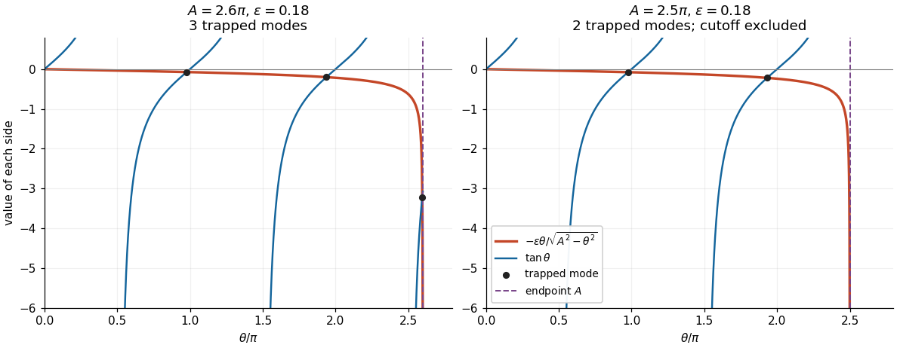

<h1 id="1/c/solution">Solution</h1>

↑ **Parent:** [C](../c.md)

Eliminating the [phase velocity](../../../../phase-velocity.md) from the first two relations yields

$$
\ell^2=k^2\left(1-\frac{c_1^2}{c_2^2}\right)-\frac{c_1^2}{c_2^2}m^2.
$$

With $\theta=mh$, put

$$
\boxed{a=h\sqrt{\frac{c_2^2}{c_1^2}-1}
=h\sqrt{\frac{\mu_2\rho_1}{\mu_1\rho_2}-1},\qquad
\epsilon=\frac{\mu_1c_2}{\mu_2c_1}
=\sqrt{\frac{\mu_1\rho_1}{\mu_2\rho_2}}.}
$$

Then $\ell=(c_1/(c_2h))\sqrt{a^2k^2-\theta^2}$. The [dispersion relation](../../../../dispersion-relation-split.md) becomes

$$
\boxed{\tan\theta=-\frac{\epsilon\theta}{\sqrt{A^2-\theta^2}},\qquad
0<\theta<A,\qquad A=ak.}
$$

Here $a>0$ follows from $c_1<c_2$. The parameter $a$ has dimensions of length; $A$ and $\epsilon$ are dimensionless.

For the [strict mode count for a rigid-backed elastic layer](../../../../strict-mode-count-for-a-rigid-backed-elastic-layer.md), consider

$$
g(\theta)=-\frac{\epsilon\theta}{\sqrt{A^2-\theta^2}},\qquad
g'(\theta)=-\frac{\epsilon A^2}{(A^2-\theta^2)^{3/2}}<0.
$$

The right side is negative, so intersections occur only on the negative branches of the [tangent](../../../../tangent.md),

$$
p_n<\theta<n\pi,\qquad p_n=(n-\tfrac12)\pi,\quad n=1,2,\ldots.
$$

On each such branch $\tan\theta-g(\theta)$ is strictly increasing. If $p_n<A$, its limit at $p_n^+$ is negative infinity. At the other end of the available interval, it is positive: either $\theta\to n\pi^-$ with $n\pi

**[Figure 1](#1/c/image-intersections-of-the-negative-tangent-branches-with-the-interface-loading-curve-a-branch-beginning-exactly-at-the-cutoff-contributes-no-trapped-mode). Intersections of the negative tangent branches with the interface loading curve. A branch beginning exactly at the cutoff contributes no trapped mode.**

Thus the exact answer, including all cutoff values, is

$$
\boxed{N=\#\{n\geq1:(n-\tfrac12)\pi<A\}
=\left\lceil\frac{A}{\pi}-\frac12\right\rceil.}
$$

Away from $A=(n-1/2)\pi$, this equals the printed [floor function](../../../../floor-function.md) expression $\lfloor A/\pi+1/2\rfloor$. At $A=(n-1/2)\pi$, the printed expression is one too large: the $n$th interval is empty and the limiting state has $\ell=0$, contradicting [exponential decay](../../../../exponential-decay.md). This exception is present in the native paper, rather than introduced by transcription.

Now hold $A$ fixed and let $\epsilon\to0^+$. Neglecting the right side gives $\theta_n\simeq n\pi$ and hence the candidate [phase velocities](../../../../phase-velocity.md)

$$
\boxed{c_n\simeq c_1\sqrt{1+\frac{n^2\pi^2}{k^2h^2}}.}
$$

The [zero](../../../../zero-of-a-function.md) $\theta=0$ is excluded: it would require $c=c_1$, already ruled out. For every $n\pi<A$, the candidate is a valid leading [asymptotic expansion](../../../../asymptotic-expansion-split.md). A first correction, obtained by expanding the [tangent](../../../../tangent.md) about $n\pi$, is

$$
\theta_n=n\pi-\frac{\epsilon n\pi}{\sqrt{A^2-n^2\pi^2}}+O(\epsilon^2).
$$

The [big O notation](../../../../big-o-notation.md) here assumes a fixed positive gap between $n\pi$ and $A$. In particular, when $A>N\pi$, all $N$ leading approximations are valid. The [phase velocity](../../../../phase-velocity.md) increases strictly with $\theta$, so only the last branch can cause an endpoint difficulty.

If $(N-1/2)\pi<A<N\pi$, the formal last [equation root](../../../../root-of-an-equation.md) $N\pi$ lies outside the allowed interval. The actual last [equation root](../../../../root-of-an-equation.md) approaches $A$, where the small factor $\epsilon$ is balanced by the vanishing denominator. This is a [singular perturbation](../../../../singular-perturbation-split.md). For fixed $A$ strictly inside that interval, write $\theta_N=A-\delta$. Since $\tan A<0$,

$$
\tan A\sim-\frac{\epsilon A}{\sqrt{2A\delta}},\qquad
\boxed{\delta\sim\frac{\epsilon^2A}{2\tan^2A},\quad
\theta_N=A-\frac{\epsilon^2A}{2\tan^2A}+O(\epsilon^4).}
$$

The valid [endpoint approximation for a rigid-backed shear mode](../../../../endpoint-approximation-for-a-rigid-backed-shear-mode.md) consequently gives

$$
\boxed{c_N=c_2\left[1-\frac{\epsilon^2}{2\tan^2A}
\left(1-\frac{c_1^2}{c_2^2}\right)+O(\epsilon^4)\right].}
$$

Here we used $c^2=c_1^2(1+\theta^2/(kh)^2)$ and $A^2/(kh)^2=c_2^2/c_1^2-1$. Thus this [normal mode](../../../../normal-mode.md) approaches the upper [wave speed](../../../../wave-speed.md) from below; it does not approach the inadmissible value obtained from $\theta=N\pi>A$.

There is a further exceptional fixed value $A=N\pi$. Put $\theta_N=A-\delta$ again. Now $\tan(A-\delta)\sim-\delta$, so the balance changes to

$$
\delta\sqrt{2A\delta}\sim\epsilon A,\qquad
\boxed{\delta\sim\left(\frac{\epsilon^2A}{2}\right)^{1/3},\qquad
c_N\sim c_2\left[1-\left(1-\frac{c_1^2}{c_2^2}\right)\frac{\delta}{A}\right].}
$$

In the last formula the bracket specifies the first nonzero correction. The zeroth-order candidate $c_N=c_2$ is correct as a limit but misses this correction and the positive exterior [exponential decay](../../../../exponential-decay.md) rate. More generally, close to $A=N\pi$, let $\Delta=A-N\pi$ and $\theta_N=N\pi-\delta$. For $|\Delta|,\delta\ll1$, a transition approximation valid on both sides is

$$
\boxed{\delta^2(\Delta+\delta)\simeq\frac{\epsilon^2N\pi}{2},\qquad
\delta>0,\quad\Delta+\delta>0,\qquad
c_N\simeq c_1\sqrt{1+\frac{(N\pi-\delta)^2}{(kh)^2}}.}
$$

It recovers the $\epsilon^{2/3}$ balance at $\Delta=0$ and the ordinary expansion above the transition. The fixed-endpoint formula involving $\tan A$ should be used when $A$ is below, and bounded away from, $N\pi$.

## ↑ Ancestors (12)

1. [C](../c.md)
2. [1](../../1.md)
3. [2023](../../../2023-split.md)
4. [Past exam of the elasticity and plasticity course of the University of Oxford](../../../split.md)
5. [Elasticity and plasticity course of the University of Oxford](../../../../elasticity-and-plasticity-course-of-the-university-of-oxford.md)
6. [Year 4 of the mathematics course of the University of Oxford](../../../../year-4-of-the-mathematics-course-of-the-university-of-oxford.md)
7. [Mathematics course of the University of Oxford](../../../../mathematics-course-of-the-university-of-oxford.md)
8. [Undergraduate course of the University of Oxford](../../../../undergraduate-course-of-the-university-of-oxford.md)
9. [Course of the University of Oxford](../../../../course-of-the-university-of-oxford.md)
10. [University of Oxford](../../../../university-of-oxford-split.md)
11. [List of universities](../../../../list-of-universities.md)
12. [Codex Wiki](../../../../split.md)
