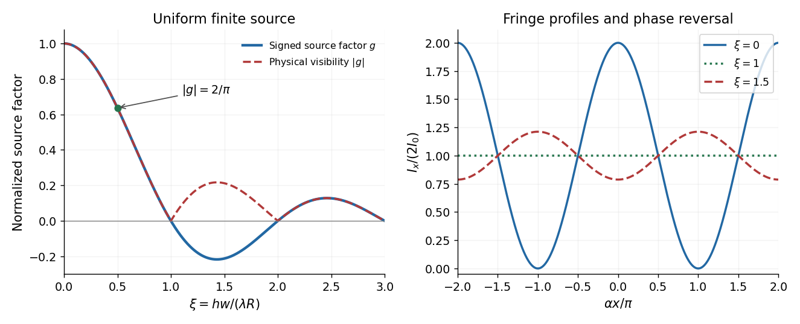

<h1 id="10/solution">Solution</h1>

↑ **Parent:** [10](../10.md)

Place the two slits at transverse coordinates $+h/2$ and $-h/2$. Let the source point have coordinate $s$ and the observation point coordinate $x$, both measured in the same transverse direction. The total lower-slit path minus upper-slit path is

$$
\begin{aligned}
\Delta\ell(s,x)={}&\sqrt{R^2+(s+h/2)^2}-\sqrt{R^2+(s-h/2)^2}\\
&+\sqrt{D^2+(x+h/2)^2}-\sqrt{D^2+(x-h/2)^2}\\
\simeq{}&h\left(\frac sR+\frac xD\right).
\end{aligned}
$$

The last line uses the [paraxial approximation](../../../paraxial-approximation.md) at both source and screen. The source assumptions give $w,h\ll R$; the screen expression also assumes $h,|x|\ll D$. Reversing the source-coordinate orientation would change the sign of $s/R$, without changing the uniform-source result.

At the slits, the differential path delay from a source element is $hs/R$. Across the full filament its range is $hw/R$. Keeping all these phases nearly equal therefore requires

$$
\boxed{\frac{hw}{R}\ll\lambda.}
$$

This is a sufficient near-unit-[spatial coherence](../../../spatial-optical-coherence.md) condition, rather than a necessary condition for any observable [interference](../../../interference-wave-propagation.md). That distinction follows quantitatively below.

Different small elements of a thermal filament are mutually incoherent, so their [wave intensities](../../../intensity-physics.md) add. The two paths from one element are coherent. If that element supplies the same intensity $I_0B(s)\,ds$ through each slit, the [superposition principle](../../../superposition-principle.md) gives

$$
dI_x=\left|\sqrt{I_0B(s)\,ds}\,e^{i\varphi_+}+\sqrt{I_0B(s)\,ds}\,e^{i\varphi_-}\right|^2
=2I_0B(s)[1+\cos\delta(s,x)]\,ds,
$$

where

$$
\boxed{\delta(s,x)=\frac{2\pi h}{\lambda}\left(\frac xD+\frac sR\right).}
$$

Integrating intensities over the incoherent source gives

$$
\boxed{I_x=2I_0\int_{-w/2}^{w/2}B(s)\left[1+\cos\left(\frac{2\pi h x}{\lambda D}+\frac{2\pi h s}{\lambda R}\right)\right]ds.}
$$

Adding complex amplitudes across different source elements instead would incorrectly assume mutual [optical coherence](../../../optical-coherence.md) of the entire filament.

For $B(s)=1/w$, define $\alpha=2\pi h/(\lambda D)$ and $\beta=\pi h/(\lambda R)$. The source's signed quantity is

$$
V_{\rm printed}(x)=\frac1w\int_{-w/2}^{w/2}\cos(\alpha x+2\beta s)\,ds
=\cos(\alpha x)\frac{\sin(\beta w)}{\beta w}.
$$

Thus

$$
\boxed{\alpha=\frac{2\pi h}{\lambda D},\qquad \beta=\frac{\pi h}{\lambda R},\qquad I_x=2I_0\left[1+\cos(\alpha x)\frac{\sin(\beta w)}{\beta w}\right].}
$$

The continuous limit at $\beta w=0$ uses $\sin z/z\to1$.

**The printed $V$ is a signed local modulation, not the usual fringe visibility.** From the maximum and minimum of this scanned fringe pattern, the [interferometric visibility](../../../interferometric-visibility.md) is

$$
\boxed{\mathcal V=\frac{I_{\max}-I_{\min}}{I_{\max}+I_{\min}}=\left|\frac{\sin(\beta w)}{\beta w}\right|.}
$$

It is independent of the screen's fringe phase and is nonnegative. For a concrete distinction, take $\beta w=\pi/2$ and $\alpha x=\pi/2$: the printed $V$ is zero at that observation point, while the pattern has contrast $\mathcal V=2/\pi$. The same example has $hw/R=\lambda/2$, which is not much smaller than $\lambda$, yet substantial [interference](../../../interference-wave-propagation.md) survives. When the signed coherence factor is negative, bright and dark fringe positions interchange; the contrast remains its absolute value. This is the distinction between [signed coherence and fringe visibility](../../../signed-coherence-and-fringe-visibility.md).

**[Figure 3](#10/image-finite-source-width-changes-fringe-contrast-and-can-reverse-fringe-phase). Finite source width changes fringe contrast and can reverse fringe phase**. Original uniform-filament calculation. The signed source factor and its absolute value differ; the latter is the standard [interferometric visibility](../../../interferometric-visibility.md). The fringe traces illustrate high contrast, vanishing contrast, and phase reversal.

## ↑ Ancestors (11)

1. [10](../10.md)
2. [2016](../../2016-split.md)
3. [Past exam of the electromagnetism and optics course of the University of Oxford](../../split.md)
4. [Electromagnetism and optics course of the University of Oxford](../../../electromagnetism-and-optics-course-of-the-university-of-oxford.md)
5. [Year 2 of the physics course of the University of Oxford](../../../year-2-of-the-physics-course-of-the-university-of-oxford.md)
6. [Physics course of the University of Oxford](../../../physics-course-of-the-university-of-oxford.md)
7. [Undergraduate course of the University of Oxford](../../../undergraduate-course-of-the-university-of-oxford.md)
8. [Course of the University of Oxford](../../../course-of-the-university-of-oxford.md)
9. [University of Oxford](../../../university-of-oxford-split.md)
10. [List of universities](../../../list-of-universities.md)
11. [Codex Wiki](../../../split.md)
