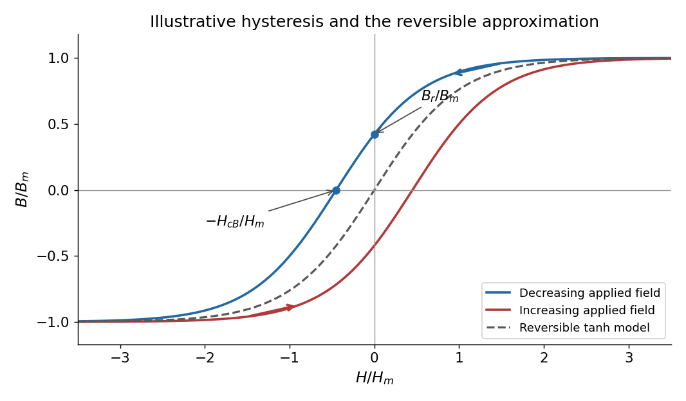

<h1 id="2/solution">Solution</h1>

↑ **Parent:** [2](../2.md)

Let $\ell=2\pi r-d$ be the mean path length in the core. Neglect leakage and fringing across the narrow air gap, and assume a cross-section small compared with $r$. Continuity of normal [magnetic flux density](../../../magnetic-field-split.md) then gives the same tangential [magnetic field](../../../magnetic-field-split.md) magnitude $B$ in the core and gap. [Ampère's circuital law](../../../ampere-s-circuital-law.md) for the [magnetic field strength](../../../magnetic-field-strength.md) $H$ is

$$
H_{\rm core}\ell+H_{\rm gap}d=nI.
$$

For a linear core, $H_{\rm core}=B/(\mu_0\mu_r)$ and $H_{\rm gap}=B/\mu_0$, giving

$$
\boxed{\mathbf B_{\rm core}\simeq\mathbf B_{\rm gap}\simeq\frac{\mu_0nI}{d+\ell/\mu_r}\,\widehat{\mathbf t}.}
$$

Here $\widehat{\mathbf t}$ follows the winding's [right-hand rule](../../../right-hand-rule.md). The gap has much larger $H$ than the core when $\mu_r\gg1$, although $B$ is approximately continuous. Equivalently, the core and gap [magnetic reluctances](../../../magnetic-reluctance.md) add in series.

On a [magnetic hysteresis](../../../magnetic-hysteresis.md) loop, [remanence](../../../remanent-magnetization.md) is the nonzero $B_r$ remaining at $H=0$ after magnetizing the sample. The [normal magnetic coercivity](../../../normal-magnetic-coercivity.md) $H_{cB}$ is the magnitude of reverse $H$ at which $B=0$ on that branch. The intrinsic [magnetic coercivity](../../../magnetic-coercivity.md) instead refers to zero [magnetization](../../../magnetization.md); these two conventions should not be confused. A comparison of coercive $H$ with remanent $B$ requires a unit conversion or a specified constitutive scale, because their [SI](../../../international-system-of-units.md) units differ. A soft [ferromagnet](../../../ferromagnet.md) is understood here to have a narrow loop and small coercive field.

**[Figure 1](#2/image-magnetic-hysteresis-and-the-reversible-tanh-approximation). Magnetic hysteresis and the reversible tanh approximation**. Original illustrative [magnetic hysteresis](../../../magnetic-hysteresis.md) loop with the remanent [magnetic field](../../../magnetic-field-split.md) and normal coercive [magnetic field strength](../../../magnetic-field-strength.md) marked. The dashed single-valued curve is the reversible approximation used in the calculation, rather than a hysteresis branch.

Use the stated single-valued [constitutive equation](../../../constitutive-equation.md) for the calculation. Inverting it gives $H_{\rm core}=H_m\operatorname{artanh}(B/B_m)$, so

$$
nI=\ell H_m\operatorname{artanh}(B/B_m)+\frac d{\mu_0}B.
$$

Since $\operatorname{artanh}z=z+O(z^3)$, the [small-signal response of a gapped magnetic core](../../../small-signal-response-of-a-gapped-magnetic-core.md) is

$$
\boxed{B\simeq\kappa I,\qquad \kappa=\frac{n}{\ell H_m/B_m+d/\mu_0}=\frac{\mu_0n}{d+\mu_0\ell H_m/B_m}.}
$$

The small-field core [magnetic permeability](../../../permeability-electromagnetism.md) is $B_m/H_m$. Strictly, $B=B_m\tanh(H/H_m)$ is a reversible approximation: at $H=0$ it has $B=0$, so it cannot itself model nonzero [remanence](../../../remanent-magnetization.md). The displayed loop and this constitutive approximation serve different purposes. Keeping a genuinely remanent branch would generally add a history-dependent offset; it would not imply $B=\kappa I$ through the origin.

## ↑ Ancestors (11)

1. [2](../2.md)
2. [2016](../../2016-split.md)
3. [Past exam of the electromagnetism and optics course of the University of Oxford](../../split.md)
4. [Electromagnetism and optics course of the University of Oxford](../../../electromagnetism-and-optics-course-of-the-university-of-oxford.md)
5. [Year 2 of the physics course of the University of Oxford](../../../year-2-of-the-physics-course-of-the-university-of-oxford.md)
6. [Physics course of the University of Oxford](../../../physics-course-of-the-university-of-oxford.md)
7. [Undergraduate course of the University of Oxford](../../../undergraduate-course-of-the-university-of-oxford.md)
8. [Course of the University of Oxford](../../../course-of-the-university-of-oxford.md)
9. [University of Oxford](../../../university-of-oxford-split.md)
10. [List of universities](../../../list-of-universities.md)
11. [Codex Wiki](../../../split.md)
