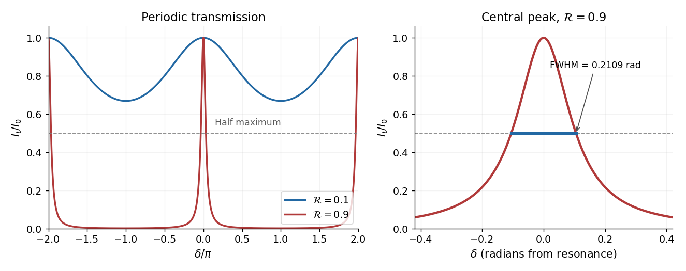

<h1 id="9/solution">Solution</h1>

↑ **Parent:** [9](../9.md)

Let $\mathcal R=|r|^2$ be the single-mirror power reflectivity and $\theta_g$ the propagation angle inside the gas. Define $\lambda$ as the [vacuum](../../../vacuum.md) [wavelength](../../../wavelength.md). Successive transmitted [complex amplitudes](../../../complex-amplitude.md) differ by a round-trip factor $\mathcal R e^{i\delta}$, where, for real dielectric reflection coefficients whose product has positive sign,

$$
\delta=\frac{4\pi nd\cos\theta_g}{\lambda}.
$$

The [cosine](../../../cosine.md) arises by comparing successive emerging rays on the same outgoing [wavefront](../../../wavefront.md); it is not the literal zigzag distance $2d/\cos\theta_g$. Equivalently, the round-trip phase is $2k_zd$. If the source's $\theta$ is the angle in external air, [Snell's law](../../../snell-s-law.md) gives $n\sin\theta_g=\sin\theta$ and

$$
\delta=\frac{4\pi d}{\lambda}\sqrt{n^2-\sin^2\theta}.
$$

If $\theta$ denotes the internal angle, simply set $\theta_g=\theta$.

For identical lossless mirrors, their power transmission is $1-\mathcal R$. In an energy-normalized amplitude convention this is $|t|^2=1-\mathcal R$; more general interface amplitudes require the corresponding [wave impedance](../../../wave-impedance.md) factors. The [geometric series](../../../geometric-series.md) of transmitted amplitudes gives

$$
\frac{I_t}{I_0}=\frac{|t|^4}{|1-\mathcal R e^{i\delta}|^2}
=\frac{(1-\mathcal R)^2}{(1-\mathcal R)^2+4\mathcal R\sin^2(\delta/2)}.
$$

Hence

$$
\boxed{I_t=\frac{I_0}{1+Q\sin^2(\delta/2)},\qquad Q=\frac{4\mathcal R}{(1-\mathcal R)^2}=\frac{4|r|^2}{(1-|r|^2)^2}.}
$$

This is [Fabry–Pérot transmission from multiple reflections](../../../fabry-perot-transmission-from-multiple-reflections.md).[Theory equations (1)–(2), including the coefficient of finesse](../../../fabry-perot-interferometer-university-of-washington-physics-331.md)

At [normal incidence](../../../normal-incidence.md), for nondispersive $n$ and zero net reflection phase modulo $2\pi$, the [resonance](../../../resonance.md) condition is $\delta=2\pi m$. The resonance [frequencies](../../../frequency.md) and [free spectral range](../../../free-spectral-range.md) are

$$
\boxed{\nu_m=\frac{mc}{2nd},\qquad \Delta\nu_{\rm FSR}=\frac{c}{2nd}.}
$$

For finite $\mathcal R<1$ the resonances have finite width, and transmission away from them is nonzero. Thus “only discrete frequencies” is an ideal high-reflectivity description of the selected resonances, not an exact statement about the support of the transmitted spectrum. For example, $\mathcal R=0.9$ at $\delta=\pi$ still gives $I_t/I_0=(0.1/1.9)^2\simeq0.00277$.

At half the unit peak, $Q\sin^2(\delta/2)=1$. Measuring the phase displacement from a resonance yields

$$
\Delta\delta_{\rm FWHM}=4\arcsin\frac1{\sqrt Q},\qquad
\boxed{\Delta\nu_{\rm FWHM}=\frac{2\Delta\nu_{\rm FSR}}\pi\arcsin\left(\frac{1-\mathcal R}{2\sqrt{\mathcal R}}\right)
\simeq\frac{c}{2nd}\frac{1-\mathcal R}{\pi\sqrt{\mathcal R}}.}
$$

The last expression is the high-reflectivity approximation, with [finesse](../../../finesse.md) $\pi\sqrt{\mathcal R}/(1-\mathcal R)$. At $\mathcal R=0.9$, the full phase width is about $0.2109$ radians and $\Delta\nu_{\rm FWHM}/\Delta\nu_{\rm FSR}\simeq0.03357$. At $\mathcal R=0.1$, the minimum transmission is $0.6694$, so the trace never reaches half the peak and this [full width at half maximum](../../../full-width-at-half-maximum.md) is not defined. The exact half-maximum condition requires $\mathcal R\ge3-2\sqrt2$.

**[Figure 2](#9/image-fabry-perot-transmission-for-mirror-reflectivities-0-1-and-0-9). Fabry–Pérot transmission for mirror reflectivities 0.1 and 0.9**. Original ideal [Fabry–Pérot interferometer](../../../fabry-perot-interferometer.md) calculation. The broad low-reflectivity curve stays above half maximum; the right panel resolves the high-reflectivity peak and its full width at half maximum.

For the [absorbing Fabry–Pérot mirror phase and transmission](../../../absorbing-fabry-perot-mirror-phase-and-transmission.md), write $r=\sqrt{\mathcal R}e^{i\phi_r}$ and let $\mathcal T$ be the power transmission of one mirror. [Optical absorption](../../../optical-absorption.md) makes $\mathcal R+\mathcal T<1$. The transmitted intensity becomes

$$
\boxed{\frac{I_t}{I_0}=\frac{\mathcal T^2}{(1-\mathcal R)^2}\frac1{1+\frac{4\mathcal R}{(1-\mathcal R)^2}\sin^2(\delta_{\rm tot}/2)},\qquad
\delta_{\rm tot}=\frac{4\pi\nu nd}{c}+2\phi_r.}
$$

Here the phase formula is at [normal incidence](../../../normal-incidence.md). The peak is reduced below unity, while a change in $\mathcal R$ changes the width. The complex reflection phase also moves the resonances: if $\phi_r$ is approximately constant,

$$
\boxed{\nu_m=\frac{c}{2nd}\left(m-\frac{\phi_r}{\pi}\right).}
$$

If either $n$ or $\phi_r$ depends on [frequency](../../../frequency.md), this is an implicit condition and the [free spectral range](../../../free-spectral-range.md) need not be constant. No numerical shift is determined without the mirrors' optical response.

## ↑ Ancestors (11)

1. [9](../9.md)
2. [2016](../../2016-split.md)
3. [Past exam of the electromagnetism and optics course of the University of Oxford](../../split.md)
4. [Electromagnetism and optics course of the University of Oxford](../../../electromagnetism-and-optics-course-of-the-university-of-oxford.md)
5. [Year 2 of the physics course of the University of Oxford](../../../year-2-of-the-physics-course-of-the-university-of-oxford.md)
6. [Physics course of the University of Oxford](../../../physics-course-of-the-university-of-oxford.md)
7. [Undergraduate course of the University of Oxford](../../../undergraduate-course-of-the-university-of-oxford.md)
8. [Course of the University of Oxford](../../../course-of-the-university-of-oxford.md)
9. [University of Oxford](../../../university-of-oxford-split.md)
10. [List of universities](../../../list-of-universities.md)
11. [Codex Wiki](../../../split.md)
