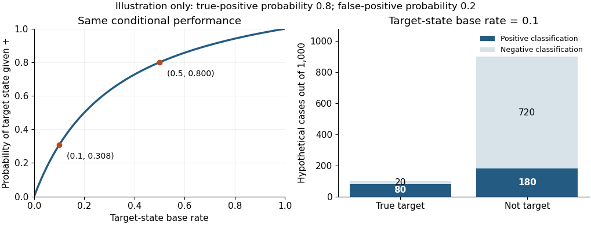
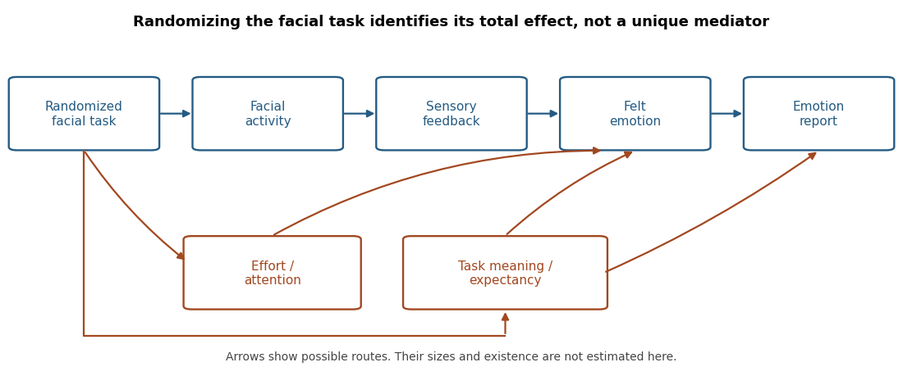

# 2022

↑ **Parent:** [Past exam of the emotion: extending appraisal and feedback approaches course of the University of Oxford](../past-exam-of-the-emotion-extending-appraisal-and-feedback-approaches-course-of-the-university-of-oxford.md)

Original solutions to all six essay options in the [Emotion: extending appraisal and feedback approaches course of the University of Oxford](../university-of-oxford.md#emotion-extending-appraisal-and-feedback-approaches-course-of-the-university-of-oxford) examination held on 25 May 2022. The cover allowed candidates to choose three; every option is addressed here. The arguments use evidence published before the examination. The mathematical examples and diagrams are explanatory constructions, not new experimental findings.

Source: [Oxford examination release](https://www.whatdotheyknow.com/request/experimental_psychology_past_exa/response/2757831/attach/3/New%20Compressed%20zipped%20Folder.zip?cookie_passthrough=1), member a16467w1.pdf. The original cover supplies the code and date; the audited course identification supplies Part II.

**Table of contents**

- [1](#1)
  - [Solution](#1/solution)
- [2](#2)
  - [Solution](#2/solution)
- [3](#3)
  - [Solution](#3/solution)
- [4](#4)
  - [Solution](#4/solution)
- [5](#5)
  - [Solution](#5/solution)
- [6](#6)
  - [Solution](#6/solution)

## 1

↑ **Parent:** [2022](2022.md)

<h3 id="1/solution">Solution</h3>

↑ **Parent:** [1](#1)

**Autonomic recordings can support probabilistic discrimination of emotional states under specified conditions; they do not establish a person's experienced [emotion](../psychology.md#emotion) with certainty.** The distinction matters because a physiological response, an experimenter's induction label and a subjective feeling are different things. A useful [psychophysiology](../psychology.md#psychophysiology) study must justify how its labels relate to experience before assessing how well a bodily measure predicts them.

The [autonomic nervous system](../neuroscience.md#autonomic-nervous-system) regulates organs and glands through interacting pathways, including the [sympathetic nervous system](../physiology.md#sympathetic-nervous-system) and [parasympathetic nervous system](../neuroscience.md#parasympathetic-nervous-system). An [electrocardiogram](../biology.md#electrocardiogram) supplies cardiac timing and hence [heart rate](../physiology.md#heart-rate); [heart rate variability](../physiology.md#heart-rate-variability) describes variation in successive intervals. [Electrodermal activity](../psychology.md#electrodermal-activity) can be recorded with skin electrodes, while a temperature sensor supplies peripheral temperature. [Breathing](../physiology.md#pulmonary-ventilation) and blood-pressure measurements add other information. These measurements differ in what generates them and in their temporal response. In particular, sweat-related [skin conductance](../psychology.md#skin-conductance) provides information about sympathetic sudomotor activity, whereas a faster [heart rate](../physiology.md#heart-rate) can reflect several autonomic influences and physical demands. [Facial electromyography](../physiology.md#facial-electromyography) is useful complementary evidence, but records [skeletal muscle](../physiology.md#skeletal-muscle) activity through the [somatic nervous system](../neuroscience.md#somatic-nervous-system); it should not be counted as another autonomic channel.

Historically, the question was not simply whether the body changes during [emotion](../psychology.md#emotion), but whether bodily patterns distinguish categories. [Paul Ekman](../psychologist.md#paul-ekman) and colleagues in 1983 used muscle-by-muscle facial instructions and reliving of past episodes. They reported autonomic differentiation among some negative states as well as between positive and negative states. This challenges the claim that autonomic activity is entirely undifferentiated. It does not show that the same pattern is a necessary and sufficient marker in every spontaneous episode: posing, recollection and the selection of categories constrain the result.[1983, pp. 1208–1210, induction procedures and autonomic differentiation](../psychology-bibliography.md#autonomic-nervous-system-activity-distinguishes-among-emotions-by-paul-ekman-and-others)

Joint patterns can carry information that a single measure misses. [Philip A. Kragel](../neuroscientist.md#philip-a-kragel) and colleagues combined electrodermal, cardiac, respiratory and gastric measures during film- and music-induced states. Their 2013 study reported 58.0% autonomic classification accuracy across six induced categories and a neutral condition, with training and testing on separate participant subsets, above its chance benchmark. This supports multivariate information about the tested states. It does not establish invariant bodily essences: a [classifier](../foundations-of-mathematics.md#classifier) can exploit overlapping distributions whose average patterns differ.[2013, abstract and methods, classification of induced states](../psychology-bibliography.md#multivariate-pattern-classification-reveals-autonomic-and-experiential-representations-of-discrete-emotions-by-philip-a-kragel-and-others)

Conversely, [Erika H. Siegel](../psychology.md#erika-h-siegel) and colleagues' 2018 synthesis found substantial within-category variation, and mean autonomic patterns that did not clearly separate the categories. Its laboratory adult samples do not exhaust every possible real-world measurement. Nevertheless, a universal fingerprint claim should generalize across episodes, and the observed variation is a substantial problem for that strong claim. Failure to establish a fingerprint does not imply that [physiology](../physiology.md) contains zero predictive information; distributions can overlap without being identical.[2018, abstract and Discussion, autonomic variation within and between categories](../psychology-bibliography.md#emotion-fingerprints-or-emotion-populations-by-erika-h-siegel-and-others)

Several alternative explanations must therefore be tested. A film may make participants breathe differently because of its pacing; imagined confrontation may prepare action; an emotional task may differ from a neutral task in movement or [attention](../psychology.md#attention). Exercise, room temperature, medication and individual baselines can change the recorded variables without a change in discrete emotional category. A [classifier](../foundations-of-mathematics.md#classifier) that recognizes the stimulus or task is not necessarily recognizing the feeling. Splitting trials while retaining the same people and clips in training and test sets can also overstate generalization. Appropriate [cross-validation](../statistical-learning.md#cross-validation) should hold out the people or inductions required by the intended claim, with preprocessing and feature selection fitted only to training data. Mixed feelings and changing episodes should be allowed rather than forced into one mutually exclusive label.

Even genuine conditional discrimination does not determine the reliability of a particular classification. Let $E$ denote one independently defined target state and $+$ a positive [classifier](../foundations-of-mathematics.md#classifier) result. Partitioning the positive results into target and nontarget cases and applying [Bayes' theorem](../probability-theory.md#bayes-theorem) gives

$$
P(E\mid +)=\frac{P(+\mid E)P(E)}{P(+\mid E)P(E)+P(+\mid\neg E)P(\neg E)}.
$$

For an explicitly hypothetical [classifier](../foundations-of-mathematics.md#classifier) with true-positive [probability](../probability-theory.md#probability) $0.8$ and false-positive [probability](../probability-theory.md#probability) $0.2$, a target [base rate](../bayesian-statistics.md#base-rate) of $0.1$ produces $0.08/(0.08+0.18)\approx0.308$. At a [base rate](../bayesian-statistics.md#base-rate) of $0.5$, the same conditional performance produces $0.8$. The [positive predictive value](../artificial-intelligence.md#positive-predictive-value) therefore depends on the setting as well as the instrument. This calculation illustrates a limit on inference; it is not an estimate from either study.

**[Figure 1](#1/image-base-rate-dependence-of-a-hypothetical-autonomic-classifier). Base-rate dependence of a hypothetical autonomic classifier**.

The strongest conclusion combines measures while respecting their different roles. Repeated [self-report](../psychology.md#self-report) helps establish experienced feeling, independently coded behavior establishes action, and autonomic recording establishes bodily regulation. None is error-free, and agreement must be demonstrated. [Psychophysiologists](../psychology.md#psychophysiologist) can estimate how much an autonomic pattern changes the [probability](../probability-theory.md#probability) of a reported or independently characterized state, with an explicit uncertainty and domain of validation. **They can establish useful evidence about experienced [emotion](../psychology.md#emotion), but autonomic activity alone supplies a conditional inference rather than a uniquely identifying emotional signature.**

## 2

↑ **Parent:** [2022](2022.md)

<h3 id="2/solution">Solution</h3>

↑ **Parent:** [2](#2)

**Naturalistic facial evidence supports biological and social regularities, but gives limited support to a universal one-to-one code for [basic emotions](../psychology.md#basic-emotion).** The relevant contrast is between describing a [facial movement](../psychology.md#facial-movement) and inferring its cause. The same visible action can accompany an emotional episode, communicate affiliation or serve a task. A strong [basic emotion theory](../psychology.md#basic-emotion-theory) needs independent evidence linking a category of felt [emotion](../psychology.md#emotion) to a characteristic pattern across situations, rather than defining the category by the pattern it is supposed to explain.

Posed photographs are useful controlled stimuli, but agreement about them answers a different question from why people move their faces in ordinary life. [Forced-choice emotion recognition](../psychology.md#forced-choice-emotion-recognition) supplies observers with labels and alternatives; it can encourage consensus even when spontaneous descriptions would differ. Recognition of a prototype also does not establish that its full configuration occurs frequently in lived episodes. Naturalistic studies should therefore code movements independently of a category judgment, record the social setting, and obtain an independent indicator of experience where possible. The [Facial Action Coding System](../psychology.md#facial-action-coding-system) helps separate visible actions from their interpretation; anatomical coding is not itself a measurement of feeling.

[Robert E. Kraut](../psychologist.md#robert-e-kraut) and colleagues' 1979 observations make the methodological issue concrete. At a bowling alley, bowlers were especially likely to smile while socially engaged, including when facing companions, rather than simply after a successful delivery. Observations in other settings also implicated social engagement. Bowling supplies identifiable outcome events and changes of orientation towards an audience, so it offers a useful setting for separating success from immediate social contact. However, a good score is an imperfect indicator of what that individual feels at that instant; the study cannot infer the absence of [happiness](../psychology.md#happiness) merely from a lack of smiles.[1979, naturalistic bowling studies and discussion of social messages](../psychology-bibliography.md#social-and-emotional-messages-of-smiling-by-robert-e-kraut-and-others)

[María-Ángeles Ruiz-Belda](../psychologist.md#maria-angeles-ruiz-belda) and colleagues addressed this limitation in 2003 by adding reports of feeling in field studies of bowlers and soccer fans. Among those reporting [happiness](../psychology.md#happiness), smiling was much more probable during social interaction than outside it. The key contribution is the separation of reported [happiness](../psychology.md#happiness) from the presence of a smile, not merely the observation that social people smile. Reports still have timing and reconstruction limitations, and social interaction can itself alter felt intensity. Nevertheless, these observations are difficult to reconcile with the simple claim that [happiness](../psychology.md#happiness) reliably releases a smile regardless of audience.[2003, abstract and two field studies, reported happiness and social interaction](../psychology-bibliography.md#spontaneous-facial-expressions-of-happy-bowlers-and-soccer-fans-by-maria-angeles-ruiz-belda-and-others)

The evidence does not require treating biological expression and communication as mutually exclusive. An inherited movement repertoire could become selectively deployed towards partners. Conversely, describing a smile as communicative does not show that its producer lacks [happiness](../psychology.md#happiness). A [display rule](../psychology.md#display-rule) may suppress or amplify a response. But if every absent expression is retrospectively called suppression and every unexpected expression is called a disguise, the claim loses predictive content. A useful version must specify the circumstances of suppression independently and predict differences before seeing the faces.

Evidence from blindness strengthens the case for a biological contribution without settling the strong universality claim. [David Matsumoto](../psychologist.md#david-matsumoto) and colleagues compared spontaneous expressions of congenitally blind, noncongenitally blind and sighted athletes. Similarities show that visual imitation is not necessary for all features of the observed repertoire. They do not remove social experience, other sensory [learning](../animal-behaviour.md#learning), shared anatomy or competition-related goals. Nor do they establish a unique correspondence between each movement and a consciously felt category.[2009, comparison groups and spontaneous competition-related expressions](../psychology-bibliography.md#spontaneous-facial-expressions-of-emotion-of-congenitally-and-noncongenitally-blind-individuals-by-david-matsumoto-and-others)

A complementary result concerns interpretation rather than natural production. [Rachael E. Jack](../psychologist.md#rachael-e-jack) and colleagues used generated dynamic faces and [reverse correlation](../psychology.md#reverse-correlation) to estimate observers' category representations. Cultural differences in those representations challenge a single universal observer code. This is not direct evidence that the same cultural groups make different spontaneous movements in every emotional situation. Production and interpretation require separate tests.[2012, Figures 1–3, dynamic stimulus generation and category representations](../psychology-bibliography.md#facial-expressions-of-emotion-are-not-culturally-universal-by-rachael-e-jack-and-others)

A decisive programme would sample episodes rather than only successful examples, include nonsocial and social periods within the same people, and obtain time-linked reports without prompting a fixed inventory of categories. Facial coders should be blind to reports and outcomes; analyses should distinguish within-person effects from differences between people. Researchers should test the entire distribution: how often a movement occurs without the proposed feeling, and how often the feeling occurs without the movement. A distinctive expression might still be informative without being necessary or sufficient. To establish a specifically _basic_ category, the pattern must also outperform alternatives based on [emotional valence](../psychology.md#emotional-valence), [emotional arousal](../psychology.md#emotional-arousal), action and social intention.

**Naturalistic evidence is most consistent with context-sensitive facial behavior that can convey [emotion](../psychology.md#emotion) and regulate interaction. It supports some shared capacities, while weakening the claim that each [basic emotion](../psychology.md#basic-emotion) has an obligatory, context-independent visible signature.**

## 3

↑ **Parent:** [2022](2022.md)

<h3 id="3/solution">Solution</h3>

↑ **Parent:** [3](#3)

**Small, variable effects support a limited influence of facial activity on reported feeling; they do not identify a single feedback mechanism or establish that [facial feedback](../psychology.md#facial-feedback) is necessary for [emotion](../psychology.md#emotion).** This conclusion separates the experimental contrast from its proposed explanation. Randomly assigning a facial task estimates the effect of that task, including every change the task produces. It does not automatically isolate sensory feedback from the face.

[Nicholas A. Coles](../psychologist.md#nicholas-a-coles), [Jeff T. Larsen](../psychologist.md#jeff-t-larsen) and [Heather C. Lench](../psychologist.md#heather-c-lench) synthesized 286 [effect sizes](../statistical-inference.md#effect-size) from 138 studies using a random-effects approach with robust [variance](../variance.md) estimates. Their overall estimate combined outcomes, so the more relevant result for experienced [emotion](../psychology.md#emotion) is the emotional-experience subgroup: [standardized mean difference](../causal-inference.md#standardized-mean-difference) $d=0.17$, with 95% [confidence interval](../statistical-inference.md#confidence-interval) $[0.11,0.23]$. Affective judgments of stimuli had a larger estimate. The reported moderators included outcome type and properties of the eliciting stimuli. These are comparisons among existing studies, not randomized assignments of the proposed moderators.[2019, abstract, pp. 637–639 and Table 3, outcome-specific estimates and moderators](../psychology-bibliography.md#a-meta-analysis-of-the-facial-feedback-literature-by-nicholas-a-coles-and-others)

The distinction between outcome types is theoretically important. Rating a cartoon's objective funniness asks for an evaluative judgment about a stimulus; rating one's own amusement asks about experience. Either can change through inference, expectations or response interpretation. Treating both as direct measures of feeling would make the evidence seem more decisive about the [facial feedback hypothesis](../psychology.md#facial-feedback-hypothesis) than it is. Equally, a small average change in experience is compatible with a real contributory mechanism: [emotion](../psychology.md#emotion) ordinarily has many inputs, so no single input need dominate.

The classic apparatus illustrates both the ingenuity and the ambiguity. [Fritz Strack](../psychologist.md#fritz-strack) and colleagues in 1988 had participants hold a pen in ways that facilitated or inhibited smile-related activity, without explicitly instructing them to look happy. They reported differences in humor responses to cartoons. Avoiding an instruction to act happy reduces an obvious route through deliberate category labeling. It does not equate effort, discomfort, [attention](../psychology.md#attention), interpretation of the task or the sensory consequences of the postures.[1988, pp. 768–777, pen positions and humor responses](../psychology-bibliography.md#inhibiting-and-facilitating-conditions-of-the-human-smile-by-fritz-strack-and-others)

A subsequent preregistered [replication](../design-of-experiments.md#replication-in-experimental-design) coordinated by [Eric-Jan Wagenmakers](../psychologist.md#eric-jan-wagenmakers) and colleagues used 17 laboratories and 1,894 analyzed participants and did not reproduce the original difference. That directly limits confidence in the robustness of this particular procedure. It is not a test of every possible facial manipulation, and it should not be counted as evidence independent of a later synthesis that includes those [replication](../design-of-experiments.md#replication-in-experimental-design) studies.[2016, pp. 917–928, preregistration, pooled sample and replication outcome](../psychology-bibliography.md#registered-replication-report-on-facial-feedback-by-eric-jan-wagenmakers-and-others)

There are several possible causal routes. First, information generated by [muscle](../anatomy.md#muscle) activity or associated bodily changes might contribute to felt [emotion](../psychology.md#emotion). Second, a person might use their own posture as evidence when interpreting an ambiguous state: a self-inference route could be stronger when other emotional information is weak. Third, producing a posture might activate learned associations without an explicit inference. Fourth, the task might change [breathing](../physiology.md#pulmonary-ventilation), effort, discomfort or [attention](../psychology.md#attention). Fifth, [demand characteristics](../design-of-experiments.md#demand-characteristic) might change the report while leaving experience relatively unchanged. Social responses to a visible face are another possible route in interactive settings, but cannot explain a truly isolated participant's immediate response through an actual partner's reaction. These alternatives are hypotheses, not findings established by the [meta-analysis](../statistical-inference.md#meta-analysis).

**[Figure 2](#3/image-alternative-causal-routes-from-a-facial-task-to-an-emotion-report). Alternative causal routes from a facial task to an emotion report**.

The logical problem can be stated without assuming that any route is absent. Write assignment as $X$, facial activity as $F$, sensory feedback as $M$ and the report as $Y$. The chain $X\to F\to M\to Y$ and a model with $X\to F$ plus an expectancy route $X\to D\to Y$ can produce the same association between assignment, movement and report. [Randomization](../causal-inference.md#randomization) of $X$ removes preassignment [confounding](../causal-inference.md#confounding) of its total effect, but does not randomize $M$ or eliminate $D$. Establishing [causal mediation](../causal-inference.md#causal-mediation) therefore requires additional interventions or justified assumptions, not simply a significant total effect.

Heterogeneity also has a limited interpretation. A simple [random-effects meta-analysis](../statistical-inference.md#random-effects-meta-analysis) writes $y_i=\mu+u_i+\varepsilon_i$, with between-study [variance](../variance.md) $\tau^2$ and sampling [variance](../variance.md) $s_i^2$. Under independent errors the [variance](../variance.md) of $y_i$ is $\tau^2+s_i^2$. Nonzero $\tau^2$ means that true effects differ under the model; it does not specify whether the difference comes from sensory mechanisms, expectations, populations or measurement. Dependent estimates require further treatment, which is why a naive analysis counting every effect as an independent study is inappropriate. Small effects and noisy measurement also make individual studies unstable. Selecting a plausible moderator after a failed experiment is insufficient unless it predicts results in a new test.

Useful follow-up work would preregister a factorial design that varies actual facial activity separately from participants' beliefs about its emotional meaning, with matched effort controls and separate reports of felt state and stimulus judgment. [Facial electromyography](../physiology.md#facial-electromyography) can verify the motor manipulation, but not certify its psychological mediator. A test of a sensory route also needs a defensible manipulation of that route that leaves the relevant alternatives adequately controlled. Masked hypotheses, automated instructions and timing measures reduce particular ambiguities rather than providing a universal guarantee. A necessary-role claim would require evidence that reducing the relevant feedback prevents an otherwise expected emotional response; an initiation claim requires an effect without the external emotional elicitor, while accounting for the task's own meaning.

**By May 2022, the justified position was a modest, conditional contribution of facial manipulation, with its mechanism underdetermined. The size and variability narrow strong theories; they do not choose uniquely between bodily feedback, interpretation and reporting routes.**

## 4

↑ **Parent:** [2022](2022.md)

<h3 id="4/solution">Solution</h3>

↑ **Parent:** [4](#4)

**Appraisal is a powerful explanation of emotional differentiation, but a universal claim is empirically useful only if appraisal and [emotion](../psychology.md#emotion) are defined and measured independently enough to permit failure.** The hypothesis should not be evaluated as though it required a conscious sentence before every feeling. In [Richard S. Lazarus](../psychologist.md#richard-lazarus)'s 1984 account, a primitive evaluation of what an event means for well-being can count as [cognitive appraisal](../psychology.md#cognitive-appraisal). Such evaluation can be rapid and unavailable to verbal report. His argument also concerns what qualifies as an emotional episode: an immediate sensory preference need not meet his definition of [emotion](../psychology.md#emotion).[1984, pp. 124–126, definitions of emotion and primitive evaluative cognition](../psychology-bibliography.md#on-the-primacy-of-cognition-by-richard-s-lazarus)

The proposal explains why the same physical event can yield different feelings. A difficult task may threaten an important goal, offer an opportunity, or have little personal significance. [Primary appraisal](../psychology.md#primary-appraisal) concerns that relevance and potential benefit or harm; [secondary appraisal](../psychology.md#secondary-appraisal) concerns coping possibilities and control. These distinguish evaluative contents rather than requiring two slow, sequential verbal decisions. [Anger](../psychology.md#anger) at an obstruction and [fear](../psychology.md#fear) of an uncontrollable threat can therefore differ even when both involve unpleasantness and bodily activation. The explanatory gain is a link between the person's goals, interpretation and response, rather than a label attached to a stimulus after the fact.

An informative experiment would hold aversive visual material constant while varying its interpreted significance: commentary might emphasize personal harm or encourage a detached interpretation. Independent measures of [cognitive appraisal](../psychology.md#cognitive-appraisal), felt [emotion](../psychology.md#emotion) and autonomic responses would then test the predicted differences. This is a proposed contrast, not a new empirical result. A successful manipulation would show that appraisal _can influence_ an emotional response, not that every emotional episode requires it. Commentary might also change [attention](../psychology.md#attention) or expectations, which a more selective design should address. Historically, [Richard S. Lazarus](../psychologist.md#richard-lazarus) explicitly allowed automatic defensive processing: in his 1991 account, an evaluation of threat could trigger coping without a fully developed conscious emotional episode. This illustrates why the theory's evaluative process cannot be equated with a later verbal judgment.[1991, discussion of unconscious appraisal and short-circuiting of threat](../psychology-bibliography.md#cognition-and-motivation-in-emotion-by-richard-s-lazarus)

The universal claim is stronger than this modulatory evidence. Let $E$ denote an emotional episode, and $A$ an event-specific evaluation of significance. Necessity asserts that no $E$ occurs without an appropriate $A$. Temporal priority further asserts that the relevant $A$ occurs before the emotional response whose dependence it explains. Showing many $A$ followed by $E$ cannot establish this universal proposition; a convincing instance of $E$ without prior $A$ would challenge it. Furthermore, evaluation need not be sufficient: a person can understand that an event is threatening without currently feeling the corresponding [fear](../psychology.md#fear). The strength of necessity and the strength of sufficiency must be assessed separately.

The historical primacy debate exposes a difficulty in interpreting apparent counterexamples. [W. R. Kunst-Wilson](../psychologist.md#w-r-kunst-wilson) and [Robert Zajonc](../psychologist.md#robert-zajonc) presented irregular octagons under severely degraded exposure conditions and later compared preference with explicit [recognition memory](../neuroscience.md#recognition-memory). Previously exposed shapes could be preferred despite unsuccessful explicit recognition. The apparatus separated exposure, later preference and recognition tasks; it demonstrated that reportable recognition is not a necessary mediator of every preference effect. It did not establish the absence of all evaluation of significance, and preference is not automatically the full emotional phenomenon that Lazarus intended to explain.[1980, pp. 557–558, degraded exposure and preference–recognition dissociation](../psychology-bibliography.md#affective-discrimination-of-stimuli-that-cannot-be-recognized-by-w-r-kunst-wilson-and-others)

The same reasoning applies to [visual masking](../neuroscience.md#visual-masking), rapid bodily responses and animals unable to verbalize an evaluation. Lack of awareness of a stimulus does not imply lack of processing, and a fast response does not show that its evaluation was slower. Conversely, a [muscle](../anatomy.md#muscle) response or autonomic change does not by itself establish felt [emotion](../psychology.md#emotion). These are genuine methodological distinctions, but they become evasions if used to preserve the theory after every conceivable result. If any emotional response is defined as proof that an otherwise undetectable appraisal must have happened, then the universal claim is protected by definition rather than evidence.

For [falsifiability](../README.md#falsifiability), a formulation must therefore constrain both sides. One could preregister an independently specified appraisal content, such as goal obstruction, and a process or neural representation that carries it, without defining its presence by the eventual [emotion](../psychology.md#emotion) score. The experiment should verify that a targeted manipulation substantially changes that evaluative processing while preserving sensory access, report ability and the relevant alternative pathways. It should measure an emotional outcome independently and with adequate temporal resolution. Preserved emotional responses despite a validated disruption would count against the specified dependency. It would not, by itself, refute every possible appraisal process: that broader inference needs a justified claim that the disrupted process exhausts the relevant evaluations.

Timing needs similar discipline. Earlier [skin conductance](../psychology.md#skin-conductance) than a later verbal judgment is not proof that feeling precedes appraisal, because the two measures have different delays and the report may follow an unreported evaluation. A null appraisal measure needs demonstrated [statistical power](../probability-and-statistics.md#statistical-power) and sensitivity to the proposed content; a null result is not evidence of absolute absence without a bound on what the apparatus could have detected. Multiple measures and interventions provide a stronger test than timing alone. Finally, once feeling begins it can change subsequent evaluation, so evidence for recurrent interaction is compatible with appraisal contributions while challenging an unnecessarily rigid single-pass sequence.

**A precisely specified appraisal mechanism is testable and can fail. The unrestricted assertion that every [emotion](../psychology.md#emotion) implies some prior, potentially unmeasurable appraisal is weakly falsifiable at best; when appraisal is inferred solely from [emotion](../psychology.md#emotion), it is circular. The evidence supports important appraisal processes more clearly than it establishes their universal temporal necessity.**

## 5

↑ **Parent:** [2022](2022.md)

<h3 id="5/solution">Solution</h3>

↑ **Parent:** [5](#5)

**The strongest evidence concerns inherited bodily capacities, response repertoires and [learning](../animal-behaviour.md#learning) biases; it does not establish a complete immutable package for each mature emotional category.** Asking what is hardwired requires distinguishing several propositions. An [innate behavior](../psychology.md#innate-behavior) may have an inherited developmental basis without appearing fully formed at birth. An early response may depend on prenatal experience. A universal pattern can reflect shared environments as well as common inheritance, and a biological mechanism can remain modifiable through development. These possibilities prevent a simple equation of innate with early, universal or unchangeable.

An emotional episode has several [emotion components](../psychology.md#emotion-component): evaluation, feeling, bodily regulation, expression and action. Evidence about one component should not be silently transferred to the others. The inherited organization of the [autonomic nervous system](../neuroscience.md#autonomic-nervous-system) and [skeletal muscle](../physiology.md#skeletal-muscle) supplies important response capacities. It does not follow that a particular heart-rate change means [fear](../psychology.md#fear), or that everyone uses an identical [muscle](../anatomy.md#muscle) configuration whenever [anger](../psychology.md#anger) is felt. Common physiological resources can be recruited in different combinations for different goals and situations.

Cross-cultural expression research provides evidence about shared capacities, with a qualification about the task. [Paul Ekman](../psychologist.md#paul-ekman) and colleagues' 1971 study used story-to-photograph judgments in New Guinea and found substantial agreement for several proposed categories. This matters because agreement cannot be attributed solely to participation in the same Western experimental setting. But supplied stories, selected photographs and response alternatives test a constrained matching ability. They do not directly measure the prevalence of those configurations in spontaneous episodes or establish the same spontaneous category boundaries everywhere.[1971, story-to-photograph judgments and cross-cultural comparisons](../psychology-bibliography.md#constants-across-cultures-in-the-face-and-emotion-by-paul-ekman-and-others)

Blindness comparisons help separate a specific [learning](../animal-behaviour.md#learning) route from a shared capacity. [David Matsumoto](../psychologist.md#david-matsumoto) and colleagues' 2009 competition observations included congenitally blind athletes. Their similarities with sighted athletes suggest that seeing and copying facial examples is unnecessary for all aspects of expression. This is stronger evidence against a purely visual imitation account than a comparison between sighted cultures alone. It is not evidence for development in the absence of experience: blind athletes still have bodily feedback, social interactions and nonvisual information. Competition-related expressions also do not identify the whole content of conscious feeling.[2009, congenitally blind comparison and its implications for visual learning](../psychology-bibliography.md#spontaneous-facial-expressions-of-emotion-of-congenitally-and-noncongenitally-blind-individuals-by-david-matsumoto-and-others)

The clearest intermediate position is prepared [learning](../animal-behaviour.md#learning). [Michael Cook](../psychologist.md#michael-cook) and colleagues in 1989 used edited videos in which a model monkey's fearful behavior appeared directed towards different objects. Observer monkeys acquired stronger fear-related responses to fear-relevant objects, including toy snakes or a toy crocodile, than to comparison objects such as flowers or a toy rabbit. Editing helps control the demonstrator's fearful behavior while varying its apparent object. The experiment therefore tests selective acquisition rather than simply comparing encounters in the wild.[1989, Experiments 1–2, edited demonstrators and fear-relevance contrast](../psychology-bibliography.md#observational-conditioning-of-fear-to-fear-relevant-versus-fear-irrelevant-stimuli-in-rhesus-monkeys-by-michael-cook-and-others)

[Preparedness in psychology](../animal-behaviour.md#preparedness-in-psychology) makes sense of this result without calling the acquired response present from the start. An inherited bias in [attention](../psychology.md#attention), association or defensive [learning](../animal-behaviour.md#learning) could influence _what is easily learned_, while observation supplies _which object is dangerous_. However, unequal [learning](../animal-behaviour.md#learning) need not uniquely prove genetic specification: the object classes differ perceptually, and laboratory rearing is not absence of all earlier experience. Further work should control exposure histories and perceptual salience and examine generalization to new exemplars. The experiment supports constrained [observational conditioning](../animal-behaviour.md#observational-conditioning), with evolutionary interpretation requiring additional evidence; it does not demonstrate an unlearned conscious human [fear](../psychology.md#fear) of every snake.

Social context further limits claims of a complete fixed programme. An inherited ability to smile can coexist with acquired [display rules](../psychology.md#display-rule), context-sensitive audiences and strategic communication. Cultural differences in dynamic expression representations found by [Rachael E. Jack](../psychologist.md#rachael-e-jack) and colleagues concern how observers interpret faces. They show that the decoding system is not adequately described by one universal template, while leaving room for shared sensory and motor resources. Naturalistic dissociations between reported [happiness](../psychology.md#happiness) and smiling likewise challenge a rigid output rule rather than the existence of a biological contribution.[2012, observer-specific dynamic representations, rather than direct proof about every spontaneous display](../psychology-bibliography.md#facial-expressions-of-emotion-are-not-culturally-universal-by-rachael-e-jack-and-others)

The content of [cognitive appraisal](../psychology.md#cognitive-appraisal) also develops. Concern about a predator may build on defensive capacities, whereas [shame](../psychology.md#shame) over breaking a locally valued rule requires [learning](../animal-behaviour.md#learning) that rule and understanding the social relation. This does not make one purely biological and the other outside biology. It distinguishes inherited capacities for [learning](../animal-behaviour.md#learning), evaluation and bodily regulation from the learned situations, categories and conventions through which those capacities operate. Inferring a specific subjective state from a newborn's grimace, an animal's avoidance or a single neural response would go beyond the measured component unless independently justified.

An informative research programme therefore specifies an inherited contribution at a particular level: anatomy, sensory bias, [learning](../animal-behaviour.md#learning) rate, action tendency or category-specific coordination. It compares developmental and cross-cultural trajectories, controls relevant experience where possible and asks which predictions are unique to the proposed mechanism. Neither similarity alone nor variability alone settles innateness. Shared development can produce similarity; inherited systems can produce variable outcomes when inputs differ.

**[Emotion](../psychology.md#emotion) is biologically enabled and plausibly biologically constrained, with particularly strong evidence against unrestricted visual imitation and wholly unconstrained [fear](../psychology.md#fear) [learning](../animal-behaviour.md#learning). The available evidence does not license treating every named [emotion](../psychology.md#emotion), its elicitors, its felt quality and its facial and autonomic outputs as one fully preassembled hardwired unit.**

## 6

↑ **Parent:** [2022](2022.md)

<h3 id="6/solution">Solution</h3>

↑ **Parent:** [6](#6)

**[Social appraisal](../psychology.md#social-appraisal) explains an important route of interpersonal influence, including influence without deliberate [emotion](../psychology.md#emotion) labeling, but it is not established as the sole explanation of implicit transfer.** The first task is to distinguish outcomes. [Interpersonal emotion transfer](../psychology.md#interpersonal-emotion-transfer) occurs when another person's reaction changes one's own [emotion](../psychology.md#emotion). [Emotional contagion](../psychology.md#emotional-contagion) more specifically involves matching affect; [facial mimicry](../psychology.md#facial-mimicry) is a congruent motor response and need not include a matching feeling. A common event can also change two people's feelings independently, creating [correlation](../variance.md#pearson-correlation-coefficient) without interpersonal transfer.

[Social appraisal theory](../psychology.md#social-appraisal-theory) proposes that another person's reaction supplies information about an event's significance. A companion's unease may make an uncertain decision seem riskier; their [excitement](../psychology.md#excitement) may suggest an opportunity. The observer's relationship, goals and assessment of the companion's knowledge affect the interpretation. Such evaluation can be rapid and nonverbal. Therefore an absence of consciously naming the companion's [anxiety](../psychology.md#anxiety) is not sufficient to rule out [social appraisal](../psychology.md#social-appraisal). Equally, if appraisal is invoked whenever any influence occurs, the account loses the independent mechanism needed for an explanation.

[Brian Parkinson](../psychologist.md#brian-parkinson) and colleagues' 2009 diary study collected accounts of decisions involving other people from 41 participants over three weeks. Reports of participants' [anxiety](../psychology.md#anxiety) and [excitement](../psychology.md#excitement) related to the [emotions](../psychology.md#emotion) attributed to the other person. Risk and importance appraisals partly accounted for the [anxiety](../psychology.md#anxiety) relationship, but did not eliminate the other person's predictive contribution. The design provides evidence outside a single laboratory induction and connects interpersonal affect with reported evaluative content. It is also observational: shared circumstances, selective reports and unmeasured interpretations remain alternatives.[2009, diary design, risk and importance appraisals, and residual affect associations](../psychology-bibliography.md#affecting-others-by-brian-parkinson-and-others)

In particular, statistical adjustment does not settle the causal route. Imperfectly measured appraisal can leave a residual association even if the underlying process is entirely evaluative. Conversely, partial statistical mediation does not establish that changing the measured appraisal would change feeling: a shared cause can affect both. A residual after adjusting for explicit perceptions of another's feeling is compatible with implicit transfer, but is not a direct awareness manipulation and does not prove that every appraisal was absent. The diary findings support a mixed-process interpretation more readily than a clean estimate of independent automatic and cognitive pathways.

Rapid muscular effects supply a different kind of evidence. [Ulf Dimberg](../psychology.md#ulf-dimberg) and colleagues in 2000 presented happy, angry or neutral target faces for 30 milliseconds, followed by neutral masking faces. Surface recordings over facial [muscles](../anatomy.md#muscle) revealed differential responses consistent with the target expressions, despite masking intended to prevent conscious target perception. This shows that some facial responding need not await a deliberate instruction to imitate. It does not establish that the observer felt the corresponding [happiness](../psychology.md#happiness) or [anger](../psychology.md#anger), or that evaluation of significance was absent.[2000, pp. 86–89, backward masking and facial electromyographic responses](../psychology-bibliography.md#unconscious-facial-reactions-to-emotional-facial-expressions-by-ulf-dimberg-and-others)

The distinction between motor matching and feeling is supported by [Ursula Hess](../psychologist.md#ursula-hess) and colleagues' 2001 study of weak, dynamic expressions. It found evidence of mimicry across the tested expression types, and evidence of [emotional contagion](../psychology.md#emotional-contagion) for [happiness](../psychology.md#happiness) and [sadness](../psychology.md#sadness), but its mediation analyses did not confirm a link from mimicry to contagion or recognition. This is evidence against assuming that observing a matching [muscle](../anatomy.md#muscle) response automatically establishes the whole mimicry–feedback–feeling sequence. It is not proof that such a route never operates: measurement precision and the tested setting bound a negative result.[2001, abstract, results and mediation analyses](../psychology-bibliography.md#facial-mimicry-and-emotional-contagion-to-dynamic-emotional-facial-expressions-and-their-influence-on-decoding-accuracy-by-ursula-hess-and-others)

Appraisal also predicts complementary responses that a simple matching rule misses. [Gerben A. van Kleef](../psychologist.md#gerben-a-van-kleef) and colleagues in 2004 supplied emotional information about an opponent during computer-mediated bargaining. Participants made larger concessions to an angry than to a happy opponent, with evidence that information about the opponent's limits mattered. Another's [anger](../psychology.md#anger) can signal difficulty or threat and prompt one's own caution rather than matching [anger](../psychology.md#anger). These experiments establish an informative interpersonal function of [emotion](../psychology.md#emotion) communications; their explicit messages do not by themselves demonstrate unconscious appraisal in the masked-face paradigm.[2004, Experiments 1–2, communicated emotion, inferred limits and concessions](../psychology-bibliography.md#the-interpersonal-effects-of-anger-and-happiness-in-negotiations-by-gerben-a-van-kleef-and-others)

The theories can therefore be partly complementary. A face can evoke [facial mimicry](../psychology.md#facial-mimicry), alter an appraisal of the situation, and attract [attention](../psychology.md#attention) at the same time. [Facial feedback](../psychology.md#facial-feedback) may contribute to feeling, but the 2019 synthesis gives no warrant for assuming a strong obligatory effect from every small muscular response. Learned associations, shared stimulation and report expectations also require consideration. Calling a process implicit must specify what is unavailable to awareness: the expression, the change in one's own state, or the causal relationship between them. These are distinct experimental claims.

A stronger discriminating experiment would vary the displayed reaction independently of the common event and independently of the expresser's relevance to that event. The same ambiguous display could come from an informed adviser or an uninformed observer; a common physical elicitor should be matched across conditions. Predictions about perceived risk, goals and the resulting feeling should be specified before measurement. If appraisal is the route, changing the informational relevance should alter the predicted evaluative content and transfer, beyond differences in face visibility. Testing a mimicry route requires an independent manipulation with a motor control condition: facial restriction can itself alter effort and [attention](../psychology.md#attention), so it is not automatically a selective intervention on feedback.

The experiment should record [facial electromyography](../physiology.md#facial-electromyography), time-linked appraisals and felt-state reports separately. Awareness tests should be appropriate to the actual target-mask sequence and sensitive enough to bound residual discrimination. Randomizing expressions supports their total causal effect, whereas establishing [causal mediation](../causal-inference.md#causal-mediation) still needs control of mediator–outcome [confounding](../causal-inference.md#confounding) or a defensible mediator intervention. Mere disappearance of one regression coefficient after adding another is insufficient. Nor should repeated observations from the same participant or pair be treated as independent [replications](../design-of-experiments.md#replication-in-experimental-design).

**[Social appraisal](../psychology.md#social-appraisal) has explanatory strength because it predicts whose [emotion](../psychology.md#emotion) matters, what the observer infers and when responses should complement rather than copy. Existing implicit-transfer evidence leaves room for it, while muscular responding and observational residuals do not uniquely establish or refute it. The justified account is multiple potentially interacting routes, with appraisal contributing where independently measured meaning changes support it.**

## ↑ Ancestors (9)

1. [Past exam of the emotion: extending appraisal and feedback approaches course of the University of Oxford](../past-exam-of-the-emotion-extending-appraisal-and-feedback-approaches-course-of-the-university-of-oxford.md)
2. [Emotion: extending appraisal and feedback approaches course of the University of Oxford](../university-of-oxford.md#emotion-extending-appraisal-and-feedback-approaches-course-of-the-university-of-oxford)
3. [Year 3 of the psychology (experimental) course of the University of Oxford](../university-of-oxford.md#year-3-of-the-psychology-experimental-course-of-the-university-of-oxford)
4. [Psychology (experimental) course of the University of Oxford](../university-of-oxford.md#psychology-experimental-course-of-the-university-of-oxford)
5. [Undergraduate course of the University of Oxford](../university-of-oxford.md#undergraduate-course-of-the-university-of-oxford)
6. [Course of the University of Oxford](../university-of-oxford.md#course-of-the-university-of-oxford)
7. [University of Oxford](../university-of-oxford.md)
8. [List of universities](../README.md#list-of-universities)
9. [Codex Wiki](../README.md)
