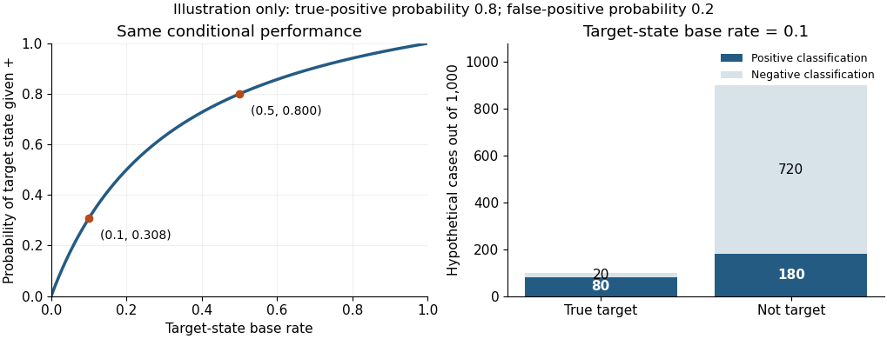

<h1 id="1/solution">Solution</h1>

↑ **Parent:** [1](../1.md)

**Autonomic recordings can support probabilistic discrimination of emotional states under specified conditions; they do not establish a person's experienced [emotion](../../../emotion.md) with certainty.** The distinction matters because a physiological response, an experimenter's induction label and a subjective feeling are different things. A useful [psychophysiology](../../../psychophysiology.md) study must justify how its labels relate to experience before assessing how well a bodily measure predicts them.

The [autonomic nervous system](../../../autonomic-nervous-system.md) regulates organs and glands through interacting pathways, including the [sympathetic nervous system](../../../sympathetic-nervous-system.md) and [parasympathetic nervous system](../../../parasympathetic-nervous-system.md). An [electrocardiogram](../../../electrocardiogram.md) supplies cardiac timing and hence [heart rate](../../../heart-rate.md); [heart rate variability](../../../heart-rate-variability.md) describes variation in successive intervals. [Electrodermal activity](../../../electrodermal-activity.md) can be recorded with skin electrodes, while a temperature sensor supplies peripheral temperature. [Breathing](../../../pulmonary-ventilation.md) and blood-pressure measurements add other information. These measurements differ in what generates them and in their temporal response. In particular, sweat-related [skin conductance](../../../skin-conductance.md) provides information about sympathetic sudomotor activity, whereas a faster [heart rate](../../../heart-rate.md) can reflect several autonomic influences and physical demands. [Facial electromyography](../../../facial-electromyography.md) is useful complementary evidence, but records [skeletal muscle](../../../skeletal-muscle.md) activity through the [somatic nervous system](../../../somatic-nervous-system.md); it should not be counted as another autonomic channel.

Historically, the question was not simply whether the body changes during [emotion](../../../emotion.md), but whether bodily patterns distinguish categories. [Paul Ekman](../../../paul-ekman.md) and colleagues in 1983 used muscle-by-muscle facial instructions and reliving of past episodes. They reported autonomic differentiation among some negative states as well as between positive and negative states. This challenges the claim that autonomic activity is entirely undifferentiated. It does not show that the same pattern is a necessary and sufficient marker in every spontaneous episode: posing, recollection and the selection of categories constrain the result.[1983, pp. 1208–1210, induction procedures and autonomic differentiation](../../../autonomic-nervous-system-activity-distinguishes-among-emotions-by-paul-ekman-and-others.md)

Joint patterns can carry information that a single measure misses. [Philip A. Kragel](../../../philip-a-kragel.md) and colleagues combined electrodermal, cardiac, respiratory and gastric measures during film- and music-induced states. Their 2013 study reported 58.0% autonomic classification accuracy across six induced categories and a neutral condition, with training and testing on separate participant subsets, above its chance benchmark. This supports multivariate information about the tested states. It does not establish invariant bodily essences: a [classifier](../../../classifier.md) can exploit overlapping distributions whose average patterns differ.[2013, abstract and methods, classification of induced states](../../../multivariate-pattern-classification-reveals-autonomic-and-experiential-representations-of-discrete-emotions-by-philip-a-kragel-and-others.md)

Conversely, [Erika H. Siegel](../../../erika-h-siegel.md) and colleagues' 2018 synthesis found substantial within-category variation, and mean autonomic patterns that did not clearly separate the categories. Its laboratory adult samples do not exhaust every possible real-world measurement. Nevertheless, a universal fingerprint claim should generalize across episodes, and the observed variation is a substantial problem for that strong claim. Failure to establish a fingerprint does not imply that [physiology](../../../physiology-split.md) contains zero predictive information; distributions can overlap without being identical.[2018, abstract and Discussion, autonomic variation within and between categories](../../../emotion-fingerprints-or-emotion-populations-by-erika-h-siegel-and-others.md)

Several alternative explanations must therefore be tested. A film may make participants breathe differently because of its pacing; imagined confrontation may prepare action; an emotional task may differ from a neutral task in movement or [attention](../../../attention.md). Exercise, room temperature, medication and individual baselines can change the recorded variables without a change in discrete emotional category. A [classifier](../../../classifier.md) that recognizes the stimulus or task is not necessarily recognizing the feeling. Splitting trials while retaining the same people and clips in training and test sets can also overstate generalization. Appropriate [cross-validation](../../../cross-validation.md) should hold out the people or inductions required by the intended claim, with preprocessing and feature selection fitted only to training data. Mixed feelings and changing episodes should be allowed rather than forced into one mutually exclusive label.

Even genuine conditional discrimination does not determine the reliability of a particular classification. Let $E$ denote one independently defined target state and $+$ a positive [classifier](../../../classifier.md) result. Partitioning the positive results into target and nontarget cases and applying [Bayes' theorem](../../../bayes-theorem.md) gives

$$
P(E\mid +)=\frac{P(+\mid E)P(E)}{P(+\mid E)P(E)+P(+\mid\neg E)P(\neg E)}.
$$

For an explicitly hypothetical [classifier](../../../classifier.md) with true-positive [probability](../../../probability.md) $0.8$ and false-positive [probability](../../../probability.md) $0.2$, a target [base rate](../../../base-rate.md) of $0.1$ produces $0.08/(0.08+0.18)\approx0.308$. At a [base rate](../../../base-rate.md) of $0.5$, the same conditional performance produces $0.8$. The [positive predictive value](../../../positive-predictive-value.md) therefore depends on the setting as well as the instrument. This calculation illustrates a limit on inference; it is not an estimate from either study.

**[Figure 1](#1/image-base-rate-dependence-of-a-hypothetical-autonomic-classifier). Base-rate dependence of a hypothetical autonomic classifier**.

The strongest conclusion combines measures while respecting their different roles. Repeated [self-report](../../../self-report.md) helps establish experienced feeling, independently coded behavior establishes action, and autonomic recording establishes bodily regulation. None is error-free, and agreement must be demonstrated. [Psychophysiologists](../../../psychophysiologist.md) can estimate how much an autonomic pattern changes the [probability](../../../probability.md) of a reported or independently characterized state, with an explicit uncertainty and domain of validation. **They can establish useful evidence about experienced [emotion](../../../emotion.md), but autonomic activity alone supplies a conditional inference rather than a uniquely identifying emotional signature.**

## ↑ Ancestors (11)

1. [1](../1.md)
2. [2022](../../2022-split.md)
3. [Past exam of the emotion: extending appraisal and feedback approaches course of the University of Oxford](../../split.md)
4. [Emotion: extending appraisal and feedback approaches course of the University of Oxford](../../../emotion-extending-appraisal-and-feedback-approaches-course-of-the-university-of-oxford.md)
5. [Year 3 of the psychology (experimental) course of the University of Oxford](../../../year-3-of-the-psychology-experimental-course-of-the-university-of-oxford.md)
6. [Psychology (experimental) course of the University of Oxford](../../../psychology-experimental-course-of-the-university-of-oxford.md)
7. [Undergraduate course of the University of Oxford](../../../undergraduate-course-of-the-university-of-oxford.md)
8. [Course of the University of Oxford](../../../course-of-the-university-of-oxford.md)
9. [University of Oxford](../../../university-of-oxford-split.md)
10. [List of universities](../../../list-of-universities.md)
11. [Codex Wiki](../../../split.md)
