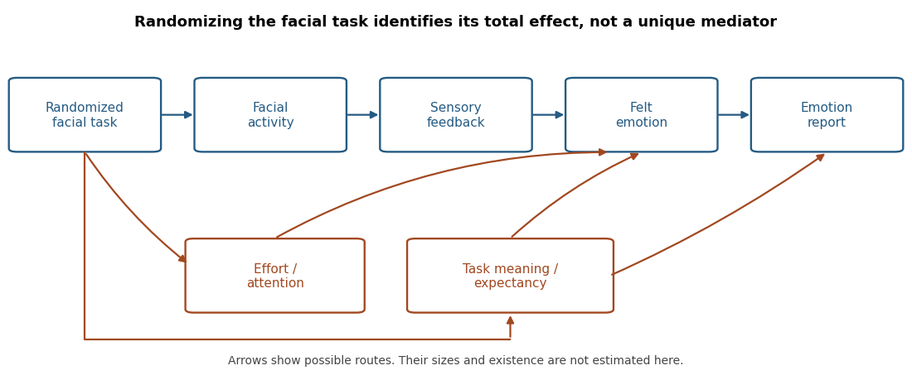

<h1 id="3/solution">Solution</h1>

↑ **Parent:** [3](../3.md)

**Small, variable effects support a limited influence of facial activity on reported feeling; they do not identify a single feedback mechanism or establish that [facial feedback](../../../facial-feedback.md) is necessary for [emotion](../../../emotion.md).** This conclusion separates the experimental contrast from its proposed explanation. Randomly assigning a facial task estimates the effect of that task, including every change the task produces. It does not automatically isolate sensory feedback from the face.

[Nicholas A. Coles](../../../nicholas-a-coles.md), [Jeff T. Larsen](../../../jeff-t-larsen.md) and [Heather C. Lench](../../../heather-c-lench.md) synthesized 286 [effect sizes](../../../effect-size.md) from 138 studies using a random-effects approach with robust [variance](../../../variance-split.md) estimates. Their overall estimate combined outcomes, so the more relevant result for experienced [emotion](../../../emotion.md) is the emotional-experience subgroup: [standardized mean difference](../../../standardized-mean-difference.md) $d=0.17$, with 95% [confidence interval](../../../confidence-interval.md) $[0.11,0.23]$. Affective judgments of stimuli had a larger estimate. The reported moderators included outcome type and properties of the eliciting stimuli. These are comparisons among existing studies, not randomized assignments of the proposed moderators.[2019, abstract, pp. 637–639 and Table 3, outcome-specific estimates and moderators](../../../a-meta-analysis-of-the-facial-feedback-literature-by-nicholas-a-coles-and-others.md)

The distinction between outcome types is theoretically important. Rating a cartoon's objective funniness asks for an evaluative judgment about a stimulus; rating one's own amusement asks about experience. Either can change through inference, expectations or response interpretation. Treating both as direct measures of feeling would make the evidence seem more decisive about the [facial feedback hypothesis](../../../facial-feedback-hypothesis.md) than it is. Equally, a small average change in experience is compatible with a real contributory mechanism: [emotion](../../../emotion.md) ordinarily has many inputs, so no single input need dominate.

The classic apparatus illustrates both the ingenuity and the ambiguity. [Fritz Strack](../../../fritz-strack.md) and colleagues in 1988 had participants hold a pen in ways that facilitated or inhibited smile-related activity, without explicitly instructing them to look happy. They reported differences in humor responses to cartoons. Avoiding an instruction to act happy reduces an obvious route through deliberate category labeling. It does not equate effort, discomfort, [attention](../../../attention.md), interpretation of the task or the sensory consequences of the postures.[1988, pp. 768–777, pen positions and humor responses](../../../inhibiting-and-facilitating-conditions-of-the-human-smile-by-fritz-strack-and-others.md)

A subsequent preregistered [replication](../../../replication-in-experimental-design.md) coordinated by [Eric-Jan Wagenmakers](../../../eric-jan-wagenmakers.md) and colleagues used 17 laboratories and 1,894 analyzed participants and did not reproduce the original difference. That directly limits confidence in the robustness of this particular procedure. It is not a test of every possible facial manipulation, and it should not be counted as evidence independent of a later synthesis that includes those [replication](../../../replication-in-experimental-design.md) studies.[2016, pp. 917–928, preregistration, pooled sample and replication outcome](../../../registered-replication-report-on-facial-feedback-by-eric-jan-wagenmakers-and-others.md)

There are several possible causal routes. First, information generated by [muscle](../../../muscle.md) activity or associated bodily changes might contribute to felt [emotion](../../../emotion.md). Second, a person might use their own posture as evidence when interpreting an ambiguous state: a self-inference route could be stronger when other emotional information is weak. Third, producing a posture might activate learned associations without an explicit inference. Fourth, the task might change [breathing](../../../pulmonary-ventilation.md), effort, discomfort or [attention](../../../attention.md). Fifth, [demand characteristics](../../../demand-characteristic.md) might change the report while leaving experience relatively unchanged. Social responses to a visible face are another possible route in interactive settings, but cannot explain a truly isolated participant's immediate response through an actual partner's reaction. These alternatives are hypotheses, not findings established by the [meta-analysis](../../../meta-analysis.md).

**[Figure 2](#3/image-alternative-causal-routes-from-a-facial-task-to-an-emotion-report). Alternative causal routes from a facial task to an emotion report**.

The logical problem can be stated without assuming that any route is absent. Write assignment as $X$, facial activity as $F$, sensory feedback as $M$ and the report as $Y$. The chain $X\to F\to M\to Y$ and a model with $X\to F$ plus an expectancy route $X\to D\to Y$ can produce the same association between assignment, movement and report. [Randomization](../../../randomization.md) of $X$ removes preassignment [confounding](../../../confounding.md) of its total effect, but does not randomize $M$ or eliminate $D$. Establishing [causal mediation](../../../causal-mediation.md) therefore requires additional interventions or justified assumptions, not simply a significant total effect.

Heterogeneity also has a limited interpretation. A simple [random-effects meta-analysis](../../../random-effects-meta-analysis.md) writes $y_i=\mu+u_i+\varepsilon_i$, with between-study [variance](../../../variance-split.md) $\tau^2$ and sampling [variance](../../../variance-split.md) $s_i^2$. Under independent errors the [variance](../../../variance-split.md) of $y_i$ is $\tau^2+s_i^2$. Nonzero $\tau^2$ means that true effects differ under the model; it does not specify whether the difference comes from sensory mechanisms, expectations, populations or measurement. Dependent estimates require further treatment, which is why a naive analysis counting every effect as an independent study is inappropriate. Small effects and noisy measurement also make individual studies unstable. Selecting a plausible moderator after a failed experiment is insufficient unless it predicts results in a new test.

Useful follow-up work would preregister a factorial design that varies actual facial activity separately from participants' beliefs about its emotional meaning, with matched effort controls and separate reports of felt state and stimulus judgment. [Facial electromyography](../../../facial-electromyography.md) can verify the motor manipulation, but not certify its psychological mediator. A test of a sensory route also needs a defensible manipulation of that route that leaves the relevant alternatives adequately controlled. Masked hypotheses, automated instructions and timing measures reduce particular ambiguities rather than providing a universal guarantee. A necessary-role claim would require evidence that reducing the relevant feedback prevents an otherwise expected emotional response; an initiation claim requires an effect without the external emotional elicitor, while accounting for the task's own meaning.

**By May 2022, the justified position was a modest, conditional contribution of facial manipulation, with its mechanism underdetermined. The size and variability narrow strong theories; they do not choose uniquely between bodily feedback, interpretation and reporting routes.**

## ↑ Ancestors (11)

1. [3](../3.md)
2. [2022](../../2022-split.md)
3. [Past exam of the emotion: extending appraisal and feedback approaches course of the University of Oxford](../../split.md)
4. [Emotion: extending appraisal and feedback approaches course of the University of Oxford](../../../emotion-extending-appraisal-and-feedback-approaches-course-of-the-university-of-oxford.md)
5. [Year 3 of the psychology (experimental) course of the University of Oxford](../../../year-3-of-the-psychology-experimental-course-of-the-university-of-oxford.md)
6. [Psychology (experimental) course of the University of Oxford](../../../psychology-experimental-course-of-the-university-of-oxford.md)
7. [Undergraduate course of the University of Oxford](../../../undergraduate-course-of-the-university-of-oxford.md)
8. [Course of the University of Oxford](../../../course-of-the-university-of-oxford.md)
9. [University of Oxford](../../../university-of-oxford-split.md)
10. [List of universities](../../../list-of-universities.md)
11. [Codex Wiki](../../../split.md)
