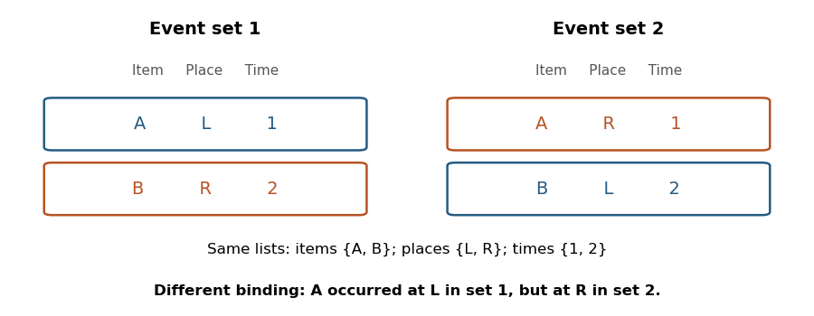
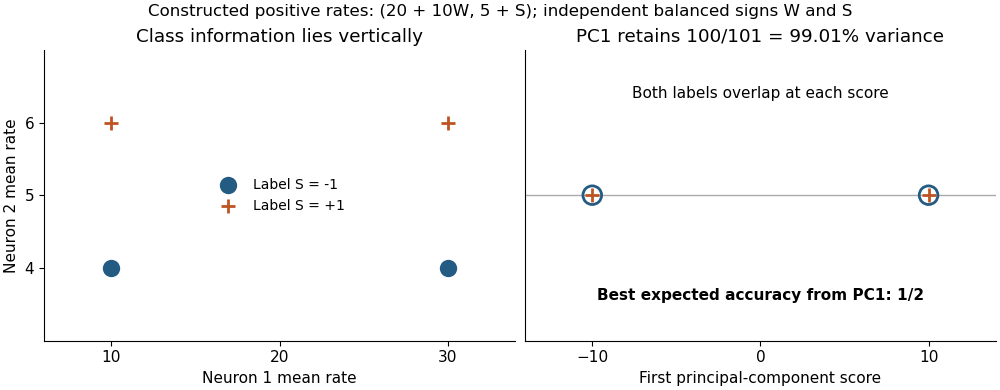

# 2022

↑ **Parent:** [Past exam of the episodic and semantic memory course of the University of Oxford](../past-exam-of-the-episodic-and-semantic-memory-course-of-the-university-of-oxford.md)

Original solutions to all six options in the [Episodic and semantic memory course of the University of Oxford](../university-of-oxford.md#episodic-and-semantic-memory-course-of-the-university-of-oxford) examination held on 3 June 2022. Question 1 retains its two printed Roman labels. The arguments use research available before the examination; the explanatory diagrams and counterexamples are original constructions.

Source: [Oxford examination release](https://www.whatdotheyknow.com/request/experimental_psychology_past_exa/response/2757831/attach/3/New%20Compressed%20zipped%20Folder.zip?cookie_passthrough=1), member a10975w1.pdf. The cover supplies the code and date; Part II is the frozen audited course classification.

**Table of contents**

- [1](#1)
  - [i](#1/i)
    - [Solution](#1/i/solution)
  - [ii](#1/ii)
    - [Solution](#1/ii/solution)
- [2](#2)
  - [Solution](#2/solution)
- [3](#3)
  - [Solution](#3/solution)
- [4](#4)
  - [Solution](#4/solution)
- [5](#5)
  - [Solution](#5/solution)
- [6](#6)
  - [Solution](#6/solution)

## 1

↑ **Parent:** [2022](2022.md)

<h3 id="1/i">i</h3>

↑ **Parent:** [1](#1)

<h4 id="1/i/solution">Solution</h4>

↑ **Parent:** [I](#1/i)

**Nonhuman animals retain information about particular past events, but this does not by itself establish human-like conscious [recollection](../neuroscience.md#recollection).** The answer depends on what the category [episodic memory](../neuroscience.md#episodic-memory) requires. Knowing that an event happened differs from reliving it as something that happened to oneself. A species could possess useful event representations without satisfying every phenomenological criterion used in human research.

[Endel Tulving](../psychologist.md#endel-tulving)'s 1985 account makes [autonoetic consciousness](../psychology.md#autonoetic-consciousness) central: the rememberer apprehends the self in subjective time. This distinguishes episodic remembering from [semantic memory](../neuroscience.md#semantic-memory), in which knowledge can be available without recollecting its acquisition. It is an influential theoretical proposal, supported by human observations and tasks, rather than an experiment establishing that every nonhuman species lacks that awareness.[1985, definitions of autonoetic awareness and distinctions among memory systems](../psychology-bibliography.md#memory-and-consciousness-by-endel-tulving)

The measurement problem is substantial. A verbal human report can distinguish knowing from remembering, although it is also vulnerable to instructions and interpretation. An animal's correct choice cannot supply the same report, and a failed verbal test would be inappropriate to its capacities. Thus absence of a linguistic demonstration is not evidence of absence of experience. Conversely, sophisticated behavior should not simply be renamed conscious reliving: trained rules, relative [familiarity](../neuroscience.md#familiarity) or a combination of independent cues may sometimes solve the task.

Converging evidence can narrow this uncertainty. Retaining a trial-specific combination, using it flexibly under an unexpected query, and distinguishing earlier from later events are stronger functional criteria than repeating a well-trained response. [Hippocampal](../neuroscience.md#hippocampus) lesion effects that spare [perception](../neuroscience.md#perception) or simple item recognition further constrain the mechanism. Yet even a convincing functional resemblance does not uniquely decide whether subjective temporal self-awareness accompanies it. Anatomical similarity is supporting evidence about mechanisms, not a direct measure of private experience.

A defensible position therefore separates the phenomenon from the inference. If [episodic memory](../neuroscience.md#episodic-memory) is defined functionally as flexible memory for individual events and their relations, evidence from animals can support it. If the definition necessarily includes [autonoetic consciousness](../psychology.md#autonoetic-consciousness), the same evidence leaves a further question unresolved. **The available evidence supports substantial continuity in event-memory capacities, while remaining insufficient for an unqualified claim that animals consciously relive episodes in the human sense.** That conclusion expresses a measurement limit rather than a claim that animal [consciousness](../psychology.md#consciousness) is impossible.

<h3 id="1/ii">ii</h3>

↑ **Parent:** [1](#1)

<h4 id="1/ii/solution">Solution</h4>

↑ **Parent:** [Ii](#1/ii)

**Evidence for [episodic-like memory](../neuroscience.md#episodic-like-memory) is substantially stronger, because its behavioral requirements can be tested without asserting conscious reliving.** The strongest design establishes content, location and temporal information belonging to the _same_ event, then shows that their combination guides behavior. Success on three unrelated tests would establish less.

[Nicky Clayton](../psychologist.md#nicky-clayton) and [Anthony Dickinson](../psychologist.md#anthony-dickinson)'s 1998 study exploited the ecology of food storage. [Scrub jays](../organism.md#scrub-jay) cached perishable wax worms and nonperishable peanuts at distinct sites. They preferred recovering favored worms after a short interval, but learned to avoid searching for worms after a longer interval when those stores would have deteriorated. The choice therefore depended jointly on food type, caching location and delay, meeting a useful behavioral criterion for [episodic-like memory](../neuroscience.md#episodic-like-memory).[1998, cache contents, spatially distinct sites and interval-dependent recovery](../psychology-bibliography.md#episodic-like-memory-during-cache-recovery-by-scrub-jays-by-nicky-clayton-and-others)

This result should not be expanded into a claim of complete freedom from learned knowledge. Knowledge that worms deteriorate supplies an enduring rule about food, while memory of a particular cache supplies event-specific input to the rule. An episodic-like account can therefore require interaction with learned knowledge rather than its absence. Critical controls and extensions should remove immediately informative odor cues, separate elapsed time from time of day, counterbalance item preferences, and test combinations that cannot be answered by one permanently rewarded location. Such controls are requirements for discriminating explanations, not additional findings attributed here to the original paper.

An original example illustrates why conjunction matters. Compare the two event sets

$$
\{(A,L,1),(B,R,2)\},\qquad \{(A,R,1),(B,L,2)\}.
$$

Both contain the same items, places and temporal positions. However, the correct answer to where $A$ occurred differs. Separate lists cannot determine that answer. [Episodic binding](../neuroscience.md#episodic-binding) is therefore a stronger claim than retaining the three lists, and a useful experiment tests a relation whose answer changes across otherwise matched combinations.

**[Figure 1](#1/ii/image-identical-feature-lists-can-conceal-different-event-bindings). Identical feature lists can conceal different event bindings**.

Rodent studies provide complementary causal evidence. [Norbert J. Fortin](../neuroscientist.md#norbert-j-fortin) and colleagues found impaired memory for the order of odor events after [hippocampal](../neuroscience.md#hippocampus) lesions despite preserved recognition of recently presented odors. [Ceren Ergorul](../neuroscientist.md#ceren-ergorul) and colleagues presented odor events at different locations and found that intact rats used combinations of odor and spatial cues in temporal judgments, whereas [hippocampal](../neuroscience.md#hippocampus) lesions disrupted this integration. Their probe tests help distinguish a binding deficit from simply being unable to detect the individual cues.[2002, sequence-order versus item-recognition comparison](../psychology-bibliography.md#critical-role-of-the-hippocampus-in-memory-for-sequences-of-events-by-norbert-j-fortin-and-others)[2004, single episodes and cue-combination probes](../psychology-bibliography.md#the-hippocampus-and-memory-for-what-where-and-when-by-ceren-ergorul-and-others)

These studies support event-specific relational retention across different species and tasks. They leave open how much a given test depends on relative recency, [familiarity](../neuroscience.md#familiarity) or a learned retrieval strategy; selective transfer and matched recognition controls are particularly useful. **[Episodic-like memory](../neuroscience.md#episodic-like-memory) is supported as a graded collection of experimentally demonstrated capacities, without treating every such success as proof of autonoetic remembering.**

## 2

↑ **Parent:** [2022](2022.md)

<h3 id="2/solution">Solution</h3>

↑ **Parent:** [2](#2)

**Content, space and time show partly different neural emphases, but their conjunction is distributed across interacting populations rather than stored in three independent boxes.** The same experimental result can concern sensory selectivity, encoding, retention or retrieval. Distinguishing these stages prevents an area that responds to a stimulus from being identified automatically as the permanent store of its memory.

For item information, the [perirhinal cortex](../neuroscience.md#perirhinal-cortex) is a useful starting point. Its connections and representational properties make it important for distinguishing complex objects and their [familiarity](../neuroscience.md#familiarity). [Lila Davachi](../neuroscientist.md#lila-davachi) and colleagues in 2003 used event-related [functional magnetic resonance imaging](../nuclear-magnetic-resonance.md#functional-magnetic-resonance-imaging) while participants encoded adjectives through scene imagery or a reading transformation. Later tests separated item recognition from remembering the encoding source. Perirhinal encoding activity predicted later item recognition; [hippocampal](../neuroscience.md#hippocampus) and posterior parahippocampal encoding activity predicted source [recollection](../neuroscience.md#recollection). This supports distinguishable contributions, not a proof that the [hippocampus](../neuroscience.md#hippocampus) never represents an item or that perirhinal activity cannot depend on context.[2003, encoding tasks and subsequent item/source memory effects](../psychology-bibliography.md#multiple-routes-to-memory-by-lila-davachi-and-others)

Spatial information is likewise heterogeneous. A [place cell](../neuroscience.md#place-cell) is selective for the animal's location under specified conditions, whereas a [spatial view cell](../neuroscience.md#spatial-view-cell) concerns a viewed location. The distinction matters in primates, where gaze and bodily position can vary independently. Recordings associated with [Edmund T. Rolls](../neuroscientist.md#edmund-rolls) tracked viewing and movement to distinguish spatial-view responses from self-location. Such cells establish an available code for a spatial variable; they do not demonstrate that the code alone contains an entire episode.[1997, active locomotion, eye-position controls and allocentric viewed location](../neuroscience-bibliography.md#spatial-view-cells-in-the-primate-hippocampus-by-edmund-t-rolls-and-others)

The [parahippocampal cortex](../neuroscience.md#parahippocampal-cortex), [entorhinal cortex](../neuroscience.md#entorhinal-cortex) and [hippocampus](../neuroscience.md#hippocampus) participate in contextual and spatial processing, with reciprocal cortical interactions. A scene or context can help specify where an item belongs, while an item's identity can change the significance of a location. Thus “what” and “where” are distinguishable questions without requiring completely independent neuronal populations. A location-selective cell may also depend on the task, preceding event or remembered destination.

Temporal information requires a further distinction between elapsed duration, relative order and a date-like temporal context. [Norbert J. Fortin](../neuroscientist.md#norbert-j-fortin)'s odor-order result shows that [hippocampal](../neuroscience.md#hippocampus) dependence is not confined to spatial arrangements: remembering a nonspatial sequence can be impaired even when recent-item recognition remains possible. However, an earlier-versus-later judgment need not use an explicit clock. A change in trace strength can sometimes serve as a recency cue, so order and recognition controls are essential.[2002, nonspatial sequence task and recognition control](../psychology-bibliography.md#critical-role-of-the-hippocampus-in-memory-for-sequences-of-events-by-norbert-j-fortin-and-others)

[Christopher J. MacDonald](../neuroscientist.md#christopher-j-macdonald) and colleagues' 2011 recordings provide a cellular example. Rats performed object–delay–odor sequences, requiring the earlier object to guide the later odor response. Successive [hippocampal](../neuroscience.md#hippocampus) cells were active at different parts of the intervening interval; changing its duration caused many cells to alter their temporal organization. These [time cells](../neuroscience.md#time-cell) could also carry location, behavior or sequence information. The result is more consistent with temporally organized population states than with every [neuron](../neuron.md) being assigned exclusively to one content dimension.[2011, object–delay–odor task, interval responses and retiming](../psychology-bibliography.md#hippocampal-time-cells-bridge-the-gap-in-memory-for-discontiguous-events-by-christopher-j-macdonald-and-others)

The coding similarities are therefore as informative as the differences. Spatial and temporal selectivity can both form sequences of changing activity; either can be combined with an object's identity. [Mixed selectivity](../neuroscience.md#mixed-selectivity) permits a representation to distinguish the same item in different contexts. An analysis should vary content, place and timing independently wherever possible, because locomotion, [expectation](../expected-value.md), reward and elapsed time are often correlated. Decoding a variable from correlated neural data shows available information, not necessarily a dedicated code for that variable.

Finally, retrieving a particular conjunction differs from retaining isolated features. The counterexample of identical marginal lists with different bindings demonstrates this logically. Neural evidence should therefore test whether a pattern distinguishes the correct relations, generalizes to a new query, and predicts errors that specifically confuse bindings. Single-cell recordings provide timing and selectivity; imaging samples wider regions; lesions test necessity under particular task conditions. Each method addresses a different part of the claim.

**The best account is differentiated inputs and computations combined into event representations, with content, place and time often expressed jointly. Neither regional specialization nor mixed coding eliminates the need to explain how the correct features are bound and later accessed.**

## 3

↑ **Parent:** [2022](2022.md)

<h3 id="3/solution">Solution</h3>

↑ **Parent:** [3](#3)

**Specific memory operations can depend on communication between regions even when the required information is measurable within each region separately.** Binding an event, selecting its relevant context and using it to guide a response impose different demands. Regional involvement alone does not tell us whether two regions cooperate, act in parallel or merely share an input. Two experimentally characterized interactions illustrate what stronger evidence can establish.

For [hippocampal](../neuroscience.md#hippocampus)–prefrontal coordination, [Matthew W. Jones](../neuroscientist.md#matthew-w-jones) and [Matthew A. Wilson](../neuroscientist.md#matthew-a-wilson) in 2005 recorded simultaneously with tetrodes in rat [hippocampal CA1](../neuroscience.md#hippocampal-ca1) and [medial prefrontal cortex](../neuroscience.md#medial-prefrontal-cortex) during a spatial memory task. Correlated firing and coupling in the theta range increased during behavior recruiting spatial [working memory](../neuroscience.md#working-memory). This links interaction to a particular task demand rather than merely showing that both areas are active. It offers a mechanism by which spatial information can become coordinated with task-dependent behavior.[2005, simultaneous CA1/PFC recordings, correlated firing and task-selective theta coupling](../psychology-bibliography.md#theta-rhythms-coordinate-hippocampal-prefrontal-interactions-in-a-spatial-memory-task-by-matthew-w-jones-and-others)

The proposed benefit of timing is precise: if downstream [neurons](../neuron.md) are sensitive to when inputs arrive, consistent relative phases can make selected inputs effective together. This does not mean that synchrony itself supplies the remembered content. Nor does a common theta rhythm prove transmission from one named region to the other. Shared rhythmic input, changes in movement or another task-related state could increase coupling. [Correlation](../variance.md#pearson-correlation-coefficient) provides evidence for [functional connectivity](../neuroscience.md#functional-connectivity); demonstrating the necessary route or direction requires a stronger intervention or a constrained causal model.

The [hippocampal](../neuroscience.md#hippocampus)–retrosplenial example adds such an intervention. [Brenton G. Cooper](../neuroscientist.md#brenton-g-cooper) and colleagues in 2001 combined temporary [retrosplenial cortex](../neuroscience.md#retrosplenial-cortex) inactivation with [hippocampal](../neuroscience.md#hippocampus) recordings during radial-maze behavior. Place-field locations changed during inactivation. In well-trained animals, behavioral impairment was particularly evident in darkness, when visual landmarks could not supply the same information. Crucially, changes in [hippocampal](../neuroscience.md#hippocampus) spatial coding also occurred without a behavioral deficit in other conditions. Remote neural reorganization and overt impairment therefore need not have a one-to-one relation.[2001, Experiments 1–2, light/dark conditions and hippocampal coding changes](../psychology-bibliography.md#temporary-inactivation-of-the-retrosplenial-cortex-causes-a-transient-reorganization-of-spatial-coding-in-the-hippocampus-by-brenton-g-cooper-and-others)

This finding supports a causal dependence of [hippocampal](../neuroscience.md#hippocampus) coding on the state of retrosplenial circuitry. A plausible interpretation is that the network combines landmark and movement-related information to maintain spatial context. It remains an interpretation of the computation, not proof of a direct monosynaptic message or a complete model of human [recollection](../neuroscience.md#recollection). Inactivation can influence indirect pathways, and a spatial navigation task tests ingredients useful for episodes without itself demonstrating autonoetic recall.

These interactions can be related to specific mnemonic demands. A [hippocampal](../neuroscience.md#hippocampus) representation may distinguish the relationships within an event, while a prefrontal interaction makes the appropriate relationship relevant to the current rule or query. A retrosplenial interaction may help maintain or update the spatial frame in which that relationship is interpreted. The hypotheses predict different vulnerabilities: changing retrieval goals should particularly challenge selection, whereas removing reliable external spatial cues should increase reliance on internally updated context. They do not require every region, including all posterior parietal subdivisions, to be equally necessary on every trial.

A particularly informative next experiment would combine a controlled perturbation with simultaneous recording and a task that dissociates item recognition, spatial binding and source or sequence judgments. Preserved recognition alongside disrupted binding would narrow a general arousal or sensory explanation. Comparing matched movement and reward conditions would test behavioral confounds. A [crossed disconnection experiment](../design-of-experiments.md#crossed-disconnection-experiment) could examine cooperation between a specified pair if the relevant pathways and their laterality were established: the comparison must include unilateral and same-side controls rather than assuming that any two lesions diagnose an interaction.

The critical question is not simply whether performance declines. The perturbation should disrupt the predicted representation or its task-dependent use at the relevant time, and the remote change should be measured. Even this requires caution about indirect effects and compensation. Conversely, normal performance after perturbation may reflect redundant routes or the availability of external cues, rather than complete irrelevance of the region.

**The evidence supports task-dependent interactions for coordinating, contextualizing and using event information. It does not justify equating a regional activation map, a synchrony measure or one navigation impairment with a universal four-region circuit for every aspect of episodic remembering.**

## 4

↑ **Parent:** [2022](2022.md)

<h3 id="4/solution">Solution</h3>

↑ **Parent:** [4](#4)

**The theories can be reconciled at several explanatory levels, but a strong restriction of medial temporal regions to [declarative memory](../neuroscience.md#declarative-memory) conflicts with evidence for their contribution to demanding online [perception](../neuroscience.md#perception).** Compatibility should be assessed between explicit claims, rather than achieved by renaming every deficit relational or mnemonic.

The [medial temporal lobe declarative memory system theory](../neuroscience.md#medial-temporal-lobe-declarative-memory-system-theory), associated with [Larry Squire](../psychology.md#larry-squire) and [Stuart Zola-Morgan](../neuroscientist.md#stuart-zola-morgan), identifies a system important for rapidly establishing long-term memories for facts and events. Their 1991 account emphasizes binding distributed cortical representations and a time-limited dependence during consolidation. It explains why substantial impairment in acquiring new declarative knowledge can coexist with preserved skills or other [learning](../animal-behaviour.md#learning). The proposal specifies a memory system and its temporal role; it does not by itself specify every representation or [learning](../animal-behaviour.md#learning) rule inside each component.[1991, anatomical components, declarative learning, cortical binding and consolidation](../psychology-bibliography.md#the-medial-temporal-lobe-memory-system-by-larry-squire-and-others)

[Relational memory theory](../neuroscience.md#relational-memory-theory), associated with [Howard Eichenbaum](../neuroscientist.md#howard-eichenbaum) and supported by work including [Norbert J. Fortin](../neuroscientist.md#norbert-j-fortin)'s, addresses the organization and flexible use of relationships. Items may be connected by location, order or another shared element. The account therefore explains why [hippocampal](../neuroscience.md#hippocampus) damage can affect more than a spatial map. Its proposal that related experiences support flexible queries supplies a candidate computation within a wider declarative system, rather than necessarily competing with the existence of that system.[1999, systematic organization and flexible expression of memories](../psychology-bibliography.md#the-hippocampus-and-mechanisms-of-declarative-memory-by-howard-eichenbaum)

The [representational hierarchy theory](../neuroscience.md#representational-hierarchy-theory) associated with [Timothy J. Bussey](../neuroscientist.md#timothy-j-bussey) and [Mark J. Buckley](../neuroscientist.md#mark-j-buckley) asks what conjunctions a region represents. A simple feature can occur in several objects and be insufficient for distinguishing them. Perirhinal object-level representations can reduce such ambiguity. The same representation can support recognizing an object after a delay or distinguishing it among simultaneously visible alternatives; the representational demand crosses the usual [perception](../neuroscience.md#perception)–memory boundary.

Two experiments sharpen this claim. [Timothy J. Bussey](../neuroscientist.md#timothy-j-bussey) and colleagues in 2002 held the number of object pairs constant while varying [feature ambiguity](../neuroscience.md#feature-ambiguity) in visual discrimination. Perirhinal lesion effects were related to the conjunction demand, supporting a more specific account than simply more objects or more difficult [learning](../animal-behaviour.md#learning). [Mark J. Buckley](../neuroscientist.md#mark-j-buckley) and colleagues in 2001 used simultaneous touchscreen oddity tasks. Lesioned macaques were impaired when object-level distinctions were required, with spared performance on difficult discriminations based on simple color, shape or size differences. Difficulty alone therefore does not explain the pattern.[2002, fixed number of pairs and manipulated feature ambiguity](../psychology-bibliography.md#perirhinal-cortex-resolves-feature-ambiguity-in-complex-visual-discriminations-by-timothy-j-bussey-and-others)[2001, object oddity and difficult simple-feature controls](../psychology-bibliography.md#selective-perceptual-impairments-after-perirhinal-cortex-ablation-by-mark-j-buckley-and-others)

A constructive reconciliation follows. The declarative account identifies a broad system and its role in long-term [learning](../animal-behaviour.md#learning); the relational account specifies organization and flexible expression; a representational hierarchy specifies which conjunctions its components can supply. Perirhinal object representations and contextual representations can participate in [hippocampal](../neuroscience.md#hippocampus) binding, and [learning](../animal-behaviour.md#learning) can stabilize those relations. Item/source differences in [Lila Davachi](../neuroscientist.md#lila-davachi)'s encoding study are consistent with differentiated contributions within a common system. Consistency is weaker than a unique confirmation of this particular synthesis.[2003, differentiated subsequent item and source memory effects](../psychology-bibliography.md#multiple-routes-to-memory-by-lila-davachi-and-others)

A real disagreement remains. If an original strong declarative-only position says that these regions have no necessary role in [perception](../neuroscience.md#perception) or immediate processing, a selective deficit on simultaneous object discrimination is problematic. Calling every across-fixation comparison memory would protect that position only by changing what it excludes. Conversely, simultaneous display does not eliminate [working memory](../neuroscience.md#working-memory), [attention](../psychology.md#attention), task-rule [learning](../animal-behaviour.md#learning) or all incidental encoding. The strongest adjudication manipulates representational complexity separately from retention demand and matches sensory and motor requirements. A selective conjunction deficit at negligible imposed delay supports the representational claim more directly than a generic difficult-task impairment.

The theories also need not agree about eventual [hippocampal](../neuroscience.md#hippocampus) [independence](../random-variable.md#independent-random-variables) of detailed remote episodes. Systems-level consolidation, relational organization and perceptual conjunctions are different issues; adopting one does not logically settle the others. Each retained commitment should generate a prediction that could differ from an alternative, including the kind of error expected after a selective lesion.

**A coherent account can combine a differentiated medial temporal system, relational binding and hierarchical representations. It must explicitly revise a strict memory-only boundary if complex online [perception](../neuroscience.md#perception) requires the same representations; that tension cannot be removed merely by saying that all three theories describe different levels.**

## 5

↑ **Parent:** [2022](2022.md)

<h3 id="5/solution">Solution</h3>

↑ **Parent:** [5](#5)

**Episodes can be encoded through learned relationships among distributed neuronal activity patterns, with temporal context distinguishing successive events and selective reinstatement supporting retrieval.** A satisfactory explanation needs more than a [neuron](../neuron.md) that responds during an experience. It must account for persistence after the event, separation of similar events and access from a partial cue.

At encoding, different populations carry information about content, context, actions and internal state. A [cell assembly](../neuroscience.md#cell-assembly) can represent their conjunction through coordinated activity rather than assigning one exclusive [neuron](../neuron.md) to each episode. [Mixed selectivity](../neuroscience.md#mixed-selectivity) permits the same cell to contribute differently when an item occurs in different contexts. [Synaptic plasticity](../neuron.md#synaptic-plasticity) can preserve changes in interactions after the original activity stops. Thus remembering need not require the encoding [neurons](../neuron.md) to fire continuously throughout retention.

A simplified [Hebbian learning](../statistical-learning.md#hebbian-learning) rule makes the proposal concrete. If two activities are $a_i$ and $a_j$, an update $\Delta w_{ij}=\eta a_i a_j$, with $\eta>0$, strengthens their association under the model. Recurrent interactions can later support [pattern completion](../statistical-learning.md#pattern-completion) from a partial cue, while [pattern separation](../statistical-learning.md#pattern-separation) can reduce confusion between similar inputs. These operations fit the anatomy of [hippocampal](../neuroscience.md#hippocampus) circuits, but the equation is an idealized storage rule, not a complete experimentally established biochemical mechanism. Stability, interference and correct downstream readout remain additional requirements.

Order creates a further constraint. Suppose a putative episode is stored only through

$$
\Delta W=\eta\sum_{t=1}^{T}a_ta_t^T.
$$

Reversing the order of the vectors leaves the sum unchanged. Such an order-insensitive update cannot distinguish the original sequence from its reversal. Temporal context, directed transition [learning](../animal-behaviour.md#learning) or [trace learning](../statistical-learning.md#trace-learning) must add information if order matters. This is a mathematical limitation of the displayed rule, not evidence that all Hebbian mechanisms lack temporal sensitivity.

[Christopher J. MacDonald](../neuroscientist.md#christopher-j-macdonald)'s time-cell findings supply a candidate representational ingredient: population activity changes across an interval and can depend on which event initiated the sequence. An item can therefore become linked to a changing state rather than to a timeless list. Because cells also encode behavior and location, experimental controls must separate elapsed time from correlated actions or expectations. The repeated trained sequence demonstrates an available [temporal coding](../neuroscience.md#temporal-coding) mechanism, not a recording of every feature of a unique autobiographical episode.[2011, delay coding and sequence-dependent responses](../psychology-bibliography.md#hippocampal-time-cells-bridge-the-gap-in-memory-for-discontiguous-events-by-christopher-j-macdonald-and-others)

Retrieval offers another test. [Hagar Gelbard-Sagiv](../neuroscientist.md#hagar-gelbard-sagiv) and colleagues in 2008 recorded single [neurons](../neuron.md) in human [hippocampal](../neuroscience.md#hippocampus) and nearby regions while patients watched cinematic episodes and later freely recalled them. Selective reactivation of some of the same [hippocampal](../neuroscience.md#hippocampus) and entorhinal [neurons](../neuron.md) preceded verbal recall of the corresponding episode. This connects internally generated activity with specific remembered content. It does not establish that one cell contains the entire memory, that every encoded cell must reactivate, or that the recorded activity causes the subjective experience.[2008, cinematic episodes, free verbal recall and selective cellular reactivation](../psychology-bibliography.md#internally-generated-reactivation-of-single-neurons-in-human-hippocampus-during-free-recall-by-hagar-gelbard-sagiv-and-others)

Causal work addresses a different level. [Tomás J. Ryan](../neuroscientist.md#tomas-j-ryan) and colleagues in 2015 tagged learning-associated cell ensembles in mice. Artificial activation could elicit memory-related fear behavior even under experimentally induced [amnesia](../psychology.md#amnesia). This supports a distinction between failure of natural access and complete loss of every retained trace. Artificially evoked freezing is nevertheless a behavioral readout; it does not demonstrate recovery of all episode details or [autonoetic consciousness](../psychology.md#autonoetic-consciousness). Appropriate control ensembles and contexts are needed to distinguish selective access from nonspecific recruitment of defensive behavior.[2015, tagged ensembles, amnesia and artificially evoked memory behavior](../psychology-bibliography.md#engram-cells-retain-memory-under-retrograde-amnesia-by-tomas-j-ryan-and-others)

These findings motivate an interacting account of storage and retrieval. Distributed representations supply content; learned connections bind and separate events; evolving activity supplies temporal position; a retrieval cue recruits an appropriate pattern. Reinstatement can be partial and transformed by the current goal, rather than a literal replay of every original sensory input. [Semantic memory](../neuroscience.md#semantic-memory) can provide the enduring knowledge used to interpret an episode without replacing its event-specific relations.

**The strongest explanation combines population representations, persistent plastic changes, temporal organization and selective retrieval. Recording selectivity, identifying an [engram](../neuroscience.md#engram) and showing behavior after stimulation are complementary findings; none alone amounts to a complete neural account of an experienced episode.**

## 6

↑ **Parent:** [2022](2022.md)

<h3 id="6/solution">Solution</h3>

↑ **Parent:** [6](#6)

**A reduced state space is useful when it preserves the structure needed for the question being asked; low dimension and high explained [variance](../variance.md) do not by themselves establish a sufficient neural code.** Start with a clear observation model. A vector of binned [spike counts](../neuroscience.md#spike-count) from $N$ [neurons](../neuron.md) may be approximated through $d<N$ latent coordinates, but the choices of bins, transformations, noise model and preserved criterion all affect the result.

For centered observations, [principal component analysis](../statistical-learning.md#principal-component-analysis) chooses an orthonormal projection $U\in\mathbb R^{N\times d}$ to minimize expected squared reconstruction error,

$$
E\lVert X-UU^TX\rVert^2=\operatorname{tr}(\Sigma)-\operatorname{tr}(U^T\Sigma U),
$$

where $\Sigma=E[XX^T]$. The identity follows by expanding the square and using $U^TU=I$. Diagonalize $\Sigma=V\operatorname{diag}(\lambda_i)V^T$. The trace term is $\sum_i\lambda_i\alpha_i$, with $\alpha_i=\lVert U^Tv_i\rVert^2$ for the columns $v_i$ of $V$. Here $0\leq\alpha_i\leq1$ and $\sum_i\alpha_i=d$ because the columns of $U$ are orthonormal. Allocating this total weight to the largest [eigenvalues](../linear-operator-theory.md#eigenvalue) maximizes the sum. This is an optimality statement about squared error in the chosen coordinates; [PCA](../statistical-learning.md#principal-component-analysis) does not require a [Gaussian distribution](../probability-distribution.md#normal-distribution) to satisfy it and does not optimize every behavioral question.

An exact counterexample makes the limitation decisive. Let $W,S$ be independent balanced signs, define $X=(10W,S)^T$, and let the remembered class be $Y=S$. Zero means and [independence](../random-variable.md#independent-random-variables) give

$$
\Sigma=\begin{pmatrix}100&0\\0&1\end{pmatrix}.
$$

The first component retains $100/101\approx99.01\%$ of total [variance](../variance.md). Yet $P(Y=1\mid W)=1/2$: no [classifier](../foundations-of-mathematics.md#classifier) using that component alone exceeds one-half expected accuracy. The second component determines the class exactly. Positive rates $(20+10W,5+S)$ give the same example after centering. These are constructed rates, not experimental recordings.

**[Figure 2](#6/image-high-explained-variance-can-discard-all-information-about-a-memory-label). High explained variance can discard all information about a memory label**.

This example also exposes a scaling assumption. Covariance-based [PCA](../statistical-learning.md#principal-component-analysis) emphasizes large-variance coordinates; standardization changes that objective and may increase the influence of noisy low-rate cells. Neither preprocessing choice is automatically correct. Behaviorally relevant information may lie in a small-amplitude direction, in precise spike timing lost by binning, or in [correlations](../variance.md#pearson-correlation-coefficient) not retained by a rate-only summary. Dimensionality must therefore be evaluated against decoding, reconstruction and the scientific question separately.

[Byron M. Yu](../neuroscientist.md#byron-m-yu) and colleagues' 2009 [Gaussian-process factor analysis](../latent-variable.md#gaussian-process-factor-analysis) combined temporal smoothing and [dimensionality reduction](../statistical-learning.md#dimensionality-reduction) in a probabilistic framework. Its demonstration used 61 simultaneously recorded macaque premotor and motor [neurons](../neuron.md) during reaching. It shows a method for estimating single-trial trajectories, not direct evidence that episodic memories have the same dimensional structure.[2009, observation model, temporal priors and motor-recording demonstration](../psychology-bibliography.md#gaussian-process-factor-analysis-for-low-dimensional-single-trial-analysis-of-neural-population-activity-by-byron-m-yu-and-others)

In a linear observation model $y_t=Cz_t+b+\varepsilon_t$, the noise and latent temporal assumptions matter. A Gaussian observation approximation can be imperfect for sparse counts; independent residual errors can misassign shared fluctuations; a smooth temporal prior can suppress abrupt transitions. Trial averaging can manufacture a smooth path while concealing different single-trial paths. A useful low-dimensional description must also generalize beyond the sampled cells, session and task: unrecorded populations may encode variables absent from the fitted coordinates.

Latent axes require care as well. In $y=Cz+b$, an orthogonal rotation $Q$ gives the identical reconstruction through $z'=Qz$ and $C'=CQ^T$, because $Q^TQ=I$. Reconstruction alone therefore cannot label one axis a unique psychological process. Model priors and constraints can restrict this ambiguity. Similarly, attractive geometry does not establish intrinsic dynamics: unobserved inputs, behavior or the analysis itself may shape the apparent trajectory. If a true dynamical state is claimed, the retained coordinates should predict relevant future activity under a specified model, not merely provide a convenient picture.

Validation should choose dimension and preprocessing within [training data](../foundations-of-mathematics.md#training-data), then assess held-out trials or sessions and, where appropriate, held-out [neurons](../neuron.md). Behavioral labels must be kept out of unsupervised fitting decisions used to claim independent prediction. Comparing multiple dimensions and reporting uncertainty is more informative than selecting the most compelling two-dimensional plot. A reduced representation can support a useful decoder without being a complete causal explanation of the circuit.

**Low-dimensional state spaces are testable approximations whose value depends on retained information, model fit and generalization. The projection, scaling, temporal and sampling assumptions should remain explicit, especially when a high-variance view is being interpreted as the mechanism of [episodic memory](../neuroscience.md#episodic-memory).**

## ↑ Ancestors (9)

1. [Past exam of the episodic and semantic memory course of the University of Oxford](../past-exam-of-the-episodic-and-semantic-memory-course-of-the-university-of-oxford.md)
2. [Episodic and semantic memory course of the University of Oxford](../university-of-oxford.md#episodic-and-semantic-memory-course-of-the-university-of-oxford)
3. [Year 3 of the psychology (experimental) course of the University of Oxford](../university-of-oxford.md#year-3-of-the-psychology-experimental-course-of-the-university-of-oxford)
4. [Psychology (experimental) course of the University of Oxford](../university-of-oxford.md#psychology-experimental-course-of-the-university-of-oxford)
5. [Undergraduate course of the University of Oxford](../university-of-oxford.md#undergraduate-course-of-the-university-of-oxford)
6. [Course of the University of Oxford](../university-of-oxford.md#course-of-the-university-of-oxford)
7. [University of Oxford](../university-of-oxford.md)
8. [List of universities](../README.md#list-of-universities)
9. [Codex Wiki](../README.md)
