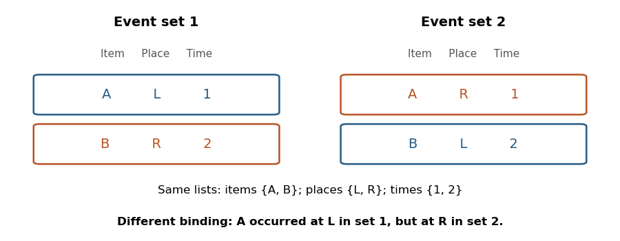

<h1 id="1/ii/solution">Solution</h1>

↑ **Parent:** [Ii](../ii.md)

**Evidence for [episodic-like memory](../../../../episodic-like-memory.md) is substantially stronger, because its behavioral requirements can be tested without asserting conscious reliving.** The strongest design establishes content, location and temporal information belonging to the _same_ event, then shows that their combination guides behavior. Success on three unrelated tests would establish less.

[Nicky Clayton](../../../../nicky-clayton.md) and [Anthony Dickinson](../../../../anthony-dickinson.md)'s 1998 study exploited the ecology of food storage. [Scrub jays](../../../../scrub-jay.md) cached perishable wax worms and nonperishable peanuts at distinct sites. They preferred recovering favored worms after a short interval, but learned to avoid searching for worms after a longer interval when those stores would have deteriorated. The choice therefore depended jointly on food type, caching location and delay, meeting a useful behavioral criterion for [episodic-like memory](../../../../episodic-like-memory.md).[1998, cache contents, spatially distinct sites and interval-dependent recovery](../../../../episodic-like-memory-during-cache-recovery-by-scrub-jays-by-nicky-clayton-and-others.md)

This result should not be expanded into a claim of complete freedom from learned knowledge. Knowledge that worms deteriorate supplies an enduring rule about food, while memory of a particular cache supplies event-specific input to the rule. An episodic-like account can therefore require interaction with learned knowledge rather than its absence. Critical controls and extensions should remove immediately informative odor cues, separate elapsed time from time of day, counterbalance item preferences, and test combinations that cannot be answered by one permanently rewarded location. Such controls are requirements for discriminating explanations, not additional findings attributed here to the original paper.

An original example illustrates why conjunction matters. Compare the two event sets

$$
\{(A,L,1),(B,R,2)\},\qquad \{(A,R,1),(B,L,2)\}.
$$

Both contain the same items, places and temporal positions. However, the correct answer to where $A$ occurred differs. Separate lists cannot determine that answer. [Episodic binding](../../../../episodic-binding.md) is therefore a stronger claim than retaining the three lists, and a useful experiment tests a relation whose answer changes across otherwise matched combinations.

**[Figure 1](#1/ii/image-identical-feature-lists-can-conceal-different-event-bindings). Identical feature lists can conceal different event bindings**.

Rodent studies provide complementary causal evidence. [Norbert J. Fortin](../../../../norbert-j-fortin.md) and colleagues found impaired memory for the order of odor events after [hippocampal](../../../../hippocampus.md) lesions despite preserved recognition of recently presented odors. [Ceren Ergorul](../../../../ceren-ergorul.md) and colleagues presented odor events at different locations and found that intact rats used combinations of odor and spatial cues in temporal judgments, whereas [hippocampal](../../../../hippocampus.md) lesions disrupted this integration. Their probe tests help distinguish a binding deficit from simply being unable to detect the individual cues.[2002, sequence-order versus item-recognition comparison](../../../../critical-role-of-the-hippocampus-in-memory-for-sequences-of-events-by-norbert-j-fortin-and-others.md)[2004, single episodes and cue-combination probes](../../../../the-hippocampus-and-memory-for-what-where-and-when-by-ceren-ergorul-and-others.md)

These studies support event-specific relational retention across different species and tasks. They leave open how much a given test depends on relative recency, [familiarity](../../../../familiarity.md) or a learned retrieval strategy; selective transfer and matched recognition controls are particularly useful. **[Episodic-like memory](../../../../episodic-like-memory.md) is supported as a graded collection of experimentally demonstrated capacities, without treating every such success as proof of autonoetic remembering.**

## ↑ Ancestors (12)

1. [Ii](../ii.md)
2. [1](../../1.md)
3. [2022](../../../2022-split.md)
4. [Past exam of the episodic and semantic memory course of the University of Oxford](../../../split.md)
5. [Episodic and semantic memory course of the University of Oxford](../../../../episodic-and-semantic-memory-course-of-the-university-of-oxford.md)
6. [Year 3 of the psychology (experimental) course of the University of Oxford](../../../../year-3-of-the-psychology-experimental-course-of-the-university-of-oxford.md)
7. [Psychology (experimental) course of the University of Oxford](../../../../psychology-experimental-course-of-the-university-of-oxford.md)
8. [Undergraduate course of the University of Oxford](../../../../undergraduate-course-of-the-university-of-oxford.md)
9. [Course of the University of Oxford](../../../../course-of-the-university-of-oxford.md)
10. [University of Oxford](../../../../university-of-oxford-split.md)
11. [List of universities](../../../../list-of-universities.md)
12. [Codex Wiki](../../../../split.md)
