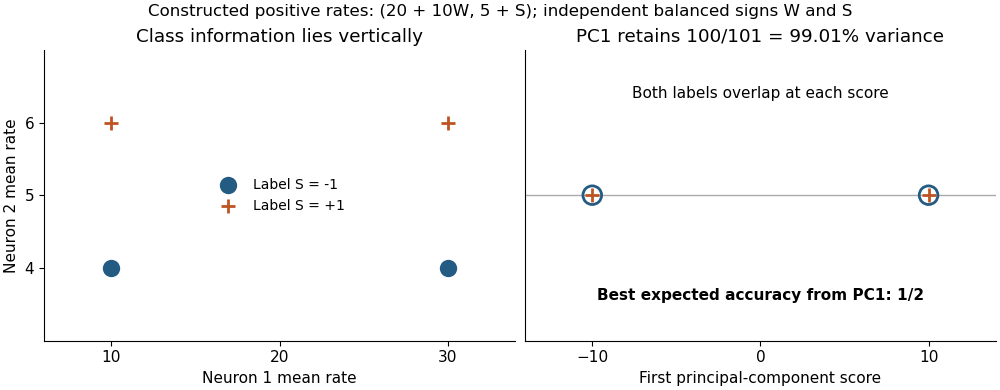

<h1 id="6/solution">Solution</h1>

↑ **Parent:** [6](../6.md)

**A reduced state space is useful when it preserves the structure needed for the question being asked; low dimension and high explained [variance](../../../variance-split.md) do not by themselves establish a sufficient neural code.** Start with a clear observation model. A vector of binned [spike counts](../../../spike-count.md) from $N$ [neurons](../../../neuron-split.md) may be approximated through $d<N$ latent coordinates, but the choices of bins, transformations, noise model and preserved criterion all affect the result.

For centered observations, [principal component analysis](../../../principal-component-analysis.md) chooses an orthonormal projection $U\in\mathbb R^{N\times d}$ to minimize expected squared reconstruction error,

$$
E\lVert X-UU^TX\rVert^2=\operatorname{tr}(\Sigma)-\operatorname{tr}(U^T\Sigma U),
$$

where $\Sigma=E[XX^T]$. The identity follows by expanding the square and using $U^TU=I$. Diagonalize $\Sigma=V\operatorname{diag}(\lambda_i)V^T$. The trace term is $\sum_i\lambda_i\alpha_i$, with $\alpha_i=\lVert U^Tv_i\rVert^2$ for the columns $v_i$ of $V$. Here $0\leq\alpha_i\leq1$ and $\sum_i\alpha_i=d$ because the columns of $U$ are orthonormal. Allocating this total weight to the largest [eigenvalues](../../../eigenvalue.md) maximizes the sum. This is an optimality statement about squared error in the chosen coordinates; [PCA](../../../principal-component-analysis.md) does not require a [Gaussian distribution](../../../normal-distribution.md) to satisfy it and does not optimize every behavioral question.

An exact counterexample makes the limitation decisive. Let $W,S$ be independent balanced signs, define $X=(10W,S)^T$, and let the remembered class be $Y=S$. Zero means and [independence](../../../independent-random-variables.md) give

$$
\Sigma=\begin{pmatrix}100&0\\0&1\end{pmatrix}.
$$

The first component retains $100/101\approx99.01\%$ of total [variance](../../../variance-split.md). Yet $P(Y=1\mid W)=1/2$: no [classifier](../../../classifier.md) using that component alone exceeds one-half expected accuracy. The second component determines the class exactly. Positive rates $(20+10W,5+S)$ give the same example after centering. These are constructed rates, not experimental recordings.

**[Figure 2](#6/image-high-explained-variance-can-discard-all-information-about-a-memory-label). High explained variance can discard all information about a memory label**.

This example also exposes a scaling assumption. Covariance-based [PCA](../../../principal-component-analysis.md) emphasizes large-variance coordinates; standardization changes that objective and may increase the influence of noisy low-rate cells. Neither preprocessing choice is automatically correct. Behaviorally relevant information may lie in a small-amplitude direction, in precise spike timing lost by binning, or in [correlations](../../../pearson-correlation-coefficient.md) not retained by a rate-only summary. Dimensionality must therefore be evaluated against decoding, reconstruction and the scientific question separately.

[Byron M. Yu](../../../byron-m-yu.md) and colleagues' 2009 [Gaussian-process factor analysis](../../../gaussian-process-factor-analysis.md) combined temporal smoothing and [dimensionality reduction](../../../dimensionality-reduction.md) in a probabilistic framework. Its demonstration used 61 simultaneously recorded macaque premotor and motor [neurons](../../../neuron-split.md) during reaching. It shows a method for estimating single-trial trajectories, not direct evidence that episodic memories have the same dimensional structure.[2009, observation model, temporal priors and motor-recording demonstration](../../../gaussian-process-factor-analysis-for-low-dimensional-single-trial-analysis-of-neural-population-activity-by-byron-m-yu-and-others.md)

In a linear observation model $y_t=Cz_t+b+\varepsilon_t$, the noise and latent temporal assumptions matter. A Gaussian observation approximation can be imperfect for sparse counts; independent residual errors can misassign shared fluctuations; a smooth temporal prior can suppress abrupt transitions. Trial averaging can manufacture a smooth path while concealing different single-trial paths. A useful low-dimensional description must also generalize beyond the sampled cells, session and task: unrecorded populations may encode variables absent from the fitted coordinates.

Latent axes require care as well. In $y=Cz+b$, an orthogonal rotation $Q$ gives the identical reconstruction through $z'=Qz$ and $C'=CQ^T$, because $Q^TQ=I$. Reconstruction alone therefore cannot label one axis a unique psychological process. Model priors and constraints can restrict this ambiguity. Similarly, attractive geometry does not establish intrinsic dynamics: unobserved inputs, behavior or the analysis itself may shape the apparent trajectory. If a true dynamical state is claimed, the retained coordinates should predict relevant future activity under a specified model, not merely provide a convenient picture.

Validation should choose dimension and preprocessing within [training data](../../../training-data.md), then assess held-out trials or sessions and, where appropriate, held-out [neurons](../../../neuron-split.md). Behavioral labels must be kept out of unsupervised fitting decisions used to claim independent prediction. Comparing multiple dimensions and reporting uncertainty is more informative than selecting the most compelling two-dimensional plot. A reduced representation can support a useful decoder without being a complete causal explanation of the circuit.

**Low-dimensional state spaces are testable approximations whose value depends on retained information, model fit and generalization. The projection, scaling, temporal and sampling assumptions should remain explicit, especially when a high-variance view is being interpreted as the mechanism of [episodic memory](../../../episodic-memory.md).**

## ↑ Ancestors (11)

1. [6](../6.md)
2. [2022](../../2022-split.md)
3. [Past exam of the episodic and semantic memory course of the University of Oxford](../../split.md)
4. [Episodic and semantic memory course of the University of Oxford](../../../episodic-and-semantic-memory-course-of-the-university-of-oxford.md)
5. [Year 3 of the psychology (experimental) course of the University of Oxford](../../../year-3-of-the-psychology-experimental-course-of-the-university-of-oxford.md)
6. [Psychology (experimental) course of the University of Oxford](../../../psychology-experimental-course-of-the-university-of-oxford.md)
7. [Undergraduate course of the University of Oxford](../../../undergraduate-course-of-the-university-of-oxford.md)
8. [Course of the University of Oxford](../../../course-of-the-university-of-oxford.md)
9. [University of Oxford](../../../university-of-oxford-split.md)
10. [List of universities](../../../list-of-universities.md)
11. [Codex Wiki](../../../split.md)
