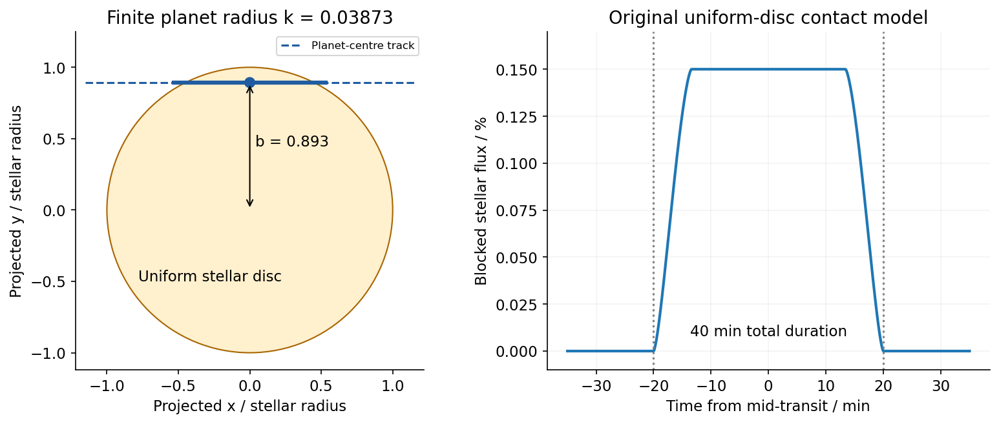
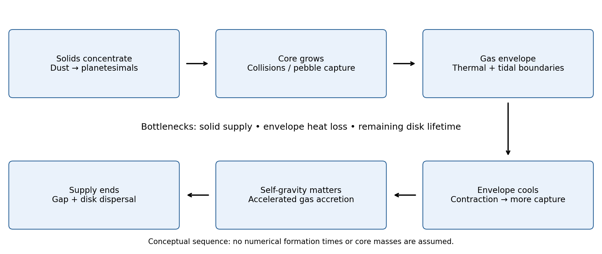
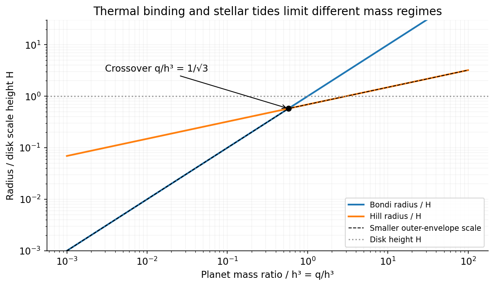
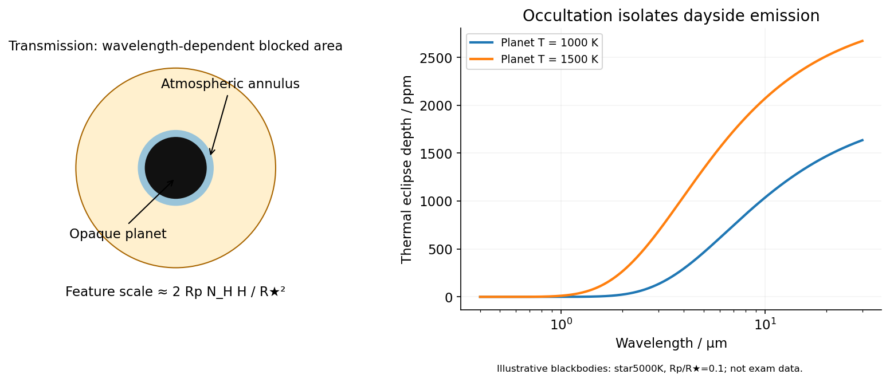

# Paper 1

↑ **Parent:** [2015](../2015.md)

[Original examination PDF,physical pages738–739](https://www.whatdotheyknow.com/request/natural_science_tripos_physics_e_2/response/2340776/attach/2/FOI%202023%20399%20Zahid%20materials.pdf?cookie_passthrough=1#page=738)

**Table of contents**

- [1](#1)
  - [Solution](#1/solution)
- [2](#2)
  - [Solution](#2/solution)
- [3](#3)
  - [a](#3/a)
    - [Solution](#3/a/solution)
  - [b](#3/b)
    - [Solution](#3/b/solution)
  - [c](#3/c)
    - [Solution](#3/c/solution)
  - [d](#3/d)
    - [Solution](#3/d/solution)

## 1

↑ **Parent:** [Paper 1](paper-1.md)

<h3 id="1/solution">Solution</h3>

↑ **Parent:** [1](#1)

A stable sinusoidal [radial-velocity semi-amplitude](../../celestial-mechanics.md#radial-velocity-semi-amplitude) can be stellar reflex motion caused by a companion on a nearly [circular orbit](../../classical-mechanics.md#circular-orbit). The amplitude is compatible with a giant [planet](../../planetary-science.md#planet); a low-[mass](../../classical-mechanics.md#mass) [star](../../stellar-astrophysics.md#star) or [brown dwarf](../../stellar-astrophysics.md#brown-dwarf) viewed nearly face-on can mimic the same projected motion, but requires an increasingly unlikely orientation. [Starspots](../../exoplanet.md#starspot) and magnetically suppressed [convection](../../convection.md) can produce a rotational [stellar activity](../../stellar-astrophysics.md#stellar-activity) signal on a ten-day timescale; contemporaneous photometry, activity indicators and [stellar spectral-line bisector](../../stellar-astrophysics.md#stellar-spectral-line-bisector) and other profile changes distinguish these from a clean common Doppler shift. Solar-like [stellar oscillations](../../astrophysical-fluid-dynamics.md#stellar-oscillation) ordinarily have much shorter periods, so a coherent ten-day oscillation of an otherwise ordinary solar-type dwarf is less plausible. Instrumental drift, sampling aliases and blended spectra also need checking. A sinusoid alone does not establish a planetary origin, and the data do not assign numerical probabilities to these alternatives.

For the [minimum companion mass from radial velocity](../../exoplanet.md#minimum-companion-mass-from-radial-velocity), take a circular two-body orbit and initially $M_\star=M_\odot$. The exact relation and its low-[mass](../../classical-mechanics.md#mass) limit are

$$
K=\left(\frac{2\pi G}{P}\right)^{1/3}\frac{M_p\sin i}{(M_\star+M_p)^{2/3}},\qquad M_p\sin i\simeq K\left(\frac P{2\pi G}\right)^{1/3}M_\star^{2/3}.
$$

With $\sin i=1$,

$$
\boxed{M_{p,\min}\simeq0.636\,M_J\simeq202\,M_\oplus,\qquad a\simeq0.0908\,\mathrm{au}.}
$$

Here $a=[GM_\star P^2/(4\pi^2)]^{1/3}$ is the relative orbital [semi-major axis](../../celestial-mechanics.md#semi-major-axis). Nonzero [orbital eccentricity](../../celestial-mechanics.md#orbital-eccentricity) multiplies the inferred $M_p\sin i$ by $\sqrt{1-e^2}$ at fixed measured $K,P$, but the sinusoidal model motivates $e=0$ here.

For the [radial-velocity sensitivity limit at fixed planet mass](../../exoplanet.md#radial-velocity-sensitivity-limit-at-fixed-planet-mass), use $K=M_p\sin i\sqrt{G/(M_\star a)}$ and interpret the stated detection scale as a semi-amplitude threshold $K_{\min}$. The largest distance occurs for $\sin i=1$:

$$
\boxed{a_{\max}=\frac{G M_p^2}{M_\star K_{\min}^2}\simeq0.0180\,\mathrm{au}\quad(M_\star=M_\odot).}
$$

For an inclination $i$, this boundary is smaller by $\sin^2i$. The result assumes adequate time coverage and neglects the stipulated [stellar noise](../../stellar-astrophysics.md#stellar-noise). If the detection scale instead denotes a full peak-to-peak excursion, set $K_{\min}$ to half that scale; $a_{\max}$ then increases fourfold.

The [stellar-mass scaling of radial-velocity planet estimates](../../exoplanet.md#stellar-mass-scaling-of-radial-velocity-planet-estimates) changes these inferences because [Kepler's third law](../../mathematical-physics.md#kepler-s-third-law) and the stellar reflex response depend on the stellar [mass](../../classical-mechanics.md#mass). At fixed $K,P$, $M_p\sin i\propto M_\star^{2/3}$ and $a\propto M_\star^{1/3}$, whereas the fixed-[mass](../../classical-mechanics.md#mass) detectability boundary scales as $M_\star^{-1}$. Therefore

$$
\boxed{M_{p,\min}\simeq0.401\,M_J\simeq127\,M_\oplus,\quad a\simeq0.0721\,\mathrm{au},\quad a_{\max}(3M_\oplus)\simeq0.0360\,\mathrm{au}.}
$$

The observed period and amplitude are unchanged. The [stellar radius](../../stellar-astrophysics.md#stellar-radius) does not enter these leading dynamical estimates, but is crucial for the [exoplanet transit](../../exoplanet.md#exoplanet-transit) inference.

For the transiting companion, assume an opaque spherical [planet](../../planetary-science.md#planet), negligible [transit dilution](../../exoplanet.md#transit-dilution) and negligible [limb darkening](../../radiometry.md#limb-darkening). Its [radius](../../topology.md#radius) ratio is $k=R_p/R_\star=\sqrt\delta=0.03873$, hence

$$
\boxed{R_p=0.01936\,R_\odot\simeq1.35\times10^7\,\mathrm m\simeq2.11\,R_\oplus.}
$$

Using the revised stellar [mass](../../classical-mechanics.md#mass) and a [circular orbit](../../classical-mechanics.md#circular-orbit) gives $a=0.01850\,\mathrm{au}$ and $A=a/R_\star=7.957$. Interpret the duration as the total first-to-fourth-contact duration $T_{14}$. The [impact parameter from total transit duration](../../exoplanet.md#impact-parameter-from-total-transit-duration) follows from the [total duration of a circular planetary transit](../../exoplanet.md#total-duration-of-a-circular-planetary-transit):

$$
s=\sin\left(\frac{\pi T_{14}}P\right),\qquad b^2=\frac{(1+k)^2-A^2s^2}{1-s^2},\qquad\boxed{b\simeq0.893,\quad i=\arccos(b/A)\simeq83.56^\circ.}
$$

This is noncentral but not grazing: $b<1-k$. The small-[planet](../../planetary-science.md#planet) straight-chord approximation gives $b\simeq0.845$; retaining finite $R_p$ and orbital curvature gives the stated value. A duration measured between other contacts needs the corresponding contact formula. Unknown [orbital eccentricity](../../celestial-mechanics.md#orbital-eccentricity) and argument of periapsis change the transverse speed and prevent a unique unconstrained $b$; the numerical estimate is conditional on the stated circular model.[Section3.1, equations1–4: depth, contact geometry and circular-orbit scale](../../physics-bibliography.md#on-the-unique-solution-of-planet-and-star-parameters-from-an-extrasolar-planet-transit-light-curve-by-sara-seager-and-gabriela-mallen-ornelas)

**[Figure 1](#1/image-the-measured-transit-duration-selects-a-short-off-centre-chord-when-finite-planet-size-is-retained). The measured transit duration selects a short off-centre chord when finite planet size is retained**. [Source](paper-1-transit-geometry.py).

Because the transit constrains $\sin i\simeq0.994$, the RV nondetection now bounds the actual planetary [mass](../../classical-mechanics.md#mass), rather than only its projected [mass](../../classical-mechanics.md#mass). The [bulk-density upper limit from a transit and an RV nondetection](../../exoplanet.md#bulk-density-upper-limit-from-a-transit-and-an-rv-nondetection) is

$$
\boxed{M_p\lesssim2.16\,M_\oplus,\qquad\bar\rho_p\lesssim1.26\,\mathrm{g\,cm^{-3}}.}
$$

These bounds assume the instrumental threshold can be applied to a fitted signal at the transit period; no statistical confidence level is specified. Such a large [radius](../../topology.md#radius) at this low [mass](../../classical-mechanics.md#mass) is inconsistent with an ordinary compact rock-and-iron body. A low-[density](../../fluid-mechanics.md#density) volatile-rich [planet](../../planetary-science.md#planet), possibly with an extended H/He envelope, is indicated under the planetary interpretation. The observations do not uniquely determine interior composition, atmospheric abundance or formation history; blended eclipses and activity still require validation. There is no luminosity or effective [temperature](../../temperature.md) supplied for the host, so a numerical planetary equilibrium [temperature](../../temperature.md) cannot be inferred from these data alone.

The numerical conversions above use externally documented $(GM)_\odot=1.3271244\times10^{20}\,\mathrm{m^3\,s^{-2}}$, $R_\odot=6.957\times10^8\,\mathrm m$, $M_\oplus=5.9722\times10^{24}\,\mathrm{kg}$, $R_\oplus=6.371\times10^6\,\mathrm m$, $M_J=1.89813\times10^{27}\,\mathrm{kg}$, $G=6.67430\times10^{-11}\,\mathrm{m^3\,kg^{-1}\,s^{-2}}$ and $1\,\mathrm{au}=149597870700\,\mathrm m$. They are conversion constants, not additional measured system parameters.[2015 ResolutionB3: solar [radius](../../topology.md#radius) and solar [mass](../../classical-mechanics.md#mass) parameter](../../physics-bibliography.md#nominal-solar-and-planetary-conversion-constants-by-the-international-astronomical-union)[Masses, mean radii and CODATA2018 gravitational constant](../../physics-bibliography.md#planetary-physical-parameters-by-nasa-jpl)

## 2

↑ **Parent:** [Paper 1](paper-1.md)

<h3 id="2/solution">Solution</h3>

↑ **Parent:** [2](#2)

**[Core accretion](../../planetary-science.md#core-accretion) builds a solid core and then a massive gaseous envelope before [protoplanetary disk dispersal](../../astrophysical-disk.md#protoplanetary-disk-dispersal).** The solid and [gas](../../thermodynamics.md#gas) stages overlap; this is not direct collapse of a whole disk patch.

In a [protoplanetary disk](../../astrophysical-disk.md#protoplanetary-disk), refractory grains and, beyond a [snow line](../../astrophysical-disk.md#snow-line), condensed ices provide solids. Settling and [protoplanetary dust coagulation](../../planetary-science.md#protoplanetary-dust-coagulation) build aggregates, but fragmentation, bouncing and [radial drift of solids in a gas disk](../../astrophysical-disk.md#radial-drift-of-solids-in-a-gas-disk) can interrupt simple sticking. Concentration processes such as the [streaming instability](../../astrophysical-disk.md#streaming-instability) can produce dense particle structures that collapse into [planetesimals](../../planetary-science.md#planetesimal). Subsequent collisions build [planetary embryos](../../planetary-science.md#planetary-embryo); alternatively, embryos can efficiently capture drifting particles through [gas](../../thermodynamics.md#gas)-assisted [pebble accretion](../../planetary-science.md#pebble-accretion). Neither the initial planetesimal population nor unrestricted growth through every size should be assumed without a mechanism.

For [gravitationally focused growth of a planetary core](../../classical-mechanics.md#gravitationally-focused-growth-of-a-planetary-core), the two-body capture cross-section is

$$
\sigma_{\rm coll}=\pi R_c^2\left(1+\frac{v_{\rm esc}^2}{v_\infty^2}\right),\qquad v_{\rm esc}^2=\frac{2GM_c}{R_c}.
$$

An illustrative thin-disk estimate is $\dot M_c\sim\Sigma_s\Omega\sigma_{\rm coll}$, up to geometry and velocity-distribution factors. At fixed solid [density](../../fluid-mechanics.md#density) and random speed, strong [gravitational focusing](../../classical-mechanics.md#gravitational-focusing) gives $\dot M_c\propto M_c^{4/3}$: [runaway planetesimal growth](../../planetary-science.md#runaway-planetesimal-growth). As large embryos stir the smaller bodies, encounter speeds increase and focusing weakens, giving [oligarchic growth](../../planetary-science.md#oligarchic-growth). Consuming the local [feeding zone](../../planetary-science.md#feeding-zone-of-a-planetary-embryo) leads toward an [isolation mass](../../planetary-science.md#isolation-mass); radial supply, migration and mergers can extend growth. [Snow lines](../../astrophysical-disk.md#snow-line) can increase the solid reservoir, but a distant core also grows more slowly because orbital times are longer.[Version1, sectionIII.B, pages27–31: [gravitational focusing](../../classical-mechanics.md#gravitational-focusing) and planetesimal growth](../../physics-bibliography.md#lecture-notes-on-the-formation-and-early-evolution-of-planetary-systems-by-philip-j-armitage)

A growing core binds [gas](../../thermodynamics.md#gas) over a scale limited by the smaller of its [Bondi radius](../../astrophysical-black-hole.md#bondi-radius) and [Hill radius](../../celestial-mechanics.md#hill-radius). The envelope approximately satisfies

$$
\frac{dP}{dr}=-\frac{G[M_c+m(r)]\rho}{r^2},\qquad\frac{dm}{dr}=4\pi r^2\rho.
$$

An [equation of state](../../pressure.md#equation-of-state), disk boundary conditions, and radiative or convective energy transport close the structure. In an optically thick radiative region,

$$
\frac{dT}{dr}=-\frac{3\kappa\rho L}{64\pi\sigma_{\rm SB}r^2T^3}.
$$

Here $\kappa$ is [opacity](../../stellar-structure.md#opacity); an unstable radiative gradient instead drives [convection](../../convection.md). Solid accretion releases roughly $L_s\sim GM_c\dot M_c/R_c$, heating and supporting the envelope. [Gas](../../thermodynamics.md#gas) capture consequently depends on cooling, not just whether the potential can bind [gas](../../thermodynamics.md#gas) instantaneously.

The envelope loses energy on a [Kelvin-Helmholtz cooling time](../../stellar-astrophysics.md#kelvin-helmholtz-cooling-time), $t_{\rm KH}\sim|E_{\rm env}|/L$. Lower grain [opacity](../../stellar-structure.md#opacity), higher core [mass](../../classical-mechanics.md#mass), or reduced solid-accretion heating can accelerate contraction. The [critical core mass for gas accretion](../../planetary-science.md#critical-core-mass-for-gas-accretion) is therefore model dependent; “of order ten Earth masses” is a common scale, not a universal switch. As envelope self-[gravity](../../physics.md#gravity) becomes important and the [gas](../../thermodynamics.md#gas) and solid masses become comparable, contraction permits still more [gas](../../thermodynamics.md#gas) capture, producing [runaway gas accretion](../../planetary-science.md#runaway-gas-accretion). The classical sequence has a rapid solid-growth phase, a slower envelope-growth phase, and accelerated [gas](../../thermodynamics.md#gas) accumulation.[1996 model: coupled solid and [gas](../../thermodynamics.md#gas) growth, three phases and crossover](../../physics-bibliography.md#formation-of-the-giant-planets-by-concurrent-accretion-of-solids-and-gas-by-james-b-pollack-and-others)

**[Figure 2](#2/image-core-accretion-requires-both-solid-growth-and-envelope-cooling-while-the-disk-still-supplies-gas). Core accretion requires both solid growth and envelope cooling while the disk still supplies gas**. [Source](paper-1-core-accretion.py).

**The decisive race is $t_{\rm core}+t_{\rm envelope}\lesssim t_{\rm disk}$.** Failure to cool or obtain a sufficiently large core before [gas](../../thermodynamics.md#gas) removal leaves a smaller solid or ice-rich [planet](../../planetary-science.md#planet). Successful growth is ultimately limited by disk supply, [gap opening by a planet](../../planetary-science.md#gap-opening-by-a-planet), and dispersal; a gap does not completely seal off accretion. Angular-momentum exchange drives [planetary migration](../../planetary-science.md#planetary-migration), so the observed orbit need not be the formation [radius](../../topology.md#radius). Accretion-shock radiation and subsequent contraction set the young giant's entropy and luminosity; final core [mass](../../classical-mechanics.md#mass), envelope enrichment and orbital location depend on the whole growth history, not on one fixed threshold. The necessary cooling, supply and orbital constraints make the model testable rather than an assertion that every embryo must become a [gas giant](../../planetary-science.md#gas-giant).

## 3

↑ **Parent:** [Paper 1](paper-1.md)

<h3 id="3/a">a</h3>

↑ **Parent:** [3](#3)

<h4 id="3/a/solution">Solution</h4>

↑ **Parent:** [A](#3/a)

**A sufficiently self-gravitating disk can fragment directly, bypassing the slow assembly of a massive solid core.** In the simplest thin [gas](../../thermodynamics.md#gas)-disk model the competition is between self-[gravity](../../physics.md#gravity), [pressure](../../pressure.md) and rotational shear. Axisymmetric perturbations have

$$
\omega^2=\kappa^2+c_s^2k^2-2\pi G\Sigma|k|,\qquad\boxed{Q_T=\frac{c_s\kappa}{\pi G\Sigma}\lesssim1,}
$$

where $\kappa$ is the [radial epicyclic frequency](../../astrophysical-disk.md#radial-epicyclic-frequency), not the [opacity](../../stellar-structure.md#opacity). In a nearly Keplerian disk, $\kappa\simeq\Omega$. This is [Toomre's stability criterion](../../gravitational-instability-of-an-astrophysical-disk.md#toomre-s-stability-criterion); finite thickness and global/nonaxisymmetric modes modify the precise boundary. The fastest local wavelength is $\lambda=2c_s^2/(G\Sigma)$, of order the [disk scale height](../../astrophysical-disk.md#disk-scale-height) times $2\pi$ when $Q_T\simeq1$.

Instability alone does not ensure bound planets. Compression and shocks heat the [gas](../../thermodynamics.md#gas), raising $Q_T$; a slowly cooling disk can maintain self-regulated spiral turbulence. [Cooling-limited disk fragmentation](../../gravitational-instability-of-an-astrophysical-disk.md#cooling-limited-disk-fragmentation) requires energy loss on a sufficiently short dynamical timescale, conventionally expressed as $\beta=\Omega t_{\rm cool}$ below a model-dependent threshold. The often quoted $\beta\sim3$ belongs to a particular local razor-thin calculation, not every real disk.[2001 local model: cooling, self-regulated turbulence and fragmentation](../../physics-bibliography.md#nonlinear-outcome-of-gravitational-instability-in-cooling-gaseous-disks-by-charles-f-gammie) Cold massive outer disks are promising sites, but fragment contraction, tidal survival, further accretion and migration determine whether the result remains a planetary-[mass](../../classical-mechanics.md#mass) body or grows into a [brown dwarf](../../stellar-astrophysics.md#brown-dwarf).

For [gravitational collapse of a settled particle layer](../../planetary-science.md#gravitational-collapse-of-a-settled-particle-layer), if “core collapse” instead denotes a **solid-particle layer**, its random-velocity dispersion replaces [gas](../../thermodynamics.md#gas) [sound speed](../../compressible-flow.md#speed-of-sound) in an appropriate particle-disk stability condition. Settling and concentration can enable collapse into [planetesimals](../../planetary-science.md#planetesimal); [gas](../../thermodynamics.md#gas) turbulence and particle stirring oppose it. This route makes solid seeds for later [core accretion](../../planetary-science.md#core-accretion) and is physically distinct from direct [gas](../../thermodynamics.md#gas) fragmentation. In both cases one must establish self-[gravity](../../physics.md#gravity) against velocity support and tides, rather than infer collapse from high [surface density](../../astrophysical-disk.md#surface-density-of-a-disk) alone.

<h3 id="3/b">b</h3>

↑ **Parent:** [3](#3)

<h4 id="3/b/solution">Solution</h4>

↑ **Parent:** [B](#3/b)

The [Hill radius](../../celestial-mechanics.md#hill-radius) compares planetary [gravity](../../physics.md#gravity) with the differential stellar tide. Expanding the stellar tide near a circular orbit gives $GM_p/r_H^2\simeq3\Omega^2r_H$, so

$$
\boxed{r_H=a\left(\frac{M_p}{3M_\star}\right)^{1/3}.}
$$

It sets the size of the [planet](../../planetary-science.md#planet)'s tidal neighbourhood, controls encounter and [feeding zone](../../planetary-science.md#feeding-zone-of-a-planetary-embryo) scales, and limits the region within which material can remain bound against stellar shear. It is not itself a solid surface or a guarantee of capture.

The [Bondi radius](../../astrophysical-black-hole.md#bondi-radius) compares planetary potential energy per unit [mass](../../classical-mechanics.md#mass) with the [gas](../../thermodynamics.md#gas) thermal scale,

$$
\boxed{r_B=\frac{GM_p}{c_s^2}.}
$$

This convention uses the ambient [sound speed](../../compressible-flow.md#speed-of-sound); definitions based on escape speed can differ by a factor of two. Inside $r_B$, [gravity](../../physics.md#gravity) can substantially perturb thermal [gas](../../thermodynamics.md#gas). [Gas](../../thermodynamics.md#gas) still needs a way to dissipate energy and [angular momentum](../../momentum.md#angular-momentum) to accrete; a geometric boundary alone does not supply a [gas](../../thermodynamics.md#gas)-capture rate.

For an embedded hydrostatic envelope a useful outer scale is $r_{\rm out}\sim\min(r_B,r_H)$, subject to disk thickness and [gas](../../thermodynamics.md#gas) recycling. Let $h=H/a=c_s/(a\Omega)$ and $q=M_p/M_\star$. The [Bondi-Hill crossover in a protoplanetary disk](../../astrophysical-black-hole.md#bondi-hill-crossover-in-a-protoplanetary-disk) obeys

$$
\frac{r_B}{a}=\frac q{h^2},\qquad\frac{r_H}{a}=\left(\frac q3\right)^{1/3},\qquad\boxed{r_B=r_H\ \Longrightarrow\ q=\frac{h^3}{\sqrt3}.}
$$

Small cores are usually thermally limited, whereas larger ones become tidally limited. These radii also organize [pebble accretion](../../planetary-science.md#pebble-accretion): [gas](../../thermodynamics.md#gas) [drag](../../fluid-mechanics.md#drag-physics) can turn an encounter into capture, with drift-dominated and shear-dominated regimes depending on particle stopping and encounter times. There is no universal accretion efficiency fixed by $r_H$ or $r_B$ alone.[Version1, sectionIII.C.1, pages32–34: [core accretion](../../planetary-science.md#core-accretion) and envelope boundaries](../../physics-bibliography.md#lecture-notes-on-the-formation-and-early-evolution-of-planetary-systems-by-philip-j-armitage)

**[Figure 3](#3/b/image-bondi-and-hill-radii-exchange-their-roles-as-the-smaller-planetary-envelope-scale). Bondi and Hill radii exchange their roles as the smaller planetary-envelope scale**. [Source](paper-1-bondi-hill-scales.py).

<h3 id="3/c">c</h3>

↑ **Parent:** [3](#3)

<h4 id="3/c/solution">Solution</h4>

↑ **Parent:** [C](#3/c)

**[Type I migration](../../planetary-science.md#type-i-migration) is orbital angular-momentum exchange between an embedded low-[mass](../../classical-mechanics.md#mass) [planet](../../planetary-science.md#planet) and its disk without a deep gap.** The [planet](../../planetary-science.md#planet) excites spiral [density](../../fluid-mechanics.md#density) waves near [Lindblad resonances](../../planetary-science.md#lindblad-resonance); the disk's reaction torques act back on the [planet](../../planetary-science.md#planet). The outer wake usually supplies a negative torque and the inner wake a positive one, with their small imbalance often driving inward migration. [Gas](../../thermodynamics.md#gas) on [horseshoe orbits in a planetary disk](../../planetary-science.md#horseshoe-orbit-in-a-planetary-disk) near corotation adds a [corotation torque](../../planetary-science.md#corotation-torque) that depends on entropy and [vortensity](../../gravitational-instability-of-an-astrophysical-disk.md#vortensity) gradients.

For a thin disk, define $q=M_p/M_\star$, $h=H/a$ and

$$
\Gamma_0=\left(\frac qh\right)^2\Sigma_g a^4\Omega^2,\qquad\Gamma=C\Gamma_0.
$$

The coefficient $C$ is signed and depends on disk gradients, thermodynamics and diffusion; it is not a universal constant. For a circular orbit with fixed [planet](../../planetary-science.md#planet) [mass](../../classical-mechanics.md#mass), $L_p=M_pa^2\Omega\propto a^{1/2}$. The [Type I migration timescale from disk torque](../../planetary-science.md#type-i-migration-timescale-from-disk-torque) follows from $\dot L_p=\Gamma$:

$$
\dot a=\frac{2\Gamma}{M_pa\Omega},\qquad\boxed{\frac a{|\dot a|}=\frac1{2|C|}\frac{M_\star}{M_p}\frac{M_\star}{\Sigma_g a^2}h^2\Omega^{-1}.}
$$

Thus a more massive embedded core generally migrates faster within this regime, unlike a picture in which migration starts only after giant-[planet](../../planetary-science.md#planet) formation.

In a simple locally isothermal smooth disk the net torque is commonly negative, potentially removing cores before they acquire [gas](../../thermodynamics.md#gas). In a non-isothermal disk an unsaturated [entropy-related corotation torque](../../planetary-science.md#entropy-related-corotation-torque) can balance or exceed the negative wave torque, giving a [planet trap](../../planetary-science.md#planet-trap) or outward migration. Viscosity and thermal diffusion help maintain the background gradients across the horseshoe region; without adequate replenishment [corotation-torque saturation](../../planetary-science.md#corotation-torque-saturation) can suppress that contribution. The linear low-[mass](../../classical-mechanics.md#mass) scaling requires a small disturbance, roughly $q\ll h^3$; larger planets, gap formation and strong disk feedback require a different treatment. Type I migration is therefore neither universally inward nor literally viscous advection of the [planet](../../planetary-science.md#planet).[Sections on Lindblad and corotation torques, saturation and low-[mass](../../classical-mechanics.md#mass) migration](../../physics-bibliography.md#planet-disc-interactions-and-early-evolution-of-planetary-systems-by-clement-baruteau-and-others)

<h3 id="3/d">d</h3>

↑ **Parent:** [3](#3)

<h4 id="3/d/solution">Solution</h4>

↑ **Parent:** [D](#3/d)

In [transit spectroscopy](../../exoplanet.md#transit-spectroscopy), starlight passes tangentially through the [planet](../../planetary-science.md#planet)'s terminator atmosphere during primary transit. Wavelength-dependent [opacity](../../stellar-structure.md#opacity) changes the effective occulting [radius](../../topology.md#radius). For a thin atmosphere with an absorption feature spanning $N_H$ [atmospheric scale heights](../../exoplanet.md#atmospheric-scale-height),

$$
H=\frac{k_BT}{\mu m_Hg},\qquad\boxed{\Delta\delta_{\rm tr}\sim\frac{2R_pN_HH}{R_\star^2}.}
$$

Here $\mu$ is the mean particle [mass](../../classical-mechanics.md#mass) in units of $m_H$, not a chemical potential. Large planets with warm low-[gravity](../../physics.md#gravity), low-molecular-weight atmospheres against small stars have larger signals. A spherical isothermal atmosphere has tangential column enhancement of order $\sqrt{2\pi R_p/H}$ over a vertical column, explaining sensitivity to tenuous high-altitude [gas](../../thermodynamics.md#gas). Molecular bands, atomic lines, scattering slopes and clouds constrain the terminator, but cloud [opacity](../../stellar-structure.md#opacity), reference [pressure](../../pressure.md) and abundance-[temperature](../../temperature.md) degeneracies limit unique retrievals.[Atmospheric absorption superimposed on transmitted stellar light and the small annular area](../../physics-bibliography.md#theoretical-transmission-spectra-during-extrasolar-giant-planet-transits-by-sara-seager-and-dimitar-sasselov)

[Occultation spectroscopy](../../exoplanet.md#occultation-spectroscopy) instead subtracts the [star](../../stellar-astrophysics.md#star)-only spectrum during secondary eclipse from the [star](../../stellar-astrophysics.md#star)-plus-[planet](../../planetary-science.md#planet) spectrum immediately outside eclipse. It measures the dayside [planet](../../planetary-science.md#planet)/[star](../../stellar-astrophysics.md#star) flux ratio. In the blackbody approximation the [thermal eclipse depth](../../exoplanet.md#thermal-eclipse-depth) is

$$
\boxed{\delta_{\rm th}(\lambda)\simeq\left(\frac{R_p}{R_\star}\right)^2\frac{B_\lambda(T_p)}{B_\lambda(T_\star)}.}
$$

Longer infrared wavelengths generally improve contrast for a cooler [planet](../../planetary-science.md#planet); molecular absorption or emission depends on the vertical [temperature](../../temperature.md) gradient. At optical wavelengths reflected light can dominate, with full-phase contrast $A_g(\lambda)(R_p/a)^2$, where $A_g$ is [geometric albedo](../../exoplanet.md#geometric-albedo). Eclipse spectra therefore probe dayside emission or reflection, rather than the transit's slant absorption. Clouds and [temperature](../../temperature.md) inversions affect interpretation.[Exoplanet emission spectrum](../../exoplanet.md#exoplanet-emission-spectrum)

For either measurement, the photon-limited [signal-to-noise ratio](../../electrical-engineering.md#signal-to-noise-ratio) scales as the spectral feature amplitude times $\sqrt{N_\gamma}$, with a penalty for subtracting finite in- and out-of-event samples. Finer spectral bins reduce photons per bin; bright hosts, repeated events and stable instruments improve sensitivity. Detector systematics, telluric absorption for ground observations, and variable starspots can limit the practical gain. Space observations remove telluric contamination, not stellar variability or instrumental drift. Neither technique directly measures a unique bulk composition or samples all longitudes of the [planet](../../planetary-science.md#planet).

**[Figure 4](#3/d/image-transmission-isolates-a-thin-atmospheric-annulus-while-occultation-isolates-the-planet-s-dayside-flux). Transmission isolates a thin atmospheric annulus, while occultation isolates the planet's dayside flux**. [Source](paper-1-atmospheric-spectroscopy.py).

## ↑ Ancestors (11)

1. [2015](../2015.md)
2. [Past exam of the exoplanets and Planetary Systems course of the University of Cambridge](../../past-exam-of-the-exoplanets-and-planetary-systems-course-of-the-university-of-cambridge.md)
3. [Exoplanets and Planetary Systems course of the University of Cambridge](../../university-of-cambridge.md#exoplanets-and-planetary-systems-course-of-the-university-of-cambridge)
4. [Physics course of the year 4 of the natural sciences course of the University of Cambridge](../../university-of-cambridge.md#physics-course-of-the-year-4-of-the-natural-sciences-course-of-the-university-of-cambridge)
5. [Year 4 of the natural sciences course of the University of Cambridge](../../university-of-cambridge.md#year-4-of-the-natural-sciences-course-of-the-university-of-cambridge)
6. [Year of the natural sciences course of the University of Cambridge](../../university-of-cambridge.md#year-of-the-natural-sciences-course-of-the-university-of-cambridge)
7. [Natural sciences course of the University of Cambridge](../../university-of-cambridge.md#natural-sciences-course-of-the-university-of-cambridge)
8. [Course of the University of Cambridge](../../university-of-cambridge.md#course-of-the-university-of-cambridge)
9. [University of Cambridge](../../university-of-cambridge.md)
10. [List of universities](../../README.md#list-of-universities)
11. [Codex Wiki](../../README.md)
