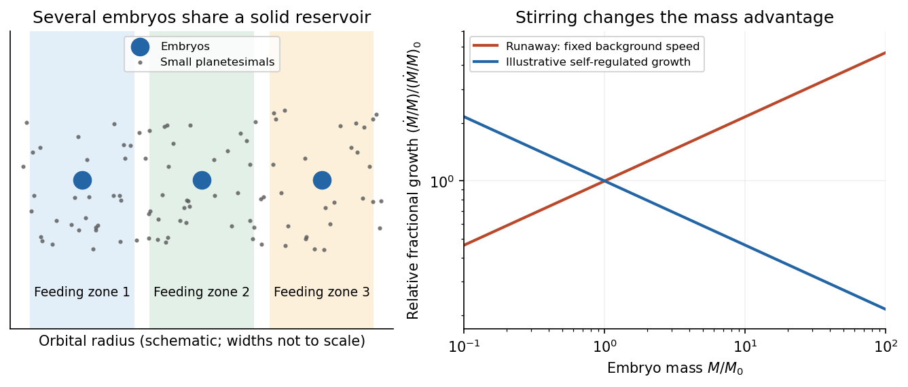

# Paper 1

↑ **Parent:** [2016](../2016.md)

[Original public PDF, physical pages 804–806; exam dated 19 April 2016](https://www.whatdotheyknow.com/request/natural_science_tripos_physics_e_2/response/2340776/attach/2/FOI%202023%20399%20Zahid%20materials.pdf?cookie_passthrough=1#page=804).

All three questions and all three alternatives in Question 3 are covered. Unlabelled requests in Questions 1 and 2 remain within their printed question headings.

**Table of contents**

- [1](#1)
  - [Solution](#1/solution)
- [2](#2)
  - [Solution](#2/solution)
- [3](#3)
  - [a](#3/a)
    - [Solution](#3/a/solution)
  - [b](#3/b)
    - [Solution](#3/b/solution)
  - [c](#3/c)
    - [Solution](#3/c/solution)

## 1

↑ **Parent:** [Paper 1](paper-1.md)

<h3 id="1/solution">Solution</h3>

↑ **Parent:** [1](#1)

Adopt [circular orbits](../../classical-mechanics.md#circular-orbit), negligible planetary [masses](../../classical-mechanics.md#mass), spherical bodies, uniform stellar brightness and no [transit dilution](../../exoplanet.md#transit-dilution). Interpret the measured duration as the [total duration of a circular planetary transit](../../exoplanet.md#total-duration-of-a-circular-planetary-transit), from first to fourth contact, $T_{14}$. These conventions matter especially for the off-centre crossing: finite planet size cannot automatically be ignored there. Unknown [orbital eccentricity](../../celestial-mechanics.md#orbital-eccentricity) or [limb darkening](../../radiometry.md#limb-darkening) would require further information to infer unique stellar [radii](../../topology.md#radius).

First convert the [apparent magnitude](../../astrophysics.md#apparent-magnitude) difference into a fractional [exoplanet transit depth](../../exoplanet.md#exoplanet-transit-depth), rather than treating a milli-magnitude as a part in a thousand:

$$
\delta=1-10^{-0.005/2.5}=0.00459458,\qquad
k\equiv\frac{R_p}{R_\star}=\sqrt\delta=0.0677834.
$$

Both crossings are non-grazing because their [transit impact parameters](../../exoplanet.md#transit-impact-parameter) satisfy $b<1-k$, so the full projected planetary disc can block the [star](../../stellar-astrophysics.md#star). Equal depths determine equal [radius](../../topology.md#radius) ratios, not equal absolute planet [radii](../../topology.md#radius).

For [orbital inclination](../../celestial-mechanics.md#orbital-inclination) $i$ measured from the sky plane, $b=(a/R_\star)\cos i$. Choosing mid-transit as orbital phase zero, the projected separation obeys

$$
\frac{z^2}{R_\star^2}=b^2+
\left[\left(\frac a{R_\star}\right)^2-b^2\right]\sin^2\left(\frac{2\pi t}{P}\right).
$$

At first and fourth contact, $z/R_\star=1+k$. The full crossing duration therefore is

$$
\boxed{T_{14}=\frac P\pi\arcsin\!\left[
\frac{\sqrt{(1+k)^2-b^2}}{\sqrt{(a/R_\star)^2-b^2}}
\right].}
$$

For the numerical scale use [solar radius](../../stellar-astrophysics.md#solar-radius) $R_\odot=6.957\times10^8\,\mathrm m$ and [nominal solar mass parameter](../../stellar-astrophysics.md#nominal-solar-mass-parameter) $(GM)_\odot=1.3271244\times10^{20}\,\mathrm{m^3\,s^{-2}}$, with one day equal to $86400\,\mathrm s$. These are stated conversion choices, not additional measurements of the two systems.[2015 resolution, printed p. 3, solar conversion constants](../../physics-bibliography.md#resolution-b3-on-recommended-nominal-conversion-constants-for-selected-solar-and-planetary-properties-by-international-astronomical-union)

[Kepler's third law](../../mathematical-physics.md#kepler-s-third-law) gives $a=[GM_\star P^2/(4\pi^2)]^{1/3}$. For a solar-mass, solar-radius host, this gives $a/R_\odot=12.3051$ at five days and $6.68023$ at two days. Substitution in the contact formula yields

$$
\boxed{T_{14,A,\odot}=3.32\,\mathrm h,\qquad
T_{14,B,\odot}=1.63\,\mathrm h.}
$$

The [transit duration of a small planet](../../exoplanet.md#transit-duration-of-a-small-planet) instead takes both $k\to0$ and $R_\star/a\ll1$, giving $T\simeq PR_\star\sqrt{1-b^2}/(\pi a)$. It predicts $3.10\,\mathrm h$ and $1.37\,\mathrm h$, respectively. The difference is appreciable for B because the fractional change in its crossing chord is larger. Durations defined by mid-ingress to mid-egress or by second to third contact should not be silently equated with $T_{14}$.

**[Figure 1](#1/image-finite-planet-size-lengthens-the-contact-to-contact-chord-particularly-off-centre). Finite planet size lengthens the contact-to-contact chord, particularly off centre**.

The original diagram uses a straight projected track to display the contact geometry; the duration formula above retains orbital curvature.

To infer the actual [stellar radii](../../stellar-astrophysics.md#stellar-radius), invert the contact formula before applying the supplied mass-radius scaling. Let $A=a/R_\star$ and $s=\sin(\pi T_{14}/P)$; then

$$
A=\left[b^2+\frac{(1+k)^2-b^2}{s^2}\right]^{1/2}.
$$

The measured durations imply $A_A=8.34661$ and $A_B=7.55743$. Normalize the stipulated constant mass-radius ratio to the [Sun](../../stellar-astrophysics.md#sun), so $M_\star/M_\odot=R_\star/R_\odot\equiv r_\star$. [Kepler's third law](../../mathematical-physics.md#kepler-s-third-law) then gives

$$
\frac a{R_\star}=A_\odot r_\star^{-2/3},\qquad
r_\star=\left(\frac{A_\odot}{A}\right)^{3/2}.
$$

Thus the [stellar radius from transit duration and a linear mass-radius relation](../../exoplanet.md#stellar-radius-from-transit-duration-and-a-linear-mass-radius-relation) is

$$
\boxed{R_A=1.79R_\odot,\qquad R_B=0.831R_\odot.}
$$

The same assumed scaling gives $M_A=1.79M_\odot$ and $M_B=0.831M_\odot$. A's longer crossing requires a lower mean stellar [mass density](../../fluid-mechanics.md#density), while B's shorter full-contact crossing requires a higher one. They are not both solar replicas under this model. Their planets have $R_{p,A}=0.1213R_\odot$ and $R_{p,B}=0.05633R_\odot$.

For a consistently applied point-planet approximation, the duration scales as $T\propto P^{1/3}r_\star^{2/3}\sqrt{1-b^2}$ and the inferred radii would instead be $R_A\simeq1.98R_\odot$, $R_B\simeq1.07R_\odot$. The latter is close to solar. Consequently the assertion of a substantial non-solar radius for B depends on which duration convention and finite-size approximation are intended. The contact-based values above use the measured depth rather than discarding it. If eccentric orbits are allowed, the transit speed introduces an additional factor depending on eccentricity and orientation, so the two durations alone cannot establish those radii uniquely.

For an outer coplanar [planet](../../planetary-science.md#planet) around B, the common [orbital inclination](../../celestial-mechanics.md#orbital-inclination) gives $b_2/b_B=a_2/a_B=(P_2/P_B)^{2/3}$. A point-planet centre must cross the stellar disc, requiring $b_2<1$. The usual [coplanar transit limit](../../exoplanet.md#coplanar-transit-limit) is therefore

$$
P_2<P_B b_B^{-3/2},\qquad
\boxed{P_{2,\rm lim}=2.80\,\mathrm{days}\quad\text{(point-planet geometry).}}
$$

This is a limiting value approached from below; a tangent path has no duration. For an outer planet of finite, unspecified [radius](../../topology.md#radius) ratio $k_2$, any overlap instead requires $b_2<1+k_2$, giving $P_2<P_B[(1+k_2)/b_B]^{3/2}$. If it had the same ratio $k_2=k$, that geometric limit would be $3.08$ days; requiring full overlap would give $2.52$ days. Because neither its [radius](../../topology.md#radius) nor a photometric detection threshold is supplied, no unique finite-size practical maximum period can be inferred beyond this conditional expression. The stellar radius cancels from the point-planet period-ratio bound.

For B's inner [planet](../../planetary-science.md#planet), a [reflected-light planetary phase curve](../../exoplanet.md#reflected-light-planetary-phase-curve) has

$$
\frac{F_p}{F_\star}=A_g\left(\frac{R_p}{a}\right)^2\Phi(\alpha),\qquad \Phi(0)=1,
$$

where $A_g$ is [geometric albedo](../../exoplanet.md#geometric-albedo) and $\alpha$ is [phase angle](../../planetary-science.md#phase-angle-astronomy). Near [exoplanet secondary eclipse](../../exoplanet.md#exoplanet-secondary-eclipse) the visible hemisphere is almost fully illuminated. Using the standard full-phase approximation and the contact-based $A_B$,

$$
\frac{F_p}{F_\star}\simeq0.5\left(\frac{k}{A_B}\right)^2
=4.0222\times10^{-5},\qquad
\boxed{\delta_{\rm occ}\simeq40.2\,\mathrm{ppm}.}
$$

The exact lost fraction of combined stellar and planetary light is $F_p/(F_\star+F_p)$, which changes the result negligibly at this contrast. The corresponding magnitude depth is about $0.0437$ milli-magnitudes. The [circular orbit](../../classical-mechanics.md#circular-orbit) has the same impact distance at eclipse as at transit, and $b_B<1-k$, so the [star](../../stellar-astrophysics.md#star) can hide the entire planetary disc.

The inclination inferred for B is $83.92^\circ$, putting closest approach to full phase at $\alpha\simeq6.08^\circ$. A fully precise prediction would therefore also require the reflected-light phase function, which the question does not specify; the boxed value uses $\Phi\simeq1$. The consistent point-planet duration approximation yields about $56.7\,\mathrm{ppm}$ instead, through its different inferred $a/R_B$. It is important to keep the geometry used for the radius inference and the reflected-light calculation consistent.

Finally, the [stellar radial-velocity semi-amplitude](../../exoplanet.md#stellar-radial-velocity-semi-amplitude) for a low-mass companion on a [circular orbit](../../classical-mechanics.md#circular-orbit) is

$$
K\simeq\left(\frac{2\pi G}{P}\right)^{1/3}
\frac{M_p\sin i}{M_\star^{2/3}}.
$$

The two stars' equal [apparent magnitudes](../../astrophysics.md#apparent-magnitude) make a comparison at similar photon statistics plausible, though spectral-line widths, stellar variability and observing cadence can still differ. With the contact-based stellar estimates,

$$
\frac{K_A}{K_B}=\frac{M_{p,A}}{M_{p,B}}
\left(\frac{P_B}{P_A}\right)^{1/3}
\left(\frac{M_B}{M_A}\right)^{2/3}
\frac{\sin i_A}{\sin i_B}
\simeq0.444\,\frac{M_{p,A}}{M_{p,B}}.
$$

**If the planets have comparable mean densities, A is easier:** their equal depth then gives $M_{p,A}/M_{p,B}\simeq(R_A/R_B)^3\simeq9.99$, so $K_A/K_B\simeq4.44$. The larger planetary [mass](../../classical-mechanics.md#mass) outweighs A's longer [orbital period](../../celestial-mechanics.md#orbital-period) and larger host [mass](../../classical-mechanics.md#mass). **For equal planetary masses, B is easier by a factor $2.25$ in amplitude.** The supplied transit data give planet radii, not masses, so the ranking is conditional on a planetary mass-radius assumption; a unique unconditional ranking would invent information.

## 2

↑ **Parent:** [Paper 1](paper-1.md)

<h3 id="2/solution">Solution</h3>

↑ **Parent:** [2](#2)

The principal feature is the abundance of planets with radii of roughly one to a few [Earth](../../planetary-science.md#earth) radii compared with large [gas giants](../../planetary-science.md#gas-giant) within the stated short-period sample. The smallest few plotted bins are of broadly similar height, followed by a substantial decline at larger sizes. Thus the figure supports **a high occurrence of small planets relative to giants**, rather than an indefinitely steep rise toward arbitrarily small sizes. The horizontal scale is logarithmic: one should compare counts in the displayed bins with their widths in $\ln R_p$, not mistake a bin count for a density per unit linear [radius](../../topology.md#radius).

The vertical axis is an average number of planets per target [star](../../stellar-astrophysics.md#star). This [exoplanet occurrence rate](../../exoplanet.md#exoplanet-occurrence-rate) need not equal the fraction of stars hosting a planet, because one star can host several. The restriction to periods below $85$ days also matters: the figure is not a census of distant [gas giants](../../planetary-science.md#gas-giant) or of every planet in a system. Neither the detailed reduction procedure nor the raw detection counts are specified in the caption, so they cannot be reconstructed uniquely from the histogram.

Selection effects actually make the small-planet population harder to see. A full, undiluted [exoplanet transit depth](../../exoplanet.md#exoplanet-transit-depth) is approximately $(R_p/R_\star)^2$. For independent photometric errors of fractional size $\sigma_f$ per sample, an idealized detection [signal-to-noise ratio](../../electrical-engineering.md#signal-to-noise-ratio) is

$$
\mathrm{SNR}\simeq\frac{(R_p/R_\star)^2}{\sigma_f}\sqrt{N_{\rm in}},
$$

where $N_{\rm in}$ counts in-transit samples. At fixed [star](../../stellar-astrophysics.md#star) and [orbital period](../../celestial-mechanics.md#orbital-period), halving planet [radius](../../topology.md#radius) reduces this amplitude by four. Fainter hosts, correlated stellar noise, gaps and transit vetting reduce [transit survey completeness](../../exoplanet.md#transit-survey-completeness) further. [Geometric transit probability](../../exoplanet.md#geometric-transit-probability) also falls with orbital distance, $p_{\rm tr}\simeq R_\star/a\propto P^{-2/3}$ for fixed stellar [mass](../../classical-mechanics.md#mass). For a fixed observing baseline and cadence, the small-planet circular duration law gives $N_{\rm in}\propto P^{-2/3}$ and approximately $\mathrm{SNR}\propto R_p^2P^{-1/3}$.

Recovering an intrinsic [exoplanet occurrence rate](../../exoplanet.md#exoplanet-occurrence-rate) therefore requires correcting for geometric alignments, incomplete recovery and false positives. An illustrative estimator for a radius-period bin is

$$
f_{\mathcal B}\simeq\frac1{N_\star}\sum_{j\in\mathcal B}
\frac{w_j}{p_{{\rm tr},j}C_j},
$$

where $C_j$ is the recovery probability over the relevant target sample and $w_j$ accounts for candidate reliability. Real analyses must average these probabilities over heterogeneous targets and measurement uncertainty; the formula indicates the required weights, not a reconstruction of the unpublished inputs to this figure. A primary [Kepler space telescope](../../physics.md#kepler-space-telescope) analysis explicitly models both false positives and incomplete detection to infer occurrence.[Sections V–VI: detection model and planet occurrence; Figure 7 distinguishes average number per star from hosting fraction](../../physics-bibliography.md#the-false-positive-rate-of-kepler-and-the-occurrence-of-planets-by-francois-fressin-and-others)

Thus the apparent preference for small planets cannot be explained by their being photometrically easier to detect. Small transits are harder. A plateau in occurrence below about twice Earth's size was independently reported using synthetic-transit injection and recovery, though that study used a different $5$–$50$-day selection and is not identified here as the source of the exam's plot.[Abstract: injection/recovery completeness, rise from large planets to about two Earth radii, plateau toward one Earth radius, and 5–50-day selection](../../physics-bibliography.md#a-plateau-in-the-planet-population-below-twice-the-size-of-earth-by-erik-a-petigura-and-others)

The natural physical framework is [core accretion](../../planetary-science.md#core-accretion) in a [protoplanetary disk](../../astrophysical-disk.md#protoplanetary-disk). Most initial disk [mass](../../classical-mechanics.md#mass) is gas, principally [hydrogen](../../chemical-substance.md#hydrogen) and [helium](../../chemical-substance.md#helium); a much smaller fraction is solid material. [Protoplanetary dust coagulation](../../planetary-science.md#protoplanetary-dust-coagulation) first assembles aggregates through low-speed sticking. Settling and differential [drag](../../fluid-mechanics.md#drag-physics) help concentrate solids, but bouncing, the [fragmentation barrier to dust growth](../../planetary-science.md#fragmentation-barrier-to-dust-growth) and [radial drift of solids in a gas disk](../../astrophysical-disk.md#radial-drift-of-solids-in-a-gas-disk) prevent a simple assumption that every collision grows a body smoothly to planetary size. Concentration in [dust traps](../../astrophysical-disk.md#dust-trap) or through [streaming instability](../../astrophysical-disk.md#streaming-instability), followed by gravitational collapse of a dense solid population, provides routes to [planetesimals](../../planetary-science.md#planetesimal). Subsequent collisions must dissipate sufficient relative [energy](../../energy.md) to bind material rather than disrupt it.

Once sufficiently large [planetesimals](../../planetary-science.md#planetesimal) exist, [gravitational focusing](../../classical-mechanics.md#gravitational-focusing) enhances their accretion cross-sections:

$$
\sigma_{\rm coll}\simeq\pi R^2\left(1+\frac{v_{\rm esc}^2}{v_{\rm rel}^2}\right),
\qquad v_{\rm esc}^2\simeq\frac{2GM}{R}.
$$

When background random velocities remain small, larger bodies grow disproportionately fast in [runaway planetesimal growth](../../planetary-science.md#runaway-planetesimal-growth). As they become massive enough to stir the surrounding population, [oligarchic growth](../../planetary-science.md#oligarchic-growth) develops: several [planetary embryos](../../planetary-science.md#planetary-embryo) occupy neighboring [feeding zones](../../planetary-science.md#feeding-zone-of-a-planetary-embryo), while much of the remaining solid material resides in smaller [planetesimals](../../planetary-science.md#planetesimal). Heating the planetesimal random motions weakens [gravitational focusing](../../classical-mechanics.md#gravitational-focusing), and local depletion drives the embryos toward an [isolation mass](../../planetary-science.md#isolation-mass). Collisions among embryos can continue assembly after gas dispersal.

This solid-building pathway naturally produces many modest cores. Producing a large [gas giant](../../planetary-science.md#gas-giant) requires an additional, time-sensitive step: a sufficiently massive core must acquire and cool a gaseous envelope while disk gas remains available. Gas captured by a low-mass core releases [gravitational potential energy](../../energy.md#gravitational-energy); the envelope's ability to radiate that energy governs its contraction and further accretion. A characteristic cooling estimate is

$$
t_{\rm cool}\sim\frac{|E_{\rm tot}|}{L_{\rm cool}},
$$

where $E_{\rm tot}$ includes the envelope’s gravitational and internal energies. This states an energy budget rather than a calibrated accretion timescale. Increasing core mass generally facilitates faster gas growth in the appropriate envelope regime. The [critical core mass for gas accretion](../../planetary-science.md#critical-core-mass-for-gas-accretion) depends on [opacity](../../stellar-structure.md#opacity), solid accretion heating and disk conditions; no one exact threshold follows from the histogram. If envelope cooling becomes rapid enough and gas supply persists, [runaway gas accretion](../../planetary-science.md#runaway-gas-accretion) can produce a giant. If core growth or cooling is too slow, [protoplanetary disk dispersal](../../astrophysical-disk.md#protoplanetary-disk-dispersal) removes the reservoir first, leaving a rocky core or a smaller planet with a limited envelope.

The [snow line](../../astrophysical-disk.md#snow-line) changes the supply of condensed solids: where water ice can survive, additional solid material can help cores grow. Its location depends on the evolving disk [temperature](../../temperature.md) and [pressure](../../pressure.md), so there is no universal orbital radius at which giants must form. Short-period planets need not have assembled entirely at their present locations. [Planetary migration](../../planetary-science.md#planetary-migration) can carry cores and giants inward; scattering and collisions can further reshape their [orbits](../../dynamical-systems.md#orbit-dynamical-system). [Pebble accretion](../../planetary-science.md#pebble-accretion) is another way to supply solids rapidly to embryos, but its efficiency depends on particle coupling and the available pebble flow. These processes alter the distribution without requiring every core to become a giant.

Radius also is not a linear proxy for [mass](../../classical-mechanics.md#mass). A relatively small [hydrogen](../../chemical-substance.md#hydrogen)-[helium](../../chemical-substance.md#helium) envelope can increase a planet's [radius](../../topology.md#radius) substantially, so some planets with a few [Earth](../../planetary-science.md#earth) radii need not be purely rocky. Contraction as planets cool and irradiation-driven [atmospheric escape](../../exoplanet.md#atmospheric-escape) can subsequently reduce their radii. Hence the final histogram combines solid growth, gas capture, migration and later thermal evolution. In particular, the smallest bins need not all share one composition or one formation location.

Direct fragmentation through [gravitational instability of an astrophysical disk](../../gravitational-instability-of-an-astrophysical-disk.md) is an alternative route to massive gaseous objects. It requires a sufficiently self-gravitating disk, described locally by [Toomre's stability criterion](../../gravitational-instability-of-an-astrophysical-disk.md#toomre-s-stability-criterion), together with sufficiently rapid cooling for bound fragments to survive. It does not naturally explain the dominant population of small close-in cores by itself, although migration or further evolution can change the locations of fragments. The observed abundance of small planets is therefore consistent with solid cores commonly forming while only a minority acquire a massive gas envelope before disk dispersal. It does not uniquely prove a particular prescription for each uncertain growth stage.

**The physical explanation is widespread core formation combined with restricted access to runaway gas accretion.** The strongest observational conclusion concerns small versus giant planets in the stated period range, after accounting for selection; the figure alone does not determine a universal core threshold, a unique mass distribution, or the population beyond the period cut.

## 3

↑ **Parent:** [Paper 1](paper-1.md)

<h3 id="3/a">a</h3>

↑ **Parent:** [3](#3)

<h4 id="3/a/solution">Solution</h4>

↑ **Parent:** [A](#3/a)

A [protoplanetary disk](../../astrophysical-disk.md#protoplanetary-disk) is a flattened, rotating reservoir of gas and solids around a young [star](../../stellar-astrophysics.md#star). Its radial [gravity](../../physics.md#gravity) is usually dominated by the host, making its rotation close to [Keplerian rotation](../../astrophysical-disk.md#keplerian-disk), $\Omega_K=(GM_\star/r^3)^{1/2}$. Gas [pressure](../../pressure.md) provides vertical support and a small radial correction to the orbital speed; it does not make the disk a nonrotating spherical atmosphere.

At height $|z|\ll r$, vertical [hydrostatic equilibrium](../../statistical-physics.md#hydrostatic-equilibrium) in the stellar gravitational field gives

$$
\frac{\partial P_g}{\partial z}=-\rho_g\Omega_K^2z.
$$

For a locally vertically isothermal [ideal gas](../../ideal-gas.md), $P_g=\rho_gc_s^2$ with $c_s^2=k_BT/(\mu m_H)$, where $\mu$ is [mean molecular weight](../../ideal-gas.md#mean-molecular-weight). Integration gives

$$
\boxed{\rho_g(r,z)=\frac{\Sigma_g(r)}{\sqrt{2\pi}H}
\exp\!\left(-\frac{z^2}{2H^2}\right),\qquad H=\frac{c_s}{\Omega_K}.}
$$

Here $\Sigma_g$ is the vertically integrated gas [surface density of a disk](../../astrophysical-disk.md#surface-density-of-a-disk), and $H$ is the isothermal [disk scale height](../../astrophysical-disk.md#disk-scale-height). The [disk aspect ratio](../../astrophysical-disk.md#disk-aspect-ratio) $H/r=c_s/v_K$ is small in a geometrically thin disk. For $T\propto r^{-q}$ it scales as $r^{(1-q)/2}$, so $q<1$ produces [disk flaring](../../astrophysical-disk.md#disk-flaring). This illustrative local vertical model does not determine a unique radial surface-density law or temperature normalization from the information given.

**[Figure 2](#3/a/image-gas-settled-solids-and-condensation-fronts-in-an-original-schematic-protoplanetary-disk). Gas, settled solids and condensation fronts in an original schematic protoplanetary disk**.

The gas is predominantly molecular [hydrogen](../../chemical-substance.md#hydrogen) and [helium](../../chemical-substance.md#helium). A much smaller component consists of heavier elements, partitioned between vapor, solid refractory grains and condensed volatile ices. A gas-to-solid mass ratio of order $100$ is a common initial fiducial model, not a universal measurement applying at every disk radius or evolutionary stage. Solids can grow and settle while gas accretes or disperses, changing the local ratio substantially.[2007 v1, Section II.D, condensation sequence; Section III.A, settling and the fiducial global gas-to-solid ratio](../../physics-bibliography.md#lecture-notes-on-the-formation-and-early-evolution-of-planetary-systems-by-philip-j-armitage)

Thermal structure organizes composition. In the hottest inner region, grains can sublimate and much of their material remains in the gas. Refractory [silicate minerals](../../planetary-science.md#silicate-mineral) and metallic grains survive at lower temperatures; farther out, water and then other sufficiently volatile species can condense when their local condensation conditions are met. The water [snow line](../../astrophysical-disk.md#snow-line) can raise the solid inventory available to [planet formation](../../planetary-science.md#planet-formation). Its location depends on stellar irradiation, accretion heating, [opacity](../../stellar-structure.md#opacity) and gas [pressure](../../pressure.md), and evolves with time; it is not fixed merely by naming a star or adopting a solar-system distance.

Stellar radiation heats the exposed surface of a passive disk. Beneath it, shielding can leave a cooler, molecule-rich interior with a higher [mass density](../../fluid-mechanics.md#density). In the inner actively accreting disk, dissipation can instead make the optically thick midplane the hottest region. These are distinct heating regimes; a vertically isothermal profile is an analytic approximation rather than a claim that every real layer has the same [temperature](../../temperature.md). Dust [opacity](../../stellar-structure.md#opacity) controls how radiation is absorbed and re-emitted. Infrared and millimetre emission probe solid material, while [spectral lines](../../stellar-astrophysics.md#spectral-line) probe gas; neither observable alone supplies a model-free inventory of the whole disk.

[Dust settling in an astrophysical disk](../../astrophysical-disk.md#dust-settling-in-an-astrophysical-disk) makes larger, less tightly coupled particles more concentrated toward the midplane, while turbulence and mixing oppose that settling. For an [aerodynamic stopping time](../../fluid-mechanics.md#aerodynamic-stopping-time) $t_s$ short compared with $\Omega_K^{-1}$, terminal vertical balance gives $v_z\simeq-\Omega_K^2t_sz$. Small grains remain better coupled to the gas. Radial [drift](../../stochastic-calculus.md#drift-coefficient) also changes the distribution of solids and their access to [snow lines](../../astrophysical-disk.md#snow-line) and embryos.

The disk evolves through [accretion](../../astrophysics.md#accretion) and [angular momentum transport](../../momentum.md#angular-momentum-transport), potentially involving turbulent stresses, [magnetorotational instability](../../astrophysical-disk.md#magnetorotational-instability) or magnetically driven winds where conditions permit. [Protoplanetary disk dispersal](../../astrophysical-disk.md#protoplanetary-disk-dispersal) eventually removes gas through accretion and mass loss, including [photoevaporation](../../astrophysics.md#photoevaporation). In standard evolutionary pictures this occurs on a scale of a few million years, with substantial system-to-system variation. That finite reservoir lifetime is central to whether an embryo acquires a massive gaseous envelope.[2007 v1, Section II.C.6, disk dispersal and accretion/photoevaporation timescale comparison](../../physics-bibliography.md#lecture-notes-on-the-formation-and-early-evolution-of-planetary-systems-by-philip-j-armitage)

**The essential structure is a nearly Keplerian gas disk with vertical pressure support, radial and vertical thermal gradients, and an evolving solid population concentrated by settling, growth and drift.** Its composition is set jointly by the original elemental inventory, local condensation conditions and transport.

<h3 id="3/b">b</h3>

↑ **Parent:** [3](#3)

<h4 id="3/b/solution">Solution</h4>

↑ **Parent:** [B](#3/b)

[Sub-Keplerian rotation](../../astrophysical-disk.md#sub-keplerian-rotation) means that the gas rotates more slowly than a pressure-free particle on a [circular orbit](../../classical-mechanics.md#circular-orbit) at the same cylindrical radius. Let $v_K=(GM_\star/r)^{1/2}$. Neglecting radial acceleration, radial [force](../../force.md) balance in the gas is

$$
\frac{v_{g\phi}^2}{r}=\frac{GM_\star}{r^2}
+\frac1{\rho_g}\frac{dP_g}{dr}.
$$

An outwardly decreasing [pressure](../../pressure.md), $dP_g/dr<0$, supplies part of the inward-gravity balance through an outward pressure force. Less centrifugal support is needed, so $v_{g\phi}<v_K$. Using $c_s^2=P_g/\rho_g$, define the [pressure-gradient parameter of a protoplanetary disk](../../astrophysical-disk.md#pressure-gradient-parameter-of-a-protoplanetary-disk) by

$$
\eta\equiv-\frac{r}{2\rho_gv_K^2}\frac{dP_g}{dr}
=-\frac12\left(\frac{c_s}{v_K}\right)^2\frac{d\ln P_g}{d\ln r}.
$$

Then

$$
\boxed{v_{g\phi}=v_K\sqrt{1-2\eta}\simeq v_K(1-\eta).}
$$

For a thin disk and a smooth radial pressure profile, $\eta$ is small, of order $(H/r)^2$. The factor of two is part of this explicit convention; changing the convention for $\eta$ changes the drift formula correspondingly.

A solid particle feels essentially no continuum gas-pressure support. Left alone, it would orbit at $v_K$, so in the gas it feels a headwind. [Drag](../../fluid-mechanics.md#drag-physics) removes [angular momentum](../../momentum.md#angular-momentum), causing [radial drift of solids in a gas disk](../../astrophysical-disk.md#radial-drift-of-solids-in-a-gas-disk). Define [Stokes number](../../fluid-mechanics.md#stokes-number) $\mathrm{St}=\Omega_Kt_s$ using the [aerodynamic stopping time](../../fluid-mechanics.md#aerodynamic-stopping-time) $t_s$. In a dilute test-particle limit with linear drag, negligible radial gas flow and small departures from a circular Keplerian orbit, let $u_\phi=v_{p\phi}-v_K$. The steady local radial and azimuthal balances are

$$
0=2\Omega_Ku_\phi-\frac{v_{pr}}{t_s},\qquad
0=-\frac{\Omega_Kv_{pr}}2-\frac{u_\phi+\eta v_K}{t_s}.
$$

Solving gives

$$
\boxed{v_{pr}=-\frac{2\eta v_K\mathrm{St}}{1+\mathrm{St}^2},\qquad
v_{p\phi}-v_K=-\frac{\eta v_K}{1+\mathrm{St}^2}.}
$$

The sign is inward for the usual negative pressure gradient. Very small particles, $\mathrm{St}\ll1$, closely follow the gas and have a small relative drift $v_{pr}\simeq-2\eta v_K\mathrm{St}$. Very weakly coupled large bodies, $\mathrm{St}\gg1$, also drift slowly, with $v_{pr}\simeq-2\eta v_K/\mathrm{St}$. **The fastest pressure-driven inward drift occurs at $\mathrm{St}=1$, where $|v_{pr}|=\eta v_K$.** The corresponding physical grain or aggregate size depends on gas density, orbital radius and the drag regime; “metre-size barrier” is a conventional description of some disk models, not a universal size.

**[Figure 3](#3/b/image-pressure-support-creates-a-headwind-with-maximum-inward-solid-drift-at-unit-stokes-number). Pressure support creates a headwind, with maximum inward solid drift at unit Stokes number**.

The drift timescale in this model is

$$
t_{\rm drift}=\frac r{|v_{pr}|}
=\frac{1+\mathrm{St}^2}{2\eta\Omega_K\mathrm{St}}.
$$

It can be much shorter than the disk gas lifetime, threatening loss of the material needed to make [planetesimals](../../planetary-science.md#planetesimal). Growth through the vulnerable coupling range must compete with this loss, while differential drift generates collisions that may stick, bounce or fragment. Radial redistribution also changes solid-to-gas ratios and moves material across condensation fronts. These are consequences for [planet formation](../../planetary-science.md#planet-formation), rather than merely a small correction to an orbital frequency.

The same mechanism can help concentrate solids. At a local radial pressure maximum, $dP_g/dr=0$, so this component of drift vanishes. On the inside, a positive pressure gradient gives outward drift; on the outside, a negative gradient gives inward drift. Particles therefore converge toward a [dust trap](../../astrophysical-disk.md#dust-trap). Turbulent diffusion and inward gas advection can limit retention. With a nonzero radial gas speed $v_{gr}$, the test-particle result generalizes to $v_{pr}=[v_{gr}-2\eta v_K\mathrm{St}]/(1+\mathrm{St}^2)$, so gas advection need not vanish even at a pressure maximum.

Finally, if local solid loading becomes large, backreaction on the gas can no longer be neglected. Coupled gas-particle drift can support [streaming instability](../../astrophysical-disk.md#streaming-instability) and strong solid concentrations, potentially enabling gravitational collapse into [planetesimals](../../planetary-science.md#planetesimal). The simple test-particle drift formula is a useful starting point, but not a description of that nonlinear high-loading regime. **Pressure support creates both a drift obstacle to growth and opportunities for concentration where the pressure structure changes.**

<h3 id="3/c">c</h3>

↑ **Parent:** [3](#3)

<h4 id="3/c/solution">Solution</h4>

↑ **Parent:** [C](#3/c)

[Oligarchic growth](../../planetary-science.md#oligarchic-growth) is the stage in which a relatively small number of [planetary embryos](../../planetary-science.md#planetary-embryo) dominate the dynamics of many smaller [planetesimals](../../planetary-science.md#planetesimal). It follows [runaway planetesimal growth](../../planetary-science.md#runaway-planetesimal-growth). The embryos remain separated, grow to broadly comparable masses within similar local disk conditions, and regulate their accretion by stirring the population that supplies their material. The primary numerical study describes this embryo–planetesimal structure and typical separations of about ten individual [Hill radii](../../celestial-mechanics.md#hill-radius).[1998, abstract: three-dimensional simulations, self-regulated comparable-mass protoplanets and typical orbital separation](../../physics-bibliography.md#oligarchic-growth-of-protoplanets-by-eiichiro-kokubo-and-shigeru-ida)

The key feedback is [gravitational focusing](../../classical-mechanics.md#gravitational-focusing). In a dispersion-dominated encounter with approach speed $v$ and a small impactor, [conservation of energy](../../mathematical-physics.md#conservation-of-energy) and [conservation of angular momentum](../../momentum.md#conservation-of-angular-momentum) give the collision cross-section

$$
\sigma_{\rm coll}\simeq\pi R^2\left(1+\frac{v_{\rm esc}^2}{v^2}\right),
\qquad v_{\rm esc}^2\simeq\frac{2GM}{R}.
$$

At fixed internal [mass density](../../fluid-mechanics.md#density), $R\propto M^{1/3}$ and $v_{\rm esc}^2\propto M^{2/3}$. If the background random speed initially is controlled by small planetesimals and varies little with embryo [mass](../../classical-mechanics.md#mass), strong focusing gives $\sigma_{\rm coll}\propto M^{4/3}$. For a disk with planetesimal thickness of order $v_z/\Omega_K$ and a fixed ratio $v/v_z$, the associated estimate is

$$
\dot M\sim\Sigma_s\Omega_KR^2
\left(1+\frac{v_{\rm esc}^2}{v^2}\right),
$$

up to geometric factors. With nearly fixed $v$, this gives $\dot M\propto M^{4/3}$ and $\dot M/M\propto M^{1/3}$: the largest bodies have the shortest fractional growth times, the essence of runaway growth.

As embryos grow, their gravitational encounters increasingly excite the random eccentricities and inclinations of nearby [planetesimals](../../planetary-science.md#planetesimal). This is [viscous stirring of planetesimals](../../planetary-science.md#viscous-stirring-of-planetesimals), not molecular fluid viscosity. Higher encounter speeds lower the focusing factor. The largest local embryo heats its feeding population most strongly and thereby suppresses its own relative growth advantage. Gas [drag](../../fluid-mechanics.md#drag-physics) and dissipative collisions oppose stirring; [dynamical friction](../../planetary-science.md#dynamical-friction) tends to keep the more massive embryos' random motions relatively small while transferring random energy to lighter bodies. The balance between these processes controls the accretion rate.

For an illustrative self-regulated scaling $v\propto M^{1/3}$, the ratio $v_{\rm esc}/v$ is approximately fixed. The previous growth estimate becomes

$$
\dot M\propto M^{2/3},\qquad
\boxed{\frac{\dot M}{M}\propto M^{-1/3},\quad
 t_{\rm grow}=\frac M{\dot M}\propto M^{1/3}.}
$$

Larger embryos now grow more slowly in fractional terms, allowing neighboring embryos in comparable environments to approach similar masses. This scaling illustrates the feedback; it is not a universal exact exponent for every planetesimal size distribution, damping law or disk surface-density profile. In particular, a two-body focusing cross-section must be modified in the shear-dominated regime, where encounters are governed by the stellar tidal field.

The relevant gravitational interaction scale is the [Hill radius](../../celestial-mechanics.md#hill-radius),

$$
R_H=a\left(\frac{M}{3M_\star}\right)^{1/3},\qquad v_H=\Omega_KR_H.
$$

Close embryo encounters and orbital repulsion keep adjacent embryos separated by several Hill-scale lengths. The [mutual Hill radius](../../celestial-mechanics.md#mutual-hill-radius) uses their combined [mass](../../classical-mechanics.md#mass); for equal neighboring masses it is $2^{1/3}R_H$. Stating which definition is used matters when quoting a spacing coefficient. The spacing is a dynamical scale, not an exact universal integer.

**[Figure 4](#3/c/image-neighboring-feeding-zones-and-the-change-from-runaway-to-self-regulated-fractional-growth). Neighboring feeding zones and the change from runaway to self-regulated fractional growth**.

Each [feeding zone of a planetary embryo](../../planetary-science.md#feeding-zone-of-a-planetary-embryo) contains a finite solid reservoir. To estimate its [isolation mass](../../planetary-science.md#isolation-mass), let the full annular width be $\Delta a=B R_H$, where the dimensionless coefficient $B$ includes the stated choice of width and Hill-radius convention. For local solid [surface density](../../astrophysical-disk.md#surface-density-of-a-disk) $\Sigma_s$,

$$
M_{\rm iso}\simeq2\pi a\Delta a\Sigma_s
=2\pi B a^2\Sigma_s
\left(\frac{M_{\rm iso}}{3M_\star}\right)^{1/3}.
$$

Solving gives

$$
\boxed{M_{\rm iso}=\frac{(2\pi B a^2\Sigma_s)^{3/2}}
{(3M_\star)^{1/2}}.}
$$

Thus denser solid disks and wider feeding annuli allow larger embryos. If $\Sigma_s\propto a^{-p}$, the estimate scales as $M_{\rm iso}\propto a^{3-3p/2}$ at fixed host mass and $B$. This is a local exhaustion estimate, not an absolute maximum planet mass: radial delivery of solids, [pebble accretion](../../planetary-science.md#pebble-accretion), migration and embryo mergers can replenish or enlarge a feeding zone. No solid surface-density normalization is given, so a numerical isolation mass would require an invented disk model.

As the local supply is depleted, growth slows further. After gas damping weakens, embryo orbits may cross and giant collisions can assemble larger [terrestrial planets](../../planetary-science.md#terrestrial-planet). Farther out, sufficiently massive cores may instead acquire gas before [protoplanetary disk dispersal](../../astrophysical-disk.md#protoplanetary-disk-dispersal). **Oligarchic growth explains why a few comparable embryos share a disk while many smaller planetesimals remain: gravitational stirring weakens focusing and makes accretion self-regulating.**

## ↑ Ancestors (11)

1. [2016](../2016.md)
2. [Past exam of the exoplanets and Planetary Systems course of the University of Cambridge](../../past-exam-of-the-exoplanets-and-planetary-systems-course-of-the-university-of-cambridge.md)
3. [Exoplanets and Planetary Systems course of the University of Cambridge](../../university-of-cambridge.md#exoplanets-and-planetary-systems-course-of-the-university-of-cambridge)
4. [Physics course of the year 4 of the natural sciences course of the University of Cambridge](../../university-of-cambridge.md#physics-course-of-the-year-4-of-the-natural-sciences-course-of-the-university-of-cambridge)
5. [Year 4 of the natural sciences course of the University of Cambridge](../../university-of-cambridge.md#year-4-of-the-natural-sciences-course-of-the-university-of-cambridge)
6. [Year of the natural sciences course of the University of Cambridge](../../university-of-cambridge.md#year-of-the-natural-sciences-course-of-the-university-of-cambridge)
7. [Natural sciences course of the University of Cambridge](../../university-of-cambridge.md#natural-sciences-course-of-the-university-of-cambridge)
8. [Course of the University of Cambridge](../../university-of-cambridge.md#course-of-the-university-of-cambridge)
9. [University of Cambridge](../../university-of-cambridge.md)
10. [List of universities](../../README.md#list-of-universities)
11. [Codex Wiki](../../README.md)
