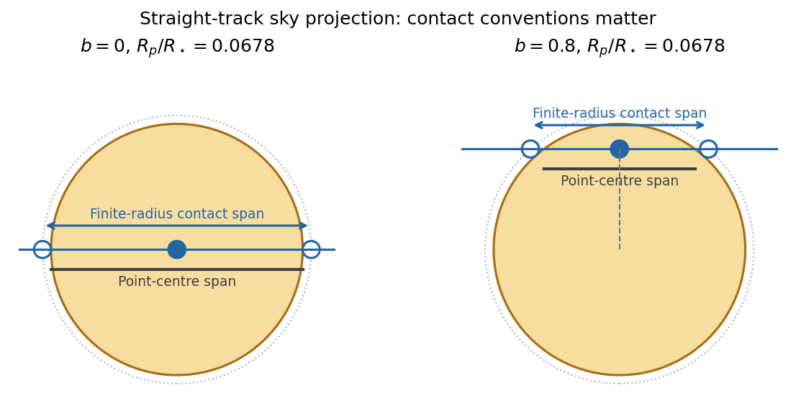

<h1 id="1/solution">Solution</h1>

↑ **Parent:** [1](../1.md)

Adopt [circular orbits](../../../../circular-orbit.md), negligible planetary [masses](../../../../mass.md), spherical bodies, uniform stellar brightness and no [transit dilution](../../../../transit-dilution.md). Interpret the measured duration as the [total duration of a circular planetary transit](../../../../total-duration-of-a-circular-planetary-transit.md), from first to fourth contact, $T_{14}$. These conventions matter especially for the off-centre crossing: finite planet size cannot automatically be ignored there. Unknown [orbital eccentricity](../../../../orbital-eccentricity.md) or [limb darkening](../../../../limb-darkening.md) would require further information to infer unique stellar [radii](../../../../radius.md).

First convert the [apparent magnitude](../../../../apparent-magnitude.md) difference into a fractional [exoplanet transit depth](../../../../exoplanet-transit-depth.md), rather than treating a milli-magnitude as a part in a thousand:

$$
\delta=1-10^{-0.005/2.5}=0.00459458,\qquad
k\equiv\frac{R_p}{R_\star}=\sqrt\delta=0.0677834.
$$

Both crossings are non-grazing because their [transit impact parameters](../../../../transit-impact-parameter.md) satisfy $b<1-k$, so the full projected planetary disc can block the [star](../../../../star.md). Equal depths determine equal [radius](../../../../radius.md) ratios, not equal absolute planet [radii](../../../../radius.md).

For [orbital inclination](../../../../orbital-inclination.md) $i$ measured from the sky plane, $b=(a/R_\star)\cos i$. Choosing mid-transit as orbital phase zero, the projected separation obeys

$$
\frac{z^2}{R_\star^2}=b^2+
\left[\left(\frac a{R_\star}\right)^2-b^2\right]\sin^2\left(\frac{2\pi t}{P}\right).
$$

At first and fourth contact, $z/R_\star=1+k$. The full crossing duration therefore is

$$
\boxed{T_{14}=\frac P\pi\arcsin\!\left[
\frac{\sqrt{(1+k)^2-b^2}}{\sqrt{(a/R_\star)^2-b^2}}
\right].}
$$

For the numerical scale use [solar radius](../../../../solar-radius.md) $R_\odot=6.957\times10^8\,\mathrm m$ and [nominal solar mass parameter](../../../../nominal-solar-mass-parameter.md) $(GM)_\odot=1.3271244\times10^{20}\,\mathrm{m^3\,s^{-2}}$, with one day equal to $86400\,\mathrm s$. These are stated conversion choices, not additional measurements of the two systems.[2015 resolution, printed p. 3, solar conversion constants](../../../../resolution-b3-on-recommended-nominal-conversion-constants-for-selected-solar-and-planetary-properties-by-international-astronomical-union.md)

[Kepler's third law](../../../../kepler-s-third-law.md) gives $a=[GM_\star P^2/(4\pi^2)]^{1/3}$. For a solar-mass, solar-radius host, this gives $a/R_\odot=12.3051$ at five days and $6.68023$ at two days. Substitution in the contact formula yields

$$
\boxed{T_{14,A,\odot}=3.32\,\mathrm h,\qquad
T_{14,B,\odot}=1.63\,\mathrm h.}
$$

The [transit duration of a small planet](../../../../transit-duration-of-a-small-planet.md) instead takes both $k\to0$ and $R_\star/a\ll1$, giving $T\simeq PR_\star\sqrt{1-b^2}/(\pi a)$. It predicts $3.10\,\mathrm h$ and $1.37\,\mathrm h$, respectively. The difference is appreciable for B because the fractional change in its crossing chord is larger. Durations defined by mid-ingress to mid-egress or by second to third contact should not be silently equated with $T_{14}$.

**[Figure 1](#1/image-finite-planet-size-lengthens-the-contact-to-contact-chord-particularly-off-centre). Finite planet size lengthens the contact-to-contact chord, particularly off centre**.

The original diagram uses a straight projected track to display the contact geometry; the duration formula above retains orbital curvature.

To infer the actual [stellar radii](../../../../stellar-radius.md), invert the contact formula before applying the supplied mass-radius scaling. Let $A=a/R_\star$ and $s=\sin(\pi T_{14}/P)$; then

$$
A=\left[b^2+\frac{(1+k)^2-b^2}{s^2}\right]^{1/2}.
$$

The measured durations imply $A_A=8.34661$ and $A_B=7.55743$. Normalize the stipulated constant mass-radius ratio to the [Sun](../../../../sun.md), so $M_\star/M_\odot=R_\star/R_\odot\equiv r_\star$. [Kepler's third law](../../../../kepler-s-third-law.md) then gives

$$
\frac a{R_\star}=A_\odot r_\star^{-2/3},\qquad
r_\star=\left(\frac{A_\odot}{A}\right)^{3/2}.
$$

Thus the [stellar radius from transit duration and a linear mass-radius relation](../../../../stellar-radius-from-transit-duration-and-a-linear-mass-radius-relation.md) is

$$
\boxed{R_A=1.79R_\odot,\qquad R_B=0.831R_\odot.}
$$

The same assumed scaling gives $M_A=1.79M_\odot$ and $M_B=0.831M_\odot$. A's longer crossing requires a lower mean stellar [mass density](../../../../density.md), while B's shorter full-contact crossing requires a higher one. They are not both solar replicas under this model. Their planets have $R_{p,A}=0.1213R_\odot$ and $R_{p,B}=0.05633R_\odot$.

For a consistently applied point-planet approximation, the duration scales as $T\propto P^{1/3}r_\star^{2/3}\sqrt{1-b^2}$ and the inferred radii would instead be $R_A\simeq1.98R_\odot$, $R_B\simeq1.07R_\odot$. The latter is close to solar. Consequently the assertion of a substantial non-solar radius for B depends on which duration convention and finite-size approximation are intended. The contact-based values above use the measured depth rather than discarding it. If eccentric orbits are allowed, the transit speed introduces an additional factor depending on eccentricity and orientation, so the two durations alone cannot establish those radii uniquely.

For an outer coplanar [planet](../../../../planet.md) around B, the common [orbital inclination](../../../../orbital-inclination.md) gives $b_2/b_B=a_2/a_B=(P_2/P_B)^{2/3}$. A point-planet centre must cross the stellar disc, requiring $b_2<1$. The usual [coplanar transit limit](../../../../coplanar-transit-limit.md) is therefore

$$
P_2<P_B b_B^{-3/2},\qquad
\boxed{P_{2,\rm lim}=2.80\,\mathrm{days}\quad\text{(point-planet geometry).}}
$$

This is a limiting value approached from below; a tangent path has no duration. For an outer planet of finite, unspecified [radius](../../../../radius.md) ratio $k_2$, any overlap instead requires $b_2<1+k_2$, giving $P_2<P_B[(1+k_2)/b_B]^{3/2}$. If it had the same ratio $k_2=k$, that geometric limit would be $3.08$ days; requiring full overlap would give $2.52$ days. Because neither its [radius](../../../../radius.md) nor a photometric detection threshold is supplied, no unique finite-size practical maximum period can be inferred beyond this conditional expression. The stellar radius cancels from the point-planet period-ratio bound.

For B's inner [planet](../../../../planet.md), a [reflected-light planetary phase curve](../../../../reflected-light-planetary-phase-curve.md) has

$$
\frac{F_p}{F_\star}=A_g\left(\frac{R_p}{a}\right)^2\Phi(\alpha),\qquad \Phi(0)=1,
$$

where $A_g$ is [geometric albedo](../../../../geometric-albedo.md) and $\alpha$ is [phase angle](../../../../phase-angle-astronomy.md). Near [exoplanet secondary eclipse](../../../../exoplanet-secondary-eclipse.md) the visible hemisphere is almost fully illuminated. Using the standard full-phase approximation and the contact-based $A_B$,

$$
\frac{F_p}{F_\star}\simeq0.5\left(\frac{k}{A_B}\right)^2
=4.0222\times10^{-5},\qquad
\boxed{\delta_{\rm occ}\simeq40.2\,\mathrm{ppm}.}
$$

The exact lost fraction of combined stellar and planetary light is $F_p/(F_\star+F_p)$, which changes the result negligibly at this contrast. The corresponding magnitude depth is about $0.0437$ milli-magnitudes. The [circular orbit](../../../../circular-orbit.md) has the same impact distance at eclipse as at transit, and $b_B<1-k$, so the [star](../../../../star.md) can hide the entire planetary disc.

The inclination inferred for B is $83.92^\circ$, putting closest approach to full phase at $\alpha\simeq6.08^\circ$. A fully precise prediction would therefore also require the reflected-light phase function, which the question does not specify; the boxed value uses $\Phi\simeq1$. The consistent point-planet duration approximation yields about $56.7\,\mathrm{ppm}$ instead, through its different inferred $a/R_B$. It is important to keep the geometry used for the radius inference and the reflected-light calculation consistent.

Finally, the [stellar radial-velocity semi-amplitude](../../../../stellar-radial-velocity-semi-amplitude.md) for a low-mass companion on a [circular orbit](../../../../circular-orbit.md) is

$$
K\simeq\left(\frac{2\pi G}{P}\right)^{1/3}
\frac{M_p\sin i}{M_\star^{2/3}}.
$$

The two stars' equal [apparent magnitudes](../../../../apparent-magnitude.md) make a comparison at similar photon statistics plausible, though spectral-line widths, stellar variability and observing cadence can still differ. With the contact-based stellar estimates,

$$
\frac{K_A}{K_B}=\frac{M_{p,A}}{M_{p,B}}
\left(\frac{P_B}{P_A}\right)^{1/3}
\left(\frac{M_B}{M_A}\right)^{2/3}
\frac{\sin i_A}{\sin i_B}
\simeq0.444\,\frac{M_{p,A}}{M_{p,B}}.
$$

**If the planets have comparable mean densities, A is easier:** their equal depth then gives $M_{p,A}/M_{p,B}\simeq(R_A/R_B)^3\simeq9.99$, so $K_A/K_B\simeq4.44$. The larger planetary [mass](../../../../mass.md) outweighs A's longer [orbital period](../../../../orbital-period.md) and larger host [mass](../../../../mass.md). **For equal planetary masses, B is easier by a factor $2.25$ in amplitude.** The supplied transit data give planet radii, not masses, so the ranking is conditional on a planetary mass-radius assumption; a unique unconditional ranking would invent information.

## ↑ Ancestors (13)

1. [1](../1.md)
2. [Paper 1](../../paper-1-split.md)
3. [2016](../../split.md)
4. [Past exam of the exoplanets and Planetary Systems course of the University of Cambridge](../../../split.md)
5. [Exoplanets and Planetary Systems course of the University of Cambridge](../../../../exoplanets-and-planetary-systems-course-of-the-university-of-cambridge.md)
6. [Physics course of the year 4 of the natural sciences course of the University of Cambridge](../../../../physics-course-of-the-year-4-of-the-natural-sciences-course-of-the-university-of-cambridge.md)
7. [Year 4 of the natural sciences course of the University of Cambridge](../../../../year-4-of-the-natural-sciences-course-of-the-university-of-cambridge.md)
8. [Year of the natural sciences course of the University of Cambridge](../../../../year-of-the-natural-sciences-course-of-the-university-of-cambridge.md)
9. [Natural sciences course of the University of Cambridge](../../../../natural-sciences-course-of-the-university-of-cambridge.md)
10. [Course of the University of Cambridge](../../../../course-of-the-university-of-cambridge.md)
11. [University of Cambridge](../../../../university-of-cambridge-split.md)
12. [List of universities](../../../../list-of-universities.md)
13. [Codex Wiki](../../../../split.md)
