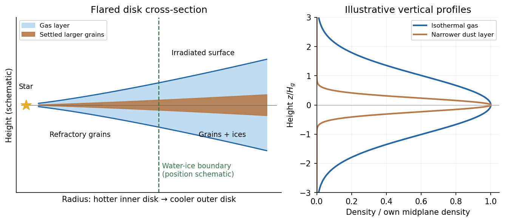

<h1 id="3/a/solution">Solution</h1>

↑ **Parent:** [A](../a.md)

A [protoplanetary disk](../../../../../protoplanetary-disk.md) is a flattened, rotating reservoir of gas and solids around a young [star](../../../../../star.md). Its radial [gravity](../../../../../gravity.md) is usually dominated by the host, making its rotation close to [Keplerian rotation](../../../../../keplerian-disk.md), $\Omega_K=(GM_\star/r^3)^{1/2}$. Gas [pressure](../../../../../pressure-split.md) provides vertical support and a small radial correction to the orbital speed; it does not make the disk a nonrotating spherical atmosphere.

At height $|z|\ll r$, vertical [hydrostatic equilibrium](../../../../../hydrostatic-equilibrium.md) in the stellar gravitational field gives

$$
\frac{\partial P_g}{\partial z}=-\rho_g\Omega_K^2z.
$$

For a locally vertically isothermal [ideal gas](../../../../../ideal-gas-split.md), $P_g=\rho_gc_s^2$ with $c_s^2=k_BT/(\mu m_H)$, where $\mu$ is [mean molecular weight](../../../../../mean-molecular-weight.md). Integration gives

$$
\boxed{\rho_g(r,z)=\frac{\Sigma_g(r)}{\sqrt{2\pi}H}
\exp\!\left(-\frac{z^2}{2H^2}\right),\qquad H=\frac{c_s}{\Omega_K}.}
$$

Here $\Sigma_g$ is the vertically integrated gas [surface density of a disk](../../../../../surface-density-of-a-disk.md), and $H$ is the isothermal [disk scale height](../../../../../disk-scale-height.md). The [disk aspect ratio](../../../../../disk-aspect-ratio.md) $H/r=c_s/v_K$ is small in a geometrically thin disk. For $T\propto r^{-q}$ it scales as $r^{(1-q)/2}$, so $q<1$ produces [disk flaring](../../../../../disk-flaring.md). This illustrative local vertical model does not determine a unique radial surface-density law or temperature normalization from the information given.

**[Figure 2](#3/a/image-gas-settled-solids-and-condensation-fronts-in-an-original-schematic-protoplanetary-disk). Gas, settled solids and condensation fronts in an original schematic protoplanetary disk**.

The gas is predominantly molecular [hydrogen](../../../../../hydrogen.md) and [helium](../../../../../helium.md). A much smaller component consists of heavier elements, partitioned between vapor, solid refractory grains and condensed volatile ices. A gas-to-solid mass ratio of order $100$ is a common initial fiducial model, not a universal measurement applying at every disk radius or evolutionary stage. Solids can grow and settle while gas accretes or disperses, changing the local ratio substantially.[2007 v1, Section II.D, condensation sequence; Section III.A, settling and the fiducial global gas-to-solid ratio](../../../../../lecture-notes-on-the-formation-and-early-evolution-of-planetary-systems-by-philip-j-armitage.md)

Thermal structure organizes composition. In the hottest inner region, grains can sublimate and much of their material remains in the gas. Refractory [silicate minerals](../../../../../silicate-mineral.md) and metallic grains survive at lower temperatures; farther out, water and then other sufficiently volatile species can condense when their local condensation conditions are met. The water [snow line](../../../../../snow-line.md) can raise the solid inventory available to [planet formation](../../../../../planet-formation.md). Its location depends on stellar irradiation, accretion heating, [opacity](../../../../../opacity.md) and gas [pressure](../../../../../pressure-split.md), and evolves with time; it is not fixed merely by naming a star or adopting a solar-system distance.

Stellar radiation heats the exposed surface of a passive disk. Beneath it, shielding can leave a cooler, molecule-rich interior with a higher [mass density](../../../../../density.md). In the inner actively accreting disk, dissipation can instead make the optically thick midplane the hottest region. These are distinct heating regimes; a vertically isothermal profile is an analytic approximation rather than a claim that every real layer has the same [temperature](../../../../../temperature-split.md). Dust [opacity](../../../../../opacity.md) controls how radiation is absorbed and re-emitted. Infrared and millimetre emission probe solid material, while [spectral lines](../../../../../spectral-line.md) probe gas; neither observable alone supplies a model-free inventory of the whole disk.

[Dust settling in an astrophysical disk](../../../../../dust-settling-in-an-astrophysical-disk.md) makes larger, less tightly coupled particles more concentrated toward the midplane, while turbulence and mixing oppose that settling. For an [aerodynamic stopping time](../../../../../aerodynamic-stopping-time.md) $t_s$ short compared with $\Omega_K^{-1}$, terminal vertical balance gives $v_z\simeq-\Omega_K^2t_sz$. Small grains remain better coupled to the gas. Radial [drift](../../../../../drift-coefficient.md) also changes the distribution of solids and their access to [snow lines](../../../../../snow-line.md) and embryos.

The disk evolves through [accretion](../../../../../accretion.md) and [angular momentum transport](../../../../../angular-momentum-transport.md), potentially involving turbulent stresses, [magnetorotational instability](../../../../../magnetorotational-instability.md) or magnetically driven winds where conditions permit. [Protoplanetary disk dispersal](../../../../../protoplanetary-disk-dispersal.md) eventually removes gas through accretion and mass loss, including [photoevaporation](../../../../../photoevaporation.md). In standard evolutionary pictures this occurs on a scale of a few million years, with substantial system-to-system variation. That finite reservoir lifetime is central to whether an embryo acquires a massive gaseous envelope.[2007 v1, Section II.C.6, disk dispersal and accretion/photoevaporation timescale comparison](../../../../../lecture-notes-on-the-formation-and-early-evolution-of-planetary-systems-by-philip-j-armitage.md)

**The essential structure is a nearly Keplerian gas disk with vertical pressure support, radial and vertical thermal gradients, and an evolving solid population concentrated by settling, growth and drift.** Its composition is set jointly by the original elemental inventory, local condensation conditions and transport.

## ↑ Ancestors (14)

1. [A](../a.md)
2. [3](../../3.md)
3. [Paper 1](../../../paper-1-split.md)
4. [2016](../../../split.md)
5. [Past exam of the exoplanets and Planetary Systems course of the University of Cambridge](../../../../split.md)
6. [Exoplanets and Planetary Systems course of the University of Cambridge](../../../../../exoplanets-and-planetary-systems-course-of-the-university-of-cambridge.md)
7. [Physics course of the year 4 of the natural sciences course of the University of Cambridge](../../../../../physics-course-of-the-year-4-of-the-natural-sciences-course-of-the-university-of-cambridge.md)
8. [Year 4 of the natural sciences course of the University of Cambridge](../../../../../year-4-of-the-natural-sciences-course-of-the-university-of-cambridge.md)
9. [Year of the natural sciences course of the University of Cambridge](../../../../../year-of-the-natural-sciences-course-of-the-university-of-cambridge.md)
10. [Natural sciences course of the University of Cambridge](../../../../../natural-sciences-course-of-the-university-of-cambridge.md)
11. [Course of the University of Cambridge](../../../../../course-of-the-university-of-cambridge.md)
12. [University of Cambridge](../../../../../university-of-cambridge-split.md)
13. [List of universities](../../../../../list-of-universities.md)
14. [Codex Wiki](../../../../../split.md)
