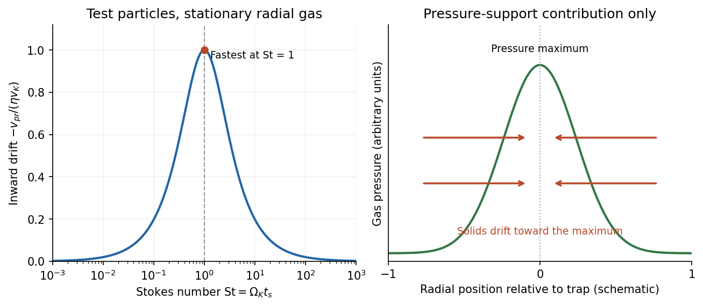

<h1 id="3/b/solution">Solution</h1>

↑ **Parent:** [B](../b.md)

[Sub-Keplerian rotation](../../../../../sub-keplerian-rotation.md) means that the gas rotates more slowly than a pressure-free particle on a [circular orbit](../../../../../circular-orbit.md) at the same cylindrical radius. Let $v_K=(GM_\star/r)^{1/2}$. Neglecting radial acceleration, radial [force](../../../../../force-split.md) balance in the gas is

$$
\frac{v_{g\phi}^2}{r}=\frac{GM_\star}{r^2}
+\frac1{\rho_g}\frac{dP_g}{dr}.
$$

An outwardly decreasing [pressure](../../../../../pressure-split.md), $dP_g/dr<0$, supplies part of the inward-gravity balance through an outward pressure force. Less centrifugal support is needed, so $v_{g\phi}<v_K$. Using $c_s^2=P_g/\rho_g$, define the [pressure-gradient parameter of a protoplanetary disk](../../../../../pressure-gradient-parameter-of-a-protoplanetary-disk.md) by

$$
\eta\equiv-\frac{r}{2\rho_gv_K^2}\frac{dP_g}{dr}
=-\frac12\left(\frac{c_s}{v_K}\right)^2\frac{d\ln P_g}{d\ln r}.
$$

Then

$$
\boxed{v_{g\phi}=v_K\sqrt{1-2\eta}\simeq v_K(1-\eta).}
$$

For a thin disk and a smooth radial pressure profile, $\eta$ is small, of order $(H/r)^2$. The factor of two is part of this explicit convention; changing the convention for $\eta$ changes the drift formula correspondingly.

A solid particle feels essentially no continuum gas-pressure support. Left alone, it would orbit at $v_K$, so in the gas it feels a headwind. [Drag](../../../../../drag-physics.md) removes [angular momentum](../../../../../angular-momentum.md), causing [radial drift of solids in a gas disk](../../../../../radial-drift-of-solids-in-a-gas-disk.md). Define [Stokes number](../../../../../stokes-number.md) $\mathrm{St}=\Omega_Kt_s$ using the [aerodynamic stopping time](../../../../../aerodynamic-stopping-time.md) $t_s$. In a dilute test-particle limit with linear drag, negligible radial gas flow and small departures from a circular Keplerian orbit, let $u_\phi=v_{p\phi}-v_K$. The steady local radial and azimuthal balances are

$$
0=2\Omega_Ku_\phi-\frac{v_{pr}}{t_s},\qquad
0=-\frac{\Omega_Kv_{pr}}2-\frac{u_\phi+\eta v_K}{t_s}.
$$

Solving gives

$$
\boxed{v_{pr}=-\frac{2\eta v_K\mathrm{St}}{1+\mathrm{St}^2},\qquad
v_{p\phi}-v_K=-\frac{\eta v_K}{1+\mathrm{St}^2}.}
$$

The sign is inward for the usual negative pressure gradient. Very small particles, $\mathrm{St}\ll1$, closely follow the gas and have a small relative drift $v_{pr}\simeq-2\eta v_K\mathrm{St}$. Very weakly coupled large bodies, $\mathrm{St}\gg1$, also drift slowly, with $v_{pr}\simeq-2\eta v_K/\mathrm{St}$. **The fastest pressure-driven inward drift occurs at $\mathrm{St}=1$, where $|v_{pr}|=\eta v_K$.** The corresponding physical grain or aggregate size depends on gas density, orbital radius and the drag regime; “metre-size barrier” is a conventional description of some disk models, not a universal size.

**[Figure 3](#3/b/image-pressure-support-creates-a-headwind-with-maximum-inward-solid-drift-at-unit-stokes-number). Pressure support creates a headwind, with maximum inward solid drift at unit Stokes number**.

The drift timescale in this model is

$$
t_{\rm drift}=\frac r{|v_{pr}|}
=\frac{1+\mathrm{St}^2}{2\eta\Omega_K\mathrm{St}}.
$$

It can be much shorter than the disk gas lifetime, threatening loss of the material needed to make [planetesimals](../../../../../planetesimal.md). Growth through the vulnerable coupling range must compete with this loss, while differential drift generates collisions that may stick, bounce or fragment. Radial redistribution also changes solid-to-gas ratios and moves material across condensation fronts. These are consequences for [planet formation](../../../../../planet-formation.md), rather than merely a small correction to an orbital frequency.

The same mechanism can help concentrate solids. At a local radial pressure maximum, $dP_g/dr=0$, so this component of drift vanishes. On the inside, a positive pressure gradient gives outward drift; on the outside, a negative gradient gives inward drift. Particles therefore converge toward a [dust trap](../../../../../dust-trap.md). Turbulent diffusion and inward gas advection can limit retention. With a nonzero radial gas speed $v_{gr}$, the test-particle result generalizes to $v_{pr}=[v_{gr}-2\eta v_K\mathrm{St}]/(1+\mathrm{St}^2)$, so gas advection need not vanish even at a pressure maximum.

Finally, if local solid loading becomes large, backreaction on the gas can no longer be neglected. Coupled gas-particle drift can support [streaming instability](../../../../../streaming-instability.md) and strong solid concentrations, potentially enabling gravitational collapse into [planetesimals](../../../../../planetesimal.md). The simple test-particle drift formula is a useful starting point, but not a description of that nonlinear high-loading regime. **Pressure support creates both a drift obstacle to growth and opportunities for concentration where the pressure structure changes.**

## ↑ Ancestors (14)

1. [B](../b.md)
2. [3](../../3.md)
3. [Paper 1](../../../paper-1-split.md)
4. [2016](../../../split.md)
5. [Past exam of the exoplanets and Planetary Systems course of the University of Cambridge](../../../../split.md)
6. [Exoplanets and Planetary Systems course of the University of Cambridge](../../../../../exoplanets-and-planetary-systems-course-of-the-university-of-cambridge.md)
7. [Physics course of the year 4 of the natural sciences course of the University of Cambridge](../../../../../physics-course-of-the-year-4-of-the-natural-sciences-course-of-the-university-of-cambridge.md)
8. [Year 4 of the natural sciences course of the University of Cambridge](../../../../../year-4-of-the-natural-sciences-course-of-the-university-of-cambridge.md)
9. [Year of the natural sciences course of the University of Cambridge](../../../../../year-of-the-natural-sciences-course-of-the-university-of-cambridge.md)
10. [Natural sciences course of the University of Cambridge](../../../../../natural-sciences-course-of-the-university-of-cambridge.md)
11. [Course of the University of Cambridge](../../../../../course-of-the-university-of-cambridge.md)
12. [University of Cambridge](../../../../../university-of-cambridge-split.md)
13. [List of universities](../../../../../list-of-universities.md)
14. [Codex Wiki](../../../../../split.md)
