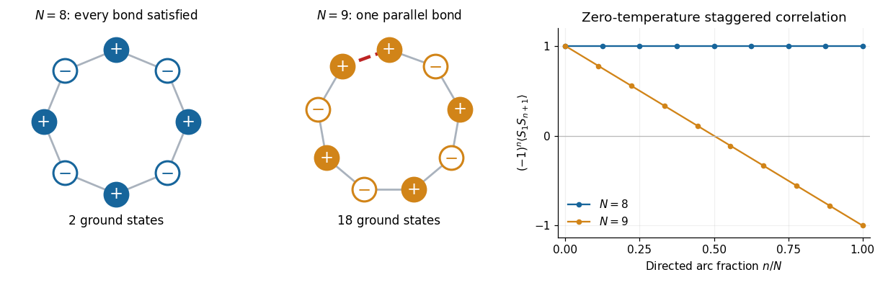

# 2025

↑ **Parent:** [Past exam of the field theories and collective phenomena in condensed matter course of the University of Oxford](../past-exam-of-the-field-theories-and-collective-phenomena-in-condensed-matter-course-of-the-university-of-oxford.md)

Source PDF: [https://mmathphys.physics.ox.ac.uk/sites/g/files/vzsiac2991/files/mmathphys/documents/media/a19021h1.pdf](https://mmathphys.physics.ox.ac.uk/sites/g/files/vzsiac2991/files/mmathphys/documents/media/a19021h1.pdf)

**Table of contents**

- [1](#1)
  - [a](#1/a)
    - [Solution](#1/a/solution)
  - [b](#1/b)
    - [Solution](#1/b/solution)
  - [c](#1/c)
    - [Solution](#1/c/solution)
  - [d](#1/d)
    - [Solution](#1/d/solution)
  - [e](#1/e)
    - [Solution](#1/e/solution)
- [2](#2)
  - [a](#2/a)
    - [i](#2/a/i)
      - [Solution](#2/a/i/solution)
    - [ii](#2/a/ii)
      - [Solution](#2/a/ii/solution)
  - [b](#2/b)
    - [Solution](#2/b/solution)
  - [c](#2/c)
    - [Solution](#2/c/solution)
  - [d](#2/d)
    - [Solution](#2/d/solution)
- [3](#3)
  - [a](#3/a)
    - [Solution](#3/a/solution)
  - [b](#3/b)
    - [Solution](#3/b/solution)
  - [c](#3/c)
    - [Solution](#3/c/solution)
  - [d](#3/d)
    - [Solution](#3/d/solution)

## 1

↑ **Parent:** [2025](2025.md)

<h3 id="1/a">a</h3>

↑ **Parent:** [1](#1)

<h4 id="1/a/solution">Solution</h4>

↑ **Parent:** [A](#1/a)

Make the [Wick rotation](../perturbative-quantum-field-theory.md#wick-rotation) $t'=-i\tau$, and write $T_E=\beta\hbar$ for the final [imaginary time](../perturbative-quantum-field-theory.md#imaginary-time), where $\beta$ is [inverse temperature](../temperature.md#inverse-temperature) and $\hbar$ is the [reduced Planck constant](../quantum-mechanics.md#reduced-planck-constant). Then $dt'=-i\,d\tau$ and $dx/dt'=i\,dx/d\tau$. Thus the continued [action](../lagrangian-mechanics.md#action) is

$$
S=i\int_0^{T_E}\left[\frac m2\left(\frac{dx}{d\tau}\right)^2+V(x)\right]d\tau
=iS_{\mathrm{Euc}},
\qquad
\boxed{S_{\mathrm{Euc}}[x]=\int_0^{\beta\hbar}\left[\frac m2\dot x^2+V(x)\right]d\tau.}
$$

Both the [kinetic energy](../energy.md#kinetic-energy) and the [potential energy](../energy.md#potential-energy) enter this [Euclidean action](../perturbative-quantum-field-theory.md#euclidean-action) with positive signs relative to their real-time definitions. Also $e^{-iH(-i\beta\hbar)/\hbar}=e^{-\beta H}$, so the [Euclidean path integral](../quantum-field-theory.md#euclidean-path-integral) is

$$
\boxed{\langle x_f|e^{-\beta H}|x_i\rangle
=\int_{x(0)=x_i}^{x(T_E)=x_f}\mathcal D x\,
 e^{-S_{\mathrm{Euc}}[x]/\hbar}.}
$$

Its [boundary conditions](../differential-equation.md#boundary-condition) fix the two endpoint [positions](../classical-mechanics.md#position). They need not coincide: identifying and integrating over them would instead give the [thermal trace](../canonical-ensemble.md#thermal-trace).

The normalization of $\mathcal D x$ can be fixed without continuing a formal measure. Apply the [Trotter product formula](../numerical-analysis.md#lie-product-formula) to $H=\hat p^2/(2m)+V(\hat x)$, divide $T_E$ into $M$ intervals of size $\epsilon=T_E/M$, and integrate the intermediate [positions](../classical-mechanics.md#position). The resulting [time-sliced configuration-space path integral](../quantum-field-theory.md#time-sliced-configuration-space-path-integral) is

$$
\lim_{M\to\infty}
\left(\frac{m}{2\pi\hbar\epsilon}\right)^{M/2}
\int_{\mathbb R^{M-1}}\prod_{j=1}^{M-1}dx_j\,
\exp\!\left[-\frac1\hbar\sum_{j=1}^M
\left\{\frac{m(x_j-x_{j-1})^2}{2\epsilon}+\epsilon V(x_{j-1})\right\}\right],
\quad x_0=x_i,\quad x_M=x_f.
$$

This also explains the upper limit $\beta\hbar$ rather than $\beta$ when the [reduced Planck constant](../quantum-mechanics.md#reduced-planck-constant) has not been set to one.

<h3 id="1/b">b</h3>

↑ **Parent:** [1](#1)

<h4 id="1/b/solution">Solution</h4>

↑ **Parent:** [B](#1/b)

For a [free particle](../quantum-mechanics.md#free-particle), vary the [Euclidean action](../perturbative-quantum-field-theory.md#euclidean-action) with a variation $h$ obeying $h(0)=h(T_E)=0$. [Integration by parts](../calculus.md#integration-by-parts) gives

$$
\delta S_{\mathrm{Euc}}=m\int_0^{T_E}\dot x\dot h\,d\tau
=-m\int_0^{T_E}\ddot xh\,d\tau.
$$

The [Euler-Lagrange equation](../analysis.md#euler-lagrange-equation) is therefore $\ddot x_0=0$. The fixed [boundary conditions](../differential-equation.md#boundary-condition) determine its unique solution:

$$
\boxed{x_0(\tau)=x_i+\frac{x_f-x_i}{\beta\hbar}\tau,
\qquad 0\leq\tau\leq\beta\hbar.}
$$

This [classical path](../quantum-field-theory.md#classical-path) is also the unique minimum among paths with finite [Euclidean action](../perturbative-quantum-field-theory.md#euclidean-action): the second variation is $m\int_0^{T_E}\dot h^2d\tau>0$ for every nonzero admissible variation. Its [Euclidean action](../perturbative-quantum-field-theory.md#euclidean-action) is

$$
\boxed{S_{\mathrm{Euc}}[x_0]=\frac{m(x_f-x_i)^2}{2\beta\hbar}.}
$$

<h3 id="1/c">c</h3>

↑ **Parent:** [1](#1)

<h4 id="1/c/solution">Solution</h4>

↑ **Parent:** [C](#1/c)

Write $x=x_0+y$, so the fluctuation has homogeneous [Dirichlet boundary conditions](../differential-equation.md#dirichlet-boundary-condition) $y(0)=y(T_E)=0$. Because $\dot x_0$ is constant, the cross term in the [Euclidean action](../perturbative-quantum-field-theory.md#euclidean-action) vanishes exactly:

$$
m\int_0^{T_E}\dot x_0\dot y\,d\tau
=m\dot x_0[y(T_E)-y(0)]=0.
$$

Consequently

$$
S_{\mathrm{Euc}}[x_0+y]
=\frac{m(x_f-x_i)^2}{2T_E}+\frac m2\int_0^{T_E}\dot y^2d\tau.
$$

Translation of each intermediate integration variable has [Jacobian determinant](../multivariable-calculus.md#jacobian-determinant) one in the [time-sliced configuration-space path integral](../quantum-field-theory.md#time-sliced-configuration-space-path-integral). This is an exact [classical-path factorization of a quadratic path integral](../quantum-field-theory.md#classical-path-factorization-of-a-quadratic-path-integral), giving

$$
\boxed{\langle x_f|e^{-\beta H}|x_i\rangle
=\mathcal N\exp\!\left[-\frac{m(x_f-x_i)^2}{2\beta\hbar^2}\right],
\quad
\mathcal N=\int_{y(0)=0}^{y(\beta\hbar)=0}\mathcal D y\,
\exp\!\left[-\frac{m}{2\hbar}\int_0^{\beta\hbar}\dot y^2d\tau\right].}
$$

The fluctuation [Euclidean action](../perturbative-quantum-field-theory.md#euclidean-action), the homogeneous [boundary conditions](../differential-equation.md#boundary-condition), and the measure normalization contain neither $x_i$ nor $x_f$. Hence **$\mathcal N$ is independent of both endpoint [positions](../classical-mechanics.md#position)**. It depends on $\beta,m,\hbar$.

With the standard position-state normalization, the [Euclidean free-particle bridge amplitude](../quantum-system.md#euclidean-free-particle-bridge-amplitude) is

$$
\boxed{\mathcal N=\sqrt{\frac{m}{2\pi\beta\hbar^2}}.}
$$

For example, a [momentum](../momentum.md) resolution gives a one-dimensional [Gaussian integral](../integral.md#gaussian-integral),

$$
\langle x_f|e^{-\beta H}|x_i\rangle
=\int_{-\infty}^{\infty}\frac{dp}{2\pi\hbar}
\exp\!\left[-\frac{\beta p^2}{2m}+\frac{ip(x_f-x_i)}{\hbar}\right],
$$

whose evaluation gives the same exponent and prefactor. In particular, the result integrates to one over $x_f$ at fixed $x_i$, as required for its [heat kernel](../diffusion-equation.md#heat-kernel) interpretation.

<h3 id="1/d">d</h3>

↑ **Parent:** [1](#1)

<h4 id="1/d/solution">Solution</h4>

↑ **Parent:** [D](#1/d)

The integrated [stochastic differential equation](../stochastic-calculus.md#stochastic-differential-equation) reads

$$
Y(t):=y(t)-y(0)=\int_0^t\eta(s)\,ds.
$$

The [Gaussian white noise](../gaussian-process.md#gaussian-white-noise) has zero [expected value](../expected-value.md), so

$$
\boxed{\langle y(t)-y(0)\rangle=0.}
$$

Its [Dirac delta](../distribution-theory.md#dirac-delta-function) [covariance](../variance.md#covariance) gives

$$
\begin{aligned}
\langle Y(t)^2\rangle
&=\int_0^t\!ds\int_0^t\!ds'\,\langle\eta(s)\eta(s')\rangle\\
&=\Gamma\int_0^t\!ds\int_0^t\!ds'\,\delta(s-s')
=\Gamma t.
\end{aligned}
$$

Thus $\boxed{\langle[y(t)-y(0)]^2\rangle=\Gamma t}$, which is also the [variance](../variance.md) because the displacement has zero [expected value](../expected-value.md). More generally its [covariance](../variance.md#covariance) is $\langle Y(s)Y(t)\rangle=\Gamma\min(s,t)$. Equivalently $Y(t)=\sqrt\Gamma\,W_t$ for standard [Brownian motion](../brownian-motion.md), and the [diffusion coefficient](../brownian-motion.md#diffusion-coefficient) is $D=\Gamma/2$.

<h3 id="1/e">e</h3>

↑ **Parent:** [1](#1)

<h4 id="1/e/solution">Solution</h4>

↑ **Parent:** [E](#1/e)

The [Brownian motion](../brownian-motion.md) displacement has a [normal distribution](../probability-distribution.md#normal-distribution) with [variance](../variance.md) $\Gamma t$. Its transition [probability density function](../continuous-probability-distribution.md#probability-density-function) is therefore

$$
p(y_f,t\mid y_i,0)
=\frac1{\sqrt{2\pi\Gamma t}}
\exp\!\left[-\frac{(y_f-y_i)^2}{2\Gamma t}\right].
$$

Comparison with the [free particle](../quantum-mechanics.md#free-particle) [heat kernel](../diffusion-equation.md#heat-kernel) obtained in part (c) gives the required matching:

$$
\boxed{\Gamma t=\frac{\beta\hbar^2}{m}.}
$$

This matches whole path distributions after a linear reparametrization, not merely endpoint [variances](../variance.md). To see this, divide the Brownian duration $t$ into $M$ slices of size $\delta t$. The [independent increments](../stochastic-process.md#independent-increments) have [normal distributions](../probability-distribution.md#normal-distribution) with [variance](../variance.md) $\Gamma\delta t$, so their joint density contributes

$$
\prod_{j=1}^M\frac1{\sqrt{2\pi\Gamma\delta t}}
\exp\!\left[-\sum_{j=1}^M\frac{(y_j-y_{j-1})^2}{2\Gamma\delta t}\right].
$$

For the [Euclidean path integral](../quantum-field-theory.md#euclidean-path-integral), the corresponding expression is

$$
\prod_{j=1}^M\sqrt{\frac{m}{2\pi\hbar\delta\tau}}
\exp\!\left[-\sum_{j=1}^M\frac{m(x_j-x_{j-1})^2}{2\hbar\delta\tau}\right],
\qquad \delta\tau=\frac{\beta\hbar}{M}.
$$

The matching condition makes $\Gamma\delta t=\hbar\delta\tau/m$, so both the exponents and all normalization factors coincide. In particular, identifying Brownian time with [imaginary time](../perturbative-quantum-field-theory.md#imaginary-time), $t=\beta\hbar$, requires $\Gamma=\hbar/m$, or [diffusion coefficient](../brownian-motion.md#diffusion-coefficient) $D=\hbar/(2m)$.

With both endpoints fixed, the normalized path law is a **[Brownian bridge](../brownian-motion.md#brownian-bridge)**. The [Euclidean path integral](../quantum-field-theory.md#euclidean-path-integral) itself is the endpoint density times that conditional path law. In the normalized time coordinate $s=\tau/(\beta\hbar)$, its [expected value](../expected-value.md) and [covariance](../variance.md#covariance) are

$$
\mathbb E[x(s)]=x_i+s(x_f-x_i),
\qquad
\operatorname{Cov}(x(s),x(s'))
=\frac{\beta\hbar^2}{m}\bigl[\min(s,s')-ss'\bigr].
$$

The [classical path](../quantum-field-theory.md#classical-path) is therefore the bridge's [expected value](../expected-value.md), while individual [Brownian bridge](../brownian-motion.md#brownian-bridge) paths fluctuate about it. Typical [Brownian motion](../brownian-motion.md) paths are continuous but nowhere differentiable: the kinetic [Euclidean action](../perturbative-quantum-field-theory.md#euclidean-action) is interpreted through the [time-sliced diffusion path integral](../quantum-field-theory.md#time-sliced-diffusion-path-integral), rather than by assuming that a typical path has an ordinary velocity.

## 2

↑ **Parent:** [2025](2025.md)

<h3 id="2/a">a</h3>

↑ **Parent:** [2](#2)

<h4 id="2/a/i">i</h4>

↑ **Parent:** [A](#2/a)

<h5 id="2/a/i/solution">Solution</h5>

↑ **Parent:** [I](#2/a/i)

For $J>0$ each bond minimizes its [energy](../energy.md) when its two [Ising spins](../spin-model.md#ising-spin-variable) are opposite, giving bond [energy](../energy.md) $-J$. An even ring allows every bond to do this simultaneously, including the closing bond required by the [periodic boundary conditions](../differential-equation.md#periodic-boundary-conditions). Its two [ground states](../quantum-mechanics.md#ground-state) are

$$
\boxed{S_j=\sigma(-1)^{j-1},\quad\sigma=\pm1;
\qquad E_0=-NJ,\quad g_0=2.}
$$

The two configurations are related by [spin inversion symmetry](../spin-model.md#spin-inversion-symmetry). There is no [geometrical frustration](../statistical-physics.md#geometrical-frustration).

<h4 id="2/a/ii">ii</h4>

↑ **Parent:** [A](#2/a)

<h5 id="2/a/ii/solution">Solution</h5>

↑ **Parent:** [Ii](#2/a/ii)

Let $k$ count parallel bonds. Then $N-k$ bonds are antiparallel and the [energy](../energy.md) is

$$
H=Jk-J(N-k)=-NJ+2Jk.
$$

The [periodic boundary conditions](../differential-equation.md#periodic-boundary-conditions) impose

$$
\prod_{j=1}^N(S_jS_{j+1})=\prod_{j=1}^NS_j^2=1.
$$

Hence $N-k$ must be even. For odd $N$, $k$ is odd, so its minimum is one: one bond must be parallel. All other bonds alternate. Choosing that bond in $N$ ways and then choosing either value of $S_1$ determines every [Ising spin](../spin-model.md#ising-spin-variable), giving

$$
\boxed{E_0=-(N-2)J,\qquad g_0=2N.}
$$

This is an [odd antiferromagnetic Ising ring](../spin-model.md#odd-antiferromagnetic-ising-ring): [geometrical frustration](../statistical-physics.md#geometrical-frustration) forces one defect, whose location is unrestricted. The [ground-state degeneracy](../quantum-mechanics.md#ground-state-degeneracy) includes both its possible locations and global [spin inversion symmetry](../spin-model.md#spin-inversion-symmetry). The formula also includes the self-bond case $N=1$ under the stated [Hamiltonian](../hamiltonian-mechanics.md#hamiltonian) convention.

<h3 id="2/b">b</h3>

↑ **Parent:** [2](#2)

<h4 id="2/b/solution">Solution</h4>

↑ **Parent:** [B](#2/b)

Set $K=\beta J$. The [transfer matrix for the one-dimensional Ising model](../spin-model.md#transfer-matrix-for-the-one-dimensional-ising-model) assigns a [Boltzmann factor](../canonical-ensemble.md#boltzmann-factor) to each bond. In the [Ising spin](../spin-model.md#ising-spin-variable) order $(+1,-1)$, it is

$$
T_{ss'}=e^{-Kss'},\qquad
T=\begin{pmatrix}e^{-K}&e^K\\e^K&e^{-K}\end{pmatrix}.
$$

Multiplying these bond factors and summing every [Ising spin](../spin-model.md#ising-spin-variable) implements the [canonical ensemble](../canonical-ensemble.md). The [periodic boundary conditions](../differential-equation.md#periodic-boundary-conditions) close the product into a [trace](../linear-algebra.md#matrix-trace):

$$
Z_N=\sum_{S_1,\ldots,S_N}\prod_{j=1}^NT_{S_jS_{j+1}}
=\operatorname{tr}T^N.
$$

The [eigenvectors](../linear-operator-theory.md#eigenvector) $|+\rangle=(1,1)^T/\sqrt2$ and $|-\rangle=(1,-1)^T/\sqrt2$ form an [orthonormal basis](../inner-product.md#orthonormal-basis), with [eigenvalues](../linear-operator-theory.md#eigenvalue)

$$
\lambda_+=e^{-K}+e^K=2\cosh K,
\qquad
\lambda_-=e^{-K}-e^K=-2\sinh K.
$$

The negative second [eigenvalue](../linear-operator-theory.md#eigenvalue) encodes alternating [correlations](../variance.md#pearson-correlation-coefficient). Defining $q=\lambda_-/\lambda_+=-\tanh K$, the exact [partition function](../canonical-ensemble.md#canonical-partition-function) and total [Helmholtz free energy](../thermodynamic-potential.md#helmholtz-free-energy) are

$$
\boxed{Z_N=(2\cosh K)^N+(-2\sinh K)^N
=(2\cosh K)^N(1+q^N),}
$$

$$
\boxed{F_N=-\frac1\beta\ln Z_N
=-\frac N\beta\ln(2\cosh K)-\frac1\beta\ln(1+q^N).}
$$

The parity-dependent term must be retained for finite $N$; in particular it nearly cancels the leading term of $Z_N$ at low [temperature](../temperature.md) when $N$ is odd.

Represent insertion of one [Ising spin](../spin-model.md#ising-spin-variable) by $\Sigma=\operatorname{diag}(1,-1)$. In the [eigenbasis](../linear-operator-theory.md#eigenbasis) of $T$, this [matrix](../vector-space.md#matrix) swaps $|+\rangle$ and $|-\rangle$. Its diagonal entries in that [eigenbasis](../linear-operator-theory.md#eigenbasis) vanish, giving the exact [one-point correlation function](../critical-phenomenon.md#one-point-correlation-function)

$$
\boxed{\langle S_1\rangle=\frac{\operatorname{tr}(\Sigma T^N)}{Z_N}=0.}
$$

Equivalently, configurations pair with their opposites under [spin inversion symmetry](../spin-model.md#spin-inversion-symmetry), with the same [Boltzmann factor](../canonical-ensemble.md#boltzmann-factor) and opposite $S_1$.

Two insertions separated by $n$ bonds give the [two-point correlation function](../critical-phenomenon.md#two-point-correlation-function)

$$
\begin{aligned}
\langle S_1S_{n+1}\rangle
&=\frac{\operatorname{tr}(\Sigma T^n\Sigma T^{N-n})}{Z_N}\\
&=\frac{\lambda_-^n\lambda_+^{N-n}+\lambda_+^n\lambda_-^{N-n}}
{\lambda_+^N+\lambda_-^N}.
\end{aligned}
$$

Thus the exact [finite antiferromagnetic Ising-ring correlation](../spin-model.md#finite-ring-antiferromagnetic-ising-correlation) is

$$
\boxed{C_N(n):=\langle S_1S_{n+1}\rangle
=\frac{q^n+q^{N-n}}{1+q^N},\quad q=-\tanh(\beta J),\quad0\leq n\leq N-1.}
$$

The two numerator terms represent the two arcs between the sites. The formula has $C_N(0)=1$ and $C_N(n)=C_N(N-n)$, as required by the [periodic boundary conditions](../differential-equation.md#periodic-boundary-conditions). Since the [one-point correlation function](../critical-phenomenon.md#one-point-correlation-function) is zero, this is also the [connected correlation function](../critical-phenomenon.md#connected-correlation-function). At $K=0$, every [Ising spin](../spin-model.md#ising-spin-variable) is [independent](../random-variable.md#independent-random-variables), so $C_N(n)=0$ for distinct sites and $C_N(0)=1$; powers with exponent zero are understood as one.

<h3 id="2/c">c</h3>

↑ **Parent:** [2](#2)

<h4 id="2/c/solution">Solution</h4>

↑ **Parent:** [C](#2/c)

For $0<K<\infty$, $|q|=\tanh K<1$. Taking the [thermodynamic limit](../statistical-physics.md#thermodynamic-limit) $N\to\infty$ at fixed separation $n$ removes $q^N$ and $q^{N-n}$ from the [finite antiferromagnetic Ising-ring correlation](../spin-model.md#finite-ring-antiferromagnetic-ising-correlation). Therefore

$$
\boxed{C_\infty(n)=(-\tanh K)^n=(-1)^ne^{-n/\xi},
\qquad \xi=-\frac1{\ln\tanh(\beta J)}=\frac1{\ln\coth(\beta J)}.}
$$

The [correlation length](../critical-phenomenon.md#correlation-length) $\xi$ is measured in lattice spacings. If the lattice spacing is $a$, its physical value is $a\xi$. The factor $(-1)^n$ expresses [antiferromagnetism](../electromagnetism.md#antiferromagnetism), while $e^{-n/\xi}$ measures the decay of the staggered [two-point correlation function](../critical-phenomenon.md#two-point-correlation-function).

At every positive [temperature](../temperature.md), $\xi$ is finite. At low [temperature](../temperature.md), $\tanh K=1-2e^{-2K}+O(e^{-4K})$, giving $\boxed{\xi\sim\tfrac12e^{2\beta J}}$. At infinite [temperature](../temperature.md), $K=0$, distinct [Ising spins](../spin-model.md#ising-spin-variable) are uncorrelated; the limiting [correlation length](../critical-phenomenon.md#correlation-length) is zero.

<h3 id="2/d">d</h3>

↑ **Parent:** [2](#2)

<h4 id="2/d/solution">Solution</h4>

↑ **Parent:** [D](#2/d)

Put $r=\tanh K$, so $r\to1^-$ as the [temperature](../temperature.md) tends to zero. For even $N$, the [finite antiferromagnetic Ising-ring correlation](../spin-model.md#finite-ring-antiferromagnetic-ising-correlation) becomes

$$
C_N(n)=(-1)^n\frac{r^n+r^{N-n}}{1+r^N}
\quad\Longrightarrow\quad
\boxed{\lim_{\beta J\to\infty}C_N(n)=(-1)^n\qquad(N\text{ even}).}
$$

The two perfectly alternating [ground states](../quantum-mechanics.md#ground-state) give exactly the same product $S_1S_{n+1}=(-1)^n$; averaging them preserves its magnitude even though the [one-point correlation function](../critical-phenomenon.md#one-point-correlation-function) remains zero.

For odd $N$ the signs instead give

$$
C_N(n)=(-1)^n\frac{r^n-r^{N-n}}{1-r^N}.
$$

Both numerator and denominator vanish. Set $r=1-\delta$ and expand at fixed $N,n$:

$$
r^n-r^{N-n}=(N-2n)\delta+O(\delta^2),
\qquad1-r^N=N\delta+O(\delta^2).
$$

Hence

$$
\boxed{\lim_{\beta J\to\infty}C_N(n)
=(-1)^n\left(1-\frac{2n}{N}\right)\qquad(N\text{ odd}).}
$$

There is a direct [ground state](../quantum-mechanics.md#ground-state) interpretation. The mandatory parallel bond of an [odd antiferromagnetic Ising ring](../spin-model.md#odd-antiferromagnetic-ising-ring) is uniformly distributed among its $N$ bonds in the limiting [canonical ensemble](../canonical-ensemble.md). Along the directed $n$-bond arc from site 1 to site $n+1$, the product is $(-1)^n$ if the defect lies outside that arc, and $-(-1)^n$ if it lies inside. The respective probabilities are $1-n/N$ and $n/N$, giving the displayed [two-point correlation function](../critical-phenomenon.md#two-point-correlation-function). Global [spin inversion symmetry](../spin-model.md#spin-inversion-symmetry) doubles the number of [ground states](../quantum-mechanics.md#ground-state) but leaves each product unchanged.

**[Figure 1](#2/d/image-one-unavoidable-parallel-bond-changes-the-zero-temperature-correlations-of-an-odd-antiferromagnetic-ring). One unavoidable parallel bond changes the zero-temperature correlations of an odd antiferromagnetic ring**.

The reduction on an odd ring survives at separations comparable with $N$, despite the vanishing defect density $1/N$. For fixed $n$, however, taking $N\to\infty$ after the zero-[temperature](../temperature.md) limit recovers $(-1)^n$ for either parity, consistently with the diverging [correlation length](../critical-phenomenon.md#correlation-length). The linear envelope at finite odd $N$ comes from one freely located frustration defect; it is distinct from the exponential decay caused by thermal defects in the [thermodynamic limit](../statistical-physics.md#thermodynamic-limit).

## 3

↑ **Parent:** [2025](2025.md)

<h3 id="3/a">a</h3>

↑ **Parent:** [3](#3)

<h4 id="3/a/solution">Solution</h4>

↑ **Parent:** [A](#3/a)

The [canonical anticommutation relations](../supersymmetric-quantum-mechanics.md#canonical-anticommutation-relations) imply $a^2=(a^\dagger)^2=0$. Thus the [number operator](../quantum-harmonic-oscillator.md#number-operator) satisfies

$$
N_a^2=a^\dagger aa^\dagger a
=a^\dagger(1-a^\dagger a)a=N_a.
$$

It is a [orthogonal projection](../hilbert-space.md#orthogonal-projection), so its [eigenvalues](../linear-operator-theory.md#eigenvalue) obey $n_a^2=n_a$ and are $\boxed{n_a\in\{0,1\}}$. The same argument gives $\boxed{n_b\in\{0,1\}}$. This is the [Pauli exclusion principle](../tensor-product-of-quantum-systems.md#pauli-exclusion-principle) for each orbital. The two [number operators](../quantum-harmonic-oscillator.md#number-operator) commute, so they have simultaneous [eigenstates](../energy-eigenvalue.md#eigenstate).

Take the [vacuum state](../quantum-field-theory.md#vacuum-state) to have unit norm and fix the double-occupation convention $|11\rangle=a^\dagger b^\dagger|0\rangle$. An [orthonormal basis](../inner-product.md#orthonormal-basis) of the four-dimensional [fermionic Fock space](../supersymmetric-quantum-mechanics.md#fermionic-fock-space) is

$$
\boxed{\begin{array}{c|c|c}
\text{state}&n_a&n_b\\\hline
|00\rangle=|0\rangle&0&0\\
|10\rangle=a^\dagger|0\rangle&1&0\\
|01\rangle=b^\dagger|0\rangle&0&1\\
|11\rangle=a^\dagger b^\dagger|0\rangle&1&1
\end{array}}
$$

Each individual [number operator](../quantum-harmonic-oscillator.md#number-operator) has two-dimensional [eigenspaces](../linear-operator-theory.md#eigenspace): for $N_a$ these are spanned by $\{|00\rangle,|01\rangle\}$ and $\{|10\rangle,|11\rangle\}$; for $N_b$ they are spanned by $\{|00\rangle,|10\rangle\}$ and $\{|01\rangle,|11\rangle\}$. Higher [occupation numbers](../quantum-field-theory.md#occupation-number) vanish because the square of a [fermionic creation operator](../relativistic-quantum-field.md#fermionic-creation-operator) is zero. Reversing the order of the two [fermionic creation operators](../relativistic-quantum-field.md#fermionic-creation-operator) changes only the sign convention for $|11\rangle$.

<h3 id="3/b">b</h3>

↑ **Parent:** [3](#3)

<h4 id="3/b/solution">Solution</h4>

↑ **Parent:** [B](#3/b)

The [Bogoliubov transformation](../quantum-field-theory.md#bogoliubov-transformation) and its [Hermitian conjugate](../hilbert-space.md#hermitian-conjugation) read

$$
a=uc+vd^\dagger,\quad a^\dagger=uc^\dagger+vd,
\qquad
b=-vc^\dagger+ud,\quad b^\dagger=-vc+ud^\dagger.
$$

Using the [canonical anticommutation relations](../supersymmetric-quantum-mechanics.md#canonical-anticommutation-relations) of $c,d$, the nonzero same-mode [anticommutators](../vector-space.md#anticommutator) are

$$
\{a,a^\dagger\}=u^2\{c,c^\dagger\}+v^2\{d^\dagger,d\}=u^2+v^2,
\qquad
\{b,b^\dagger\}=u^2+v^2.
$$

The equal-type [anticommutators](../vector-space.md#anticommutator) satisfy $\{a,a\}=\{b,b\}=0$, since every contributing equal-type or mixed-mode [anticommutator](../vector-space.md#anticommutator) of $c,d$ vanishes. The potentially nontrivial cross term cancels:

$$
\{a,b\}=-uv\{c,c^\dagger\}+uv\{d^\dagger,d\}
=-uv+uv=0.
$$

Also $\{a,b^\dagger\}=0$, and the other cross relations follow by [Hermitian conjugation](../hilbert-space.md#hermitian-conjugation). Therefore the necessary and sufficient condition is

$$
\boxed{u^2+v^2=1.}
$$

The real transformation [matrix](../vector-space.md#matrix) is then an [orthogonal matrix](../linear-algebra.md#orthogonal-matrix), with inverse

$$
\boxed{c=ua-vb^\dagger,\qquad d=va^\dagger+ub.}
$$

This preservation of the [canonical anticommutation relations](../supersymmetric-quantum-mechanics.md#canonical-anticommutation-relations) makes it a canonical [Bogoliubov transformation](../quantum-field-theory.md#bogoliubov-transformation).

<h3 id="3/c">c</h3>

↑ **Parent:** [3](#3)

<h4 id="3/c/solution">Solution</h4>

↑ **Parent:** [C](#3/c)

Write $Q=c^\dagger c+d^\dagger d$ and $P=cd+d^\dagger c^\dagger$. Expanding the [number operators](../quantum-harmonic-oscillator.md#number-operator) and restoring the displayed order with the [canonical anticommutation relations](../supersymmetric-quantum-mechanics.md#canonical-anticommutation-relations) gives

$$
\begin{aligned}
a^\dagger a+b^\dagger b
&=(u^2-v^2)Q+2v^2-2uvP,\\
ab+b^\dagger a^\dagger
&=2uv(Q-1)+(u^2-v^2)P.
\end{aligned}
$$

The minus sign in the first line follows from $c^\dagger d^\dagger+dc=-(cd+d^\dagger c^\dagger)$. Substitution into the [Hamiltonian operator](../quantum-system.md#hamiltonian-quantum-mechanics) yields

$$
H=\bigl[\varepsilon(u^2-v^2)+2\Delta uv\bigr]Q
+\bigl[\Delta(u^2-v^2)-2\varepsilon uv\bigr]P
+2\varepsilon v^2-2\Delta uv.
$$

Let $E=\sqrt{\varepsilon^2+\Delta^2}>0$. A convenient real [Bogoliubov transformation](../quantum-field-theory.md#bogoliubov-transformation) has

$$
\boxed{u=\sqrt{\frac{E+\varepsilon}{2E}},\qquad
v=\sqrt{\frac{E-\varepsilon}{2E}}
=\frac{\Delta}{\sqrt{2E(E+\varepsilon)}}.}
$$

These obey $u^2+v^2=1$, $u^2-v^2=\varepsilon/E$ and $2uv=\Delta/E$. Equivalently $u=\cos\theta$, $v=\sin\theta$ with $0<\theta<\pi/4$ and $\tan(2\theta)=\Delta/\varepsilon$. The coefficient of $P$ vanishes, while the coefficient of $Q$ is $E$. The constant is

$$
2\varepsilon v^2-2\Delta uv
=\varepsilon\left(1-\frac\varepsilon E\right)-\frac{\Delta^2}{E}
=\varepsilon-E.
$$

Thus the diagonalized [two-mode fermion pairing Hamiltonian](../topological-quantum-matter.md#two-orbital-fermionic-pairing-hamiltonian) is

$$
\boxed{H=E(c^\dagger c+d^\dagger d)+\varepsilon-E,
\qquad \lambda=\sqrt{\varepsilon^2+\Delta^2},\quad
\mu=\varepsilon-\sqrt{\varepsilon^2+\Delta^2}.}
$$

The two transformed [fermionic occupation numbers](../quantum-field-theory.md#fermionic-occupation-number) independently take values zero or one. The [energy eigenvalues](../energy-eigenvalue.md) and their [eigenspace](../linear-operator-theory.md#eigenspace) dimensions are therefore

$$
\boxed{\begin{array}{c|c|c}
n_c+n_d&\text{energy}&\text{degeneracy}\\\hline
0&\varepsilon-E&1\\
1&\varepsilon&2\\
2&\varepsilon+E&1
\end{array}}
$$

The positive [quasiparticle](../quantum-mechanics.md#quasiparticle) [energy](../energy.md) $E$ makes the transformed [vacuum state](../quantum-field-theory.md#vacuum-state) the unique [ground state](../quantum-mechanics.md#ground-state). The constant $\mu$ is essential for the correct [ground-state energy](../quantum-mechanics.md#ground-state-energy).

As a separate sign and spectrum check, use the original [fermionic Fock space](../supersymmetric-quantum-mechanics.md#fermionic-fock-space) basis. Both singly occupied states are [energy eigenstates](../energy-eigenvalue.md#energy-eigenstate) with [energy](../energy.md) $\varepsilon$, since the pairing terms annihilate them. In the ordered even-[fermion parity](../topological-quantum-matter.md#fermion-parity) basis $(|0\rangle,a^\dagger b^\dagger|0\rangle)$,

$$
H_{\mathrm{even}}=
\begin{pmatrix}0&-\Delta\\-\Delta&2\varepsilon\end{pmatrix}.
$$

The off-diagonal signs follow from $b^\dagger a^\dagger=-a^\dagger b^\dagger$ and $ab\,a^\dagger b^\dagger|0\rangle=-|0\rangle$. Its [characteristic polynomial](../linear-operator-theory.md#characteristic-polynomial) is $z^2-2\varepsilon z-\Delta^2$, giving the remaining two [eigenvalues](../linear-operator-theory.md#eigenvalue) $\varepsilon\pm E$, in agreement with the [Bogoliubov transformation](../quantum-field-theory.md#bogoliubov-transformation).

<h3 id="3/d">d</h3>

↑ **Parent:** [3](#3)

<h4 id="3/d/solution">Solution</h4>

↑ **Parent:** [D](#3/d)

The inverse [Bogoliubov transformation](../quantum-field-theory.md#bogoliubov-transformation) gives $c=ua-vb^\dagger$ and $d=va^\dagger+ub$. Because $(a^\dagger b^\dagger)^2=0$ by the [canonical anticommutation relations](../supersymmetric-quantum-mechanics.md#canonical-anticommutation-relations), the exponential truncates:

$$
Ae^{Ba^\dagger b^\dagger}|0\rangle
=A\bigl(|0\rangle+Ba^\dagger b^\dagger|0\rangle\bigr).
$$

The [fermionic signs](../perturbative-quantum-field-theory.md#fermionic-sign) are fixed by

$$
a\,a^\dagger b^\dagger|0\rangle=b^\dagger|0\rangle,
\qquad
b\,a^\dagger b^\dagger|0\rangle=-a^\dagger|0\rangle.
$$

It follows that

$$
c|\tilde0\rangle=A(uB-v)b^\dagger|0\rangle,
\qquad
d|\tilde0\rangle=A(v-uB)a^\dagger|0\rangle.
$$

Both annihilation conditions hold precisely when $B=v/u$. Normalizing the [paired fermionic vacuum](../quantum-field-theory.md#two-mode-fermionic-paired-vacuum), using the [orthogonality](../inner-product.md#orthogonal-vectors) of its two [Fock states](../quantum-field-theory.md#fock-state), gives $A^2(1+B^2)=1$. Choose the irrelevant overall phase so that $A>0$. The result is

$$
\boxed{A=u=\sqrt{\frac{E+\varepsilon}{2E}},\qquad
B=\frac vu=\frac{\Delta}{E+\varepsilon}
=\frac{E-\varepsilon}{\Delta},\qquad
E=\sqrt{\varepsilon^2+\Delta^2}.}
$$

Equivalently,

$$
\boxed{|\tilde0\rangle=u|0\rangle+va^\dagger b^\dagger|0\rangle.}
$$

Its positive pair coefficient follows from the specified order $ab+b^\dagger a^\dagger$ in the [Hamiltonian operator](../quantum-system.md#hamiltonian-quantum-mechanics). The state has even [fermion parity](../topological-quantum-matter.md#fermion-parity) and is a [quantum superposition](../quantum-system.md#quantum-superposition) of zero and two original particles. In the limit $\Delta\to0^+$, $A\to1$ and $B\to0$, so it reduces to the original [vacuum state](../quantum-field-theory.md#vacuum-state), as expected for $\varepsilon>0$.

## ↑ Ancestors (9)

1. [Past exam of the field theories and collective phenomena in condensed matter course of the University of Oxford](../past-exam-of-the-field-theories-and-collective-phenomena-in-condensed-matter-course-of-the-university-of-oxford.md)
2. [Field theories and collective phenomena in condensed matter course of the University of Oxford](../university-of-oxford.md#field-theories-and-collective-phenomena-in-condensed-matter-course-of-the-university-of-oxford)
3. [Year 4 of the mathematical and theoretical physics course of the University of Oxford](../university-of-oxford.md#year-4-of-the-mathematical-and-theoretical-physics-course-of-the-university-of-oxford)
4. [Mathematical and theoretical physics course of the University of Oxford](../university-of-oxford.md#mathematical-and-theoretical-physics-course-of-the-university-of-oxford)
5. [Undergraduate course of the University of Oxford](../university-of-oxford.md#undergraduate-course-of-the-university-of-oxford)
6. [Course of the University of Oxford](../university-of-oxford.md#course-of-the-university-of-oxford)
7. [University of Oxford](../university-of-oxford.md)
8. [List of universities](../README.md#list-of-universities)
9. [Codex Wiki](../README.md)
