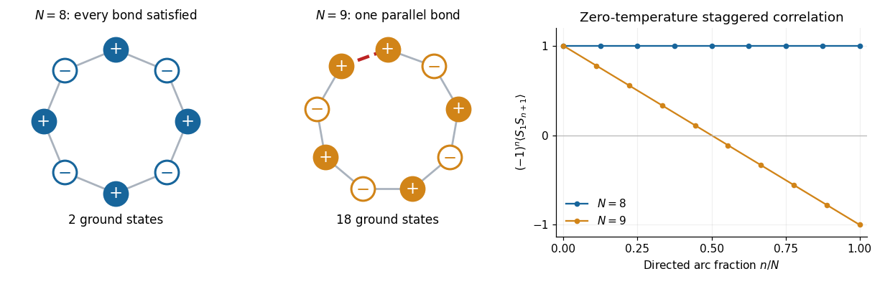

<h1 id="2/d/solution">Solution</h1>

↑ **Parent:** [D](../d.md)

Put $r=\tanh K$, so $r\to1^-$ as the [temperature](../../../../temperature-split.md) tends to zero. For even $N$, the [finite antiferromagnetic Ising-ring correlation](../../../../finite-ring-antiferromagnetic-ising-correlation.md) becomes

$$
C_N(n)=(-1)^n\frac{r^n+r^{N-n}}{1+r^N}
\quad\Longrightarrow\quad
\boxed{\lim_{\beta J\to\infty}C_N(n)=(-1)^n\qquad(N\text{ even}).}
$$

The two perfectly alternating [ground states](../../../../ground-state.md) give exactly the same product $S_1S_{n+1}=(-1)^n$; averaging them preserves its magnitude even though the [one-point correlation function](../../../../one-point-correlation-function.md) remains zero.

For odd $N$ the signs instead give

$$
C_N(n)=(-1)^n\frac{r^n-r^{N-n}}{1-r^N}.
$$

Both numerator and denominator vanish. Set $r=1-\delta$ and expand at fixed $N,n$:

$$
r^n-r^{N-n}=(N-2n)\delta+O(\delta^2),
\qquad1-r^N=N\delta+O(\delta^2).
$$

Hence

$$
\boxed{\lim_{\beta J\to\infty}C_N(n)
=(-1)^n\left(1-\frac{2n}{N}\right)\qquad(N\text{ odd}).}
$$

There is a direct [ground state](../../../../ground-state.md) interpretation. The mandatory parallel bond of an [odd antiferromagnetic Ising ring](../../../../odd-antiferromagnetic-ising-ring.md) is uniformly distributed among its $N$ bonds in the limiting [canonical ensemble](../../../../canonical-ensemble-split.md). Along the directed $n$-bond arc from site 1 to site $n+1$, the product is $(-1)^n$ if the defect lies outside that arc, and $-(-1)^n$ if it lies inside. The respective probabilities are $1-n/N$ and $n/N$, giving the displayed [two-point correlation function](../../../../two-point-correlation-function.md). Global [spin inversion symmetry](../../../../spin-inversion-symmetry.md) doubles the number of [ground states](../../../../ground-state.md) but leaves each product unchanged.

**[Figure 1](#2/d/image-one-unavoidable-parallel-bond-changes-the-zero-temperature-correlations-of-an-odd-antiferromagnetic-ring). One unavoidable parallel bond changes the zero-temperature correlations of an odd antiferromagnetic ring**.

The reduction on an odd ring survives at separations comparable with $N$, despite the vanishing defect density $1/N$. For fixed $n$, however, taking $N\to\infty$ after the zero-[temperature](../../../../temperature-split.md) limit recovers $(-1)^n$ for either parity, consistently with the diverging [correlation length](../../../../correlation-length.md). The linear envelope at finite odd $N$ comes from one freely located frustration defect; it is distinct from the exponential decay caused by thermal defects in the [thermodynamic limit](../../../../thermodynamic-limit.md).

## ↑ Ancestors (12)

1. [D](../d.md)
2. [2](../../2.md)
3. [2025](../../../2025-split.md)
4. [Past exam of the field theories and collective phenomena in condensed matter course of the University of Oxford](../../../split.md)
5. [Field theories and collective phenomena in condensed matter course of the University of Oxford](../../../../field-theories-and-collective-phenomena-in-condensed-matter-course-of-the-university-of-oxford.md)
6. [Year 4 of the mathematical and theoretical physics course of the University of Oxford](../../../../year-4-of-the-mathematical-and-theoretical-physics-course-of-the-university-of-oxford.md)
7. [Mathematical and theoretical physics course of the University of Oxford](../../../../mathematical-and-theoretical-physics-course-of-the-university-of-oxford.md)
8. [Undergraduate course of the University of Oxford](../../../../undergraduate-course-of-the-university-of-oxford.md)
9. [Course of the University of Oxford](../../../../course-of-the-university-of-oxford.md)
10. [University of Oxford](../../../../university-of-oxford-split.md)
11. [List of universities](../../../../list-of-universities.md)
12. [Codex Wiki](../../../../split.md)
