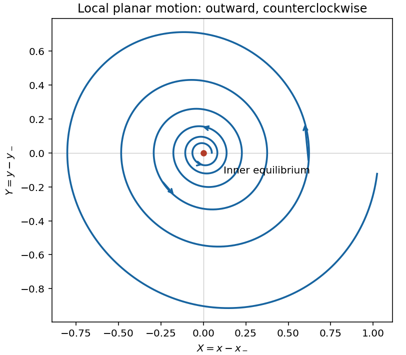
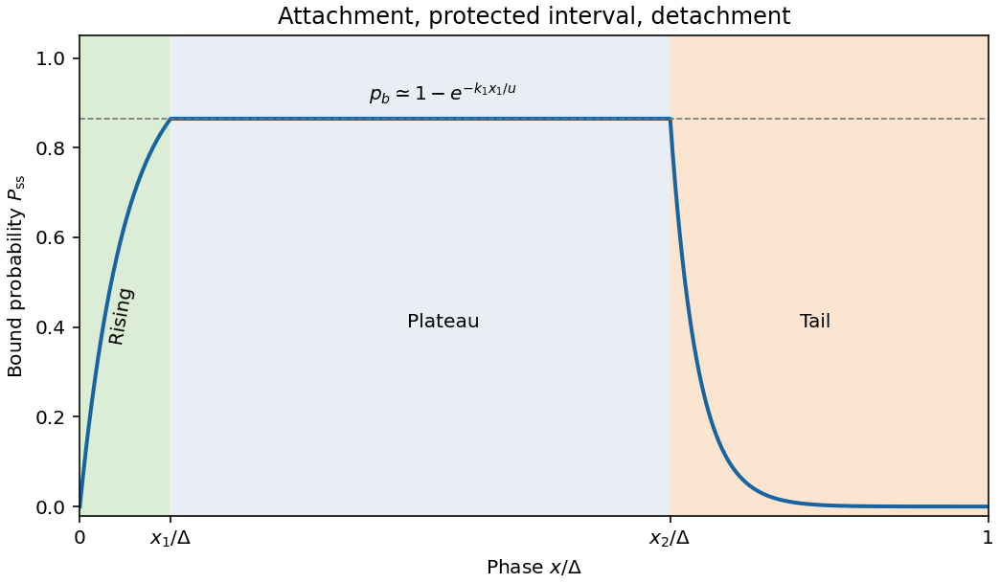
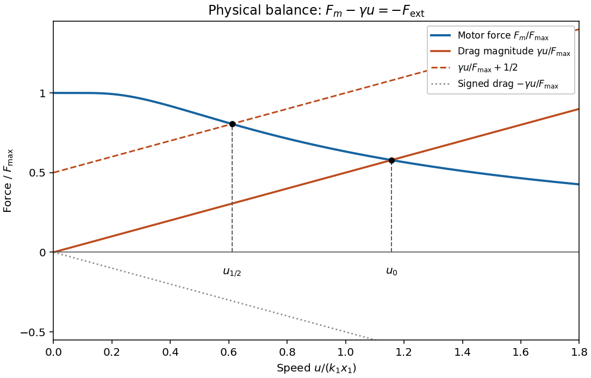

# 2011

↑ **Parent:** [Past exam of the flows, fluctuations and complexity and symmetry and relativity paper of Part B of the physics course of the University of Oxford](../past-exam-of-the-flows-fluctuations-and-complexity-and-symmetry-and-relativity-paper-of-part-b-of-the-physics-course-of-the-university-of-oxford.md)

Source paper: [https://www-thphys.physics.ox.ac.uk/people/AndreiStarinets/TUTORIAL_NOTES_SR/exam_2011_symmetry_relativity.pdf](https://www-thphys.physics.ox.ac.uk/people/AndreiStarinets/TUTORIAL_NOTES_SR/exam_2011_symmetry_relativity.pdf)

Section I comprises questions 1–4; Section II comprises questions 5–8. Numbered subdivisions below retain the successive unlettered source blocks; letters retain the source's actual letters. The [Symmetry and Relativity 2011 Exam Solution Notes](../physics-bibliography.md#symmetry-and-relativity-2011-exam-solution-notes) answer much of Section II. Covered requests are linked to their precise pages; supplements below fill requests omitted or only referred elsewhere. These page references describe coverage, not an independent certification of every calculation in the notes.

**Table of contents**

- [1](#1)
  - [1](#1/1)
    - [Solution](#1/1/solution)
  - [2](#1/2)
    - [Solution](#1/2/solution)
  - [3](#1/3)
    - [Solution](#1/3/solution)
  - [4](#1/4)
    - [Solution](#1/4/solution)
- [2](#2)
  - [1](#2/1)
    - [Solution](#2/1/solution)
  - [2](#2/2)
    - [Solution](#2/2/solution)
  - [3](#2/3)
    - [Solution](#2/3/solution)
  - [4](#2/4)
    - [Solution](#2/4/solution)
- [3](#3)
  - [1](#3/1)
    - [Solution](#3/1/solution)
  - [2](#3/2)
    - [Solution](#3/2/solution)
  - [3](#3/3)
    - [Solution](#3/3/solution)
  - [4](#3/4)
    - [Solution](#3/4/solution)
- [4](#4)
  - [1](#4/1)
    - [Solution](#4/1/solution)
  - [2](#4/2)
    - [Solution](#4/2/solution)
  - [3](#4/3)
    - [Solution](#4/3/solution)
- [5](#5)
  - [1](#5/1)
    - [Solution](#5/1/solution)
  - [2](#5/2)
    - [a](#5/2/a)
      - [Solution](#5/2/a/solution)
    - [b](#5/2/b)
      - [Solution](#5/2/b/solution)
  - [3](#5/3)
    - [Solution](#5/3/solution)
- [6](#6)
  - [1](#6/1)
    - [Solution](#6/1/solution)
  - [2](#6/2)
    - [a](#6/2/a)
      - [Solution](#6/2/a/solution)
    - [b](#6/2/b)
      - [Solution](#6/2/b/solution)
  - [3](#6/3)
    - [a](#6/3/a)
      - [Solution](#6/3/a/solution)
    - [b](#6/3/b)
      - [Solution](#6/3/b/solution)
  - [4](#6/4)
    - [Solution](#6/4/solution)
- [7](#7)
  - [1](#7/1)
    - [Solution](#7/1/solution)
  - [2](#7/2)
    - [1](#7/2/1)
      - [Solution](#7/2/1/solution)
    - [a](#7/2/a)
      - [Solution](#7/2/a/solution)
    - [b](#7/2/b)
      - [Solution](#7/2/b/solution)
  - [3](#7/3)
    - [a](#7/3/a)
      - [Solution](#7/3/a/solution)
    - [b](#7/3/b)
      - [Solution](#7/3/b/solution)
    - [comment](#7/3/comment)
      - [Solution](#7/3/comment/solution)
  - [4](#7/4)
    - [Solution](#7/4/solution)
- [8](#8)
  - [1](#8/1)
    - [Solution](#8/1/solution)
  - [2](#8/2)
    - [Solution](#8/2/solution)
  - [3](#8/3)
    - [Solution](#8/3/solution)
  - [4](#8/4)
    - [Solution](#8/4/solution)

## 1

↑ **Parent:** [2011](2011.md)

<h3 id="1/1">1</h3>

↑ **Parent:** [1](#1)

<h4 id="1/1/solution">Solution</h4>

↑ **Parent:** [1](#1/1)

Set $\partial_t\mathbf u=0$ and $\nu=0$ in the [Navier-Stokes equation](../viscous-fluid-flow.md#navier-stokes-equation). Dotting the resulting [Euler equation](../euler-equations-for-an-inviscid-fluid.md) with a displacement $d\mathbf r$ tangent to a [streamline](../fluid-mechanics.md#streamline) gives

$$
d\left(\frac{|\mathbf u|^2}{2}\right)+\frac{dp}{\rho}+g\,dz=0,
\qquad
\boxed{\frac{|\mathbf u|^2}{2}+\frac p\rho+gz=B.}
$$

Here [mass density](../fluid-mechanics.md#density) $\rho$ is constant, and $B$ is constant along each [streamline](../fluid-mechanics.md#streamline). The terms are [kinetic energy](../energy.md#kinetic-energy) per unit mass, the [pressure work](../pressure.md#pressure-work) per unit mass available from pushing a parcel through the flow, and [gravitational potential energy](../energy.md#gravitational-energy) per unit mass. Their sum is conserved mechanical energy per unit mass; $p/\rho$ is not an additional independently conserved parcel energy. Different [streamlines](../fluid-mechanics.md#streamline) can have different $B$ unless, for example, the flow is also [irrotational](../multivariable-calculus.md#irrotational-vector-field) in a connected region.

<h3 id="1/2">2</h3>

↑ **Parent:** [1](#1)

<h4 id="1/2/solution">Solution</h4>

↑ **Parent:** [2](#1/2)

For planar [incompressible flow](../fluid-mechanics.md#incompressible-flow), $u_x+w_z=0$. Locally this permits a [streamfunction](../fluid-mechanics.md#stream-function) with $u=\psi_z$, $w=-\psi_x$, because equality of the mixed derivatives enforces [incompressibility](../fluid-mechanics.md#incompressible-flow). The remaining component of the [curl](../multivariable-calculus.md#curl) is $u_z-w_x=\psi_{zz}+\psi_{xx}$, so [irrotational flow](../vorticity.md#irrotational-flow) requires [Laplace's equation](../partial-differential-equation.md#laplace-equation) for $\psi$.

Put $K=\pi/b$. The sinusoidal contribution to the supplied [streamfunction](../fluid-mechanics.md#stream-function) has $\psi_{xx}=U_0aK^2\cos(Kx)e^{-Kz}$ and $\psi_{zz}=-U_0aK^2\cos(Kx)e^{-Kz}$; the linear term is also harmonic. Hence

$$
u=U_0[1+aK\cos(Kx)e^{-Kz}],\qquad
w=-U_0aK\sin(Kx)e^{-Kz}.
$$

As $z\to\infty$, these approach the specified [uniform flow](../fluid-mechanics.md#uniform-flow), $(u,w)=(U_0,0)$.

The impermeability [kinematic boundary condition](../fluid-mechanics.md#kinematic-boundary-condition) is $w=u\,z_s'(x)$ on $z=z_s(x)$, equivalently $\psi$ is constant on the wall. For $aK\ll1$, evaluating the perturbed velocities at $z=0$ gives $w=-U_0aK\sin(Kx)=U_0z_s'$ to first order. The residual is of order $U_0(aK)^2$. Equivalently $\psi(x,z_s)=U_0a\cos(Kx)[1-e^{-Ka\cos(Kx)}]=O(U_0Ka^2)$. The surface velocity is

$$
\boxed{u_s=U_0[1+aK\cos(Kx)e^{-Ka\cos(Kx)}]
=U_0[1+aK\cos(Kx)]+O(U_0(aK)^2).}
$$

The first expression is the supplied approximate field evaluated exactly at the wall; its accuracy as a wall-flow solution is still only first order in $a/b$.

<h3 id="1/3">3</h3>

↑ **Parent:** [1](#1)

<h4 id="1/3/solution">Solution</h4>

↑ **Parent:** [3](#1/3)

Use the [rest frame](../mathematical-physics.md#rest-frame) of the [hydrofoil](../fluid-mechanics.md#hydrofoil), with undisturbed velocity $U_0\mathbf e_x$. Let $p_*$ be the undisturbed [pressure](../pressure.md) at the lower surface level $z=0$, so the undisturbed [hydrostatic pressure](../fluid-mechanics.md#hydrostatic-pressure) is $p_*-\rho gz$. The [Bernoulli equation](../euler-equations-for-an-inviscid-fluid.md#bernoulli-equation) gives, with $h=a\cos(\pi x/b)$ and $\epsilon=\pi a/b$,

$$
\boxed{p_{\rm lower}=p_*,\qquad
p_{\rm upper}=p_*-\rho gh+
\frac{\rho U_0^2}{2}\left[1-\{1+\epsilon\cos(\pi x/b)\}^2\right].}
$$

These formulas implement the prescribed neglect of the other velocity components. To the controlled first order in $a/b$, $p_{\rm lower}-p_{\rm upper}=\rho gh+\rho U_0^2\epsilon\cos(\pi x/b)$. The vertical component of [pressure](../pressure.md) acting on an inclined surface is integrated over its horizontal projection, so

$$
\boxed{L'_{\rm dynamic}=2\rho U_0^2a,\qquad
B'=\rho g\int_{-b/2}^{b/2}h\,dx=\frac{2\rho gab}{\pi}.}
$$

The total upward fluid [force](../force.md) per unit span is $L'_{\rm dynamic}+B'$. The [lift](../lift-force.md) due to motion is $L'_{\rm dynamic}$; $B'$ is the separate [buoyancy](../fluid-mechanics.md#buoyancy). If the given approximate speed is squared without truncation, the formal additional dynamic term is $\rho U_0^2\pi^2a^2/(4b)$, but a controlled second-order prediction would require the omitted second-order flow and transverse-velocity contributions too.

<h3 id="1/4">4</h3>

↑ **Parent:** [1](#1)

<h4 id="1/4/solution">Solution</h4>

↑ **Parent:** [4](#1/4)

Take positive [circulation](../vorticity.md#circulation-physics) to mean counterclockwise in the $(x,z)$ diagram, with $x$ right and $z$ up. The upper surface is then traversed right to left. To first order in $a/b$,

$$
\boxed{\Gamma=\oint\mathbf u\cdot d\mathbf l
=\int_{-b/2}^{b/2}(U_0-u_s)\,dx=-2U_0a.}
$$

Thus the bound [circulation](../vorticity.md#circulation-physics) is clockwise. Any exterior contour enclosing the [hydrofoil](../fluid-mechanics.md#hydrofoil) has the same [circulation](../vorticity.md#circulation-physics) in an [irrotational flow](../vorticity.md#irrotational-flow); a globally completed two-dimensional flow must contain a circulation component decaying as $|\Gamma|/(2\pi r)$ at large distance. The simple local upper/lower velocity prescription cannot describe the entire exterior. For a start from rest, [Kelvin's circulation theorem](../vorticity.md#kelvin-s-circulation-theorem) requires compensating shed [vorticity](../vorticity.md), represented by a starting vortex in a physical wake.

Numerically,

$$
\boxed{\Gamma=-0.40\ \mathrm{m^2\,s^{-1}},\qquad
L'_{\rm dynamic}=8.0\times10^2\ \mathrm{N\,m^{-1}}.}
$$

If the question's fluid [force](../force.md) includes [buoyancy](../fluid-mechanics.md#buoyancy), $B'\simeq1.25\times10^3\ \mathrm{N\,m^{-1}}$ and the total upward fluid [force](../force.md) is about $2.05\times10^3\ \mathrm{N\,m^{-1}}$, using $g=9.81\ \mathrm{m\,s^{-2}}$. Weight of the [hydrofoil](../fluid-mechanics.md#hydrofoil) is not specified and is not part of this fluid [force](../force.md). The motion-induced [lift](../lift-force.md) also agrees with the [Kutta–Joukowski theorem](../fluid-mechanics.md#kutta-joukowski-theorem), $L'=-\rho U_0\Gamma$ in this orientation.

The chord-based [Reynolds number](../dynamic-viscosity.md#reynolds-number) is

$$
\boxed{\mathrm{Re}=\frac{U_0b}{\nu}\simeq2.7\times10^6.}
$$

At this large [Reynolds number](../dynamic-viscosity.md#reynolds-number), smooth [laminar flow](../fluid-mechanics.md#laminar-flow) over the whole body is unlikely in ordinary conditions; wall layers may undergo transition and separate. A thin-layer [inviscid flow](../fluid-mechanics.md#inviscid-flow) approximation outside them can remain useful, but does not justify globally [laminar flow](../fluid-mechanics.md#laminar-flow).

<h2 id="2">2</h2>

↑ **Parent:** [2011](2011.md)

<h3 id="2/1">1</h3>

↑ **Parent:** [2](#2)

<h4 id="2/1/solution">Solution</h4>

↑ **Parent:** [1](#2/1)

Write $\mu$ for [dynamic viscosity](../dynamic-viscosity.md) and $\nu=\mu/\rho$ for [kinematic viscosity](../dynamic-viscosity.md#kinematic-viscosity), consistently with the introductory [Navier-Stokes equation](../viscous-fluid-flow.md#navier-stokes-equation). The phrase “dynamic viscosity $\nu$” in this request mixes these conventions. A fully developed [plane Poiseuille flow](../viscous-fluid-flow.md#plane-poiseuille-flow), $\mathbf u=(u(z),0,0)$, has zero [convective acceleration](../continuum-mechanics.md#convective-acceleration). The [Navier-Stokes equation](../viscous-fluid-flow.md#navier-stokes-equation) gives $\mu u''=-f$ and $p_z=-\rho g$. Applying the [no-slip boundary condition](../viscous-fluid-flow.md#no-slip-boundary-condition) at both stationary plates gives

$$
\boxed{u(z)=\frac{f}{2\mu}z(b-z)=\frac{f}{2\rho\nu}z(b-z).}
$$

The material coefficients must be effectively constant and positive. The profile is an exact parallel-flow solution for every $\mu>0$; experimental validity additionally requires that the realized flow remain in the [laminar flow](../fluid-mechanics.md#laminar-flow) regime. A sufficient conservative condition is

$$
\boxed{\mathrm{Re}=\frac{\bar u b}{\nu}=\frac{fb^3}{12\rho\nu^2}\ll1,
\qquad \bar u=\frac{fb^2}{12\mu}.}
$$

Equivalently $\nu\gg\sqrt{fb^3/(12\rho)}$, or $\mu\gg\sqrt{\rho fb^3/12}$. This sufficient bound is stronger than necessary; there is no need to discard [convective acceleration](../continuum-mechanics.md#convective-acceleration) by an approximation here because it vanishes identically for the assumed profile.

<h3 id="2/2">2</h3>

↑ **Parent:** [2](#2)

<h4 id="2/2/solution">Solution</h4>

↑ **Parent:** [2](#2/2)

Here $k$ is a [mass absorption coefficient](../astrophysics.md#mass-absorption-coefficient), because $k\rho$ has units of inverse length. The [Beer-Lambert law](../physical-chemistry.md#beer-lambert-law) is $dF/dz=-k\rho F$, giving $F(z)=F_0e^{-k\rho z}$. A horizontal slab of area $A$ and thickness $dz$ absorbs [power](../energy.md#power) $A[F(z)-F(z+dz)]$. Dividing by its volume and taking the limit gives

$$
\boxed{q_R(z)=-\frac{dF}{dz}=F_0k\rho e^{-k\rho z}\quad\mathrm{W\,m^{-3}}.}
$$

<h3 id="2/3">3</h3>

↑ **Parent:** [2](#2)

<h4 id="2/3/solution">Solution</h4>

↑ **Parent:** [3](#2/3)

A parcel at fixed $z$ spends [time](../classical-mechanics.md#time-in-physics) $a/u(z)$ in the light. With no [thermal conduction](../heat.md#thermal-conduction) or [thermal expansion](../thermodynamics.md#thermal-expansion), its energy balance is $\rho c\,dT/dt=q_R$. Equivalently the steady [advection equation](../transport-equation.md) is $\rho c\,u(z)T_x=q_R(z)$ with $T(0,z)=T_0$. Therefore

$$
\boxed{T(a,z)=T_0+\frac{aF_0k}{c\,u(z)}e^{-k\rho z}
=T_0+\frac{2\mu aF_0k}{cf}\frac{e^{-k\rho z}}{z(b-z)}.}
$$

The [no-slip boundary condition](../viscous-fluid-flow.md#no-slip-boundary-condition) makes residence [time](../classical-mechanics.md#time-in-physics) diverge as either wall is approached. The resulting unbounded [temperature](../temperature.md) is a failure of the approximations, rather than a physically steady wall prediction. Even small [thermal conductivity](../heat.md#thermal-conductivity) transfers heat away from these layers; conduction into real perspex adds another heat sink. [Thermal expansion](../thermodynamics.md#thermal-expansion) can alter [mass density](../fluid-mechanics.md#density), create [buoyancy](../fluid-mechanics.md#buoyancy)-driven motion and change the background profile, while temperature-dependent [dynamic viscosity](../dynamic-viscosity.md) changes the assumed residence [time](../classical-mechanics.md#time-in-physics). With exactly insulating walls, finite fluid [thermal conductivity](../heat.md#thermal-conductivity) still regularizes the transverse profile; an entrance region and, sufficiently near a stagnant wall, longitudinal conduction also matter.

<h3 id="2/4">4</h3>

↑ **Parent:** [2](#2)

<h4 id="2/4/solution">Solution</h4>

↑ **Parent:** [4](#2/4)

Put $A=2\mu aF_0k/(cf)$. In the specified near-wall limit the outer [temperature](../temperature.md) is $T-T_0\simeq A/(bz)$, so

$$
q_C\simeq\frac{2\kappa A}{bz^3},\qquad
\frac{|q_C|}{q_R}\simeq\frac{4\kappa\mu a}{\rho cfbz^3}
=\frac{4\kappa\nu a}{cfbz^3},\qquad
\chi=\frac{\kappa}{\rho c}.
$$

Thus the [near-wall radiative heating layer](../viscous-fluid-flow.md#near-wall-radiative-heating-layer) has scale

$$
\boxed{0<z\lesssim\delta_C,\qquad
\delta_C=\left(\frac{4\kappa\mu a}{\rho cfb}\right)^{1/3}
=\left(\frac{4\kappa\nu a}{cfb}\right)^{1/3}.}
$$

The comparison is an estimate of the breakdown of the outer solution, not a new inner [temperature](../temperature.md) solution. It requires $\delta_C\ll b$ and $k\rho\delta_C\ll1$; neglecting longitudinal relative to transverse [thermal conduction](../heat.md#thermal-conduction) additionally requires $\delta_C\ll a$ in the region to which the estimate is applied.

<h2 id="3">3</h2>

↑ **Parent:** [2011](2011.md)

<h3 id="3/1">1</h3>

↑ **Parent:** [3](#3)

<h4 id="3/1/solution">Solution</h4>

↑ **Parent:** [1](#3/1)

An [equilibrium point of a dynamical system](../dynamical-systems.md#equilibrium-point-of-a-dynamical-system) is a state $\mathbf x_*$ with $\mathbf f(\mathbf x_*)=0$, so the trajectory stays there. In a planar [phase portrait](../dynamical-systems.md#phase-portrait), an [unstable spiral](../dynamical-systems.md#unstable-spiral) has a complex-conjugate pair of [Jacobian matrix](../multivariable-calculus.md#jacobian-matrix) [eigenvalues](../linear-operator-theory.md#eigenvalue) with positive real part: nearby trajectories rotate while moving outward. An [attractor](../dynamical-systems.md#attractor) is an invariant set approached by trajectories from a neighborhood, its basin of attraction. It can be an [equilibrium point](../dynamical-systems.md#equilibrium-point-of-a-dynamical-system), a [limit cycle](../dynamical-systems.md#limit-cycle), or a more complicated set; outward spiralling near one [equilibrium point](../dynamical-systems.md#equilibrium-point-of-a-dynamical-system) does not preclude attraction to a larger set.

<h3 id="3/2">2</h3>

↑ **Parent:** [3](#3)

<h4 id="3/2/solution">Solution</h4>

↑ **Parent:** [2](#3/2)

At an [equilibrium point](../dynamical-systems.md#equilibrium-point-of-a-dynamical-system) of the [Rössler system](../dynamical-systems.md#rossler-system), $y=-z$, $x=az$, and $az^2-cz+a=0$. Hence

$$
\boxed{z_\pm=\frac{c\pm\sqrt{c^2-4a^2}}{2a},\qquad
(x_\pm,y_\pm,z_\pm)=(az_\pm,-z_\pm,z_\pm).}
$$

There are two distinct real [equilibrium points](../dynamical-systems.md#equilibrium-point-of-a-dynamical-system) only if $c>2a$; they merge if $c=2a$ and there are none if $c<2a$. Positivity of $a,c$ alone does not guarantee two. Under the later limits, the nearer one is $(x_-,y_-,z_-)\simeq(a^2/c,-a/c,a/c)$, while $(x_+,y_+,z_+)\simeq(c,-c/a,c/a)$.

<h3 id="3/3">3</h3>

↑ **Parent:** [3](#3)

<h4 id="3/3/solution">Solution</h4>

↑ **Parent:** [3](#3/3)

The [Jacobian matrix](../multivariable-calculus.md#jacobian-matrix) of the [Rössler system](../dynamical-systems.md#rossler-system) is

$$
\boxed{J=\begin{pmatrix}0&-1&-1\\1&a&0\\z&0&x-c\end{pmatrix}.}
$$

At the origin the vertical homogeneous perturbation obeys $\delta\dot z=-c\,\delta z$, so it decays as $e^{-ct}$. Nearby, $\dot z\simeq a-cz$ also relaxes the trajectory toward $z\simeq a/c$, close to the $x$–$y$ plane. The small fixed-point value of $z$ weakly couples planar errors back into $z$; this is neglected in the requested approximation.

The planar block has [trace](../linear-algebra.md#matrix-trace) $a$ and [determinant](../multilinear-algebra.md#determinant) $1$, with

$$
\boxed{\lambda_{1,2}=\frac a2\pm i\sqrt{1-\frac{a^2}{4}}.}
$$

For $0<a\ll1$, this is an [unstable spiral](../dynamical-systems.md#unstable-spiral). Writing $X=x-x_-$ and $Y=y-y_-$, its linearized trajectories have an envelope proportional to $e^{at/2}$ and angular frequency approximately $1$. They rotate counterclockwise: at $X>0,Y=0$, $\dot Y=X>0$. Fast vertical contraction occurs on scale $1/c$, much shorter than the planar growth scale $2/a$.

**[Figure 1](#3/3/image-counterclockwise-outward-spiral-near-the-inner-rossler-equilibrium). Counterclockwise outward spiral near the inner Rössler equilibrium**.

Confinement weakens as $x$ approaches $c$ from below; the approximate vertical relaxation time is $1/(c-x)$, and the quasi-steady value $a/(c-x)$ ceases to be small. For $x>c$, the coefficient of $z$ becomes positive, so vertical departures are amplified. The plane $z=0$ is never exactly invariant because $\dot z=a$ there.

<h3 id="3/4">4</h3>

↑ **Parent:** [3](#3)

<h4 id="3/4/solution">Solution</h4>

↑ **Parent:** [4](#3/4)

For an infinitesimal perturbation $\boldsymbol\eta$, $\dot{\boldsymbol\eta}=J\boldsymbol\eta$, and

$$
\frac{d}{dt}\log|\boldsymbol\eta|=\frac{\boldsymbol\eta^TS\boldsymbol\eta}{|\boldsymbol\eta|^2},\qquad
S=\frac{J+J^T}{2}=\begin{pmatrix}0&0&(z-1)/2\\0&a&0\\(z-1)/2&0&x-c\end{pmatrix}.
$$

Thus the principal [instantaneous stretching rates](../dynamical-systems.md#instantaneous-stretching-rate), called local [Lyapunov exponents](../dynamical-systems.md#lyapunov-exponent) in the question, are

$$
\boxed{\lambda_y=a,\qquad
\lambda_\pm=\frac{x-c\pm\sqrt{(x-c)^2+(z-1)^2}}{2}.}
$$

For $z\ne1$, $\lambda_+>0$ and $\lambda_-<0$, while $a>0$. There are two instantaneously expanding orthogonal directions and one contracting direction. These are instantaneous norm-growth rates; the directions rotate along a trajectory, so this does not imply two positive long-time [Lyapunov exponents](../dynamical-systems.md#lyapunov-exponent) or indefinitely exponential growth along fixed axes.

At $x=c$, put $s=\operatorname{sgn}(z-1)$. The [eigenvectors](../linear-operator-theory.md#eigenvector) and rates are

$$
\boxed{\mathbf e_+=\frac{(1,0,s)}{\sqrt2},\quad\lambda_+=\frac{|z-1|}{2};\qquad
\mathbf e_-=\frac{(1,0,-s)}{\sqrt2},\quad\lambda_-=-\frac{|z-1|}{2}.}
$$

The condition $|z-1|>2a$ makes $\mathbf e_+$ the fastest-growing direction, faster than $\mathbf e_y$; $\mathbf e_-$ is the fastest-contracting direction. Both lie at $45^\circ$ to the $x,z$ axes.

<h2 id="4">4</h2>

↑ **Parent:** [2011](2011.md)

<h3 id="4/1">1</h3>

↑ **Parent:** [4](#4)

<h4 id="4/1/solution">Solution</h4>

↑ **Parent:** [1](#4/1)

Take $u>0$. Despite the source's terminology, $P(x)$ is a dimensionless conditional bound-state [probability](../probability-theory.md#probability) at phase $x$, not a spatially normalized [probability density](../wave-function.md#probability-density); the phase-average bound fraction is $\Delta^{-1}\int_0^\Delta P\,dx$. The given equation has [advection](../fluid-mechanics.md#advection) and binding reactions but no diffusion term. Large $N$ permits the prescribed steady $u$ approximation.

For [spatially gated myosin attachment](../biological-cell.md#spatially-gated-myosin-attachment), define $A=e^{-k_1x_1/u}$, $B=e^{-k_2(\Delta-x_2)/u}$, $p_0=P(0)$ and $p_b=P(x_1)$. Continuity and periodicity give $p_b=1-(1-p_0)A$, $p_0=Bp_b$, hence $p_b=(1-A)/(1-AB)$. The full periodic steady solution is

$$
\boxed{P_{\rm ss}(x)=\begin{cases}
1-(1-p_0)e^{-k_1x/u},&0\le x<x_1,\\
p_b,&x_1\le x<x_2,\\
p_b e^{-k_2(x-x_2)/u},&x_2\le x<\Delta,
\end{cases}\qquad
p_0=\frac{B(1-A)}{1-AB}.}
$$

The requested limit makes $B\ll1$, so $p_0\simeq0$ and $p_b\simeq1-e^{-k_1x_1/u}$. The curve rises exponentially over the binding window, remains flat to $x_2$, then decays over length $u/k_2$ to an exponentially small value before the next period. The piecewise expression is continuous at both switching points and at the period boundary.

**[Figure 2](#4/1/image-periodic-bound-head-probability-with-a-binding-window-plateau-and-detachment-tail). Periodic bound-head probability with a binding window, plateau and detachment tail**.

<h3 id="4/2">2</h3>

↑ **Parent:** [4](#4)

<h4 id="4/2/solution">Solution</h4>

↑ **Parent:** [2](#4/2)

For a head sampling phases uniformly during steady sliding, its mean [force](../force.md) is $f_0$ times the phase-average bound [probability](../probability-theory.md#probability). In the $B\ll1$ limit of [spatially gated myosin attachment](../biological-cell.md#spatially-gated-myosin-attachment), integrating the three intervals gives

$$
\frac{\Delta\langle f\rangle}{f_0}\simeq x_1-\frac{u}{k_1}(1-A)
+(x_2-x_1)(1-A)+\frac{u}{k_2}(1-A)(1-B).
$$

The first integral is bounded by $x_1p_b$, and the last by $(u/k_2)p_b$. Relative to the plateau contribution, they are negligible when $x_1\ll x_2$ and $u/k_2\ll x_2$, respectively. Therefore

$$
\boxed{\langle f\rangle\simeq f_0\frac{x_2}{\Delta}\left(1-e^{-k_1x_1/u}\right).}
$$

This is a [constant-force spatially gated motor](../biological-cell.md#constant-force-spatially-gated-motor) approximation: complete detachment between binding windows, a narrow attachment window, a short detachment tail and essentially fixed sliding [velocity](../classical-mechanics.md#velocity). In particular, $k_1x_1/u$ need not be small.

<h3 id="4/3">3</h3>

↑ **Parent:** [4](#4)

<h4 id="4/3/solution">Solution</h4>

↑ **Parent:** [3](#4/3)

Put $V=k_1x_1$ and $F_*=Nf_0x_2/\Delta$. The [constant-force spatially gated motor](../biological-cell.md#constant-force-spatially-gated-motor) produces

$$
F_m(u)=F_*\left(1-e^{-V/u}\right),\qquad
\boxed{F_{\max}=\lim_{u\to0^+}F_m(u)=\frac{Nf_0x_2}{\Delta}.}
$$

The limit is approached after the periodic steady state is established; at exactly $u=0$ arbitrary initially bound heads in inactive phase intervals need not equilibrate. The curve decreases from $F_{\max}$ and has formal large-$u$ tail $F_{\max}V/u$. Extrapolation of that tail beyond the small-$u$ detachment assumptions is not controlled.

**Sign inconsistency in the printed force balance.** For a positive [viscous drag coefficient](../dynamic-viscosity.md#viscous-drag-coefficient) $\gamma$, the signed [drag force](../fluid-mechanics.md#drag-physics) is $-\gamma u$. The printed $F_{\rm ext}+F_m+\gamma u=0$ cannot give the requested positive no-load contraction speed: both last terms are positive when $u>0$. With $F_{\rm ext}=-F_{\max}/2$, the left side starts at $F_{\max}/2>0$ and may have zero, one or two positive roots depending on parameters; the requested usual load construction is not implied by that equation.

The physical [linear-drag load curve for a spatially gated motor](../biological-cell.md#linear-drag-load-curve-for-a-spatially-gated-motor) uses

$$
\boxed{F_{\rm ext}+F_m(u)-\gamma u=0.}
$$

On the same axes plot the positive drag magnitude $D(u)=\gamma u$ and the decreasing motor [force](../force.md) $F_m(u)$. The no-load speed $u_0$ is their intersection. For opposing load $F_{\max}/2$, intersect $F_m(u)$ with the parallel raised line $D(u)+F_{\max}/2$; equivalently intersect $D(u)$ with $F_m(u)-F_{\max}/2$. Drop verticals to the speed axis. The loaded speed obeys $0<u_{1/2}<u_0$. Each intersection is unique because $F_m$ decreases and $D$ increases. The signed drag is also indicated below the axis in the sketch.

**[Figure 3](#4/3/image-motor-force-and-drag-construction-after-correcting-the-printed-drag-sign). Motor-force and drag construction after correcting the printed drag sign**.

## 5

↑ **Parent:** [2011](2011.md)

<h3 id="5/1">1</h3>

↑ **Parent:** [5](#5)

<h4 id="5/1/solution">Solution</h4>

↑ **Parent:** [1](#5/1)

**Covered by the official notes:** proper time, rapidity, proper acceleration, longitudinal acceleration transformation, rapidity derivative and additivity (PDF pp. 6–7; handwritten pp. 1–2).[PDF pp. 6–7; handwritten pp. 1–2: proper time, rapidity, proper acceleration, longitudinal acceleration transformation, rapidity derivative and additivity](../physics-bibliography.md#symmetry-and-relativity-2011-exam-solution-notes)

<h3 id="5/2">2</h3>

↑ **Parent:** [5](#5)

<h4 id="5/2/a">a</h4>

↑ **Parent:** [2](#5/2)

<h5 id="5/2/a/solution">Solution</h5>

↑ **Parent:** [A](#5/2/a)

**Covered by the official notes:** onboard acceleration from rearward photon emission (PDF pp. 7; handwritten pp. 2).[PDF pp. 7; handwritten pp. 2: onboard acceleration from rearward photon emission](../physics-bibliography.md#symmetry-and-relativity-2011-exam-solution-notes)

<h4 id="5/2/b">b</h4>

↑ **Parent:** [2](#5/2)

<h5 id="5/2/b/solution">Solution</h5>

↑ **Parent:** [B](#5/2/b)

**Covered by the official notes:** launch-pad speed as a function of launch-pad time (PDF pp. 8; handwritten pp. 3).[PDF pp. 8; handwritten pp. 3: launch-pad speed as a function of launch-pad time](../physics-bibliography.md#symmetry-and-relativity-2011-exam-solution-notes)

<h3 id="5/3">3</h3>

↑ **Parent:** [5](#5)

<h4 id="5/3/solution">Solution</h4>

↑ **Parent:** [3](#5/3)

**Covered by the official notes:** mirror-driven acceleration and comparison of the two spacecraft (PDF pp. 8–9; handwritten pp. 3–4).[PDF pp. 8–9; handwritten pp. 3–4: mirror-driven acceleration and comparison of the two spacecraft](../physics-bibliography.md#symmetry-and-relativity-2011-exam-solution-notes)

## 6

↑ **Parent:** [2011](2011.md)

<h3 id="6/1">1</h3>

↑ **Parent:** [6](#6)

<h4 id="6/1/solution">Solution</h4>

↑ **Parent:** [1](#6/1)

**Covered by the official notes:** centre-of-momentum energy and momentum of particle 2 and boost speed (PDF pp. 10–11; handwritten pp. 5–6).[PDF pp. 10–11; handwritten pp. 5–6: centre-of-momentum energy and momentum of particle 2 and boost speed](../physics-bibliography.md#symmetry-and-relativity-2011-exam-solution-notes)

<h3 id="6/2">2</h3>

↑ **Parent:** [6](#6)

<h4 id="6/2/a">a</h4>

↑ **Parent:** [2](#6/2)

<h5 id="6/2/a/solution">Solution</h5>

↑ **Parent:** [A](#6/2/a)

**Covered by the official notes:** forward collinear laboratory energy (PDF p. 11; handwritten p. 6).[PDF p. 11; handwritten p. 6: forward collinear laboratory energy](../physics-bibliography.md#symmetry-and-relativity-2011-exam-solution-notes)

<h4 id="6/2/b">b</h4>

↑ **Parent:** [2](#6/2)

<h5 id="6/2/b/solution">Solution</h5>

↑ **Parent:** [B](#6/2/b)

**Covered by the official notes:** transverse-emission laboratory energy and laboratory angle (PDF p. 11; handwritten p. 6).[PDF p. 11; handwritten p. 6: transverse-emission laboratory energy and laboratory angle](../physics-bibliography.md#symmetry-and-relativity-2011-exam-solution-notes)

<h3 id="6/3">3</h3>

↑ **Parent:** [6](#6)

<h4 id="6/3/a">a</h4>

↑ **Parent:** [3](#6/3)

<h5 id="6/3/a/solution">Solution</h5>

↑ **Parent:** [A](#6/3/a)

**Covered by the official notes:** forward neutrino energy for the specified kaon beam (PDF p. 12; handwritten p. 7).[PDF p. 12; handwritten p. 7: forward neutrino energy for the specified kaon beam](../physics-bibliography.md#symmetry-and-relativity-2011-exam-solution-notes)

<h4 id="6/3/b">b</h4>

↑ **Parent:** [3](#6/3)

<h5 id="6/3/b/solution">Solution</h5>

↑ **Parent:** [B](#6/3/b)

**Covered by the official notes:** transverse-emission neutrino energy and laboratory angle (PDF p. 12; handwritten p. 7).[PDF p. 12; handwritten p. 7: transverse-emission neutrino energy and laboratory angle](../physics-bibliography.md#symmetry-and-relativity-2011-exam-solution-notes)

<h3 id="6/4">4</h3>

↑ **Parent:** [6](#6)

<h4 id="6/4/solution">Solution</h4>

↑ **Parent:** [4](#6/4)

**Covered by the official notes:** comparison with a 200 keV neutrino mass (PDF p. 12; handwritten p. 7).[PDF p. 12; handwritten p. 7: comparison with a 200 keV neutrino mass](../physics-bibliography.md#symmetry-and-relativity-2011-exam-solution-notes)

The notes stop at “no change”; the experimental implication is that this is a poorly conditioned [neutrino mass](../standard-model.md#neutrino-mass) measurement. In [relativistic two-body decay](../special-relativity.md#relativistic-two-body-decay), the corrections to the rest-frame energy and momentum enter through the square of the daughter [rest mass](../special-relativity.md#invariant-mass), while the [Lorentz transformation](../special-relativity.md#lorentz-transformation) boosts both the massless value and its small correction. A measured laboratory energy or angle must therefore resolve a very small change against beam-energy spread, decay-angle uncertainty and detector resolution. **No visible change at the quoted precision does not establish zero neutrino mass.**

## 7

↑ **Parent:** [2011](2011.md)

<h3 id="7/1">1</h3>

↑ **Parent:** [7](#7)

<h4 id="7/1/solution">Solution</h4>

↑ **Parent:** [1](#7/1)

The official notes give only “Part 1: as in textbooks” (PDF p. 13, handwritten p. 8). The requested derivation is supplied here.

Put a light source at the rod midpoint in its [rest frame](../mathematical-physics.md#rest-frame) $S$ and emit two pulses simultaneously toward its ends, each a distance $\ell$ away. In $S$, the reflection events are $(t,x)=(\ell/c,\pm\ell)$. Invariance of light speed, the [Einstein's principle of relativity](../special-relativity.md#einstein-s-principle-of-relativity) and linearity give a [Lorentz transformation](../special-relativity.md#lorentz-transformation) $x'=A(x-vt)$, $t'=A(t-vx/c^2)$. Applying the inverse transformation with speed $-v$ gives $A^2(1-v^2/c^2)=1$, hence $A=\gamma$.

The transformed reflection events have

$$
x'_+=\gamma\ell(1-\beta),\quad t'_+=\frac{\gamma\ell}{c}(1-\beta),\qquad
x'_-=-\gamma\ell(1+\beta),\quad t'_- =\frac{\gamma\ell}{c}(1+\beta).
$$

These events are not simultaneous in $S'$. Both rod ends move at $-v$ there, so extrapolating each endpoint to $t'=0$ gives $x'_\pm(0)=x'_\pm+vt'_\pm=\pm\ell/\gamma$. Measuring simultaneous endpoints therefore yields [length contraction](../special-relativity.md#length-contraction):

$$
\boxed{L'=x'_+(0)-x'_-(0)=\frac{2\ell}{\gamma}=2\ell\sqrt{1-\beta^2}.}
$$

<h3 id="7/2">2</h3>

↑ **Parent:** [7](#7)

<h4 id="7/2/1">1</h4>

↑ **Parent:** [2](#7/2)

<h5 id="7/2/1/solution">Solution</h5>

↑ **Parent:** [1](#7/2/1)

**Covered by the official notes:** definition of a pure force via constant rest mass (PDF p. 13; handwritten p. 8).[PDF p. 13; handwritten p. 8: definition of a pure force via constant rest mass](../physics-bibliography.md#symmetry-and-relativity-2011-exam-solution-notes)

The page labels $dp^\mu/d\tau$ as a proper force; that is the [four-force](../special-relativity.md#four-force). The requested [proper force](../special-relativity.md#proper-force) is the **three-force measured in the instantaneous rest frame of the object**. For a [pure force](../special-relativity.md#pure-force) its magnitude is $m_0$ times the [proper acceleration](../special-relativity.md#proper-acceleration), and in that frame the [four-force](../special-relativity.md#four-force) has components $(0,\mathbf f_0)$.

<h4 id="7/2/a">a</h4>

↑ **Parent:** [2](#7/2)

<h5 id="7/2/a/solution">Solution</h5>

↑ **Parent:** [A](#7/2/a)

**Covered by the official notes:** longitudinal three-force transformation (PDF p. 13; handwritten p. 8).[PDF p. 13; handwritten p. 8: longitudinal three-force transformation](../physics-bibliography.md#symmetry-and-relativity-2011-exam-solution-notes)

<h4 id="7/2/b">b</h4>

↑ **Parent:** [2](#7/2)

<h5 id="7/2/b/solution">Solution</h5>

↑ **Parent:** [B](#7/2/b)

**Covered by the official notes:** transverse three-force transformation (PDF p. 13; handwritten p. 8).[PDF p. 13; handwritten p. 8: transverse three-force transformation](../physics-bibliography.md#symmetry-and-relativity-2011-exam-solution-notes)

<h3 id="7/3">3</h3>

↑ **Parent:** [7](#7)

<h4 id="7/3/a">a</h4>

↑ **Parent:** [3](#7/3)

<h5 id="7/3/a/solution">Solution</h5>

↑ **Parent:** [A](#7/3/a)

**Covered by the official notes:** spring constant parallel to the boost (PDF p. 13; handwritten p. 8).[PDF p. 13; handwritten p. 8: spring constant parallel to the boost](../physics-bibliography.md#symmetry-and-relativity-2011-exam-solution-notes)

<h4 id="7/3/b">b</h4>

↑ **Parent:** [3](#7/3)

<h5 id="7/3/b/solution">Solution</h5>

↑ **Parent:** [B](#7/3/b)

**Covered by the official notes:** spring constant orthogonal to the boost (PDF p. 13; handwritten p. 8).[PDF p. 13; handwritten p. 8: spring constant orthogonal to the boost](../physics-bibliography.md#symmetry-and-relativity-2011-exam-solution-notes)

<h4 id="7/3/comment">comment</h4>

↑ **Parent:** [3](#7/3)

<h5 id="7/3/comment/solution">Solution</h5>

↑ **Parent:** [Comment](#7/3/comment)

The orientation-dependent results in the official notes show that the measured [spring constant](../elasticity-physics.md#spring-constant) is **not a Lorentz scalar**. A [Lorentz transformation](../special-relativity.md#lorentz-transformation) changes both the simultaneous extension and the measured three-force; their ratio depends on the orientation. This does not make the spring intrinsically anisotropic in its own [rest frame](../mathematical-physics.md#rest-frame), or require a preferred inertial frame. It is a quasistatic effective stiffness comparison between frames; an extended real spring also has finite internal signal speeds.

<h3 id="7/4">4</h3>

↑ **Parent:** [7](#7)

<h4 id="7/4/solution">Solution</h4>

↑ **Parent:** [4](#7/4)

**Covered by the official notes:** charge field-line sketches at rest and in motion, field anisotropy, and relation to the two spring orientations (PDF pp. 13–14; handwritten pp. 8–9).[PDF pp. 13–14; handwritten pp. 8–9: charge field-line sketches at rest and in motion, field anisotropy, and relation to the two spring orientations](../physics-bibliography.md#symmetry-and-relativity-2011-exam-solution-notes)

## 8

↑ **Parent:** [2011](2011.md)

<h3 id="8/1">1</h3>

↑ **Parent:** [8](#8)

<h4 id="8/1/solution">Solution</h4>

↑ **Parent:** [1](#8/1)

**Covered by the official notes:** definitions of four-force and four-velocity and the vanishing antisymmetric contraction (PDF p. 15; handwritten p. 10).[PDF p. 15; handwritten p. 10: definitions of four-force and four-velocity and the vanishing antisymmetric contraction](../physics-bibliography.md#symmetry-and-relativity-2011-exam-solution-notes)

To make the necessity statement precise, mass preservation must hold **for every allowed timelike four-velocity**, with the same field [tensor](../multilinear-algebra.md#tensor) and nonzero charge. It is not necessary for one prescribed trajectory alone. Use [metric signature](../topological-manifold.md#metric-signature) $(-,+,+,+)$, so $U_aF^a=-c^2dm/d\tau$. Put $H^{ab}=(\mathcal F^{ab}+\mathcal F^{ba})/2$. The mass-preservation condition requires the [quadratic form](../quadratic-form.md) $H^{ab}U_aU_b=0$ for every timelike $U$. Every timelike vector can be rescaled to a physical [four-velocity](../special-relativity.md#four-velocity); by homogeneity the quadratic form vanishes on the open timelike cone. A polynomial vanishing on an open set is identically zero, so $H^{ab}=0$. Thus the [electromagnetic field tensor](../relativistic-electromagnetism.md#electromagnetic-field-tensor) must be antisymmetric under this universal quantifier. For a single velocity, the scalar contraction can vanish even for a nonzero symmetric part, which is why the quantifier is essential.

<h3 id="8/2">2</h3>

↑ **Parent:** [8](#8)

<h4 id="8/2/solution">Solution</h4>

↑ **Parent:** [2](#8/2)

The official notes state only $\mathcal F'=\Lambda\mathcal F\Lambda^T$ (PDF p. 15, handwritten p. 10); they do not evaluate the requested coefficients. For a boost along positive $x$, use $\Lambda^0{}_0=\Lambda^1{}_1=\gamma$, $\Lambda^0{}_1=\Lambda^1{}_0=-\gamma v/c$, with the transverse diagonal entries equal to one. Multiplying the specified [electromagnetic field tensor](../relativistic-electromagnetism.md#electromagnetic-field-tensor) gives

$$
\mathcal F'^{01}=\mathcal F^{01},\qquad
\mathcal F'^{02}=\gamma(\mathcal F^{02}-\beta\mathcal F^{12}),\qquad
\mathcal F'^{23}=\mathcal F^{23},\qquad
\mathcal F'^{31}=\gamma(\mathcal F^{31}-\beta\mathcal F^{30}).
$$

The corresponding [Lorentz transformation of electromagnetic fields](../relativistic-electromagnetism.md#lorentz-transformation-of-electromagnetic-fields) is

$$
\boxed{E_x'=E_x,\qquad E_y'=\gamma(E_y-vB_z),\qquad
B_x'=B_x,\qquad B_y'=\gamma\left(B_y+\frac{vE_z}{c^2}\right).}
$$

Consequently

$$
\boxed{a_1=\gamma,\qquad a_2=0,\qquad a_3=-\gamma v.}
$$

These coefficients depend on the frame speed, but are constant for the fixed boost.

<h3 id="8/3">3</h3>

↑ **Parent:** [8](#8)

<h4 id="8/3/solution">Solution</h4>

↑ **Parent:** [3](#8/3)

**Covered by the official notes:** explicit field contraction and Lorentz invariance as a tensor scalar (PDF pp. 15–16; handwritten pp. 10–11).[PDF pp. 15–16; handwritten pp. 10–11: explicit field contraction and Lorentz invariance as a tensor scalar](../physics-bibliography.md#symmetry-and-relativity-2011-exam-solution-notes)

<h3 id="8/4">4</h3>

↑ **Parent:** [8](#8)

<h4 id="8/4/solution">Solution</h4>

↑ **Parent:** [4](#8/4)

**Covered by the official notes:** rocket-frame electric and magnetic fields, proper three-force and proper acceleration (PDF p. 16; handwritten p. 11).[PDF p. 16; handwritten p. 11: rocket-frame electric and magnetic fields, proper three-force and proper acceleration](../physics-bibliography.md#symmetry-and-relativity-2011-exam-solution-notes)

## ↑ Ancestors (9)

1. [Past exam of the flows, fluctuations and complexity and symmetry and relativity paper of Part B of the physics course of the University of Oxford](../past-exam-of-the-flows-fluctuations-and-complexity-and-symmetry-and-relativity-paper-of-part-b-of-the-physics-course-of-the-university-of-oxford.md)
2. [Flows, fluctuations and complexity and symmetry and relativity paper of Part B of the physics course of the University of Oxford](../university-of-oxford.md#flows-fluctuations-and-complexity-and-symmetry-and-relativity-paper-of-part-b-of-the-physics-course-of-the-university-of-oxford)
3. [Year 3 of the physics course of the University of Oxford](../university-of-oxford.md#year-3-of-the-physics-course-of-the-university-of-oxford)
4. [Physics course of the University of Oxford](../university-of-oxford.md#physics-course-of-the-university-of-oxford)
5. [Undergraduate course of the University of Oxford](../university-of-oxford.md#undergraduate-course-of-the-university-of-oxford)
6. [Course of the University of Oxford](../university-of-oxford.md#course-of-the-university-of-oxford)
7. [University of Oxford](../university-of-oxford.md)
8. [List of universities](../README.md#list-of-universities)
9. [Codex Wiki](../README.md)
