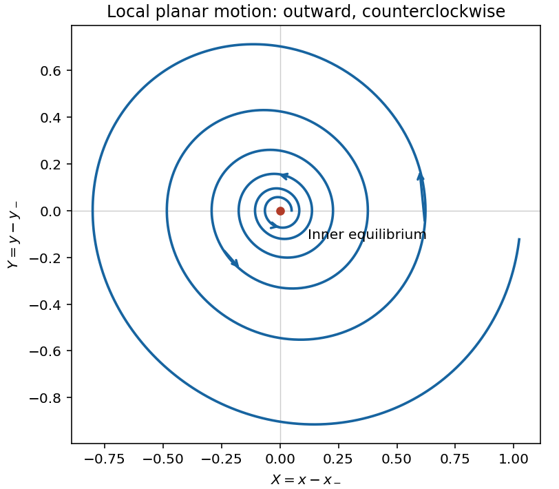

<h1 id="3/3/solution">Solution</h1>

↑ **Parent:** [3](../3.md)

The [Jacobian matrix](../../../../jacobian-matrix.md) of the [Rössler system](../../../../rossler-system.md) is

$$
\boxed{J=\begin{pmatrix}0&-1&-1\\1&a&0\\z&0&x-c\end{pmatrix}.}
$$

At the origin the vertical homogeneous perturbation obeys $\delta\dot z=-c\,\delta z$, so it decays as $e^{-ct}$. Nearby, $\dot z\simeq a-cz$ also relaxes the trajectory toward $z\simeq a/c$, close to the $x$–$y$ plane. The small fixed-point value of $z$ weakly couples planar errors back into $z$; this is neglected in the requested approximation.

The planar block has [trace](../../../../matrix-trace.md) $a$ and [determinant](../../../../determinant.md) $1$, with

$$
\boxed{\lambda_{1,2}=\frac a2\pm i\sqrt{1-\frac{a^2}{4}}.}
$$

For $0<a\ll1$, this is an [unstable spiral](../../../../unstable-spiral.md). Writing $X=x-x_-$ and $Y=y-y_-$, its linearized trajectories have an envelope proportional to $e^{at/2}$ and angular frequency approximately $1$. They rotate counterclockwise: at $X>0,Y=0$, $\dot Y=X>0$. Fast vertical contraction occurs on scale $1/c$, much shorter than the planar growth scale $2/a$.

**[Figure 1](#3/3/image-counterclockwise-outward-spiral-near-the-inner-rossler-equilibrium). Counterclockwise outward spiral near the inner Rössler equilibrium**.

Confinement weakens as $x$ approaches $c$ from below; the approximate vertical relaxation time is $1/(c-x)$, and the quasi-steady value $a/(c-x)$ ceases to be small. For $x>c$, the coefficient of $z$ becomes positive, so vertical departures are amplified. The plane $z=0$ is never exactly invariant because $\dot z=a$ there.

## ↑ Ancestors (12)

1. [3](../3.md)
2. [3](../../3.md)
3. [2011](../../../2011-split.md)
4. [Past exam of the flows, fluctuations and complexity and symmetry and relativity paper of Part B of the physics course of the University of Oxford](../../../split.md)
5. [Flows, fluctuations and complexity and symmetry and relativity paper of Part B of the physics course of the University of Oxford](../../../../flows-fluctuations-and-complexity-and-symmetry-and-relativity-paper-of-part-b-of-the-physics-course-of-the-university-of-oxford.md)
6. [Year 3 of the physics course of the University of Oxford](../../../../year-3-of-the-physics-course-of-the-university-of-oxford.md)
7. [Physics course of the University of Oxford](../../../../physics-course-of-the-university-of-oxford.md)
8. [Undergraduate course of the University of Oxford](../../../../undergraduate-course-of-the-university-of-oxford.md)
9. [Course of the University of Oxford](../../../../course-of-the-university-of-oxford.md)
10. [University of Oxford](../../../../university-of-oxford-split.md)
11. [List of universities](../../../../list-of-universities.md)
12. [Codex Wiki](../../../../split.md)
