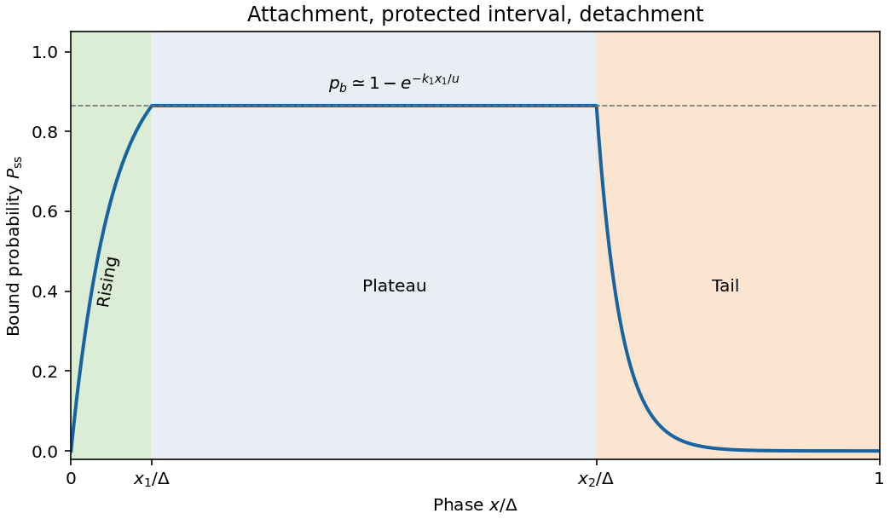

<h1 id="4/1/solution">Solution</h1>

↑ **Parent:** [1](../1.md)

Take $u>0$. Despite the source's terminology, $P(x)$ is a dimensionless conditional bound-state [probability](../../../../probability.md) at phase $x$, not a spatially normalized [probability density](../../../../probability-density.md); the phase-average bound fraction is $\Delta^{-1}\int_0^\Delta P\,dx$. The given equation has [advection](../../../../advection.md) and binding reactions but no diffusion term. Large $N$ permits the prescribed steady $u$ approximation.

For [spatially gated myosin attachment](../../../../spatially-gated-myosin-attachment.md), define $A=e^{-k_1x_1/u}$, $B=e^{-k_2(\Delta-x_2)/u}$, $p_0=P(0)$ and $p_b=P(x_1)$. Continuity and periodicity give $p_b=1-(1-p_0)A$, $p_0=Bp_b$, hence $p_b=(1-A)/(1-AB)$. The full periodic steady solution is

$$
\boxed{P_{\rm ss}(x)=\begin{cases}
1-(1-p_0)e^{-k_1x/u},&0\le x<x_1,\\
p_b,&x_1\le x<x_2,\\
p_b e^{-k_2(x-x_2)/u},&x_2\le x<\Delta,
\end{cases}\qquad
p_0=\frac{B(1-A)}{1-AB}.}
$$

The requested limit makes $B\ll1$, so $p_0\simeq0$ and $p_b\simeq1-e^{-k_1x_1/u}$. The curve rises exponentially over the binding window, remains flat to $x_2$, then decays over length $u/k_2$ to an exponentially small value before the next period. The piecewise expression is continuous at both switching points and at the period boundary.

**[Figure 2](#4/1/image-periodic-bound-head-probability-with-a-binding-window-plateau-and-detachment-tail). Periodic bound-head probability with a binding window, plateau and detachment tail**.

## ↑ Ancestors (12)

1. [1](../1.md)
2. [4](../../4.md)
3. [2011](../../../2011-split.md)
4. [Past exam of the flows, fluctuations and complexity and symmetry and relativity paper of Part B of the physics course of the University of Oxford](../../../split.md)
5. [Flows, fluctuations and complexity and symmetry and relativity paper of Part B of the physics course of the University of Oxford](../../../../flows-fluctuations-and-complexity-and-symmetry-and-relativity-paper-of-part-b-of-the-physics-course-of-the-university-of-oxford.md)
6. [Year 3 of the physics course of the University of Oxford](../../../../year-3-of-the-physics-course-of-the-university-of-oxford.md)
7. [Physics course of the University of Oxford](../../../../physics-course-of-the-university-of-oxford.md)
8. [Undergraduate course of the University of Oxford](../../../../undergraduate-course-of-the-university-of-oxford.md)
9. [Course of the University of Oxford](../../../../course-of-the-university-of-oxford.md)
10. [University of Oxford](../../../../university-of-oxford-split.md)
11. [List of universities](../../../../list-of-universities.md)
12. [Codex Wiki](../../../../split.md)
