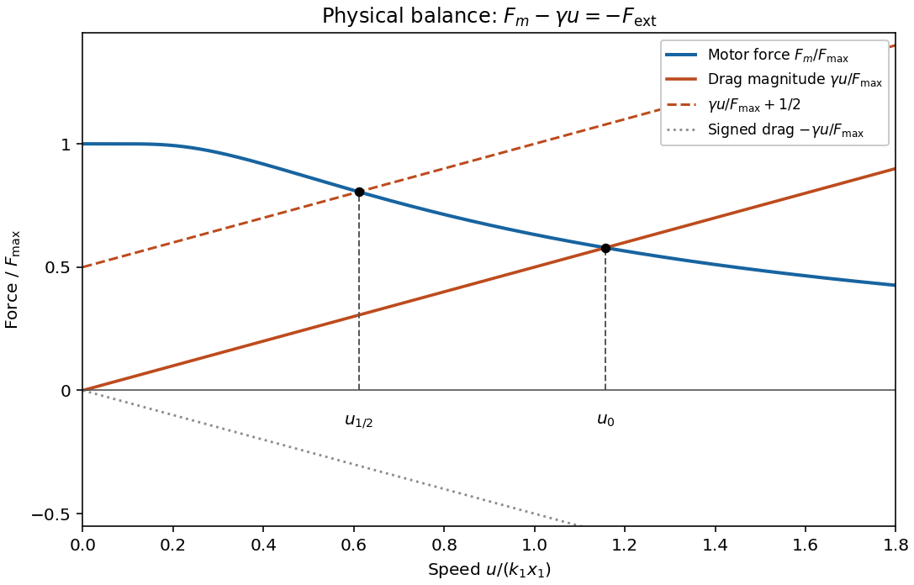

<h1 id="4/3/solution">Solution</h1>

↑ **Parent:** [3](../3.md)

Put $V=k_1x_1$ and $F_*=Nf_0x_2/\Delta$. The [constant-force spatially gated motor](../../../../constant-force-spatially-gated-motor.md) produces

$$
F_m(u)=F_*\left(1-e^{-V/u}\right),\qquad
\boxed{F_{\max}=\lim_{u\to0^+}F_m(u)=\frac{Nf_0x_2}{\Delta}.}
$$

The limit is approached after the periodic steady state is established; at exactly $u=0$ arbitrary initially bound heads in inactive phase intervals need not equilibrate. The curve decreases from $F_{\max}$ and has formal large-$u$ tail $F_{\max}V/u$. Extrapolation of that tail beyond the small-$u$ detachment assumptions is not controlled.

**Sign inconsistency in the printed force balance.** For a positive [viscous drag coefficient](../../../../viscous-drag-coefficient.md) $\gamma$, the signed [drag force](../../../../drag-physics.md) is $-\gamma u$. The printed $F_{\rm ext}+F_m+\gamma u=0$ cannot give the requested positive no-load contraction speed: both last terms are positive when $u>0$. With $F_{\rm ext}=-F_{\max}/2$, the left side starts at $F_{\max}/2>0$ and may have zero, one or two positive roots depending on parameters; the requested usual load construction is not implied by that equation.

The physical [linear-drag load curve for a spatially gated motor](../../../../linear-drag-load-curve-for-a-spatially-gated-motor.md) uses

$$
\boxed{F_{\rm ext}+F_m(u)-\gamma u=0.}
$$

On the same axes plot the positive drag magnitude $D(u)=\gamma u$ and the decreasing motor [force](../../../../force-split.md) $F_m(u)$. The no-load speed $u_0$ is their intersection. For opposing load $F_{\max}/2$, intersect $F_m(u)$ with the parallel raised line $D(u)+F_{\max}/2$; equivalently intersect $D(u)$ with $F_m(u)-F_{\max}/2$. Drop verticals to the speed axis. The loaded speed obeys $0<u_{1/2}<u_0$. Each intersection is unique because $F_m$ decreases and $D$ increases. The signed drag is also indicated below the axis in the sketch.

**[Figure 3](#4/3/image-motor-force-and-drag-construction-after-correcting-the-printed-drag-sign). Motor-force and drag construction after correcting the printed drag sign**.

## ↑ Ancestors (12)

1. [3](../3.md)
2. [4](../../4.md)
3. [2011](../../../2011-split.md)
4. [Past exam of the flows, fluctuations and complexity and symmetry and relativity paper of Part B of the physics course of the University of Oxford](../../../split.md)
5. [Flows, fluctuations and complexity and symmetry and relativity paper of Part B of the physics course of the University of Oxford](../../../../flows-fluctuations-and-complexity-and-symmetry-and-relativity-paper-of-part-b-of-the-physics-course-of-the-university-of-oxford.md)
6. [Year 3 of the physics course of the University of Oxford](../../../../year-3-of-the-physics-course-of-the-university-of-oxford.md)
7. [Physics course of the University of Oxford](../../../../physics-course-of-the-university-of-oxford.md)
8. [Undergraduate course of the University of Oxford](../../../../undergraduate-course-of-the-university-of-oxford.md)
9. [Course of the University of Oxford](../../../../course-of-the-university-of-oxford.md)
10. [University of Oxford](../../../../university-of-oxford-split.md)
11. [List of universities](../../../../list-of-universities.md)
12. [Codex Wiki](../../../../split.md)
