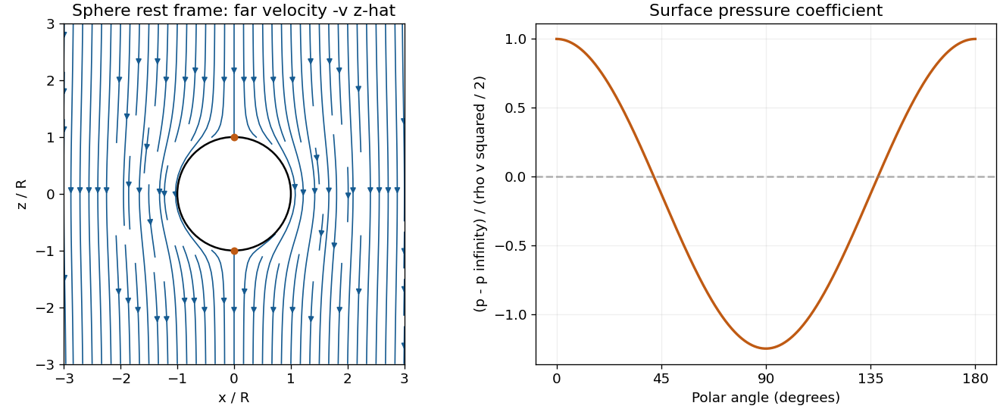
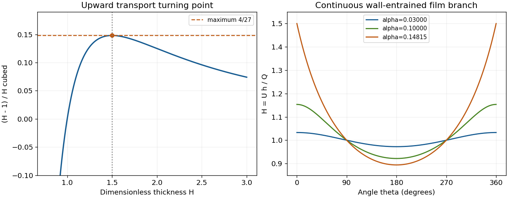
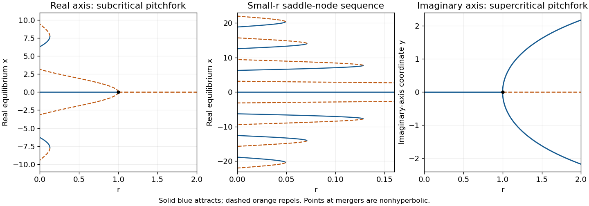
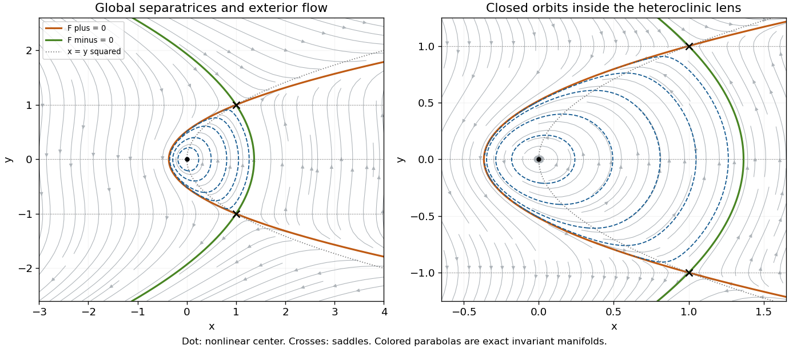
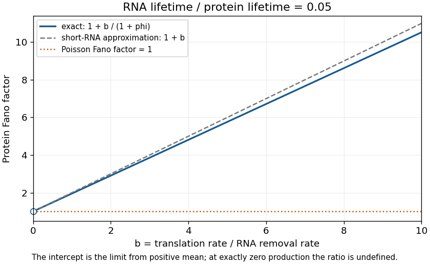

# 2016

↑ **Parent:** [Past exam of the flows, fluctuations and complexity course of the University of Oxford](../past-exam-of-the-flows-fluctuations-and-complexity-course-of-the-university-of-oxford.md)

Source paper: [https://www.whatdotheyknow.com/request/physics_past_exam_papers_2015_16/response/973997/attach/3/Cowell%20Attachment.zip?cookie_passthrough=1](https://www.whatdotheyknow.com/request/physics_past_exam_papers_2015_16/response/973997/attach/3/Cowell%20Attachment.zip?cookie_passthrough=1)

All four numbered questions in the held paper are solved. Letters on the separately marked paragraphs are inferred. Flow quantities are measured in the reference frames specified below; the molecular-noise calculation uses molecule numbers in a fixed cell.

**Table of contents**

- [1](#1)
  - [a](#1/a)
    - [Solution](#1/a/solution)
  - [b](#1/b)
    - [Solution](#1/b/solution)
  - [c](#1/c)
    - [Solution](#1/c/solution)
  - [d](#1/d)
    - [Solution](#1/d/solution)
  - [e](#1/e)
    - [Solution](#1/e/solution)
- [2](#2)
  - [a](#2/a)
    - [Solution](#2/a/solution)
  - [b](#2/b)
    - [Solution](#2/b/solution)
  - [c](#2/c)
    - [Solution](#2/c/solution)
  - [d](#2/d)
    - [Solution](#2/d/solution)
  - [e](#2/e)
    - [Solution](#2/e/solution)
- [3](#3)
  - [a](#3/a)
    - [Solution](#3/a/solution)
  - [b](#3/b)
    - [Solution](#3/b/solution)
  - [c](#3/c)
    - [Solution](#3/c/solution)
  - [d](#3/d)
    - [Solution](#3/d/solution)
- [4](#4)
  - [a](#4/a)
    - [Solution](#4/a/solution)
  - [b](#4/b)
    - [Solution](#4/b/solution)
  - [c](#4/c)
    - [Solution](#4/c/solution)
  - [d](#4/d)
    - [Solution](#4/d/solution)

## 1

↑ **Parent:** [2016](2016.md)

<h3 id="1/a">a</h3>

↑ **Parent:** [1](#1)

<h4 id="1/a/solution">Solution</h4>

↑ **Parent:** [A](#1/a)

An [irrotational flow](../vorticity.md#irrotational-flow) satisfies $\nabla\times\mathbf u=0$. On a simply connected region, or locally on any small regular region, this gives a [velocity potential](../fluid-mechanics.md#velocity-potential) $\phi$ with $\mathbf u=\nabla\phi$. The [incompressibility condition](../fluid-mechanics.md#incompressible-flow) is $\nabla\cdot\mathbf u=0$, so

$$
\boxed{\nabla^2\phi=0.}
$$

Thus the potential is a [harmonic function](../partial-differential-equation.md#harmonic-function). The locality qualification matters: a curl-free circulation around an excluded vortex core need not admit a globally single-valued potential. No such circulation is needed for the sphere flow below.

<h3 id="1/b">b</h3>

↑ **Parent:** [1](#1)

<h4 id="1/b/solution">Solution</h4>

↑ **Parent:** [B](#1/b)

Put the [stagnation point](../fluid-mechanics.md#stagnation-point) at the origin and the local tangent plane at $z=0$. A regular [Taylor expansion](../calculus.md#taylor-expansion) has no linear term because $\mathbf u(0)=0$. The impermeable tangent plane imposes $\partial_z\phi=0$ at $z=0$ to leading order, excluding mixed quadratic terms $xz,yz$. For the illustrated axisymmetric approach, [rotational symmetry](../linear-algebra.md#rotational-symmetry) in the tangent plane makes the $x^2$ and $y^2$ coefficients equal and removes $xy$. Finally the [Laplace equation](../partial-differential-equation.md#laplace-equation) fixes the normal coefficient to minus twice the tangential one. Up to an irrelevant additive constant,

$$
\boxed{\phi=W(x^2+y^2-2z^2)+O(|\mathbf r|^3),\qquad
\mathbf u=(2Wx,2Wy,-4Wz)+O(|\mathbf r|^2).}
$$

For incoming flow from $z>0$, $W>0$. This is a local leading form under the stated symmetry, not the exact universal potential near every possible wall [stagnation point](../fluid-mechanics.md#stagnation-point); a generic tangential strain can have unequal principal rates.

A [streamline](../fluid-mechanics.md#streamline) solves $\dot x=2Wx$, $\dot y=2Wy$, $\dot z=-4Wz$, hence $x=Ae^{2Wt}$, $y=Be^{2Wt}$, $z=Ce^{-4Wt}$. Eliminating the parameter gives

$$
\boxed{\arg(x+iy)=\text{constant},\qquad z(x^2+y^2)=\text{constant}.}
$$

Each [streamline](../fluid-mechanics.md#streamline) lies in a meridional plane. With cylindrical radius $s=\sqrt{x^2+y^2}$, its shape is $z=C_1/s^2$. The symmetry axis and wall are limiting invariant [streamlines](../fluid-mechanics.md#streamline). A particle exactly on the incoming axis approaches the [stagnation point](../fluid-mechanics.md#stagnation-point) asymptotically.

<h3 id="1/c">c</h3>

↑ **Parent:** [1](#1)

<h4 id="1/c/solution">Solution</h4>

↑ **Parent:** [C](#1/c)

Choose the positive $z$ direction along the sphere's laboratory [velocity](../classical-mechanics.md#velocity) $v\hat{\mathbf z}$. In its rest frame the far-field fluid velocity is $-v\hat{\mathbf z}$. Therefore the far-field potential is $-vr\cos\theta$. The impermeable sphere imposes $\partial_r\phi=0$ at $r=R$. The monopole coefficient vanishes because the sphere is not a source or sink, and the dipole coefficient follows from the wall condition:

$$
A_1=-v,\qquad B_0=0,\qquad B_1=-\frac{vR^3}{2}.
$$

Thus

$$
\boxed{\phi=-v\left(r+\frac{R^3}{2r^2}\right)\cos\theta+C,\qquad r\ge R.}
$$

The regular exterior [boundary value problem](../boundary-value-problem.md) has no forced higher multipoles; uniqueness fixes their coefficients to zero. Differentiating gives

$$
\boxed{u_r=-v\left(1-\frac{R^3}{r^3}\right)\cos\theta,\quad
u_\theta=v\left(1+\frac{R^3}{2r^3}\right)\sin\theta,\quad u_\varphi=0.}
$$

Here $u_\theta$ is the polar [velocity](../classical-mechanics.md#velocity) component. An equivalent Cartesian form is

$$
\mathbf u=-v\hat{\mathbf z}+\frac{vR^3}{2r^3}\left[3\cos\theta\,\hat{\mathbf r}-\hat{\mathbf z}\right].
$$

Only no-penetration, not no-slip, is appropriate to this ideal inviscid solution. The sphere density $\rho_0$ does not enter the [velocity](../classical-mechanics.md#velocity) field for an externally prescribed constant speed.[Section 2.3.2, Flow Around a Sphere, potential and impermeable-surface condition; the present far-field velocity has the opposite sign](../physics-bibliography.md#fluid-mechanics-by-david-tong)

<h3 id="1/d">d</h3>

↑ **Parent:** [1](#1)

<h4 id="1/d/solution">Solution</h4>

↑ **Parent:** [D](#1/d)

On the surface, $u_r=0$ and $u_\theta=(3v/2)\sin\theta$. The only surface [stagnation points](../fluid-mechanics.md#stagnation-point) are therefore

$$
\boxed{(0,0,R)\quad\text{and}\quad(0,0,-R).}
$$

There are no other [stagnation points](../fluid-mechanics.md#stagnation-point) in the exterior: away from the axis the polar component is nonzero, and on the axis the radial component vanishes only at $r=R$.

Near the front point put $(X,Y,Z)=(x,y,z-R)$. Expanding the potential from [solution](#1/c/solution) gives

$$
\phi=-\frac{3vR}{2}+\frac{3v}{4R}(X^2+Y^2-2Z^2)+O(|\mathbf X|^3/R^2),
$$

so the linear [velocity](../classical-mechanics.md#velocity) field is $(3vX/(2R),3vY/(2R),-3vZ/R)$. This agrees with [solution](#1/b/solution) for $W=3v/(4R)$.

At the rear point, using $Z=z+R$ instead, the quadratic term has the opposite sign: $W=-3v/(4R)$. Incoming axial flow and tangential outflow at the front become tangential inflow and axial outflow at the back. The local [streamline](../fluid-mechanics.md#streamline) geometry is unchanged while its direction reverses.

<h3 id="1/e">e</h3>

↑ **Parent:** [1](#1)

<h4 id="1/e/solution">Solution</h4>

↑ **Parent:** [E](#1/e)

The flow is steady and irrotational, so the [Bernoulli equation](../euler-equations-for-an-inviscid-fluid.md#bernoulli-equation) has the same constant throughout the connected exterior. Far from the sphere it equals $v^2/2+p_\infty/\rho$. On the surface the speed is $3v|\sin\theta|/2$, giving

$$
\boxed{p(R,\theta)=p_\infty+\frac{\rho v^2}{2}\left(1-\frac94\sin^2\theta\right).}
$$

The maximum stagnation [pressure](../pressure.md) is $p_\infty+\rho v^2/2$ at both poles. At the equator, where the flow is fastest, the [pressure](../pressure.md) is $p_\infty-5\rho v^2/8$. The fore-aft symmetry gives zero integrated [pressure](../pressure.md) drag in this inviscid model, the content of [D'Alembert's paradox](../fluid-mechanics.md#d-alembert-s-paradox); it does not predict zero drag for a real viscous separated flow.

**[Figure 1](#1/e/image-original-streamlines-around-a-sphere-in-its-rest-frame-and-the-associated-surface-pressure-coefficient-the-far-flow-is-downward-along-negative-z). Original streamlines around a sphere in its rest frame and the associated surface-pressure coefficient; the far flow is downward along negative z**.

## 2

↑ **Parent:** [2016](2016.md)

<h3 id="2/a">a</h3>

↑ **Parent:** [2](#2)

<h4 id="2/a/solution">Solution</h4>

↑ **Parent:** [A](#2/a)

For an incompressible Newtonian fluid at low [Reynolds number](../dynamic-viscosity.md#reynolds-number), the quasi-steady [Stokes equations](../stokes-flow.md#stokes-equation) are

$$
\boxed{\nabla\cdot\mathbf u=0,\qquad
-\nabla p+\mu\nabla^2\mathbf u+\rho\mathbf g=0,\qquad \mu=\rho\nu.}
$$

The first equation expresses local conservation of volume for constant density; the second balances [pressure](../pressure.md), viscous stresses and body force with negligible inertia. Convective inertia is negligible when $\mathrm{Re}=U\ell/\nu\ll1$ at the relevant flow scale. Quasi-steady flow also requires the viscous diffusion time $\ell^2/\nu$ to be short compared with the evolution time. Low convective [Reynolds number](../dynamic-viscosity.md#reynolds-number) alone does not justify neglecting a rapidly oscillating unsteady acceleration.

For a thin layer, slenderness further changes the comparison of longitudinal and transverse derivatives; these scalings, as well as low inertia, are needed for [lubrication theory](../viscous-fluid-flow.md#lubrication-theory).

<h3 id="2/b">b</h3>

↑ **Parent:** [2](#2)

<h4 id="2/b/solution">Solution</h4>

↑ **Parent:** [B](#2/b)

Let the cylinder radius be $a$, with $h/a\ll1$ and slowly varying thickness. Arc length is $s=a\theta$, with increasing $\theta$ following the upward-moving surface at the right-hand side. Gravity has tangential component $-g\cos\theta$. In the leading thin-film balance, normal viscous gradients dominate tangential ones, curvature corrections are small, and the longitudinal hydrostatic-pressure gradient is smaller by the aspect ratio. Neglect capillary-pressure gradients and imposed gas shear. The tangential Stokes balance is then

$$
\boxed{\nu\,\partial_z^2u=g\cos\theta.}
$$

These assumptions also require that inertia and curvature effects from rotation remain small on the thin-film scale; an arbitrary high-speed coating need not obey this equation.

No-slip at the solid wall and negligible [shear stress](../viscous-fluid-flow.md#shear-stress) at the [free surface](../fluid-mechanics.md#free-surface) give

$$
u(\theta,0)=U,\qquad \left.\partial_zu\right|_{z=h}=0.
$$

Twice integrating the constant normal forcing determines the two integration constants:

$$
\boxed{u(\theta,z)=U+\frac g\nu\left(\frac{z^2}{2}-zh\right)\cos\theta.}
$$

The profile is most strongly retarded by gravity on the ascending side. The surface [velocity](../classical-mechanics.md#velocity) is $U-gh^2\cos\theta/(2\nu)$, not generally equal to the wall speed.

<h3 id="2/c">c</h3>

↑ **Parent:** [2](#2)

<h4 id="2/c/solution">Solution</h4>

↑ **Parent:** [C](#2/c)

Integrate the profile over the thickness:

$$
\boxed{Q(\theta)=Uh-\frac{g\cos\theta}{3\nu}h^3.}
$$

This is a volume flux per unit axial length. In a steady layer with no evaporation, sources or axial variation, mass conservation gives $\partial_\theta Q=0$ to leading lubrication order. Therefore $Q$ is constant around the cylinder even though the local speed and thickness vary.

Assume $U,Q>0$ for the wall-entrained branch, and substitute $h=(Q/U)H$ into the flux formula. After division by $Q$,

$$
1=H-\frac{gQ^2}{3\nu U^3}\cos\theta\,H^3.
$$

Consequently

$$
\boxed{\frac1{H^2}-\frac1{H^3}=\alpha\cos\theta,\qquad
\alpha=\frac{gQ^2}{3\nu U^3}.}
$$

The cubic correction measures gravitational drainage relative to transport by the rotating wall. The nondimensionalization would need modification for zero or oppositely directed mean flux.

<h3 id="2/d">d</h3>

↑ **Parent:** [2](#2)

<h4 id="2/d/solution">Solution</h4>

↑ **Parent:** [D](#2/d)

Seek the branch continuous from a uniformly wall-advected film, $H=1+\alpha H_1+O(\alpha^2)$. Expanding either the flux equation or the left-hand side gives

$$
H-\alpha\cos\theta\,H^3=1+\alpha(H_1-\cos\theta)+O(\alpha^2).
$$

Equating this to one yields $H_1=\cos\theta$, hence

$$
\boxed{h(\theta)=\frac QU\left[1+\alpha\cos\theta+O(\alpha^2)\right].}
$$

The film is thicker on the ascending side, where a reduced mean fluid speed must be compensated by greater thickness to carry the same flux. It is thinner on the descending side, where gravity assists the wall motion. The approximation is uniformly small only while $\alpha\ll1$, not near the critical turning point discussed next.

<h3 id="2/e">e</h3>

↑ **Parent:** [2](#2)

<h4 id="2/e/solution">Solution</h4>

↑ **Parent:** [E](#2/e)

Define $A(H)=(H-1)/H^3$ for positive thickness. Its derivative is $A'(H)=(3-2H)/H^4$, so its maximum is attained at $H=3/2$ and equals $4/27$. At $\theta=0$, the equation requires $A(H)=\alpha$, proving the necessary condition $\alpha\le4/27$.

It is also sufficient for a continuous finite periodic branch. On $0<H\le3/2$, $A$ increases monotonically from $-\infty$ to $4/27$, so every value $\alpha\cos\theta$ in the required range has exactly one root on this branch. It joins $H=1$ where $\cos\theta=0$. The second large-thickness root on the ascending side does not extend to a finite periodic branch through those points.

Thus the limiting maximum thickness occurs at the ascending point of the critical film:

$$
\boxed{\alpha_c=\frac4{27},\qquad H_{\max}=\frac32,\qquad
h_{\max}=\frac{3Q}{2U}.}
$$

Subcritical films satisfy a strict thickness bound there. Equivalently the largest carried flux and critical absolute thickness are

$$
Q_c=\frac23\sqrt{\frac{\nu U^3}{g}},\qquad h_c=\sqrt{\frac{\nu U}{g}}.
$$

The mechanism is a transport capacity limit: wall transport grows only as $Uh$, while opposing gravitational drainage grows as $h^3$. At the critical point, adding thickness no longer increases the upward flux. Indeed $\partial Q/\partial h=U(3/H-2)$ on the steady branch and vanishes at $H=3/2$. Excess liquid cannot be maintained as this globally wall-entrained film and must redistribute or drain.

The algebra establishes existence and the limiting branch of the steady lubrication model. A full temporal free-surface stability result requires its time-dependent equation and, when relevant, [pressure](../pressure.md) and capillary corrections; the sign of $\partial Q/\partial h$ alone is not a proof of growth of perturbations.

**[Figure 2](#2/e/image-turning-point-of-the-coating-film-flux-relation-and-the-continuous-thin-film-profiles-approaching-the-critical-value-alpha-4-27). Turning point of the coating-film flux relation and the continuous thin-film profiles approaching the critical value alpha = 4/27**.

## 3

↑ **Parent:** [2016](2016.md)

<h3 id="3/a">a</h3>

↑ **Parent:** [3](#3)

<h4 id="3/a/solution">Solution</h4>

↑ **Parent:** [A](#3/a)

For $r=0$, the [equilibrium points](../dynamical-systems.md#equilibrium-point-of-a-dynamical-system) satisfy $\sin x=0$, so $x_k=k\pi$ for every integer $k$. The derivative of the vector field is $f'(x_k)=-\cos(k\pi)=-(-1)^k$. Thus

$$
\boxed{x=2k\pi\text{ is attracting},\qquad x=(2k+1)\pi\text{ is repelling}.}
$$

Between an odd multiple and the next even multiple the sine is negative, so the flow points right; between that even multiple and the next odd multiple it points left. A compact phase-line sketch is

$$
(2k-1)\pi\quad\longrightarrow\quad 2k\pi\quad\longleftarrow\quad(2k+1)\pi.
$$

Every initial condition strictly between two adjacent repelling points approaches the even multiple between them. The repelling equilibria themselves remain fixed if initialized exactly there.

<h3 id="3/b">b</h3>

↑ **Parent:** [3](#3)

<h4 id="3/b/solution">Solution</h4>

↑ **Parent:** [B](#3/b)

For $r>0$, the origin always exists. Its derivative $r-1$ makes it attracting for $0<r<1$ and repelling for $r>1$. Nonzero equilibria solve

$$
r=\frac{\sin x}{x},\qquad |x|\le\frac1r.
$$

They occur in symmetric pairs. On the first positive lobe $0<x<\pi$, the sinc function decreases from one to zero, giving one positive and one negative nonzero equilibrium for $0<r<1$. Both are repelling, since $f'=\sin x/x-\cos x>0$ there. Near $r=1$,

$$
\dot x=(r-1)x+\frac{x^3}{6}+O(x^5),\qquad
x_\pm\simeq\pm\sqrt{6(1-r)}.
$$

The unstable branches meet the stable origin in a [subcritical pitchfork bifurcation](../bifurcation-theory.md#subcritical-pitchfork-bifurcation). At $r=1$ the origin is still nonlinearly repelling because the leading term is $+x^3/6$. For $1<r\le2$ it is the only equilibrium.

For each higher positive-sine lobe $2n\pi<x<(2n+1)\pi$, $n\ge1$, the sinc function has a single positive maximum at $a_n$, where

$$
\boxed{\tan a_n=a_n,\quad 2n\pi<a_n<(2n+\tfrac12)\pi,
\qquad r_n=\frac{\sin a_n}{a_n}=\frac1{\sqrt{1+a_n^2}}.}
$$

If $0<r<r_n$, that lobe has two roots: the smaller positive root is attracting and the larger is repelling, because $f'=-x\,d(\sin x/x)/dx$. Their negative counterparts have the same stability. At $r=r_n$ the pair on each side merges in a [saddle-node bifurcation](../bifurcation-theory.md#saddle-node-bifurcation); the double equilibria are semistable. For $r>r_n$ that lobe contributes none. The first such threshold is about $0.128375$.

For $n\gg1$, put $b_n=(2n+1/2)\pi$; expanding near the sine maximum gives $a_n=b_n-b_n^{-1}+O(b_n^{-3})$ and $r_n\simeq1/b_n$. Away from [bifurcation](../bifurcation-theory.md#bifurcation) values, the exact counting rule for $0<r<1$ and its small-$r$ estimate are

$$
\boxed{N(r)=3+4\#\{n\ge1:r<r_n\},\qquad
N(r)=\frac{2}{\pi r}+O(1)\quad(r\to0^+).}
$$

At a saddle-node threshold, count each merged positive or negative equilibrium once rather than twice. Infinitely many thresholds accumulate at $r=0$, consistent with the infinitely many equilibria in [solution](#3/a/solution).

<h3 id="3/c">c</h3>

↑ **Parent:** [3](#3)

<h4 id="3/c/solution">Solution</h4>

↑ **Parent:** [C](#3/c)

Restrict the complexified equation to the imaginary axis by writing its coordinate as $z=iy$ with real $y$. Transform the left-hand side as well: $i\dot y=iry-i\sinh y$. Thus the real equation along that axis is

$$
\boxed{\dot y=ry-\sinh y.}
$$

For $r<1$, $\sinh y/y>1$ away from zero, so the origin is the only [equilibrium point](../dynamical-systems.md#equilibrium-point-of-a-dynamical-system) and is attracting. At $r=1$ the leading term is $-y^3/6$, so it remains attracting with algebraic, rather than exponential, relaxation.

For $r>1$, the origin becomes repelling and a unique pair $\pm y_*$ appears, where $r=\sinh y_*/y_*$. Each nonzero root is attracting, since $r-\cosh y_*<0$. Close to the threshold,

$$
\boxed{y_*\simeq\sqrt{6(r-1)}.}
$$

This is a [supercritical pitchfork bifurcation](../bifurcation-theory.md#supercritical-pitchfork-bifurcation), opposite to the real-axis case. The hyperbolic sine confines large real $y$ rather than producing an infinite sequence of oscillatory lobes.

**[Figure 3](#3/c/image-real-axis-sinc-equilibrium-branches-and-the-imaginary-axis-supercritical-pitchfork-solid-branches-attract-and-dashed-branches-repel-with-a-zoom-on-the-small-r-saddle-node-sequence). Real-axis sinc equilibrium branches and the imaginary-axis supercritical pitchfork; solid branches attract and dashed branches repel, with a zoom on the small-r saddle-node sequence**.

<h3 id="3/d">d</h3>

↑ **Parent:** [3](#3)

<h4 id="3/d/solution">Solution</h4>

↑ **Parent:** [D](#3/d)

The fixed-point conditions are $y(y^2-1)=0$ and $x=y^2$. They give $(0,0)$ and $(1,\pm1)$. The [Jacobian matrix](../multivariable-calculus.md#jacobian-matrix) is

$$
J=\begin{pmatrix}0&3y^2-1\\1&-2y\end{pmatrix}.
$$

At $(1,1)$ its [eigenvalues](../linear-operator-theory.md#eigenvalue) are $-1\pm\sqrt3$; at $(1,-1)$ they are $1\pm\sqrt3$. Both equilibria are [saddle equilibria](../dynamical-systems.md#saddle-equilibrium). At the origin the [eigenvalues](../linear-operator-theory.md#eigenvalue) are $\pm i$. This linear calculation alone does not distinguish a nonlinear center from a weak focus.

To settle the origin and the global connections, set

$$
a_\pm=\frac{1\pm\sqrt3}{2},\qquad
F_\pm=x-1-a_\pm(y^2-1).
$$

Using $2a_\pm^2-2a_\pm-1=0$, direct differentiation gives $\dot F_\pm=-2a_\pm yF_\pm$. Hence each parabola $F_\pm=0$ is invariant and, away from them, the following is a [first integral](../differential-equation.md#first-integral):

$$
\boxed{I=|F_+|^{-a_-}|F_-|^{a_+},\qquad\frac{dI}{dt}=0.}
$$

The two parabolas intersect precisely at the [saddle equilibria](../dynamical-systems.md#saddle-equilibrium). Their arcs between $y=-1$ and $y=1$ enclose the lens

$$
1+a_+(y^2-1)<x<1+a_-(y^2-1),\qquad |y|<1.
$$

Inside it $F_+>0$, $F_-<0$. The origin is a critical point of $\log I$ with negative-definite Hessian $-2\sqrt3$ times the identity. It is therefore a strict local maximum of this [first integral](../differential-equation.md#first-integral), proving a nonlinear [center equilibrium](../dynamical-systems.md#center-equilibrium). The regular interior levels are closed periodic orbits, circulating anticlockwise. In fact the only critical point of $I$ inside the lens is the origin, so these levels fill the lens up to its boundary.

On $F_+=0$, $\dot y=(a_+-1)(y^2-1)$, so the interior arc runs from the upper [saddle equilibrium](../dynamical-systems.md#saddle-equilibrium) to the lower. On $F_-=0$ it runs from the lower to the upper. Together they form a [heteroclinic cycle](../dynamical-systems.md#heteroclinic-cycle). Their outer branches supply the remaining stable and unstable [separatrices](../dynamical-systems.md#separatrix).

For the full exterior portrait, the two invariant parabolas partition the rest of the plane into four regions. Where both $F_\pm>0$, $\dot y>0$ everywhere; where both are negative, $\dot y<0$. In the region above both [saddle equilibria](../dynamical-systems.md#saddle-equilibrium), $y>1$ and $\dot x>0$; in the corresponding lower region, $y<-1$ and $\dot x<0$. These exterior trajectories are unbounded and cannot cross the [separatrices](../dynamical-systems.md#separatrix). The [nullclines](../dynamical-systems.md#nullcline) are $y=0,\pm1$ for $\dot x=0$ and $x=y^2$ for $\dot y=0$.

**[Figure 4](#3/d/image-full-cubic-quadratic-phase-portrait-and-a-central-zoom-an-anticlockwise-family-of-periodic-orbits-inside-a-heteroclinic-lens-two-saddles-and-unbounded-exterior-trajectories). Full cubic-quadratic phase portrait and a central zoom: an anticlockwise family of periodic orbits inside a heteroclinic lens, two saddles, and unbounded exterior trajectories**.

## 4

↑ **Parent:** [2016](2016.md)

<h3 id="4/a">a</h3>

↑ **Parent:** [4](#4)

<h4 id="4/a/solution">Solution</h4>

↑ **Parent:** [A](#4/a)

For constant positive [reaction rates](../chemical-kinetics.md#reaction-rate), the [integrating factor](../linear-ordinary-differential-equation.md#integrating-factor) for the [RNA](../polymer.md#ribonucleic-acid) equation gives

$$
\boxed{R(t)=R_*+[R(0)-R_*]e^{-\gamma_Rt},\qquad
R_*=\frac{k_R}{\gamma_R},\qquad P_*=\frac{k_PR_*}{\gamma_P}.}
$$

For completeness, the [protein](../protein.md) transient when $\gamma_P\ne\gamma_R$ is

$$
P(t)=P_*+[P(0)-P_*]e^{-\gamma_Pt}
+k_P[R(0)-R_*]\frac{e^{-\gamma_Rt}-e^{-\gamma_Pt}}{\gamma_P-\gamma_R}.
$$

At equal degradation rates, the last term becomes $k_P[R(0)-R_*]t e^{-\gamma_Pt}$, its continuous limit.

One transcript per minute means $k_R=1\,\mathrm{min}^{-1}$ for a single active [gene](../genetics.md#gene). A [mean](../expected-value.md) [RNA](../polymer.md#ribonucleic-acid) lifetime of ten minutes means $\gamma_R=0.1\,\mathrm{min}^{-1}$, not a ten-minute half-life. The steady [mean](../expected-value.md) is therefore $\boxed{\langle R\rangle=10}$ [RNA](../polymer.md#ribonucleic-acid) molecules per cell.

For the Fano factors below, $R,P$ denote molecule numbers in a fixed cell. If they instead denote dimensional concentrations, the same deterministic equations hold after rescaling, but the conversion to molecule-number [variance](../variance.md) introduces the cell-volume factor; [variance](../variance.md) divided by concentration is not intrinsically a dimensionless count [Fano factor](../variance.md#fano-factor).

<h3 id="4/b">b</h3>

↑ **Parent:** [4](#4)

<h4 id="4/b/solution">Solution</h4>

↑ **Parent:** [B](#4/b)

Write the source's noise terms consistently as $\eta_R,\eta_P$. Subtract the steady [mean](../expected-value.md) to get $\dot{\delta R}=-\gamma_R\delta R+\eta_R$. Use the Fourier convention $f(t)=\int d\omega\,e^{-i\omega t}\widetilde f(\omega)/(2\pi)$. After initial transients decay,

$$
\widetilde{\delta R}(\omega)=\frac{\widetilde\eta_R(\omega)}{\gamma_R-i\omega}.
$$

Fourier transforming the stationary white-noise [covariance](../variance.md#covariance) gives

$$
\langle\widetilde\eta_R(\omega)\widetilde\eta_R(\omega')\rangle
=2\pi q_R\delta(\omega+\omega').
$$

Therefore the [RNA](../polymer.md#ribonucleic-acid) fluctuation [power spectral density](../electrical-engineering.md#power-spectral-density) is $S_R(\omega)=q_R/(\gamma_R^2+\omega^2)$. Its integral is the equal-time [variance](../variance.md):

$$
\boxed{\langle\delta R^2\rangle=\int_{-\infty}^\infty\frac{d\omega}{2\pi}
\frac{q_R}{\gamma_R^2+\omega^2}=\frac{q_R}{2\gamma_R}.}
$$

The positivity of $\gamma_R$ ensures a stationary limit. The same calculation gives the [autocovariance](../time-series.md#autocovariance) $\langle\delta R(t)\delta R(0)\rangle=[q_R/(2\gamma_R)]e^{-\gamma_R|t|}$: the decay rate filters the white forcing into a finite correlation time. Here the [covariance](../variance.md#covariance) convention is $q_R\delta(t-t')$; replacing it by $2D_R\delta(t-t')$ would identify $q_R=2D_R$.

<h3 id="4/c">c</h3>

↑ **Parent:** [4](#4)

<h4 id="4/c/solution">Solution</h4>

↑ **Parent:** [C](#4/c)

The [protein](../protein.md) fluctuation equation gives $\widetilde{\delta P}=(k_P\widetilde{\delta R}+\widetilde\eta_P)/(\gamma_P-i\omega)$. With the stated independent noises,

$$
S_P(\omega)=\frac{q_P}{\gamma_P^2+\omega^2}
+\frac{k_P^2q_R}{(\gamma_P^2+\omega^2)(\gamma_R^2+\omega^2)}.
$$

Partial fractions and the supplied integral give the general [variance](../variance.md)

$$
\boxed{\langle\delta P^2\rangle=\frac{q_P}{2\gamma_P}
+\frac{k_P^2q_R}{2\gamma_R\gamma_P(\gamma_R+\gamma_P)}.}
$$

The specific count-noise formula in the question additionally uses the usual steady birth-and-death noise strengths $q_R=2\gamma_RR_*$ and $q_P=2\gamma_PP_*$. Then $P_*=k_PR_*/\gamma_P$ reduces it to $P_*[1+k_P/(\gamma_R+\gamma_P)]$. Arbitrary unspecified $q_R,q_P$ do not by themselves imply this particular [Fano factor](../variance.md#fano-factor).

The requested rewriting is

$$
\boxed{F=1+\frac{b}{1+\phi},\qquad b=\frac{k_P}{\gamma_R},\qquad
\phi=\frac{\gamma_P}{\gamma_R}=\frac{\tau_R}{\tau_P}.}
$$

Here $b$ is the [translational burst size](../molecular-genetics.md#translational-burst-size), the expected number of [proteins](../protein.md) produced during one [RNA](../polymer.md#ribonucleic-acid)'s [mean](../expected-value.md) lifetime. The ratio $\phi$ compares removal rates, equivalently [RNA](../polymer.md#ribonucleic-acid) to [protein](../protein.md) [mean](../expected-value.md) lifetimes. Poisson molecule-number statistics have [variance](../variance.md) equal to [mean](../expected-value.md), hence $F=1$.

When [RNA](../polymer.md#ribonucleic-acid) is much less stable than [protein](../protein.md), $\phi\ll1$ and $F\simeq1+b$. At fixed degradation rates it rises linearly with the rate of [biological translation](../molecular-genetics.md#translation-biology), with exact slope $1/(\gamma_R+\gamma_P)$. The formal intercept at zero rate is the limit from positive [protein](../protein.md) [mean](../expected-value.md); at exactly zero production both [mean](../expected-value.md) and [variance](../variance.md) vanish and their ratio is undefined. A larger [Fano factor](../variance.md#fano-factor) need not imply a larger relative [variance](../variance.md) $\operatorname{var}P/P_*^2$, because the [mean](../expected-value.md) also increases.

**[Figure 5](#4/c/image-protein-fano-factor-versus-dimensionless-rate-of-biological-translation-for-a-short-lived-rna-and-stable-protein-exact-two-stage-result-burst-approximation-and-the-poisson-baseline). Protein Fano factor versus dimensionless rate of biological translation for a short-lived RNA and stable protein: exact two-stage result, burst approximation, and the Poisson baseline**.

<h3 id="4/d">d</h3>

↑ **Parent:** [4](#4)

<h4 id="4/d/solution">Solution</h4>

↑ **Parent:** [D](#4/d)

[Intrinsic gene-expression noise](../molecular-genetics.md#intrinsic-gene-expression-noise) is variability from the random reaction events of the expression process itself, conditional on the cell's shared state: transcript production and removal, translation events and [protein](../protein.md) loss. It remains possible in nominally identical cells in the same environment and is particularly visible when molecule numbers are small.

[Extrinsic gene-expression noise](../molecular-genetics.md#extrinsic-gene-expression-noise) comes from fluctuations in shared cellular conditions, such as cell size, growth state, expression machinery abundance or environmental signals. It can correlate otherwise distinct expression processes. In a matched two-reporter measurement, reporter differences reveal an intrinsic component while correlated cell-to-cell changes reveal a shared component, after reporter-specific measurement noise is accounted for.[Matched fluorescent reporters separate within-cell reporter differences from correlated cell-to-cell variation](../biochemistry-and-biophysics-bibliography.md#stochastic-gene-expression-in-a-single-cell-by-michael-b-elowitz-and-others)

Intrinsic fluctuations can be beneficial when a population gains a diversity of temporary physiological states, or when a noisy threshold crossing helps a cell explore or select a state. They can be detrimental when an essential product transiently falls too low, when tightly coordinated components become imbalanced, or when a regulatory threshold is crossed at an inappropriate time. These are context-dependent effects: noise is not automatically adaptive, and increasing a [Fano factor](../variance.md#fano-factor) is not synonymous with improving a cellular function.

## ↑ Ancestors (9)

1. [Past exam of the flows, fluctuations and complexity course of the University of Oxford](../past-exam-of-the-flows-fluctuations-and-complexity-course-of-the-university-of-oxford.md)
2. [Flows, fluctuations and complexity course of the University of Oxford](../university-of-oxford.md#flows-fluctuations-and-complexity-course-of-the-university-of-oxford)
3. [Year 3 of the physics course of the University of Oxford](../university-of-oxford.md#year-3-of-the-physics-course-of-the-university-of-oxford)
4. [Physics course of the University of Oxford](../university-of-oxford.md#physics-course-of-the-university-of-oxford)
5. [Undergraduate course of the University of Oxford](../university-of-oxford.md#undergraduate-course-of-the-university-of-oxford)
6. [Course of the University of Oxford](../university-of-oxford.md#course-of-the-university-of-oxford)
7. [University of Oxford](../university-of-oxford.md)
8. [List of universities](../README.md#list-of-universities)
9. [Codex Wiki](../README.md)
