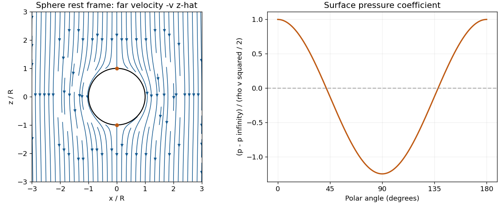

<h1 id="1/e/solution">Solution</h1>

↑ **Parent:** [E](../e.md)

The flow is steady and irrotational, so the [Bernoulli equation](../../../../bernoulli-equation.md) has the same constant throughout the connected exterior. Far from the sphere it equals $v^2/2+p_\infty/\rho$. On the surface the speed is $3v|\sin\theta|/2$, giving

$$
\boxed{p(R,\theta)=p_\infty+\frac{\rho v^2}{2}\left(1-\frac94\sin^2\theta\right).}
$$

The maximum stagnation [pressure](../../../../pressure-split.md) is $p_\infty+\rho v^2/2$ at both poles. At the equator, where the flow is fastest, the [pressure](../../../../pressure-split.md) is $p_\infty-5\rho v^2/8$. The fore-aft symmetry gives zero integrated [pressure](../../../../pressure-split.md) drag in this inviscid model, the content of [D'Alembert's paradox](../../../../d-alembert-s-paradox.md); it does not predict zero drag for a real viscous separated flow.

**[Figure 1](#1/e/image-original-streamlines-around-a-sphere-in-its-rest-frame-and-the-associated-surface-pressure-coefficient-the-far-flow-is-downward-along-negative-z). Original streamlines around a sphere in its rest frame and the associated surface-pressure coefficient; the far flow is downward along negative z**.

## ↑ Ancestors (12)

1. [E](../e.md)
2. [1](../../1.md)
3. [2016](../../../2016-split.md)
4. [Past exam of the flows, fluctuations and complexity course of the University of Oxford](../../../split.md)
5. [Flows, fluctuations and complexity course of the University of Oxford](../../../../flows-fluctuations-and-complexity-course-of-the-university-of-oxford.md)
6. [Year 3 of the physics course of the University of Oxford](../../../../year-3-of-the-physics-course-of-the-university-of-oxford.md)
7. [Physics course of the University of Oxford](../../../../physics-course-of-the-university-of-oxford.md)
8. [Undergraduate course of the University of Oxford](../../../../undergraduate-course-of-the-university-of-oxford.md)
9. [Course of the University of Oxford](../../../../course-of-the-university-of-oxford.md)
10. [University of Oxford](../../../../university-of-oxford-split.md)
11. [List of universities](../../../../list-of-universities.md)
12. [Codex Wiki](../../../../split.md)
