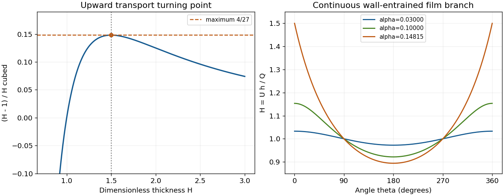

<h1 id="2/e/solution">Solution</h1>

↑ **Parent:** [E](../e.md)

Define $A(H)=(H-1)/H^3$ for positive thickness. Its derivative is $A'(H)=(3-2H)/H^4$, so its maximum is attained at $H=3/2$ and equals $4/27$. At $\theta=0$, the equation requires $A(H)=\alpha$, proving the necessary condition $\alpha\le4/27$.

It is also sufficient for a continuous finite periodic branch. On $0<H\le3/2$, $A$ increases monotonically from $-\infty$ to $4/27$, so every value $\alpha\cos\theta$ in the required range has exactly one root on this branch. It joins $H=1$ where $\cos\theta=0$. The second large-thickness root on the ascending side does not extend to a finite periodic branch through those points.

Thus the limiting maximum thickness occurs at the ascending point of the critical film:

$$
\boxed{\alpha_c=\frac4{27},\qquad H_{\max}=\frac32,\qquad
h_{\max}=\frac{3Q}{2U}.}
$$

Subcritical films satisfy a strict thickness bound there. Equivalently the largest carried flux and critical absolute thickness are

$$
Q_c=\frac23\sqrt{\frac{\nu U^3}{g}},\qquad h_c=\sqrt{\frac{\nu U}{g}}.
$$

The mechanism is a transport capacity limit: wall transport grows only as $Uh$, while opposing gravitational drainage grows as $h^3$. At the critical point, adding thickness no longer increases the upward flux. Indeed $\partial Q/\partial h=U(3/H-2)$ on the steady branch and vanishes at $H=3/2$. Excess liquid cannot be maintained as this globally wall-entrained film and must redistribute or drain.

The algebra establishes existence and the limiting branch of the steady lubrication model. A full temporal free-surface stability result requires its time-dependent equation and, when relevant, [pressure](../../../../pressure-split.md) and capillary corrections; the sign of $\partial Q/\partial h$ alone is not a proof of growth of perturbations.

**[Figure 2](#2/e/image-turning-point-of-the-coating-film-flux-relation-and-the-continuous-thin-film-profiles-approaching-the-critical-value-alpha-4-27). Turning point of the coating-film flux relation and the continuous thin-film profiles approaching the critical value alpha = 4/27**.

## ↑ Ancestors (12)

1. [E](../e.md)
2. [2](../../2.md)
3. [2016](../../../2016-split.md)
4. [Past exam of the flows, fluctuations and complexity course of the University of Oxford](../../../split.md)
5. [Flows, fluctuations and complexity course of the University of Oxford](../../../../flows-fluctuations-and-complexity-course-of-the-university-of-oxford.md)
6. [Year 3 of the physics course of the University of Oxford](../../../../year-3-of-the-physics-course-of-the-university-of-oxford.md)
7. [Physics course of the University of Oxford](../../../../physics-course-of-the-university-of-oxford.md)
8. [Undergraduate course of the University of Oxford](../../../../undergraduate-course-of-the-university-of-oxford.md)
9. [Course of the University of Oxford](../../../../course-of-the-university-of-oxford.md)
10. [University of Oxford](../../../../university-of-oxford-split.md)
11. [List of universities](../../../../list-of-universities.md)
12. [Codex Wiki](../../../../split.md)
