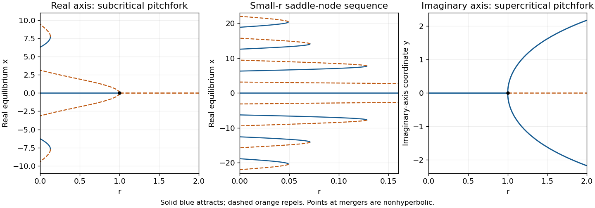

<h1 id="3/c/solution">Solution</h1>

↑ **Parent:** [C](../c.md)

Restrict the complexified equation to the imaginary axis by writing its coordinate as $z=iy$ with real $y$. Transform the left-hand side as well: $i\dot y=iry-i\sinh y$. Thus the real equation along that axis is

$$
\boxed{\dot y=ry-\sinh y.}
$$

For $r<1$, $\sinh y/y>1$ away from zero, so the origin is the only [equilibrium point](../../../../equilibrium-point-of-a-dynamical-system.md) and is attracting. At $r=1$ the leading term is $-y^3/6$, so it remains attracting with algebraic, rather than exponential, relaxation.

For $r>1$, the origin becomes repelling and a unique pair $\pm y_*$ appears, where $r=\sinh y_*/y_*$. Each nonzero root is attracting, since $r-\cosh y_*<0$. Close to the threshold,

$$
\boxed{y_*\simeq\sqrt{6(r-1)}.}
$$

This is a [supercritical pitchfork bifurcation](../../../../supercritical-pitchfork-bifurcation.md), opposite to the real-axis case. The hyperbolic sine confines large real $y$ rather than producing an infinite sequence of oscillatory lobes.

**[Figure 3](#3/c/image-real-axis-sinc-equilibrium-branches-and-the-imaginary-axis-supercritical-pitchfork-solid-branches-attract-and-dashed-branches-repel-with-a-zoom-on-the-small-r-saddle-node-sequence). Real-axis sinc equilibrium branches and the imaginary-axis supercritical pitchfork; solid branches attract and dashed branches repel, with a zoom on the small-r saddle-node sequence**.

## ↑ Ancestors (12)

1. [C](../c.md)
2. [3](../../3.md)
3. [2016](../../../2016-split.md)
4. [Past exam of the flows, fluctuations and complexity course of the University of Oxford](../../../split.md)
5. [Flows, fluctuations and complexity course of the University of Oxford](../../../../flows-fluctuations-and-complexity-course-of-the-university-of-oxford.md)
6. [Year 3 of the physics course of the University of Oxford](../../../../year-3-of-the-physics-course-of-the-university-of-oxford.md)
7. [Physics course of the University of Oxford](../../../../physics-course-of-the-university-of-oxford.md)
8. [Undergraduate course of the University of Oxford](../../../../undergraduate-course-of-the-university-of-oxford.md)
9. [Course of the University of Oxford](../../../../course-of-the-university-of-oxford.md)
10. [University of Oxford](../../../../university-of-oxford-split.md)
11. [List of universities](../../../../list-of-universities.md)
12. [Codex Wiki](../../../../split.md)
