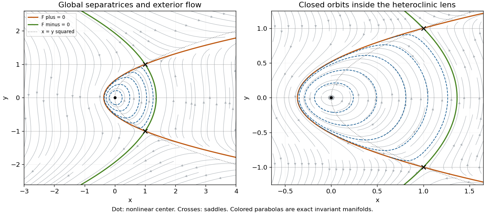

<h1 id="3/d/solution">Solution</h1>

↑ **Parent:** [D](../d.md)

The fixed-point conditions are $y(y^2-1)=0$ and $x=y^2$. They give $(0,0)$ and $(1,\pm1)$. The [Jacobian matrix](../../../../jacobian-matrix.md) is

$$
J=\begin{pmatrix}0&3y^2-1\\1&-2y\end{pmatrix}.
$$

At $(1,1)$ its [eigenvalues](../../../../eigenvalue.md) are $-1\pm\sqrt3$; at $(1,-1)$ they are $1\pm\sqrt3$. Both equilibria are [saddle equilibria](../../../../saddle-equilibrium.md). At the origin the [eigenvalues](../../../../eigenvalue.md) are $\pm i$. This linear calculation alone does not distinguish a nonlinear center from a weak focus.

To settle the origin and the global connections, set

$$
a_\pm=\frac{1\pm\sqrt3}{2},\qquad
F_\pm=x-1-a_\pm(y^2-1).
$$

Using $2a_\pm^2-2a_\pm-1=0$, direct differentiation gives $\dot F_\pm=-2a_\pm yF_\pm$. Hence each parabola $F_\pm=0$ is invariant and, away from them, the following is a [first integral](../../../../first-integral.md):

$$
\boxed{I=|F_+|^{-a_-}|F_-|^{a_+},\qquad\frac{dI}{dt}=0.}
$$

The two parabolas intersect precisely at the [saddle equilibria](../../../../saddle-equilibrium.md). Their arcs between $y=-1$ and $y=1$ enclose the lens

$$
1+a_+(y^2-1)<x<1+a_-(y^2-1),\qquad |y|<1.
$$

Inside it $F_+>0$, $F_-<0$. The origin is a critical point of $\log I$ with negative-definite Hessian $-2\sqrt3$ times the identity. It is therefore a strict local maximum of this [first integral](../../../../first-integral.md), proving a nonlinear [center equilibrium](../../../../center-equilibrium.md). The regular interior levels are closed periodic orbits, circulating anticlockwise. In fact the only critical point of $I$ inside the lens is the origin, so these levels fill the lens up to its boundary.

On $F_+=0$, $\dot y=(a_+-1)(y^2-1)$, so the interior arc runs from the upper [saddle equilibrium](../../../../saddle-equilibrium.md) to the lower. On $F_-=0$ it runs from the lower to the upper. Together they form a [heteroclinic cycle](../../../../heteroclinic-cycle.md). Their outer branches supply the remaining stable and unstable [separatrices](../../../../separatrix.md).

For the full exterior portrait, the two invariant parabolas partition the rest of the plane into four regions. Where both $F_\pm>0$, $\dot y>0$ everywhere; where both are negative, $\dot y<0$. In the region above both [saddle equilibria](../../../../saddle-equilibrium.md), $y>1$ and $\dot x>0$; in the corresponding lower region, $y<-1$ and $\dot x<0$. These exterior trajectories are unbounded and cannot cross the [separatrices](../../../../separatrix.md). The [nullclines](../../../../nullcline.md) are $y=0,\pm1$ for $\dot x=0$ and $x=y^2$ for $\dot y=0$.

**[Figure 4](#3/d/image-full-cubic-quadratic-phase-portrait-and-a-central-zoom-an-anticlockwise-family-of-periodic-orbits-inside-a-heteroclinic-lens-two-saddles-and-unbounded-exterior-trajectories). Full cubic-quadratic phase portrait and a central zoom: an anticlockwise family of periodic orbits inside a heteroclinic lens, two saddles, and unbounded exterior trajectories**.

## ↑ Ancestors (12)

1. [D](../d.md)
2. [3](../../3.md)
3. [2016](../../../2016-split.md)
4. [Past exam of the flows, fluctuations and complexity course of the University of Oxford](../../../split.md)
5. [Flows, fluctuations and complexity course of the University of Oxford](../../../../flows-fluctuations-and-complexity-course-of-the-university-of-oxford.md)
6. [Year 3 of the physics course of the University of Oxford](../../../../year-3-of-the-physics-course-of-the-university-of-oxford.md)
7. [Physics course of the University of Oxford](../../../../physics-course-of-the-university-of-oxford.md)
8. [Undergraduate course of the University of Oxford](../../../../undergraduate-course-of-the-university-of-oxford.md)
9. [Course of the University of Oxford](../../../../course-of-the-university-of-oxford.md)
10. [University of Oxford](../../../../university-of-oxford-split.md)
11. [List of universities](../../../../list-of-universities.md)
12. [Codex Wiki](../../../../split.md)
