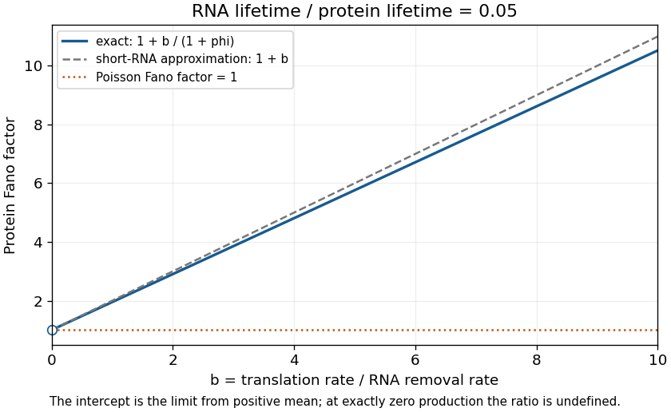

<h1 id="4/c/solution">Solution</h1>

↑ **Parent:** [C](../c.md)

The [protein](../../../../protein-split.md) fluctuation equation gives $\widetilde{\delta P}=(k_P\widetilde{\delta R}+\widetilde\eta_P)/(\gamma_P-i\omega)$. With the stated independent noises,

$$
S_P(\omega)=\frac{q_P}{\gamma_P^2+\omega^2}
+\frac{k_P^2q_R}{(\gamma_P^2+\omega^2)(\gamma_R^2+\omega^2)}.
$$

Partial fractions and the supplied integral give the general [variance](../../../../variance-split.md)

$$
\boxed{\langle\delta P^2\rangle=\frac{q_P}{2\gamma_P}
+\frac{k_P^2q_R}{2\gamma_R\gamma_P(\gamma_R+\gamma_P)}.}
$$

The specific count-noise formula in the question additionally uses the usual steady birth-and-death noise strengths $q_R=2\gamma_RR_*$ and $q_P=2\gamma_PP_*$. Then $P_*=k_PR_*/\gamma_P$ reduces it to $P_*[1+k_P/(\gamma_R+\gamma_P)]$. Arbitrary unspecified $q_R,q_P$ do not by themselves imply this particular [Fano factor](../../../../fano-factor.md).

The requested rewriting is

$$
\boxed{F=1+\frac{b}{1+\phi},\qquad b=\frac{k_P}{\gamma_R},\qquad
\phi=\frac{\gamma_P}{\gamma_R}=\frac{\tau_R}{\tau_P}.}
$$

Here $b$ is the [translational burst size](../../../../translational-burst-size.md), the expected number of [proteins](../../../../protein-split.md) produced during one [RNA](../../../../ribonucleic-acid.md)'s [mean](../../../../expected-value-split.md) lifetime. The ratio $\phi$ compares removal rates, equivalently [RNA](../../../../ribonucleic-acid.md) to [protein](../../../../protein-split.md) [mean](../../../../expected-value-split.md) lifetimes. Poisson molecule-number statistics have [variance](../../../../variance-split.md) equal to [mean](../../../../expected-value-split.md), hence $F=1$.

When [RNA](../../../../ribonucleic-acid.md) is much less stable than [protein](../../../../protein-split.md), $\phi\ll1$ and $F\simeq1+b$. At fixed degradation rates it rises linearly with the rate of [biological translation](../../../../translation-biology.md), with exact slope $1/(\gamma_R+\gamma_P)$. The formal intercept at zero rate is the limit from positive [protein](../../../../protein-split.md) [mean](../../../../expected-value-split.md); at exactly zero production both [mean](../../../../expected-value-split.md) and [variance](../../../../variance-split.md) vanish and their ratio is undefined. A larger [Fano factor](../../../../fano-factor.md) need not imply a larger relative [variance](../../../../variance-split.md) $\operatorname{var}P/P_*^2$, because the [mean](../../../../expected-value-split.md) also increases.

**[Figure 5](#4/c/image-protein-fano-factor-versus-dimensionless-rate-of-biological-translation-for-a-short-lived-rna-and-stable-protein-exact-two-stage-result-burst-approximation-and-the-poisson-baseline). Protein Fano factor versus dimensionless rate of biological translation for a short-lived RNA and stable protein: exact two-stage result, burst approximation, and the Poisson baseline**.

## ↑ Ancestors (12)

1. [C](../c.md)
2. [4](../../4.md)
3. [2016](../../../2016-split.md)
4. [Past exam of the flows, fluctuations and complexity course of the University of Oxford](../../../split.md)
5. [Flows, fluctuations and complexity course of the University of Oxford](../../../../flows-fluctuations-and-complexity-course-of-the-university-of-oxford.md)
6. [Year 3 of the physics course of the University of Oxford](../../../../year-3-of-the-physics-course-of-the-university-of-oxford.md)
7. [Physics course of the University of Oxford](../../../../physics-course-of-the-university-of-oxford.md)
8. [Undergraduate course of the University of Oxford](../../../../undergraduate-course-of-the-university-of-oxford.md)
9. [Course of the University of Oxford](../../../../course-of-the-university-of-oxford.md)
10. [University of Oxford](../../../../university-of-oxford-split.md)
11. [List of universities](../../../../list-of-universities.md)
12. [Codex Wiki](../../../../split.md)
