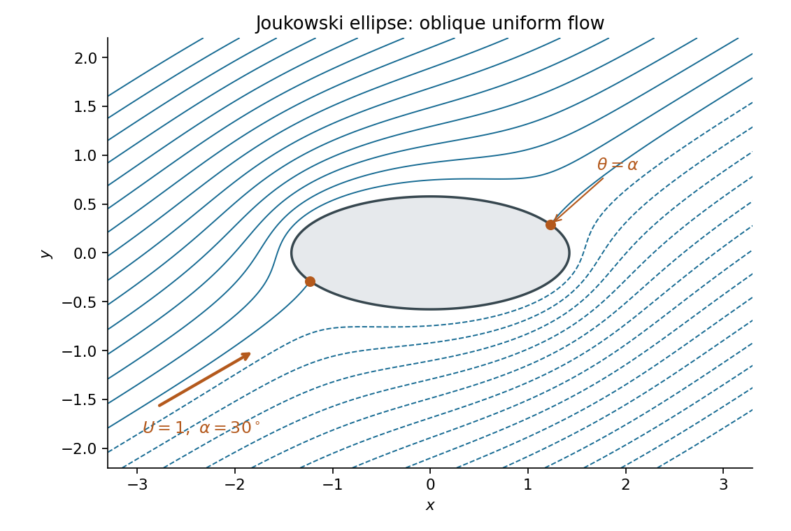

<h1 id="2/e/solution">Solution</h1>

↑ **Parent:** [E](../e.md)

The [complex velocity](../../../../complex-velocity.md) vanishes where $e^{-i\alpha}\zeta^2-e^{i\alpha}=0$, provided its denominator is nonzero. Thus $\zeta=\pm e^{i\alpha}$. Both lie on the [unit circle](../../../../complex-unit-circle.md), and $\zeta^2-a^2\ne0$ since $a<1$. Mapping these points into the physical plane gives

$$
\boxed{z_{\rm stag}=\pm\left[(1+a^2)\cos\alpha+i(1-a^2)\sin\alpha\right].}
$$

Equivalently, the two [stagnation points](../../../../stagnation-point.md) are the opposite points $(A\cos\alpha,B\sin\alpha)$ and $(-A\cos\alpha,-B\sin\alpha)$ on the [ellipse](../../../../ellipse.md). The [conformal map](../../../../conformal-map.md) preserves the zeros of the [complex velocity](../../../../complex-velocity.md) here because its derivative is finite and nonzero on the boundary.

**[Figure 1](#2/e/image-an-oblique-uniform-flow-around-an-ellipse-has-two-mapped-stagnation-points). An oblique uniform flow around an ellipse has two mapped stagnation points**. The example uses $a=0.65$, $U=1$ and $\alpha=30$ degrees. The marked points are $\pm((1+a^2)\cos\alpha,(1-a^2)\sin\alpha)$. Streamlines are level curves of the imaginary part of the mapped complex potential.

## ↑ Ancestors (12)

1. [E](../e.md)
2. [2](../../2.md)
3. [2014](../../../2014-split.md)
4. [Past exam of the fluids and waves course of the University of Oxford](../../../split.md)
5. [Fluids and waves course of the University of Oxford](../../../../fluids-and-waves-course-of-the-university-of-oxford.md)
6. [Year 2 of the mathematics course of the University of Oxford](../../../../year-2-of-the-mathematics-course-of-the-university-of-oxford.md)
7. [Mathematics course of the University of Oxford](../../../../mathematics-course-of-the-university-of-oxford.md)
8. [Undergraduate course of the University of Oxford](../../../../undergraduate-course-of-the-university-of-oxford.md)
9. [Course of the University of Oxford](../../../../course-of-the-university-of-oxford.md)
10. [University of Oxford](../../../../university-of-oxford-split.md)
11. [List of universities](../../../../list-of-universities.md)
12. [Codex Wiki](../../../../split.md)
