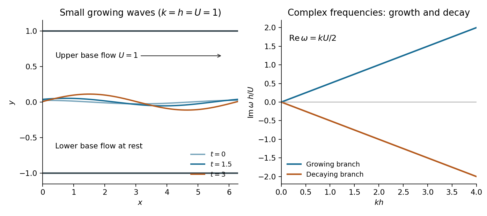

<h1 id="3/c/solution">Solution</h1>

↑ **Parent:** [C](../c.md)

Use complex [normal modes](../../../../normal-mode.md) and take their real parts at the end. Write $\eta=Ae^{i(kx-\omega t)}$, with $k>0$. The [Laplace equation](../../../../laplace-equation.md) and the wall [Neumann boundary conditions](../../../../neumann-boundary-condition.md) give the vertical forms

$$
\phi_+=C_+\cosh(k(y-h))e^{i(kx-\omega t)},\qquad
\phi_-=C_-\cosh(k(y+h))e^{i(kx-\omega t)}.
$$

At $y=0$, the two [kinematic boundary conditions](../../../../kinematic-boundary-condition.md) become

$$
-k\sinh(kh)C_+=-i(\omega-kU)A,\qquad
k\sinh(kh)C_-=-i\omega A.
$$

Thus

$$
C_+=\frac{i(\omega-kU)A}{k\sinh(kh)},\qquad
C_-=-\frac{i\omega A}{k\sinh(kh)}.
$$

The dynamic condition is

$$
\omega C_-\cosh(kh)=(\omega-kU)C_+\cosh(kh).
$$

Substituting the two amplitudes and cancelling the common nonzero depth factor gives the [dispersion relation](../../../../dispersion-relation-split.md) for a [vortex sheet in a symmetric rigid channel](../../../../vortex-sheet-in-a-symmetric-rigid-channel.md):

$$
\omega^2+(\omega-kU)^2=0.
$$

Equivalently,

$$
\left(\omega-\frac{kU}{2}\right)^2=-\frac{k^2U^2}{4},
\qquad
\boxed{\omega=\frac{kU}{2}\pm i\frac{kU}{2}.}
$$

For the specified $U>0$, the plus sign gives positive [temporal growth rate](../../../../growth-rate.md) $\gamma=kU/2$ in the convention $e^{-i\omega t}$. A real growing interface displacement is therefore

$$
\boxed{\eta(x,t)=A_0e^{kUt/2}\cos\left(kx-\frac{kU}{2}t\right).}
$$

The other branch decays at the same rate. Consequently **the interface is linearly unstable**, exhibiting [Kelvin-Helmholtz instability](../../../../kelvin-helmholtz-instability.md). There is no nonzero-amplitude mode with a purely real temporal [frequency](../../../../frequency.md) for $k>0$ and $U\ne0$; the paper's sinusoidal notation must allow a complex [frequency](../../../../frequency.md), with the physical displacement obtained by a real part.

The wave pattern is advected at speed $U/2$, the mean of the two base [velocities](../../../../velocity.md). The growth rate is independent of $h$ here because both layers have the same [mass density](../../../../density.md) and the same depth, making their factors $\coth(kh)$ cancel. In an asymmetric channel those inertia factors would differ. In the zero-shear limit $U=0$, the two roots merge at zero and there is no exponential growth.

**[Figure 2](#3/c/image-a-symmetric-channel-vortex-sheet-develops-an-exponentially-growing-interface-wave). A symmetric-channel vortex sheet develops an exponentially growing interface wave**. Small disturbances are advected at half the upper-fluid speed and grow at rate $kU/2$. The left panel keeps all three snapshots small compared with the wall spacing; the right panel shows the real and growing imaginary parts of the frequency.

## ↑ Ancestors (12)

1. [C](../c.md)
2. [3](../../3.md)
3. [2014](../../../2014-split.md)
4. [Past exam of the fluids and waves course of the University of Oxford](../../../split.md)
5. [Fluids and waves course of the University of Oxford](../../../../fluids-and-waves-course-of-the-university-of-oxford.md)
6. [Year 2 of the mathematics course of the University of Oxford](../../../../year-2-of-the-mathematics-course-of-the-university-of-oxford.md)
7. [Mathematics course of the University of Oxford](../../../../mathematics-course-of-the-university-of-oxford.md)
8. [Undergraduate course of the University of Oxford](../../../../undergraduate-course-of-the-university-of-oxford.md)
9. [Course of the University of Oxford](../../../../course-of-the-university-of-oxford.md)
10. [University of Oxford](../../../../university-of-oxford-split.md)
11. [List of universities](../../../../list-of-universities.md)
12. [Codex Wiki](../../../../split.md)
