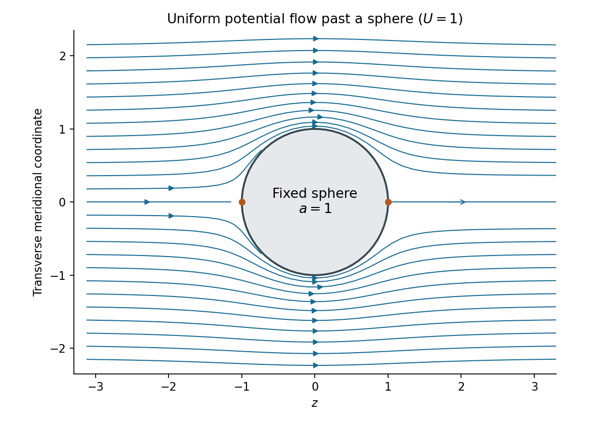
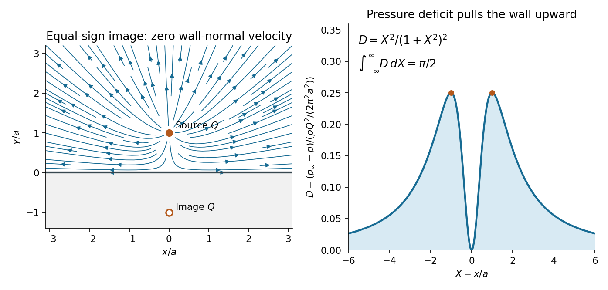
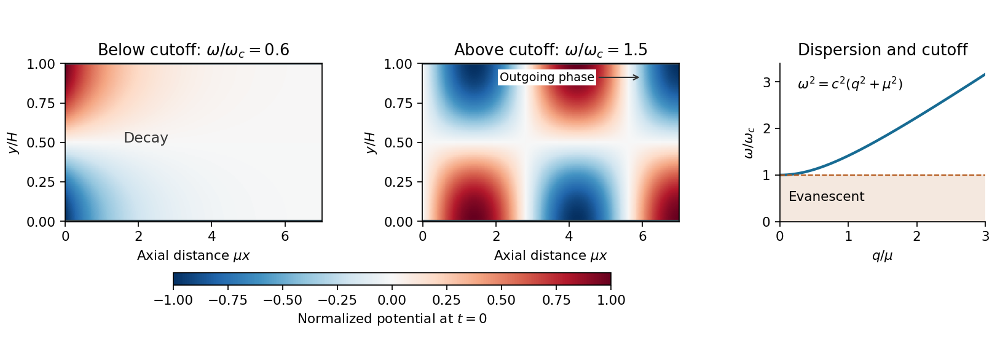

# 2015

↑ **Parent:** [Past exam of the fluids and waves course of the University of Oxford](../past-exam-of-the-fluids-and-waves-course-of-the-university-of-oxford.md)

Solutions to all three questions of the [University of Oxford](../university-of-oxford.md) Part A examination of 16 June 2015, printed as “Waves and Fluids.” Source: [released examination archive](https://www.whatdotheyknow.com/request/maths_papers_2/response/1850333/attach/3/FOI%2020210708%201%20Data.zip?cookie_passthrough=1), member `FOI-20210708-1 - Data/a13760w1.pdf`, printed pages 1–3. Question statements are omitted. Oxford's [published solutions policy](https://www.maths.ox.ac.uk/members/students/undergraduate-courses/examinations-assessments/overview-examinations) excludes this odd-numbered year, and a bounded exact-paper search found no advertised full or partial answers.

**Table of contents**

- [1](#1)
  - [a](#1/a)
    - [Solution](#1/a/solution)
  - [b](#1/b)
    - [Solution](#1/b/solution)
  - [c](#1/c)
    - [Solution](#1/c/solution)
  - [d](#1/d)
    - [Solution](#1/d/solution)
- [2](#2)
  - [a](#2/a)
    - [Solution](#2/a/solution)
  - [b](#2/b)
    - [Solution](#2/b/solution)
  - [c](#2/c)
    - [Solution](#2/c/solution)
  - [d](#2/d)
    - [Solution](#2/d/solution)
- [3](#3)
  - [a](#3/a)
    - [Solution](#3/a/solution)
  - [b](#3/b)
    - [Solution](#3/b/solution)
  - [c](#3/c)
    - [Solution](#3/c/solution)
  - [d](#3/d)
    - [Solution](#3/d/solution)

## 1

↑ **Parent:** [2015](2015.md)

<h3 id="1/a">a</h3>

↑ **Parent:** [1](#1)

<h4 id="1/a/solution">Solution</h4>

↑ **Parent:** [A](#1/a)

Write the planar [velocity field](../fluid-mechanics.md#velocity-field) as $\mathbf u=(u,v,0)$, with $\mathbf k=(0,0,1)$. Expanding the [curl](../multivariable-calculus.md#curl) gives

$$
\mathbf u=\nabla\times(\psi\mathbf k)=(\psi_y,-\psi_x,0),
\qquad \nabla\psi=\mathbf k\times\mathbf u=(-v,u,0).
$$

Consequently, for a piecewise smooth path $\gamma$ from the origin to $\mathbf x=(x,y)$,

$$
\boxed{\psi(\mathbf x)=\psi(\mathbf0)+\int_\gamma(\mathbf k\times\mathbf u)\cdot d\mathbf r
=\psi(\mathbf0)+\int_\gamma(u\,dy-v\,dx).}
$$

The arbitrary additive constant $\psi(\mathbf0)$ may be set to zero. The integrand is exactly $\nabla\psi\cdot d\mathbf r$, so the [fundamental theorem for line integrals](../multivariable-calculus.md#fundamental-theorem-for-line-integrals) proves [path independence](../multivariable-calculus.md#path-independence) immediately: the difference between two paths is the [line integral](../multivariable-calculus.md#line-integral) of a [gradient](../multivariable-calculus.md#gradient) around a [closed curve](../topology.md#closed-curve), which is zero.

One can also see the local integrability condition from [Green's theorem](../multivariable-calculus.md#green-theorem):

$$
\oint(u\,dy-v\,dx)=\iint(u_x+v_y)\,dx\,dy=0,
$$

because the given representation enforces [incompressibility](../fluid-mechanics.md#incompressible-flow). This second proof applies whenever the region between the paths lies in the regular fluid domain. The question already assumes a globally defined [streamfunction](../fluid-mechanics.md#stream-function); without that assumption, [incompressibility](../fluid-mechanics.md#incompressible-flow) alone would guarantee a global [streamfunction](../fluid-mechanics.md#stream-function) on a [simply connected domain](../complex-analysis.md#simply-connected-domain), but a hole carrying nonzero [volume flux](../fluid-mechanics.md#volumetric-flow-rate) could obstruct it.

<h3 id="1/b">b</h3>

↑ **Parent:** [1](#1)

<h4 id="1/b/solution">Solution</h4>

↑ **Parent:** [B](#1/b)

Substitute the given [Stokes streamfunction](../fluid-mechanics.md#stokes-streamfunction) representation into the [divergence](../multivariable-calculus.md#divergence) in [spherical coordinates](../multivariable-calculus.md#spherical-coordinate-system). The mixed derivatives cancel:

$$
\begin{aligned}
\nabla\cdot\mathbf u
&=\frac1{r^2}\partial_r\left(\frac{\Psi_\theta}{\sin\theta}\right)
+\frac1{r\sin\theta}\partial_\theta\left(-\frac{\Psi_r}{r}\right)\\
&=\frac{\Psi_{r\theta}-\Psi_{\theta r}}{r^2\sin\theta}=0.
\end{aligned}
$$

Thus [incompressibility](../fluid-mechanics.md#incompressible-flow) is automatic for a smooth [Stokes streamfunction](../fluid-mechanics.md#stokes-streamfunction). Since this is an [axisymmetric flow](../fluid-mechanics.md#axisymmetric-flow) with no azimuthal [velocity](../classical-mechanics.md#velocity), the only possibly nonzero component of its [vorticity](../vorticity.md) is

$$
\begin{aligned}
(\nabla\times\mathbf u)_\varphi
&=\frac1r\left[\partial_r\left(-\frac{\Psi_r}{\sin\theta}\right)
-\partial_\theta\left(\frac{\Psi_\theta}{r^2\sin\theta}\right)\right]\\
&=-\frac1{r^3\sin\theta}\left[r^2\Psi_{rr}+\sin\theta\,\partial_\theta\left(\frac{\Psi_\theta}{\sin\theta}\right)\right].
\end{aligned}
$$

Define the differential operator in the [Stokes streamfunction equation for irrotational flow](../fluid-mechanics.md#stokes-streamfunction-equation-for-irrotational-flow)

$$
\mathcal L\Psi=r^2\Psi_{rr}+\Psi_{\theta\theta}-\cot\theta\,\Psi_\theta.
$$

The stated equation is $\mathcal L\Psi=0$, and therefore

$$
\boxed{\nabla\cdot\mathbf u=0,\qquad\nabla\times\mathbf u=\mathbf0.}
$$

The [irrotational flow](../vorticity.md#irrotational-flow) has a [velocity potential](../fluid-mechanics.md#velocity-potential) locally, and globally on a regular [simply connected domain](../complex-analysis.md#simply-connected-domain). Regularity of the physical [velocity field](../fluid-mechanics.md#velocity-field) supplies the limiting interpretation on the polar axis, where the coordinate expressions contain $\sin\theta$ in the denominator.

<h3 id="1/c">c</h3>

↑ **Parent:** [1](#1)

<h4 id="1/c/solution">Solution</h4>

↑ **Parent:** [C](#1/c)

Put $s=a^2/r$ and define the image term $G(r,\theta)=(r/a)\Psi(s,\theta)$. The key step is to verify that inversion preserves the [Stokes streamfunction equation for irrotational flow](../fluid-mechanics.md#stokes-streamfunction-equation-for-irrotational-flow). Direct differentiation gives

$$
G_r=\frac1a(\Psi-s\Psi_s),\qquad
G_{rr}=\frac{s^2}{ar}\Psi_{ss},\qquad
G_{\theta\theta}-\cot\theta\,G_\theta
=\frac r a(\Psi_{\theta\theta}-\cot\theta\,\Psi_\theta),
$$

where the quantities on the right are evaluated at $(s,\theta)$. Hence

$$
\mathcal L_rG=\frac r a\left[s^2\Psi_{ss}+\Psi_{\theta\theta}-\cot\theta\,\Psi_\theta\right]
=\frac r a\mathcal L_s\Psi=0.
$$

By [linearity](../vector-space.md#linearity), $\widetilde\Psi=\Psi-G$ obeys the same equation and describes an [incompressible flow](../fluid-mechanics.md#incompressible-flow) and an [irrotational flow](../vorticity.md#irrotational-flow) wherever the original exterior flow is regular.

On the [sphere](../euclidean-geometry.md#sphere), $s=a$ and the two terms cancel identically:

$$
\widetilde\Psi(a,\theta)=0,\qquad
\boxed{\widetilde u_r(a,\theta)=\frac{\partial_\theta\widetilde\Psi(a,\theta)}{a^2\sin\theta}=0.}
$$

Thus the [sphere](../euclidean-geometry.md#sphere) is a stream surface and satisfies the [no-penetration boundary condition](../viscous-fluid-flow.md#no-penetration-boundary-condition). Tangential slip is allowed in this [potential flow](../fluid-mechanics.md#potential-flow) model. For every finite $r>a$, the image argument satisfies $0<s<a$, where $\Psi$ has no singularities. The prefactor $r/a$ is regular there. Therefore the construction creates **no new finite exterior singularities**; any original exterior singularities remain those of the prescribed incident flow. This is the [sphere theorem for a Stokes streamfunction](../fluid-mechanics.md#sphere-theorem-for-a-stokes-streamfunction).

For the far-field claim, the stated bound gives

$$
|G(r,\theta)|\leq\frac r a c\frac{a^2}r=ca
\qquad(r\text{ sufficiently large}).
$$

One must compare [velocities](../classical-mechanics.md#velocity), rather than require the correction to the [Stokes streamfunction](../fluid-mechanics.md#stokes-streamfunction) to tend to zero. Smoothness at the original origin, together with $\Psi(0,\theta)=0$, gives $\Psi_s=O(1)$ and $\Psi_\theta=O(s)$ there. Thus $G_r=O(r^{-1})$ and $G_\theta=O(1)$, and the correction has

$$
\delta u_r=-\frac{G_\theta}{r^2\sin\theta}=O(r^{-2}),\qquad
\delta u_\theta=\frac{G_r}{r\sin\theta}=O(r^{-2}).
$$

These estimates hold away from the coordinate poles, with the regular-axis limits supplied by the original smooth physical flow. Consequently

$$
\boxed{\widetilde{\mathbf u}-\mathbf u\longrightarrow\mathbf0\quad(r\to\infty).}
$$

The far-field [velocity field](../fluid-mechanics.md#velocity-field) is unchanged. For a fully smooth incident [velocity field](../fluid-mechanics.md#velocity-field) at the origin, the usual regular expansion is stronger and makes the sphere disturbance decay as $r^{-3}$.

<h3 id="1/d">d</h3>

↑ **Parent:** [1](#1)

<h4 id="1/d/solution">Solution</h4>

↑ **Parent:** [D](#1/d)

The incident [uniform flow](../fluid-mechanics.md#uniform-flow) $U\mathbf e_z$ has spherical components $u_r=U\cos\theta$, $u_\theta=-U\sin\theta$. Integrating the [Stokes streamfunction](../fluid-mechanics.md#stokes-streamfunction) formulas, with the additive constant chosen to vanish on the axis, gives

$$
\Psi=\frac12Ur^2\sin^2\theta.
$$

It is regular at the origin. Applying the [sphere theorem for a Stokes streamfunction](../fluid-mechanics.md#sphere-theorem-for-a-stokes-streamfunction) yields

$$
\boxed{\widetilde\Psi(r,\theta)=\frac U2\left(r^2-\frac{a^3}r\right)\sin^2\theta.}
$$

The resulting [velocity](../classical-mechanics.md#velocity) components are

$$
\widetilde u_r=U\left(1-\frac{a^3}{r^3}\right)\cos\theta,
\qquad
\widetilde u_\theta=-U\left(1+\frac{a^3}{2r^3}\right)\sin\theta.
$$

To find the [velocity potential](../fluid-mechanics.md#velocity-potential), integrate $\phi_r=\widetilde u_r$ and verify $r^{-1}\phi_\theta=\widetilde u_\theta$. This gives

$$
\boxed{\phi(r,\theta)=U\left(r+\frac{a^3}{2r^2}\right)\cos\theta+\text{constant}.}
$$

The first term is the incident [uniform flow](../fluid-mechanics.md#uniform-flow), and the second is a [potential dipole](../fluid-mechanics.md#potential-dipole) located inside the excluded [sphere](../euclidean-geometry.md#sphere). At $r=a$, the radial [velocity](../classical-mechanics.md#velocity) vanishes, while the far-field [velocity](../classical-mechanics.md#velocity) tends to $U\mathbf e_z$. The poles are [stagnation points](../fluid-mechanics.md#stagnation-point); the surface tangential speed reaches $3U/2$ at the equator. These formulas describe [uniform potential flow around a fixed sphere](../fluid-mechanics.md#uniform-potential-flow-around-a-fixed-sphere).

**[Figure 1](#1/d/image-streamlines-of-a-uniform-potential-flow-around-a-fixed-sphere). Streamlines of a uniform potential flow around a fixed sphere**. A meridional section with $U=a=1$. The solid sphere is impermeable, and the flow approaches a uniform stream in the positive $z$ direction. The two marked surface points are stagnation points.

## 2

↑ **Parent:** [2015](2015.md)

<h3 id="2/a">a</h3>

↑ **Parent:** [2](#2)

<h4 id="2/a/solution">Solution</h4>

↑ **Parent:** [A](#2/a)

Orient $C$ counterclockwise around the body. For an arc element $ds$, the body-outward [unit normal vector](../differential-geometry.md#unit-normal) obeys $\mathbf n\,ds=(dy,-dx)$. The [pressure](../pressure.md) acts normally into the body, so its [force per unit length](../force.md#force-per-unit-length) in the suppressed third direction is

$$
d\mathbf F=-p\mathbf n\,ds=(-p\,dy,p\,dx).
$$

Integrating gives

$$
\boxed{F_x=-\oint_Cp\,dy,\qquad F_y=\oint_Cp\,dx.}
$$

Taking positive [torque](../momentum.md#torque) to mean counterclockwise about the origin, the infinitesimal moment is $dM=x\,dF_y-y\,dF_x=p(x\,dx+y\,dy)$. Hence

$$
\boxed{M=\oint_Cp(x\,dx+y\,dy).}
$$

All three expressions are per unit span. They are the normal-[pressure](../pressure.md) contributions assumed by the inviscid model; a viscous [traction](../continuum-mechanics.md#traction) would require extra terms. A constant [pressure](../pressure.md) contributes zero net [force](../force.md) and [torque](../momentum.md#torque) on a closed body, since $\oint dx=\oint dy=\oint d(x^2+y^2)=0$.

<h3 id="2/b">b</h3>

↑ **Parent:** [2](#2)

<h4 id="2/b/solution">Solution</h4>

↑ **Parent:** [B](#2/b)

Use the [complex velocity](../fluid-mechanics.md#complex-velocity) $q(z)=w'(z)=u-iv$. For this steady, constant-[mass density](../fluid-mechanics.md#density), [irrotational flow](../vorticity.md#irrotational-flow) with no [body force](../fluid-mechanics.md#body-force), the applicable [Bernoulli equation](../euler-equations-for-an-inviscid-fluid.md#bernoulli-equation) is

$$
p+\frac\rho2|q|^2=P_*,
$$

with a single constant $P_*$ throughout the connected regular fluid region. The body's impermeability makes the [velocity](../classical-mechanics.md#velocity) tangent to $C$. Thus $q\,dz$ is real there, giving

$$
q\,dz=\bar q\,d\bar z,\qquad |q|^2d\bar z=q^2dz.
$$

The [complex force](../force.md#complex-force) from part (a) is

$$
\begin{aligned}
F_x-iF_y
&=-i\oint_Cp\,d\bar z\\
&=\frac{i\rho}{2}\oint_C|q|^2d\bar z
=\frac{i\rho}{2}\oint_Cq^2dz,
\end{aligned}
$$

where the constant-$P_*$ term vanishes. This proves the [Blasius force theorem](../fluid-mechanics.md#blasius-force-theorem):

$$
\boxed{F_x-iF_y=\frac{i\rho}{2}\oint_C\left(w'(z)\right)^2dz.}
$$

For the moment, observe that

$$
z\,d\bar z=(x\,dx+y\,dy)+i(y\,dx-x\,dy).
$$

Therefore $M=\operatorname{Re}\oint_Cp\,z\,d\bar z$. The constant [pressure](../pressure.md) contribution has zero real part, because $x\,dx+y\,dy=\tfrac12d(x^2+y^2)$. Substituting [Bernoulli's principle](../euler-equations-for-an-inviscid-fluid.md#bernoulli-s-principle) and the same tangency identity gives the [Blasius moment theorem](../fluid-mechanics.md#blasius-moment-theorem):

$$
\boxed{M=-\frac\rho2\operatorname{Re}\oint_Cz\left(w'(z)\right)^2dz.}
$$

The real-part operation is essential: $\oint z\,d\bar z$ itself need not vanish, but its real part does.

<h3 id="2/c">c</h3>

↑ **Parent:** [2](#2)

<h4 id="2/c/solution">Solution</h4>

↑ **Parent:** [C](#2/c)

The [method of images](../mathematics.md#method-of-images) places an equal [line source](../fluid-mechanics.md#line-source) at $-ia$, outside the physical [upper half-plane](../complex-analysis.md#upper-half-plane-complex-analysis). A convenient [complex potential of a two-dimensional potential flow](../fluid-mechanics.md#complex-potential-of-a-two-dimensional-potential-flow) is

$$
\boxed{w(z)=\frac Q{2\pi}\left[\log(z-ia)+\log(z+ia)\right],\qquad
w'(z)=\frac{Qz}{\pi(z^2+a^2)}.}
$$

The two logarithms can be combined locally as $(Q/(2\pi))\log(z^2+a^2)$; their branches of the [complex logarithm](../analysis.md#complex-logarithm) affect only the potential convention, not the single-valued [complex velocity](../fluid-mechanics.md#complex-velocity). The [point source](../fluid-mechanics.md#point-source) in this two-dimensional problem has the [line source](../fluid-mechanics.md#line-source) normalization: its outward [volume flux](../fluid-mechanics.md#volumetric-flow-rate) is $Q$ per unit span.

Writing $R_-^2=x^2+(y-a)^2$, $R_+^2=x^2+(y+a)^2$, and using $w'=u-iv$, the [velocity field](../fluid-mechanics.md#velocity-field) is

$$
\boxed{u=\frac Q{2\pi}\left(\frac{x}{R_-^2}+\frac{x}{R_+^2}\right),\qquad
v=\frac Q{2\pi}\left(\frac{y-a}{R_-^2}+\frac{y+a}{R_+^2}\right).}
$$

On the wall $y=0$, the vertical components cancel:

$$
\boxed{v(x,0)=0,\qquad u(x,0)=\frac{Qx}{\pi(x^2+a^2)}.}
$$

This is the required [no-penetration boundary condition](../viscous-fluid-flow.md#no-penetration-boundary-condition). Tangential slip is permitted. At large distance the [velocity](../classical-mechanics.md#velocity) decays as $1/r$, and near $z=ia$ its singular part is exactly that of the specified source; the reflected source is regular throughout the fluid. Away from the injection point, this is an [incompressible flow](../fluid-mechanics.md#incompressible-flow) and an [irrotational flow](../vorticity.md#irrotational-flow).

<h3 id="2/d">d</h3>

↑ **Parent:** [2](#2)

<h4 id="2/d/solution">Solution</h4>

↑ **Parent:** [D](#2/d)

Since the [velocity](../classical-mechanics.md#velocity) tends to zero at infinity, the steady [Bernoulli equation](../euler-equations-for-an-inviscid-fluid.md#bernoulli-equation) gives $p+\rho|\mathbf u|^2/2=p_\infty$. On the wall, therefore,

$$
p(x,0)-p_\infty=-\frac{\rho Q^2}{2\pi^2}\frac{x^2}{(x^2+a^2)^2}.
$$

Compute the finite source-induced [force](../force.md) relative to uniform ambient [pressure](../pressure.md), or equivalently use the [gauge pressure](../fluid-mechanics.md#gauge-pressure) $p-p_\infty$. The fluid lies above the wall, so its normal [force](../force.md) on the wall points in $-\mathbf e_y$ for positive [pressure](../pressure.md). The negative excess [pressure](../pressure.md) found here consequently produces an upward net force, toward the source.

For the symmetric section $-R\leq x\leq R$, there is no horizontal [force](../force.md), and the vertical excess [force](../force.md) is

$$
\begin{aligned}
F_y(R)&=-\int_{-R}^R(p-p_\infty)\,dx\\
&=\frac{\rho Q^2}{2\pi^2}\left[\frac1a\arctan\frac Ra-\frac R{R^2+a^2}\right].
\end{aligned}
$$

Here an antiderivative of $x^2/(x^2+a^2)^2$ is $(1/(2a))\arctan(x/a)-x/[2(x^2+a^2)]$. Taking $R\to\infty$ gives the [hydrodynamic attraction of a wall to a line source](../fluid-mechanics.md#hydrodynamic-attraction-of-a-wall-to-a-line-source):

$$
\boxed{F_x=0,\qquad F_y=\frac{\rho Q^2}{4\pi a}.}
$$

Each component is a [force per unit length](../force.md#force-per-unit-length) of the wall in the out-of-plane direction. The result is an attraction even though the source sends fluid away from itself: faster tangential motion reduces the wall [pressure](../pressure.md).

The excess [torque](../momentum.md#torque) about the origin is

$$
M(R)=-\int_{-R}^R x(p-p_\infty)\,dx=0
$$

for every $R$, because the integrand is odd. Thus the symmetric infinite-wall limit is

$$
\boxed{M=0.}
$$

The symmetric prescription matters: the separate one-sided moment integrals grow logarithmically, whereas the [force](../force.md) integral converges absolutely. This is the appropriate [Cauchy principal value](../complex-analysis.md#cauchy-principal-value) for the infinite wall. If one instead asks for the absolute fluid force with no balancing ambient [pressure](../pressure.md) on the other side, its vertical component on a finite section is $-2Rp_\infty+F_y(R)$ and has no finite infinite-wall limit. The finite answer above is the flow-induced load.

**[Figure 2](#2/d/image-an-image-source-enforces-impermeability-while-the-pressure-deficit-attracts-the-wall). An image source enforces impermeability while the pressure deficit attracts the wall**. The equal reflected source lies outside the fluid. The right panel shows the dimensionless pressure deficit at the wall, which vanishes directly below the source, peaks at $|x|=a$, and integrates to the finite upward load.

## 3

↑ **Parent:** [2015](2015.md)

<h3 id="3/a">a</h3>

↑ **Parent:** [3](#3)

<h4 id="3/a/solution">Solution</h4>

↑ **Parent:** [A](#3/a)

Let $V(t)$ be any material [volume](../geometry-and-topology.md#volume), moving with the [velocity field](../fluid-mechanics.md#velocity-field) $\mathbf u$. The [Reynolds transport theorem](../continuum-mechanics.md#reynolds-transport-theorem) in the required form is

$$
\frac d{dt}\int_{V(t)}f\,dV=\int_{V(t)}\left[\partial_t f+\nabla\cdot(f\mathbf u)\right]dV,
$$

applied componentwise when $f$ is vector-valued. [Mass conservation](../continuum-mechanics.md#mass-conservation) gives

$$
0=\frac d{dt}\int_{V(t)}\rho\,dV
=\int_{V(t)}\left[\rho_t+\nabla\cdot(\rho\mathbf u)\right]dV.
$$

Since the material [volume](../geometry-and-topology.md#volume) is arbitrary, the local [continuity equation](../mathematical-physics.md#continuity-equation) follows:

$$
\boxed{\rho_t+\nabla\cdot(\rho\mathbf u)=0.}
$$

For an inviscid fluid with no [body force](../fluid-mechanics.md#body-force), the [balance of linear momentum](../continuum-mechanics.md#balance-of-linear-momentum) equates the rate of change of total [momentum](../momentum.md) to the boundary [pressure](../pressure.md) force:

$$
\frac d{dt}\int_{V(t)}\rho\mathbf u\,dV
=-\int_{\partial V(t)}p\mathbf n\,dS=-\int_{V(t)}\nabla p\,dV,
$$

using the [divergence theorem](../multivariable-calculus.md#divergence-theorem). The integrand on the left expands as

$$
\partial_t(\rho\mathbf u)+\nabla\cdot(\rho\mathbf u\otimes\mathbf u)
=\rho\frac{D\mathbf u}{Dt}+\mathbf u\left[\rho_t+\nabla\cdot(\rho\mathbf u)\right].
$$

The bracket vanishes by [mass conservation](../continuum-mechanics.md#mass-conservation), leaving the [Euler momentum equation](../euler-equations-for-an-inviscid-fluid.md)

$$
\boxed{\rho\frac{D\mathbf u}{Dt}=-\nabla p,\qquad
\frac{D}{Dt}=\partial_t+\mathbf u\cdot\nabla.}
$$

Unlike the [incompressible flow](../fluid-mechanics.md#incompressible-flow) case, the [mass density](../fluid-mechanics.md#density) need not be constant along a [fluid element](../continuum-mechanics.md#fluid-element).

<h3 id="3/b">b</h3>

↑ **Parent:** [3](#3)

<h4 id="3/b/solution">Solution</h4>

↑ **Parent:** [B](#3/b)

The rest state is $\rho=\rho_0$, $p=p_0$, $\mathbf u=\mathbf0$. At [linear order](../algebra.md#linear-order) in the perturbations, the [continuity equation](../mathematical-physics.md#continuity-equation), [Euler momentum equation](../euler-equations-for-an-inviscid-fluid.md) and the given [equation of state](../pressure.md#equation-of-state) become

$$
\rho'_t+\rho_0\nabla\cdot\mathbf u=0,\qquad
\rho_0\mathbf u_t=-\nabla p'=-c^2\nabla\rho'.
$$

For the acoustic component take $\mathbf u=\nabla\phi$. This is consistent with initially zero [vorticity](../vorticity.md), since taking the [curl](../multivariable-calculus.md#curl) of the linear momentum equation gives $\partial_t(\nabla\times\mathbf u)=0$. Any pre-existing linear vortical component is time independent and is separate from the potential oscillations being sought.

Spatial integration of $\rho_0\nabla\phi_t=-c^2\nabla\rho'$ gives $\rho_0\phi_t+c^2\rho'=K(t)$. Adding a function of time to the [velocity potential](../fluid-mechanics.md#velocity-potential) removes $K(t)$ without altering the [velocity field](../fluid-mechanics.md#velocity-field). Hence

$$
\boxed{\rho'=-\frac{\rho_0}{c^2}\phi_t,\qquad p'=-\rho_0\phi_t.}
$$

Substitute the first relation into [mass conservation](../continuum-mechanics.md#mass-conservation):

$$
-\frac{\rho_0}{c^2}\phi_{tt}+\rho_0\nabla^2\phi=0.
$$

Thus the [velocity potential](../fluid-mechanics.md#velocity-potential) satisfies the [wave equation](../wave-equation.md)

$$
\boxed{\phi_{tt}-c^2\nabla^2\phi=0.}
$$

Differentiating that equation in time and using the same density-potential relation gives

$$
\boxed{\rho'_{tt}-c^2\nabla^2\rho'=0.}
$$

Alternatively, differentiate the linear [continuity equation](../mathematical-physics.md#continuity-equation) in time and take the [divergence](../multivariable-calculus.md#divergence) of the linear momentum equation. The coefficient $c$ is the [sound speed](../compressible-flow.md#speed-of-sound), since $dp/d\rho=c^2$.

<h3 id="3/c">c</h3>

↑ **Parent:** [3](#3)

<h4 id="3/c/solution">Solution</h4>

↑ **Parent:** [C](#3/c)

The fixed upper and lower walls have zero normal [velocity](../classical-mechanics.md#velocity). Since $v=\phi_y$, their [no-penetration boundary conditions](../viscous-fluid-flow.md#no-penetration-boundary-condition) are

$$
\boxed{\phi_y=0\quad\text{at }y=0,H.}
$$

For the moving end wall, use its level-set equation $F(x,y,t)=x-X(y,t)=0$. The [kinematic boundary condition](../fluid-mechanics.md#kinematic-boundary-condition) $DF/Dt=0$ gives the exact impermeability relation

$$
u=X_t+vX_y\quad\text{at }x=X(y,t).
$$

Both $v$ and $X_y$ are first order, so their product is second order. A [Taylor expansion](../calculus.md#taylor-expansion) from $x=X$ to $x=0$ changes the first-order perturbation [velocity](../classical-mechanics.md#velocity) only at second order as well. Thus

$$
\boxed{\phi_x(0,y,t)=X_t(y,t)=\epsilon\omega\cos(\omega t)\cos\frac{\pi y}H.}
$$

At infinity, select a bounded response with **no waves incident from $x=+\infty$**. A propagating [acoustic waveguide mode](../wave.md#acoustic-waveguide-mode) must satisfy the outgoing [radiation condition for a waveguide mode](../wave.md#radiation-condition-for-a-waveguide-mode), while a nonpropagating mode must decay. For a time dependence $e^{-i\omega t}$, a propagating axial factor has the form $e^{iqx}$, $q>0$, and obeys $\Phi_x-iq\Phi\to0$. An evanescent factor is $e^{-\alpha x}$, $\alpha>0$.

Requiring $\phi\to0$ for all frequencies would incorrectly exclude the radiated traveling waves. In this lossless channel they retain finite [amplitude](../wave.md#wave-amplitude) arbitrarily far downstream.

<h3 id="3/d">d</h3>

↑ **Parent:** [3](#3)

<h4 id="3/d/solution">Solution</h4>

↑ **Parent:** [D](#3/d)

Let $\mu=\pi/H$. The end-wall forcing has transverse factor $\cos(\mu y)$, which already satisfies both fixed-wall [Neumann boundary conditions](../differential-equation.md#neumann-boundary-condition). By [linearity](../vector-space.md#linearity) and [separation of variables](../partial-differential-equation.md#separation-of-variables), seek its periodic response as

$$
\phi(x,y,t)=\operatorname{Re}\left\{\Phi(x)\cos(\mu y)e^{-i\omega t}\right\}.
$$

Substitution into the [wave equation](../wave-equation.md) and the moving-wall condition gives

$$
\Phi''+\left(\frac{\omega^2}{c^2}-\mu^2\right)\Phi=0,\qquad
\Phi'(0)=\epsilon\omega.
$$

The [acoustic waveguide cutoff](../wave.md#acoustic-waveguide-cutoff) is therefore

$$
\boxed{\omega_c=c\mu=\frac{\pi c}H.}
$$

It is the lowest nonzero transverse-mode frequency. The uniform transverse mode has no cutoff, but is not excited here because $\int_0^H\cos(\pi y/H)\,dy=0$.

For $0<\omega<\omega_c$, put $\alpha=\sqrt{\mu^2-\omega^2/c^2}>0$. The axial equation has solutions $e^{\pm\alpha x}$. Boundedness removes the growing exponential, and $\Phi'(0)=\epsilon\omega$ fixes the coefficient. Thus

$$
\boxed{\phi=-\frac{\epsilon\omega}{\alpha}e^{-\alpha x}\cos\frac{\pi y}H\cos(\omega t)
\qquad(0<\omega<\omega_c).}
$$

This [evanescent wave](../elasticity-physics.md#evanescent-wave) oscillates in time but decays with penetration length $1/\alpha$. Its axial [velocity](../classical-mechanics.md#velocity) is proportional to $\cos(\omega t)$, while its excess [pressure](../pressure.md) $p'=-\rho_0\phi_t$ is proportional to $\sin(\omega t)$. They are in [phase quadrature](../wave.md#phase-quadrature), so their mean product, the axial [acoustic energy flux](../continuum-mechanics.md#acoustic-energy-flux), is zero.

For $\omega>\omega_c$, put $q=\sqrt{\omega^2/c^2-\mu^2}>0$. The axial solutions are $e^{\pm iqx}$. The outgoing condition selects $e^{iqx}$ for the chosen time convention, and

$$
iq\Phi(0)=\epsilon\omega,\qquad
\Phi(x)=\frac{\epsilon\omega}{iq}e^{iqx}.
$$

Taking the real part gives

$$
\boxed{\phi=\frac{\epsilon\omega}{q}\cos\frac{\pi y}H\sin(qx-\omega t)
\qquad(\omega>\omega_c).}
$$

Its axial [velocity](../classical-mechanics.md#velocity) is $\epsilon\omega\cos(\pi y/H)\cos(qx-\omega t)$, so the moving-wall condition is satisfied with the correct sign. This is a traveling [acoustic waveguide mode](../wave.md#acoustic-waveguide-mode) carrying [energy](../energy.md) toward positive $x$. Its [dispersion relation](../dispersion-relation.md) is

$$
\omega^2=c^2(q^2+\mu^2),\qquad
c_{\rm phase}=\frac\omega q>c,\qquad
c_{\rm group}=\frac{d\omega}{dq}=\frac{c^2q}\omega<c.
$$

The larger axial [phase velocity](../dispersion-relation.md#phase-velocity) does not imply faster energy transport: the [group velocity](../dispersion-relation.md#group-velocity) controls that transport.

At $\omega=\omega_c$, the axial equation becomes $\Phi''=0$. The imposed nonzero derivative forces $\Phi=\epsilon\omega_c x+$ a constant, which is unbounded. Thus **there is no bounded periodic response at exact cutoff** for this infinite, undamped, velocity-driven model. The divergent coefficients as $q\to0$ or $\alpha\to0$ also show why the assumed small perturbations fail sufficiently close to cutoff at fixed forcing. Initial conditions can add free transients; the displayed formulas give the selected periodic forced response.

**[Figure 3](#3/d/image-an-oscillating-end-wall-excites-either-an-evanescent-disturbance-or-an-outgoing-acoustic-wave). An oscillating end wall excites either an evanescent disturbance or an outgoing acoustic wave**. The transverse shape is $\cos(\pi y/H)$. Below cutoff, the normalized axial potential decays exponentially; above cutoff it oscillates downstream with an outgoing phase. The right panel shows the common cutoff and the propagating dispersion branch.

## ↑ Ancestors (9)

1. [Past exam of the fluids and waves course of the University of Oxford](../past-exam-of-the-fluids-and-waves-course-of-the-university-of-oxford.md)
2. [Fluids and waves course of the University of Oxford](../university-of-oxford.md#fluids-and-waves-course-of-the-university-of-oxford)
3. [Year 2 of the mathematics course of the University of Oxford](../university-of-oxford.md#year-2-of-the-mathematics-course-of-the-university-of-oxford)
4. [Mathematics course of the University of Oxford](../university-of-oxford.md#mathematics-course-of-the-university-of-oxford)
5. [Undergraduate course of the University of Oxford](../university-of-oxford.md#undergraduate-course-of-the-university-of-oxford)
6. [Course of the University of Oxford](../university-of-oxford.md#course-of-the-university-of-oxford)
7. [University of Oxford](../university-of-oxford.md)
8. [List of universities](../README.md#list-of-universities)
9. [Codex Wiki](../README.md)
