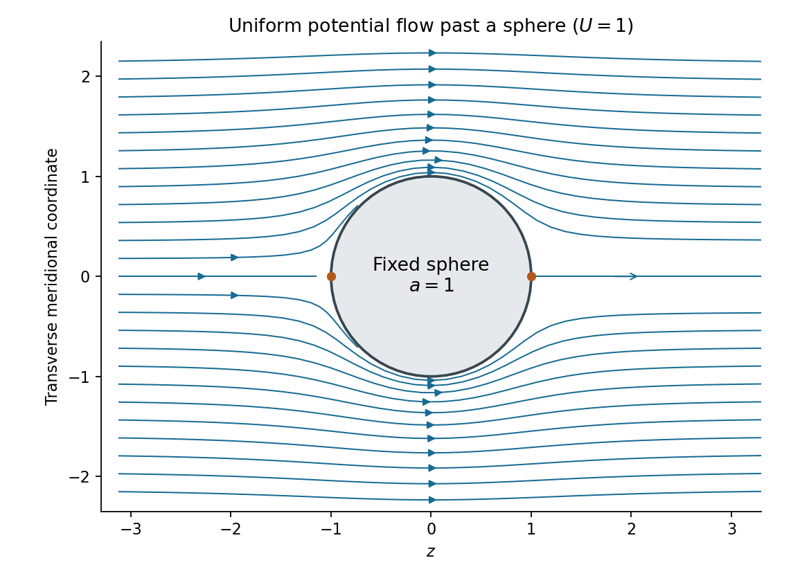

<h1 id="1/d/solution">Solution</h1>

↑ **Parent:** [D](../d.md)

The incident [uniform flow](../../../../uniform-flow.md) $U\mathbf e_z$ has spherical components $u_r=U\cos\theta$, $u_\theta=-U\sin\theta$. Integrating the [Stokes streamfunction](../../../../stokes-streamfunction.md) formulas, with the additive constant chosen to vanish on the axis, gives

$$
\Psi=\frac12Ur^2\sin^2\theta.
$$

It is regular at the origin. Applying the [sphere theorem for a Stokes streamfunction](../../../../sphere-theorem-for-a-stokes-streamfunction.md) yields

$$
\boxed{\widetilde\Psi(r,\theta)=\frac U2\left(r^2-\frac{a^3}r\right)\sin^2\theta.}
$$

The resulting [velocity](../../../../velocity.md) components are

$$
\widetilde u_r=U\left(1-\frac{a^3}{r^3}\right)\cos\theta,
\qquad
\widetilde u_\theta=-U\left(1+\frac{a^3}{2r^3}\right)\sin\theta.
$$

To find the [velocity potential](../../../../velocity-potential.md), integrate $\phi_r=\widetilde u_r$ and verify $r^{-1}\phi_\theta=\widetilde u_\theta$. This gives

$$
\boxed{\phi(r,\theta)=U\left(r+\frac{a^3}{2r^2}\right)\cos\theta+\text{constant}.}
$$

The first term is the incident [uniform flow](../../../../uniform-flow.md), and the second is a [potential dipole](../../../../potential-dipole.md) located inside the excluded [sphere](../../../../sphere.md). At $r=a$, the radial [velocity](../../../../velocity.md) vanishes, while the far-field [velocity](../../../../velocity.md) tends to $U\mathbf e_z$. The poles are [stagnation points](../../../../stagnation-point.md); the surface tangential speed reaches $3U/2$ at the equator. These formulas describe [uniform potential flow around a fixed sphere](../../../../uniform-potential-flow-around-a-fixed-sphere.md).

**[Figure 1](#1/d/image-streamlines-of-a-uniform-potential-flow-around-a-fixed-sphere). Streamlines of a uniform potential flow around a fixed sphere**. A meridional section with $U=a=1$. The solid sphere is impermeable, and the flow approaches a uniform stream in the positive $z$ direction. The two marked surface points are stagnation points.

## ↑ Ancestors (12)

1. [D](../d.md)
2. [1](../../1.md)
3. [2015](../../../2015-split.md)
4. [Past exam of the fluids and waves course of the University of Oxford](../../../split.md)
5. [Fluids and waves course of the University of Oxford](../../../../fluids-and-waves-course-of-the-university-of-oxford.md)
6. [Year 2 of the mathematics course of the University of Oxford](../../../../year-2-of-the-mathematics-course-of-the-university-of-oxford.md)
7. [Mathematics course of the University of Oxford](../../../../mathematics-course-of-the-university-of-oxford.md)
8. [Undergraduate course of the University of Oxford](../../../../undergraduate-course-of-the-university-of-oxford.md)
9. [Course of the University of Oxford](../../../../course-of-the-university-of-oxford.md)
10. [University of Oxford](../../../../university-of-oxford-split.md)
11. [List of universities](../../../../list-of-universities.md)
12. [Codex Wiki](../../../../split.md)
