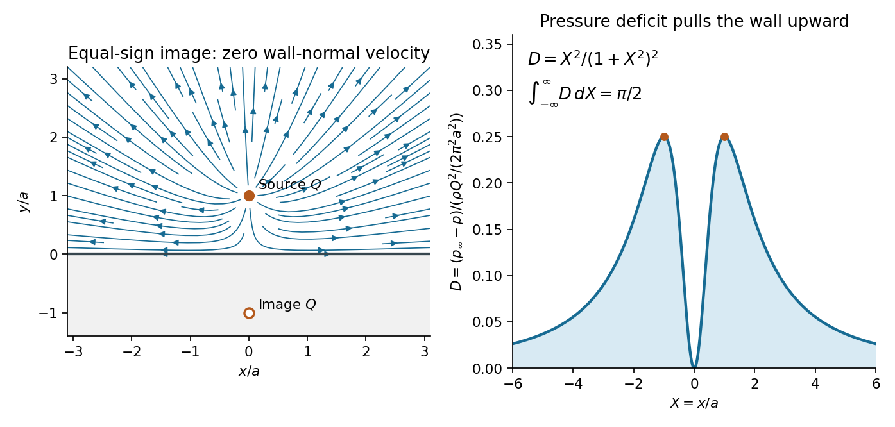

<h1 id="2/d/solution">Solution</h1>

↑ **Parent:** [D](../d.md)

Since the [velocity](../../../../velocity.md) tends to zero at infinity, the steady [Bernoulli equation](../../../../bernoulli-equation.md) gives $p+\rho|\mathbf u|^2/2=p_\infty$. On the wall, therefore,

$$
p(x,0)-p_\infty=-\frac{\rho Q^2}{2\pi^2}\frac{x^2}{(x^2+a^2)^2}.
$$

Compute the finite source-induced [force](../../../../force-split.md) relative to uniform ambient [pressure](../../../../pressure-split.md), or equivalently use the [gauge pressure](../../../../gauge-pressure.md) $p-p_\infty$. The fluid lies above the wall, so its normal [force](../../../../force-split.md) on the wall points in $-\mathbf e_y$ for positive [pressure](../../../../pressure-split.md). The negative excess [pressure](../../../../pressure-split.md) found here consequently produces an upward net force, toward the source.

For the symmetric section $-R\leq x\leq R$, there is no horizontal [force](../../../../force-split.md), and the vertical excess [force](../../../../force-split.md) is

$$
\begin{aligned}
F_y(R)&=-\int_{-R}^R(p-p_\infty)\,dx\\
&=\frac{\rho Q^2}{2\pi^2}\left[\frac1a\arctan\frac Ra-\frac R{R^2+a^2}\right].
\end{aligned}
$$

Here an antiderivative of $x^2/(x^2+a^2)^2$ is $(1/(2a))\arctan(x/a)-x/[2(x^2+a^2)]$. Taking $R\to\infty$ gives the [hydrodynamic attraction of a wall to a line source](../../../../hydrodynamic-attraction-of-a-wall-to-a-line-source.md):

$$
\boxed{F_x=0,\qquad F_y=\frac{\rho Q^2}{4\pi a}.}
$$

Each component is a [force per unit length](../../../../force-per-unit-length.md) of the wall in the out-of-plane direction. The result is an attraction even though the source sends fluid away from itself: faster tangential motion reduces the wall [pressure](../../../../pressure-split.md).

The excess [torque](../../../../torque.md) about the origin is

$$
M(R)=-\int_{-R}^R x(p-p_\infty)\,dx=0
$$

for every $R$, because the integrand is odd. Thus the symmetric infinite-wall limit is

$$
\boxed{M=0.}
$$

The symmetric prescription matters: the separate one-sided moment integrals grow logarithmically, whereas the [force](../../../../force-split.md) integral converges absolutely. This is the appropriate [Cauchy principal value](../../../../cauchy-principal-value.md) for the infinite wall. If one instead asks for the absolute fluid force with no balancing ambient [pressure](../../../../pressure-split.md) on the other side, its vertical component on a finite section is $-2Rp_\infty+F_y(R)$ and has no finite infinite-wall limit. The finite answer above is the flow-induced load.

**[Figure 2](#2/d/image-an-image-source-enforces-impermeability-while-the-pressure-deficit-attracts-the-wall). An image source enforces impermeability while the pressure deficit attracts the wall**. The equal reflected source lies outside the fluid. The right panel shows the dimensionless pressure deficit at the wall, which vanishes directly below the source, peaks at $|x|=a$, and integrates to the finite upward load.

## ↑ Ancestors (12)

1. [D](../d.md)
2. [2](../../2.md)
3. [2015](../../../2015-split.md)
4. [Past exam of the fluids and waves course of the University of Oxford](../../../split.md)
5. [Fluids and waves course of the University of Oxford](../../../../fluids-and-waves-course-of-the-university-of-oxford.md)
6. [Year 2 of the mathematics course of the University of Oxford](../../../../year-2-of-the-mathematics-course-of-the-university-of-oxford.md)
7. [Mathematics course of the University of Oxford](../../../../mathematics-course-of-the-university-of-oxford.md)
8. [Undergraduate course of the University of Oxford](../../../../undergraduate-course-of-the-university-of-oxford.md)
9. [Course of the University of Oxford](../../../../course-of-the-university-of-oxford.md)
10. [University of Oxford](../../../../university-of-oxford-split.md)
11. [List of universities](../../../../list-of-universities.md)
12. [Codex Wiki](../../../../split.md)
