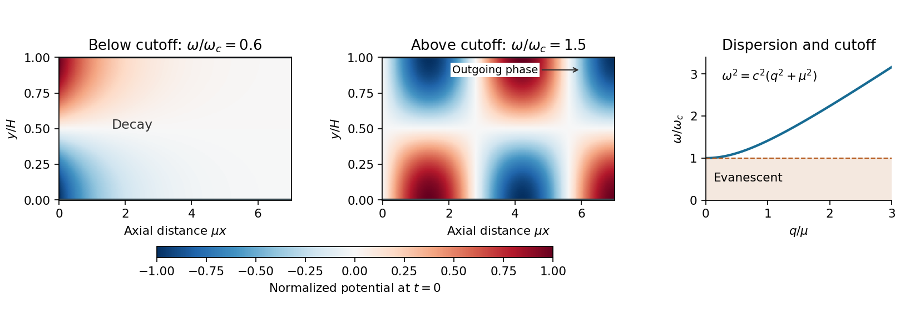

<h1 id="3/d/solution">Solution</h1>

↑ **Parent:** [D](../d.md)

Let $\mu=\pi/H$. The end-wall forcing has transverse factor $\cos(\mu y)$, which already satisfies both fixed-wall [Neumann boundary conditions](../../../../neumann-boundary-condition.md). By [linearity](../../../../linearity.md) and [separation of variables](../../../../separation-of-variables.md), seek its periodic response as

$$
\phi(x,y,t)=\operatorname{Re}\left\{\Phi(x)\cos(\mu y)e^{-i\omega t}\right\}.
$$

Substitution into the [wave equation](../../../../wave-equation-split.md) and the moving-wall condition gives

$$
\Phi''+\left(\frac{\omega^2}{c^2}-\mu^2\right)\Phi=0,\qquad
\Phi'(0)=\epsilon\omega.
$$

The [acoustic waveguide cutoff](../../../../acoustic-waveguide-cutoff.md) is therefore

$$
\boxed{\omega_c=c\mu=\frac{\pi c}H.}
$$

It is the lowest nonzero transverse-mode frequency. The uniform transverse mode has no cutoff, but is not excited here because $\int_0^H\cos(\pi y/H)\,dy=0$.

For $0<\omega<\omega_c$, put $\alpha=\sqrt{\mu^2-\omega^2/c^2}>0$. The axial equation has solutions $e^{\pm\alpha x}$. Boundedness removes the growing exponential, and $\Phi'(0)=\epsilon\omega$ fixes the coefficient. Thus

$$
\boxed{\phi=-\frac{\epsilon\omega}{\alpha}e^{-\alpha x}\cos\frac{\pi y}H\cos(\omega t)
\qquad(0<\omega<\omega_c).}
$$

This [evanescent wave](../../../../evanescent-wave.md) oscillates in time but decays with penetration length $1/\alpha$. Its axial [velocity](../../../../velocity.md) is proportional to $\cos(\omega t)$, while its excess [pressure](../../../../pressure-split.md) $p'=-\rho_0\phi_t$ is proportional to $\sin(\omega t)$. They are in [phase quadrature](../../../../phase-quadrature.md), so their mean product, the axial [acoustic energy flux](../../../../acoustic-energy-flux.md), is zero.

For $\omega>\omega_c$, put $q=\sqrt{\omega^2/c^2-\mu^2}>0$. The axial solutions are $e^{\pm iqx}$. The outgoing condition selects $e^{iqx}$ for the chosen time convention, and

$$
iq\Phi(0)=\epsilon\omega,\qquad
\Phi(x)=\frac{\epsilon\omega}{iq}e^{iqx}.
$$

Taking the real part gives

$$
\boxed{\phi=\frac{\epsilon\omega}{q}\cos\frac{\pi y}H\sin(qx-\omega t)
\qquad(\omega>\omega_c).}
$$

Its axial [velocity](../../../../velocity.md) is $\epsilon\omega\cos(\pi y/H)\cos(qx-\omega t)$, so the moving-wall condition is satisfied with the correct sign. This is a traveling [acoustic waveguide mode](../../../../acoustic-waveguide-mode.md) carrying [energy](../../../../energy-split.md) toward positive $x$. Its [dispersion relation](../../../../dispersion-relation-split.md) is

$$
\omega^2=c^2(q^2+\mu^2),\qquad
c_{\rm phase}=\frac\omega q>c,\qquad
c_{\rm group}=\frac{d\omega}{dq}=\frac{c^2q}\omega<c.
$$

The larger axial [phase velocity](../../../../phase-velocity.md) does not imply faster energy transport: the [group velocity](../../../../group-velocity.md) controls that transport.

At $\omega=\omega_c$, the axial equation becomes $\Phi''=0$. The imposed nonzero derivative forces $\Phi=\epsilon\omega_c x+$ a constant, which is unbounded. Thus **there is no bounded periodic response at exact cutoff** for this infinite, undamped, velocity-driven model. The divergent coefficients as $q\to0$ or $\alpha\to0$ also show why the assumed small perturbations fail sufficiently close to cutoff at fixed forcing. Initial conditions can add free transients; the displayed formulas give the selected periodic forced response.

**[Figure 3](#3/d/image-an-oscillating-end-wall-excites-either-an-evanescent-disturbance-or-an-outgoing-acoustic-wave). An oscillating end wall excites either an evanescent disturbance or an outgoing acoustic wave**. The transverse shape is $\cos(\pi y/H)$. Below cutoff, the normalized axial potential decays exponentially; above cutoff it oscillates downstream with an outgoing phase. The right panel shows the common cutoff and the propagating dispersion branch.

## ↑ Ancestors (12)

1. [D](../d.md)
2. [3](../../3.md)
3. [2015](../../../2015-split.md)
4. [Past exam of the fluids and waves course of the University of Oxford](../../../split.md)
5. [Fluids and waves course of the University of Oxford](../../../../fluids-and-waves-course-of-the-university-of-oxford.md)
6. [Year 2 of the mathematics course of the University of Oxford](../../../../year-2-of-the-mathematics-course-of-the-university-of-oxford.md)
7. [Mathematics course of the University of Oxford](../../../../mathematics-course-of-the-university-of-oxford.md)
8. [Undergraduate course of the University of Oxford](../../../../undergraduate-course-of-the-university-of-oxford.md)
9. [Course of the University of Oxford](../../../../course-of-the-university-of-oxford.md)
10. [University of Oxford](../../../../university-of-oxford-split.md)
11. [List of universities](../../../../list-of-universities.md)
12. [Codex Wiki](../../../../split.md)
