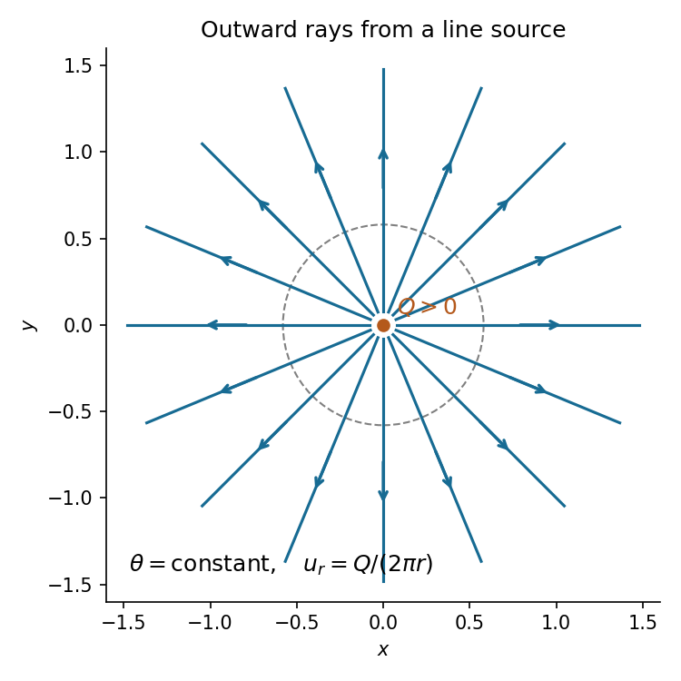
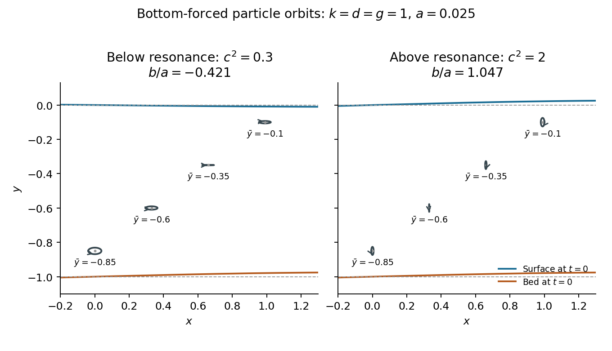

# 2017

↑ **Parent:** [Past exam of the fluids and waves course of the University of Oxford](../past-exam-of-the-fluids-and-waves-course-of-the-university-of-oxford.md)

Solutions to all three questions of the [University of Oxford](../university-of-oxford.md) Part A fluids and waves examination, sat on 17 June 2017. Source: [released examination archive](https://www.whatdotheyknow.com/request/maths_papers_2/response/1850333/attach/3/FOI%2020210708%201%20Data.zip?cookie_passthrough=1), member `FOI-20210708-1 - Data/a15292w1 (2).pdf`, printed pages 1–4. Question statements are omitted. Oxford's [published solutions policy](https://www.maths.ox.ac.uk/members/students/undergraduate-courses/examinations-assessments/overview-examinations) excludes 2017; a bounded search found no advertised full solutions for this exact paper.

**Table of contents**

- [1](#1)
  - [a](#1/a)
    - [i](#1/a/i)
      - [Solution](#1/a/i/solution)
    - [ii](#1/a/ii)
      - [Solution](#1/a/ii/solution)
    - [iii](#1/a/iii)
      - [Solution](#1/a/iii/solution)
  - [b](#1/b)
    - [i](#1/b/i)
      - [Solution](#1/b/i/solution)
    - [ii](#1/b/ii)
      - [Solution](#1/b/ii/solution)
    - [iii](#1/b/iii)
      - [Solution](#1/b/iii/solution)
  - [c](#1/c)
    - [Solution](#1/c/solution)
- [2](#2)
  - [a](#2/a)
    - [i](#2/a/i)
      - [Solution](#2/a/i/solution)
    - [ii](#2/a/ii)
      - [Solution](#2/a/ii/solution)
    - [iii](#2/a/iii)
      - [Solution](#2/a/iii/solution)
  - [b](#2/b)
    - [i](#2/b/i)
      - [Solution](#2/b/i/solution)
    - [ii](#2/b/ii)
      - [Solution](#2/b/ii/solution)
    - [iii](#2/b/iii)
      - [Solution](#2/b/iii/solution)
    - [iv](#2/b/iv)
      - [Solution](#2/b/iv/solution)
- [3](#3)
  - [a](#3/a)
    - [i](#3/a/i)
      - [Solution](#3/a/i/solution)
    - [ii](#3/a/ii)
      - [Solution](#3/a/ii/solution)
  - [b](#3/b)
    - [i](#3/b/i)
      - [Solution](#3/b/i/solution)
    - [ii](#3/b/ii)
      - [Solution](#3/b/ii/solution)
    - [iii](#3/b/iii)
      - [Solution](#3/b/iii/solution)
  - [c](#3/c)
    - [Solution](#3/c/solution)

## 1

↑ **Parent:** [2017](2017.md)

<h3 id="1/a">a</h3>

↑ **Parent:** [1](#1)

<h4 id="1/a/i">i</h4>

↑ **Parent:** [A](#1/a)

<h5 id="1/a/i/solution">Solution</h5>

↑ **Parent:** [I](#1/a/i)

For a scalar fluid property $f(\mathbf x,t)$, the [Eulerian time derivative](../continuum-mechanics.md#eulerian-time-derivative) $\partial_t f$ measures change at a fixed [Eulerian coordinate](../continuum-mechanics.md#eulerian-coordinate). The [material derivative](../continuum-mechanics.md#material-derivative), also called the Lagrangian time derivative, measures change while following one [fluid element](../continuum-mechanics.md#fluid-element). If its [Lagrangian trajectory](../continuum-mechanics.md#lagrangian-trajectory) is $\mathbf X(\mathbf a,t)$, where $\mathbf a$ is its fixed [Lagrangian coordinate](../continuum-mechanics.md#lagrangian-coordinate), then $\partial_t\mathbf X=\mathbf u(\mathbf X,t)$.

The [chain rule](../calculus.md#chain-rule) therefore gives

$$
\boxed{\frac{Df}{Dt}=\frac d{dt}f(\mathbf X(\mathbf a,t),t)=\frac{\partial f}{\partial t}+\mathbf u\cdot\nabla f.}
$$

The last term accounts for entering a region where the property differs. For example, a spatially varying but time-independent [velocity field](../fluid-mechanics.md#velocity-field) has zero [Eulerian time derivative](../continuum-mechanics.md#eulerian-time-derivative), while a moving [fluid element](../continuum-mechanics.md#fluid-element) can have nonzero [material acceleration](../continuum-mechanics.md#material-acceleration). The same formula applies componentwise to a [vector field](../multivariable-calculus.md#vector-field).

<h4 id="1/a/ii">ii</h4>

↑ **Parent:** [A](#1/a)

<h5 id="1/a/ii/solution">Solution</h5>

↑ **Parent:** [Ii](#1/a/ii)

Let $V(t)$ be a smoothly moving material [volume](../geometry-and-topology.md#volume), carried by a smooth [velocity field](../fluid-mechanics.md#velocity-field) $\mathbf u$, and let $f$ be continuously differentiable. The material-volume form of the [Reynolds transport theorem](../continuum-mechanics.md#reynolds-transport-theorem) states

$$
\boxed{\frac d{dt}\int_{V(t)}f\,dV=\int_{V(t)}\left(\frac{Df}{Dt}+f\nabla\cdot\mathbf u\right)dV.}
$$

Equivalently, the [divergence theorem](../multivariable-calculus.md#divergence-theorem) gives

$$
\frac d{dt}\int_{V(t)}f\,dV=\int_{V(t)}\partial_t f\,dV+\int_{\partial V(t)}f\mathbf u\cdot\mathbf n\,dS,
$$

where $\mathbf n$ is the outward [unit normal vector](../differential-geometry.md#unit-normal). The second integral measures the [flux](../mathematical-physics.md#flux) carried across the instantaneous boundary by its motion.

For the proof, use the particle map $\mathbf x=\mathbf X(\mathbf a,t)$ from $V(0)$, with positive [Jacobian determinant](../multivariable-calculus.md#jacobian-determinant) $J=\det(\partial\mathbf X/\partial\mathbf a)$. [Euler's volume identity](../dynamical-systems.md#euler-s-volume-identity) is

$$
\partial_tJ=J\nabla\cdot\mathbf u.
$$

It is the [Jacobian evolution of a smooth flow](../dynamical-systems.md#jacobian-evolution-of-a-smooth-flow): if $F=\partial\mathbf X/\partial\mathbf a$, differentiation gives $F_t=(\nabla\mathbf u)F$, and differentiation of the [determinant](../multilinear-algebra.md#determinant) gives $J_t=J\operatorname{tr}(F^{-1}F_t)=J\nabla\cdot\mathbf u$. The [change of variables](../multivariable-calculus.md#change-of-variables-formula) formula now moves the integral to the fixed reference [volume](../geometry-and-topology.md#volume):

$$
\begin{aligned}
\frac d{dt}\int_{V(t)}f\,dV
&=\frac d{dt}\int_{V(0)}f(\mathbf X(\mathbf a,t),t)J\,d\mathbf a\\
&=\int_{V(0)}\left(\frac{Df}{Dt}J+fJ_t\right)d\mathbf a\\
&=\int_{V(t)}\left(\frac{Df}{Dt}+f\nabla\cdot\mathbf u\right)dV.
\end{aligned}
$$

Finally, $Df/Dt+f\nabla\cdot\mathbf u=\partial_t f+\nabla\cdot(f\mathbf u)$, giving the equivalent boundary form.

<h4 id="1/a/iii">iii</h4>

↑ **Parent:** [A](#1/a)

<h5 id="1/a/iii/solution">Solution</h5>

↑ **Parent:** [Iii](#1/a/iii)

Write $\rho$ for the [mass density](../fluid-mechanics.md#density). A material [volume](../geometry-and-topology.md#volume) contains the same [fluid elements](../continuum-mechanics.md#fluid-element) at all times, so [conservation of mass](../continuum-mechanics.md#mass-conservation) requires

$$
0=\frac d{dt}\int_{V(t)}\rho\,dV=\int_{V(t)}\left(\partial_t\rho+\nabla\cdot(\rho\mathbf u)\right)dV,
$$

by the [Reynolds transport theorem](../continuum-mechanics.md#reynolds-transport-theorem). Since the initial material [volume](../geometry-and-topology.md#volume) can be chosen arbitrarily, continuity of the integrand forces it to vanish pointwise. Thus the [continuity equation](../mathematical-physics.md#continuity-equation) is

$$
\boxed{\partial_t\rho+\nabla\cdot(\rho\mathbf u)=0,\qquad\frac{D\rho}{Dt}+\rho\nabla\cdot\mathbf u=0.}
$$

For positive [mass density](../fluid-mechanics.md#density), the [incompressibility condition](../fluid-mechanics.md#incompressible-flow) $D\rho/Dt=0$ reduces this to $\nabla\cdot\mathbf u=0$. [Mass conservation](../continuum-mechanics.md#mass-conservation) itself does not require [incompressible flow](../fluid-mechanics.md#incompressible-flow).

<h3 id="1/b">b</h3>

↑ **Parent:** [1](#1)

<h4 id="1/b/i">i</h4>

↑ **Parent:** [B](#1/b)

<h5 id="1/b/i/solution">Solution</h5>

↑ **Parent:** [I](#1/b/i)

Work away from the [line source](../fluid-mechanics.md#line-source), so $r>0$. In [polar coordinates](../multivariable-calculus.md#polar-coordinates), $u_r=Q/(2\pi r)$ and $u_\theta=0$. The supplied [divergence](../multivariable-calculus.md#divergence) and [curl](../multivariable-calculus.md#curl) formulas give

$$
\nabla\cdot\mathbf u=\frac1r\partial_r\left(\frac Q{2\pi}\right)=0,
\qquad
(\nabla\times\mathbf u)_z=\frac1r\left[\partial_r(ru_\theta)-\partial_\theta u_r\right]=0.
$$

Hence **the field defines an [incompressible flow](../fluid-mechanics.md#incompressible-flow) and an [irrotational flow](../vorticity.md#irrotational-flow) for $r>0$**. The restriction matters: the outward [volume flux](../fluid-mechanics.md#volumetric-flow-rate) through any enclosing [circle](../topology.md#circle) is

$$
\int_0^{2\pi}\frac{Q}{2\pi r}r\,d\theta=Q.
$$

The origin is the excluded injection point. Applying the [divergence theorem](../multivariable-calculus.md#divergence-theorem) to a disk through that [singularity](../complex-analysis.md#complex-singularity) would violate its smoothness hypothesis.

<h4 id="1/b/ii">ii</h4>

↑ **Parent:** [B](#1/b)

<h5 id="1/b/ii/solution">Solution</h5>

↑ **Parent:** [Ii](#1/b/ii)

A [velocity potential](../fluid-mechanics.md#velocity-potential) satisfies $\mathbf u=\nabla\phi$. Integration of $\phi_r=Q/(2\pi r)$ and $r^{-1}\phi_\theta=0$ gives

$$
\boxed{\phi=\frac Q{2\pi}\log r.}
$$

Choose the [streamfunction](../fluid-mechanics.md#stream-function) convention $u=\psi_y$, $v=-\psi_x$. Its [streamfunction in polar coordinates](../fluid-mechanics.md#streamfunction-in-polar-coordinates) satisfies $u_r=r^{-1}\psi_\theta$ and $u_\theta=-\psi_r$, so

$$
\boxed{\psi=\frac Q{2\pi}\theta,\qquad w(z)=\phi+i\psi=\frac Q{2\pi}\log z.}
$$

Additive constants are immaterial. This [complex potential of a two-dimensional potential flow](../fluid-mechanics.md#complex-potential-of-a-two-dimensional-potential-flow) is defined on a chosen [logarithm branch](../analysis.md#branch-of-the-complex-logarithm). Its [complex velocity](../fluid-mechanics.md#complex-velocity) $w'=Q/(2\pi z)=u-iv$ is single-valued away from the origin. Continuing once around the [line source](../fluid-mechanics.md#line-source) increases $\psi$ by $Q$, consistently with its nonzero [volume flux](../fluid-mechanics.md#volumetric-flow-rate).

<h4 id="1/b/iii">iii</h4>

↑ **Parent:** [B](#1/b)

<h5 id="1/b/iii/solution">Solution</h5>

↑ **Parent:** [Iii](#1/b/iii)

The [streamlines](../fluid-mechanics.md#streamline) are the level curves of the [streamfunction](../fluid-mechanics.md#stream-function), so $\theta$ is constant: **radial rays directed outwards from the origin**. Their arrows point outwards because $Q>0$. A complete straight line through the origin comprises two distinct rays separated by the excluded [line source](../fluid-mechanics.md#line-source). Equivalently, $r\dot\theta=u_\theta=0$ and $\dot r=Q/(2\pi r)>0$ along each [pathline](../fluid-mechanics.md#pathline); the [steady flow](../fluid-mechanics.md#steady-flow) makes these the same curves as the [streamlines](../fluid-mechanics.md#streamline).

**[Figure 1](#1/b/iii/image-radial-streamlines-of-a-positive-line-source). Radial streamlines of a positive line source**. The excluded source is marked at the origin. Every streamline is an outward ray, and every enclosing circle carries the same outward volume flux $Q$.

<h3 id="1/c">c</h3>

↑ **Parent:** [1](#1)

<h4 id="1/c/solution">Solution</h4>

↑ **Parent:** [C](#1/c)

Set $f(z)=\cosh(\pi z/a)$. The [hyperbolic cosine](../calculus.md#hyperbolic-cosine) addition formula gives

$$
f(x+iy)=\cosh\frac{\pi x}a\cos\frac{\pi y}a+i\sinh\frac{\pi x}a\sin\frac{\pi y}a.
$$

For $x>0$ and $0<y<a$, both factors in the imaginary part are positive. Thus the image lies in the [upper half-plane](../complex-analysis.md#upper-half-plane-complex-analysis). The three walls map onto the entire [real axis](../complex-analysis.md#real-axis):

$$
\begin{aligned}
y=0&:\quad f\in[1,\infty),\\
x=0&:\quad f\in[-1,1],\\
y=a&:\quad f\in(-\infty,-1].
\end{aligned}
$$

Also $f'(z)=(\pi/a)\sinh(\pi z/a)\ne0$ in the interior.

To verify that this is a one-to-one [conformal map](../geometry-and-topology.md#conformal-map) onto the whole [upper half-plane](../complex-analysis.md#upper-half-plane-complex-analysis), factor it through $s=e^{\pi z/a}$. This first map is one-to-one onto $|s|>1$, $\operatorname{Im}s>0$, and $f(z)=(s+s^{-1})/2$. Given any $\operatorname{Im}\zeta>0$, the roots of $s^2-2\zeta s+1=0$ have product one. Neither lies on $|s|=1$, since that would make $\zeta$ real. Exactly one root therefore has $|s|>1$, and

$$
\operatorname{Im}\zeta=\tfrac12(1-|s|^{-2})\operatorname{Im}s
$$

forces that root into the upper half of the exterior disk. It has a unique preimage $z=(a/\pi)(\log|s|+i\arg s)$ with $0<\arg s<\pi$. This proves both surjectivity and injectivity. The construction is the [hyperbolic-cosine map of a half-strip](../geometry-and-topology.md#hyperbolic-cosine-map-of-a-half-strip).

The source location $c$ is complex, with $\operatorname{Re}c>0$ and $0<\operatorname{Im}c<a$. Put $C=f(c)$, so $\operatorname{Im}C>0$. The [method of images](../mathematics.md#method-of-images) places an equal [line source](../fluid-mechanics.md#line-source) at $\bar C$ below the [real axis](../complex-analysis.md#real-axis):

$$
W(\zeta)=\frac Q{2\pi}\left[\log(\zeta-C)+\log(\zeta-\bar C)\right].
$$

For real $\zeta$, the product of the two logarithm arguments is $|\zeta-C|^2>0$. Hence the [streamfunction](../fluid-mechanics.md#stream-function) is constant along the wall, on locally consistent branches of the [complex logarithm](../analysis.md#complex-logarithm), and there is no normal [velocity](../classical-mechanics.md#velocity). Pulling back gives the requested [complex potential of a two-dimensional potential flow](../fluid-mechanics.md#complex-potential-of-a-two-dimensional-potential-flow):

$$
\boxed{w(z)=\frac Q{2\pi}\left[\log\!\left(\cosh\frac{\pi z}a-\cosh\frac{\pi c}a\right)+\log\!\left(\cosh\frac{\pi z}a-\cosh\frac{\pi\bar c}a\right)\right].}
$$

This is the [line source in a closed-end semi-infinite strip](../fluid-mechanics.md#line-source-in-a-closed-end-semi-infinite-strip), with no extra imposed flow. Since $f'(c)\ne0$, near the physical source $f(z)-f(c)=f'(c)(z-c)+O((z-c)^2)$. Thus $w=(Q/(2\pi))\log(z-c)+$ a regular term, verifying that the source strength remains $Q$ under the [conformal map](../geometry-and-topology.md#conformal-map). The image source has no preimage inside the physical strip. Finally, as $x\to\infty$, $w(z)\sim Qz/a+$ a constant, so the far-field [velocity](../classical-mechanics.md#velocity) is $(Q/a,0)$ and the channel carries exactly the injected [volume flux](../fluid-mechanics.md#volumetric-flow-rate) $Q$.

## 2

↑ **Parent:** [2017](2017.md)

<h3 id="2/a">a</h3>

↑ **Parent:** [2](#2)

<h4 id="2/a/i">i</h4>

↑ **Parent:** [A](#2/a)

<h5 id="2/a/i/solution">Solution</h5>

↑ **Parent:** [I](#2/a/i)

Orient the planar [material curve](../fluid-mechanics.md#material-curve) $C(t)$ counterclockwise, and let $\mathbf t$ and $\mathbf n$ be its unit tangent and outward [unit normal vector](../differential-geometry.md#unit-normal). The [circulation](../vorticity.md#circulation-physics) and outward [volume flux](../fluid-mechanics.md#volumetric-flow-rate) are

$$
\boxed{\Gamma(t)=\oint_{C(t)}\mathbf u\cdot\mathbf t\,ds,\qquad M(t)=\oint_{C(t)}\mathbf u\cdot\mathbf n\,ds.}
$$

For $\mathbf u=(u,v)$ and this orientation, $\mathbf t\,ds=(dx,dy)$ and $\mathbf n\,ds=(dy,-dx)$, giving

$$
\Gamma=\oint_C(u\,dx+v\,dy),\qquad M=\oint_C(u\,dy-v\,dx).
$$

Here $M$ is the instantaneous [flux](../mathematical-physics.md#flux) of the [velocity field](../fluid-mechanics.md#velocity-field), rather than transport relative to the moving [material curve](../fluid-mechanics.md#material-curve); that relative transport is zero. If the enclosed region contains no source and the [velocity field](../fluid-mechanics.md#velocity-field) is smooth there, [incompressibility](../fluid-mechanics.md#incompressible-flow) and the planar [divergence theorem](../multivariable-calculus.md#divergence-theorem) imply $M=0$.

<h4 id="2/a/ii">ii</h4>

↑ **Parent:** [A](#2/a)

<h5 id="2/a/ii/solution">Solution</h5>

↑ **Parent:** [Ii](#2/a/ii)

For smooth [inviscid flow](../fluid-mechanics.md#inviscid-flow) of constant [mass density](../fluid-mechanics.md#density) under a conservative [body force](../fluid-mechanics.md#body-force), [Kelvin's circulation theorem](../vorticity.md#kelvin-s-circulation-theorem) states that the [circulation](../vorticity.md#circulation-physics) around any closed [material curve](../fluid-mechanics.md#material-curve) is conserved:

$$
\boxed{\frac{d\Gamma}{dt}=0.}
$$

The constant-[mass density](../fluid-mechanics.md#density) assumption is the usual homogeneous [incompressible flow](../fluid-mechanics.md#incompressible-flow) setting here. Merely requiring $\nabla\cdot\mathbf u=0$ in a fluid of varying [mass density](../fluid-mechanics.md#density) would not by itself make the pressure term below a [gradient](../multivariable-calculus.md#gradient).

Parameterize the [material curve](../fluid-mechanics.md#material-curve) by a periodic particle label $s\in[0,1]$, writing $\mathbf r_t(s,t)=\mathbf u(\mathbf r(s,t),t)$. Differentiate its [line integral](../multivariable-calculus.md#line-integral), keeping $s$ fixed:

$$
\begin{aligned}
\frac{d\Gamma}{dt}
&=\int_0^1\left[\frac{D\mathbf u}{Dt}\cdot\mathbf r_s+\mathbf u\cdot\partial_s\mathbf r_t\right]ds\\
&=\oint_{C(t)}\frac{D\mathbf u}{Dt}\cdot d\mathbf r+\int_0^1\partial_s\left(\frac12|\mathbf u|^2\right)ds\\
&=\oint_{C(t)}\frac{D\mathbf u}{Dt}\cdot d\mathbf r.
\end{aligned}
$$

The second term vanishes by periodicity. If the conservative [body force](../fluid-mechanics.md#body-force) per unit [mass](../classical-mechanics.md#mass) is $-\nabla\Omega$, the [Euler momentum equation](../euler-equations-for-an-inviscid-fluid.md) gives

$$
\frac{D\mathbf u}{Dt}=-\frac1\rho\nabla p-\nabla\Omega=-\nabla(p/\rho+\Omega).
$$

Its [line integral](../multivariable-calculus.md#line-integral) around a [closed curve](../topology.md#closed-curve) is zero, proving the claim. The [velocity field](../fluid-mechanics.md#velocity-field) must remain smooth on the moving curve, which cannot pass through a [line vortex](../vorticity.md#line-vortex) singularity during this argument. No assumption of [irrotational flow](../vorticity.md#irrotational-flow) was needed.

<h4 id="2/a/iii">iii</h4>

↑ **Parent:** [A](#2/a)

<h5 id="2/a/iii/solution">Solution</h5>

↑ **Parent:** [Iii](#2/a/iii)

Define the [line vortex](../vorticity.md#line-vortex) strength $\kappa$ by $\mathbf u=\kappa\mathbf e_\theta/(2\pi r)$, with $\kappa>0$ meaning counterclockwise motion. On an enclosing [circle](../topology.md#circle) of radius $R$,

$$
\Gamma=\int_0^{2\pi}\frac\kappa{2\pi R}R\,d\theta=\kappa,\qquad M=0,
$$

because the [velocity](../classical-mechanics.md#velocity) is tangent to the [circle](../topology.md#circle). For any simple positively oriented enclosing curve, the same results follow by [Stokes theorem](../multivariable-calculus.md#stokes-theorem) and the [divergence theorem](../multivariable-calculus.md#divergence-theorem) on the region between that curve and a small inner [circle](../topology.md#circle). Both [curl](../multivariable-calculus.md#curl) and [divergence](../multivariable-calculus.md#divergence) vanish throughout that intervening [annulus](../topology.md#annulus-mathematics). Consequently

$$
\boxed{\Gamma=\kappa,\qquad M=0.}
$$

Equivalently, $\Gamma=(\kappa/(2\pi))\oint d\theta$ and the total angle change is $2\pi$. If strength is instead denoted by $K$ in $u_\theta=K/r$, the answer is $\Gamma=2\pi K$. An enclosing disk through the singular origin cannot be used to infer zero [circulation](../vorticity.md#circulation-physics) from zero local [vorticity](../vorticity.md).

<h3 id="2/b">b</h3>

↑ **Parent:** [2](#2)

<h4 id="2/b/i">i</h4>

↑ **Parent:** [B](#2/b)

<h5 id="2/b/i/solution">Solution</h5>

↑ **Parent:** [I](#2/b/i)

For planar [incompressible flow](../fluid-mechanics.md#incompressible-flow) and [irrotational flow](../vorticity.md#irrotational-flow), combine a [velocity potential](../fluid-mechanics.md#velocity-potential) and a [streamfunction](../fluid-mechanics.md#stream-function) into the [complex potential of a two-dimensional potential flow](../fluid-mechanics.md#complex-potential-of-a-two-dimensional-potential-flow):

$$
\boxed{w(z)=\phi(x,y)+i\psi(x,y),\qquad z=x+iy.}
$$

The chosen conventions give

$$
u=\phi_x=\psi_y,\qquad v=\phi_y=-\psi_x.
$$

These are the [Cauchy-Riemann equations](../analysis.md#cauchy-riemann-equations), so $w$ is a [holomorphic function](../holomorphic-function.md) wherever the flow is regular and a consistent local potential is chosen. Its [complex derivative](../holomorphic-function.md#complex-derivative) is the [complex velocity](../fluid-mechanics.md#complex-velocity)

$$
\boxed{\frac{dw}{dz}=\phi_x+i\psi_x=u-iv.}
$$

A spatially [uniform flow](../fluid-mechanics.md#uniform-flow) has $w=(U-iV)z+$ a constant. The following [contour integral](../complex-analysis.md#contour-integral) identities also apply to nonuniform [potential flow](../fluid-mechanics.md#potential-flow), including the specified [line vortex](../vorticity.md#line-vortex). A [complex potential of a two-dimensional potential flow](../fluid-mechanics.md#complex-potential-of-a-two-dimensional-potential-flow) may be multivalued around a source or vortex even though its derivative is single-valued.

<h4 id="2/b/ii">ii</h4>

↑ **Parent:** [B](#2/b)

<h5 id="2/b/ii/solution">Solution</h5>

↑ **Parent:** [Ii](#2/b/ii)

Multiply the [complex velocity](../fluid-mechanics.md#complex-velocity) by the complex displacement:

$$
\frac{dw}{dz}\,dz=(u-iv)(dx+i\,dy)=(u\,dx+v\,dy)+i(u\,dy-v\,dx).
$$

The real term is the [circulation](../vorticity.md#circulation-physics) integrand. With a counterclockwise curve, $\mathbf n\,ds=(dy,-dx)$ is outward, so the imaginary term is the outward [volume flux](../fluid-mechanics.md#volumetric-flow-rate) integrand. Integrating gives

$$
\boxed{\oint_{C(t)}\frac{dw}{dz}\,dz=\Gamma(t)+iM(t).}
$$

This also fixes the sign of $M$: a positive [line source](../fluid-mechanics.md#line-source) has $w'=Q/(2\pi z)$ and the integral is $iQ$, so its outward [volume flux](../fluid-mechanics.md#volumetric-flow-rate) is $Q$.

<h4 id="2/b/iii">iii</h4>

↑ **Parent:** [B](#2/b)

<h5 id="2/b/iii/solution">Solution</h5>

↑ **Parent:** [Iii](#2/b/iii)

Assume $q(z)=w'(z)$ is single-valued and a [holomorphic function](../holomorphic-function.md) between $C$ and a sufficiently large enclosing [circle](../topology.md#circle) $|z|=R$. There are no fluid singularities in that region, so [Cauchy's integral theorem](../complex-analysis.md#cauchy-s-integral-theorem) permits [contour deformation](../complex-analysis.md#contour-deformation):

$$
\Gamma+iM=\oint_Cq(z)\,dz=\oint_{|z|=R}q(z)\,dz.
$$

Use the exterior [Laurent series](../analysis.md#laurent-series) about zero, valid for $|z|$ larger than every finite singularity:

$$
q(z)=\sum_{n=-\infty}^{\infty}a_nz^n,\qquad a_{-1}=b_1.
$$

It converges uniformly on the chosen [circle](../topology.md#circle), permitting termwise [contour integration](../complex-analysis.md#contour-integration). For integer $n$, parameterization by $z=Re^{i\theta}$ gives

$$
\oint_{|z|=R}z^n\,dz=iR^{n+1}\int_0^{2\pi}e^{i(n+1)\theta}\,d\theta
=\begin{cases}2\pi i,&n=-1,\\0,&n\ne-1.\end{cases}
$$

Only the $z^{-1}$ coefficient survives, proving

$$
\boxed{\Gamma+iM=2\pi i b_1.}
$$

Thus if $b_1=\alpha+i\beta$, then $\Gamma=-2\pi\beta$ and $M=2\pi\alpha$. A [uniform flow](../fluid-mechanics.md#uniform-flow) contributes a constant to $q$ and changes neither integral. The [Laurent series](../analysis.md#laurent-series) here is an exterior expansion; it need not converge in a punctured neighborhood of zero if other singularities intervene.

<h4 id="2/b/iv">iv</h4>

↑ **Parent:** [B](#2/b)

<h5 id="2/b/iv/solution">Solution</h5>

↑ **Parent:** [Iv](#2/b/iv)

For the same counterclockwise [line vortex](../vorticity.md#line-vortex) strength $\kappa$, its local [velocity potential](../fluid-mechanics.md#velocity-potential) and [streamfunction](../fluid-mechanics.md#stream-function) are $\phi=\kappa\theta/(2\pi)$ and $\psi=-\kappa\log r/(2\pi)$. Consequently

$$
w(z)=-\frac{i\kappa}{2\pi}\log z,\qquad w'(z)=-\frac{i\kappa}{2\pi z},\qquad b_1=-\frac{i\kappa}{2\pi}.
$$

Substitution gives

$$
\boxed{2\pi i b_1=\kappa=\Gamma+iM,\qquad M=0,}
$$

in agreement with the direct [circulation](../vorticity.md#circulation-physics) and [volume flux](../fluid-mechanics.md#volumetric-flow-rate) calculation. The sign of the imaginary coefficient is essential for a positive counterclockwise [circulation](../vorticity.md#circulation-physics).

## 3

↑ **Parent:** [2017](2017.md)

<h3 id="3/a">a</h3>

↑ **Parent:** [3](#3)

<h4 id="3/a/i">i</h4>

↑ **Parent:** [A](#3/a)

<h5 id="3/a/i/solution">Solution</h5>

↑ **Parent:** [I](#3/a/i)

Represent a [time-harmonic wave](../wave.md#time-harmonic-wave) by $A\cos(kx-\omega t+\delta)$, with $k,\omega>0$. The [angular frequency](../lagrangian-mechanics.md#angular-frequency) $\omega$ is the rate at which the [wave phase](../wave.md#phase-waves) changes at a fixed position, measured in radians per unit time. The [wavenumber](../wave-equation.md#wavenumber) $k$ is its spatial rate of change, measured in radians per unit length. One full spatial cycle defines the [wavelength](../wave-equation.md#wavelength) $\lambda$, and one temporal cycle defines the [wave period](../wave.md#wave-period) $T$, so

$$
\boxed{k=\frac{2\pi}\lambda,\qquad\omega=\frac{2\pi}T.}
$$

The ordinary [frequency](../wave.md#frequency) is $f=1/T=\omega/(2\pi)$; the paper's symbol $\omega$ denotes [angular frequency](../lagrangian-mechanics.md#angular-frequency).

<h4 id="3/a/ii">ii</h4>

↑ **Parent:** [A](#3/a)

<h5 id="3/a/ii/solution">Solution</h5>

↑ **Parent:** [Ii](#3/a/ii)

A fixed [wave phase](../wave.md#phase-waves) satisfies $kx-\omega t=$ a constant. Differentiating gives the [phase velocity](../dispersion-relation.md#phase-velocity), called the [wave speed](../wave-equation.md#wave-speed) here:

$$
\boxed{c=\frac\omega k.}
$$

It is the speed of an individual crest or other fixed-phase point. The [group velocity](../dispersion-relation.md#group-velocity) is

$$
\boxed{c_g=\frac{d\omega}{dk},}
$$

evaluated on the relevant [dispersion relation](../dispersion-relation.md). To see its meaning, superpose two equal-[amplitude](../wave.md#wave-amplitude) [waves](../wave.md) with nearby $(k,\omega)$:

$$
\cos(k_1x-\omega_1t)+\cos(k_2x-\omega_2t)
=2\cos\frac{\Delta k\,x-\Delta\omega\,t}{2}\cos(\bar kx-\bar\omega t).
$$

The slowly varying [wave envelope](../dispersion-relation.md#envelope-waves) moves with speed $\Delta\omega/\Delta k$, tending to $d\omega/dk$ as the two components approach one another. Thus [group velocity](../dispersion-relation.md#group-velocity) describes a narrow [wave packet](../dispersion-relation.md#wave-packet) and, for conservative linear [surface gravity waves](../fluid-mechanics.md#surface-gravity-wave) in still water, their [energy](../energy.md) transport. A single [time-harmonic wave](../wave.md#time-harmonic-wave) has no distinguished packet envelope. When $c=c(k)$, the equivalent relation is $c_g=c+k\,dc/dk$.

<h3 id="3/b">b</h3>

↑ **Parent:** [3](#3)

<h4 id="3/b/i">i</h4>

↑ **Parent:** [B](#3/b)

<h5 id="3/b/i/solution">Solution</h5>

↑ **Parent:** [I](#3/b/i)

Treat the [free surface](../fluid-mechanics.md#free-surface) as the material level set $F(x,y,t)=y-\eta(x,t)=0$. The [kinematic boundary condition](../fluid-mechanics.md#kinematic-boundary-condition) $DF/Dt=0$, with $\mathbf u=\nabla\phi$, gives

$$
-\eta_t-\phi_x\eta_x+\phi_y=0,
\qquad
\boxed{\phi_y=\eta_t+\phi_x\eta_x\quad\text{on }y=\eta.}
$$

This says that fluid initially on the [free surface](../fluid-mechanics.md#free-surface) remains on it.

For constant [mass density](../fluid-mechanics.md#density) $\rho$, the [Euler momentum equation](../euler-equations-for-an-inviscid-fluid.md) under [gravity](../physics.md#gravity) is $D\mathbf u/Dt=-\nabla p/\rho-g\mathbf e_y$. Since the flow is [irrotational](../multivariable-calculus.md#irrotational-vector-field), $(\mathbf u\cdot\nabla)\mathbf u=\nabla(|\mathbf u|^2/2)$. Integration in space therefore gives the [Unsteady Bernoulli equation](../euler-equations-for-an-inviscid-fluid.md#unsteady-bernoulli-equation)

$$
\phi_t+\frac12|\nabla\phi|^2+\frac p\rho+gy=B(t).
$$

At the [free surface](../fluid-mechanics.md#free-surface), $p=P_a$ and $y=\eta$. Adding a function $G(t)$ to the [velocity potential](../fluid-mechanics.md#velocity-potential) leaves the [velocity field](../fluid-mechanics.md#velocity-field) unchanged; choose $G'=P_a/\rho-B(t)$. With this choice the surface [dynamic boundary condition for an inviscid interface](../fluid-mechanics.md#dynamic-boundary-condition-for-an-inviscid-interface) becomes

$$
\boxed{\phi_t+\frac12|\nabla\phi|^2+g\eta=0\quad\text{on }y=\eta.}
$$

The constant atmospheric [pressure](../pressure.md) has been absorbed into this choice of potential.

<h4 id="3/b/ii">ii</h4>

↑ **Parent:** [B](#3/b)

<h5 id="3/b/ii/solution">Solution</h5>

↑ **Parent:** [Ii](#3/b/ii)

Linearize about fluid at rest, with mean [free surface](../fluid-mechanics.md#free-surface) $y=0$ and mean bottom $y=-d$. Regard $a$, $\eta$ and the perturbation [velocity potential](../fluid-mechanics.md#velocity-potential) as first-order quantities. A [Taylor expansion](../calculus.md#taylor-expansion) from $y=\eta$ to $y=0$ produces products of first-order quantities, as do $\phi_x\eta_x$ and $|\nabla\phi|^2$. Discarding these second-order terms gives the [linearized free-surface boundary conditions](../fluid-mechanics.md#linearized-free-surface-boundary-conditions)

$$
\boxed{\phi_y=\eta_t,\qquad\phi_t+g\eta=0\quad(y=0).}
$$

Equivalently, differentiate the second condition in time and substitute the first to obtain $\phi_{tt}+g\phi_y=0$ at $y=0$.

The bottom is also impermeable and moving. Its exact [kinematic boundary condition](../fluid-mechanics.md#kinematic-boundary-condition) follows from $D(y-h)/Dt=0$:

$$
\phi_y=h_t+\phi_xh_x\quad(y=h).
$$

Here $h_t=-akc\cos(k(x-ct))$, while $\phi_xh_x$ and the change from evaluating $\phi_y$ at $h$ to evaluating it at $-d$ are second order. Hence

$$
\boxed{\phi_y(x,-d,t)=-akc\cos(k(x-ct)).}
$$

The interior [Laplace equation](../partial-differential-equation.md#laplace-equation) remains $\phi_{xx}+\phi_{yy}=0$ on $-d<y<0$. This [linearization](../algebra.md#linearization) requires small slopes and small resulting excursions as well as $a\ll d$; close to [resonance](../dynamical-systems.md#resonance) a small prescribed bottom displacement can produce a response too large for it.

<h4 id="3/b/iii">iii</h4>

↑ **Parent:** [B](#3/b)

<h5 id="3/b/iii/solution">Solution</h5>

↑ **Parent:** [Iii](#3/b/iii)

Seek the periodic response of a [surface gravity wave forced by a traveling bottom](../fluid-mechanics.md#surface-gravity-wave-forced-by-a-traveling-bottom), with the same [wavenumber](../wave-equation.md#wavenumber) $k$ and [angular frequency](../lagrangian-mechanics.md#angular-frequency) $kc$ as the bottom. The linear equations have constant coefficients in $x,t$, so they preserve each such harmonic. There is no dissipative phase lag in this model; away from [resonance](../dynamical-systems.md#resonance), the surface response is in phase or in opposition with the bottom. Thus write $\eta=b\sin\theta$, $\theta=k(x-ct)$, with a signed coefficient $b$. Its physical [amplitude](../wave.md#wave-amplitude) is $|b|$. Arbitrary additional free [surface gravity waves](../fluid-mechanics.md#surface-gravity-wave) depend on initial data; the paper's expression selects the forced traveling component.

For $k>0$, $c\ne0$, use $\phi=F(y)\cos\theta$. The [Laplace equation](../partial-differential-equation.md#laplace-equation) gives $F''-k^2F=0$. At $y=0$, the two [linearized free-surface boundary conditions](../fluid-mechanics.md#linearized-free-surface-boundary-conditions) imply

$$
kcF(0)+gb=0,\qquad F'(0)=-kcb.
$$

These determine both constants in the vertical solution:

$$
\boxed{\phi(x,y,t)=-\frac b{kc}\left[g\cosh(ky)+kc^2\sinh(ky)\right]\cos(k(x-ct)).}
$$

Its vertical derivative at the bottom is

$$
\phi_y(x,-d,t)=\left[\frac{gb}{c}\sinh(kd)-kcb\cosh(kd)\right]\cos\theta.
$$

Matching it to $-akc\cos\theta$ and multiplying by $c$ gives

$$
b\left[kc^2\cosh(kd)-g\sinh(kd)\right]=akc^2,
$$

and therefore

$$
\boxed{b=\frac{akc^2}{kc^2\cosh(kd)-g\sinh(kd)}.}
$$

An equivalent expression for the [velocity potential](../fluid-mechanics.md#velocity-potential), which makes the bottom condition immediate, is

$$
\phi=\left[D\cosh(k(y+d))-ac\sinh(k(y+d))\right]\cos\theta,\qquad
D=\frac c{\sinh(kd)}\left[a\cosh(kd)-b\right].
$$

Let $\omega_f=kc$ be the forcing [angular frequency](../lagrangian-mechanics.md#angular-frequency), and let $\omega_0^2=gk\tanh(kd)$ be the natural [dispersion relation](../dispersion-relation.md) from [Airy wave theory](../fluid-mechanics.md#airy-wave-theory). Then

$$
\frac ba=\frac{\omega_f^2\operatorname{sech}(kd)}{\omega_f^2-\omega_0^2}.
$$

The denominator vanishes at $c^2=(g/k)\tanh(kd)$, when the forcing travels at the free-wave [phase velocity](../dispersion-relation.md#phase-velocity). For nonzero forcing there is **no bounded periodic forced solution at [resonance](../dynamical-systems.md#resonance)**; the undamped linear response develops secular growth. Below that speed $b<0$, giving a phase reversal, while above it $b>0$. At $c=0$ the bottom is stationary: the rest solution has $\phi=0$ and $\eta=0$, consistent with the zero limit of $b$, though the formula containing $1/c$ must be interpreted through that limit.

<h3 id="3/c">c</h3>

↑ **Parent:** [3](#3)

<h4 id="3/c/solution">Solution</h4>

↑ **Parent:** [C](#3/c)

Consider the nonresonant traveling forced solution, with $k>0$ and $c\ne0$. Put $x=\bar x+\xi$, $y=\bar y+\upsilon$, where $(\bar x,\bar y)$ is the mean position of a [fluid element](../continuum-mechanics.md#fluid-element). At [linear order](../algebra.md#linear-order), evaluate the [velocity field](../fluid-mechanics.md#velocity-field) at this mean position: substituting $\xi,\upsilon$ into its spatial arguments would change the already first-order [velocity](../classical-mechanics.md#velocity) only at second order. With $\Theta=k(\bar x-ct)$, differentiation of the [velocity potential](../fluid-mechanics.md#velocity-potential) gives

$$
\begin{aligned}
\dot\xi&=b\left[\frac gc\cosh(k\bar y)+kc\sinh(k\bar y)\right]\sin\Theta,\\
\dot\upsilon&=-b\left[\frac gc\sinh(k\bar y)+kc\cosh(k\bar y)\right]\cos\Theta.
\end{aligned}
$$

Since $\dot\Theta=-kc$, integration, with zero mean displacements, yields

$$
\begin{aligned}
\xi&=A(\bar y)\cos\Theta,&A(\bar y)&=b\left[\frac g{kc^2}\cosh(k\bar y)+\sinh(k\bar y)\right],\\
\upsilon&=B(\bar y)\sin\Theta,&B(\bar y)&=b\left[\frac g{kc^2}\sinh(k\bar y)+\cosh(k\bar y)\right].
\end{aligned}
$$

If both coefficients are nonzero, eliminating the [wave phase](../wave.md#phase-waves) proves that the [pathline](../fluid-mechanics.md#pathline) is an [ellipse](../euclidean-geometry.md#ellipse):

$$
\boxed{\frac{(x-\bar x)^2}{A(\bar y)^2}+\frac{(y-\bar y)^2}{B(\bar y)^2}=1.}
$$

Its [principal axes of an ellipse](../euclidean-geometry.md#principal-axes-of-an-ellipse) are horizontal and vertical, with respective [semi-axes](../euclidean-geometry.md#semi-axis)

$$
\boxed{|A(\bar y)|,\qquad|B(\bar y)|.}
$$

Thus the full axis lengths are $2|A|$ and $2|B|$. The signed coefficients also determine the direction of traversal. The useful checks $B(0)=b$ and $B(-d)=a$ reproduce the vertical displacements of the [free surface](../fluid-mechanics.md#free-surface) and bottom.

To identify the major axis without comparing the two expressions separately, use $\cosh^2s-\sinh^2s=1$:

$$
A^2-B^2=b^2\left[\left(\frac g{kc^2}\right)^2-1\right].
$$

Consequently the major axis is horizontal if $c^2<g/k$ and vertical if $c^2>g/k$; equality gives [circles](../topology.md#circle). If $A$ or $B$ vanishes at a particular depth, the first-order orbit degenerates to a line segment. These are [linearized particle orbits of a bottom-forced gravity wave](../fluid-mechanics.md#linearized-particle-orbits-of-a-bottom-forced-gravity-wave), not exact closed trajectories at all orders: a higher-order calculation may introduce a mean drift.

**[Figure 2](#3/c/image-first-order-particle-orbits-above-a-traveling-corrugated-bed). First-order particle orbits above a traveling corrugated bed**. Examples with $k=d=g=1$ and $a=0.025$ compare $c^2=0.3$ below resonance and $c^2=2$ above resonance. The surface reverses phase in the first case. Orbit sizes are shown without magnification, with equal horizontal and vertical scales. Arrows indicate traversal as time increases; dashed lines indicate the mean surface and bottom.

## ↑ Ancestors (9)

1. [Past exam of the fluids and waves course of the University of Oxford](../past-exam-of-the-fluids-and-waves-course-of-the-university-of-oxford.md)
2. [Fluids and waves course of the University of Oxford](../university-of-oxford.md#fluids-and-waves-course-of-the-university-of-oxford)
3. [Year 2 of the mathematics course of the University of Oxford](../university-of-oxford.md#year-2-of-the-mathematics-course-of-the-university-of-oxford)
4. [Mathematics course of the University of Oxford](../university-of-oxford.md#mathematics-course-of-the-university-of-oxford)
5. [Undergraduate course of the University of Oxford](../university-of-oxford.md#undergraduate-course-of-the-university-of-oxford)
6. [Course of the University of Oxford](../university-of-oxford.md#course-of-the-university-of-oxford)
7. [University of Oxford](../university-of-oxford.md)
8. [List of universities](../README.md#list-of-universities)
9. [Codex Wiki](../README.md)
