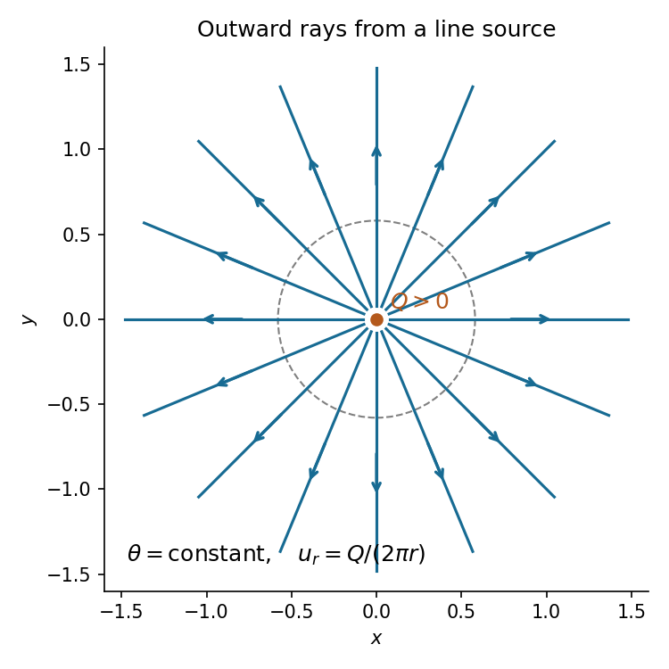

<h1 id="1/b/iii/solution">Solution</h1>

↑ **Parent:** [Iii](../iii.md)

The [streamlines](../../../../../streamline.md) are the level curves of the [streamfunction](../../../../../stream-function.md), so $\theta$ is constant: **radial rays directed outwards from the origin**. Their arrows point outwards because $Q>0$. A complete straight line through the origin comprises two distinct rays separated by the excluded [line source](../../../../../line-source.md). Equivalently, $r\dot\theta=u_\theta=0$ and $\dot r=Q/(2\pi r)>0$ along each [pathline](../../../../../pathline.md); the [steady flow](../../../../../steady-flow.md) makes these the same curves as the [streamlines](../../../../../streamline.md).

**[Figure 1](#1/b/iii/image-radial-streamlines-of-a-positive-line-source). Radial streamlines of a positive line source**. The excluded source is marked at the origin. Every streamline is an outward ray, and every enclosing circle carries the same outward volume flux $Q$.

## ↑ Ancestors (13)

1. [Iii](../iii.md)
2. [B](../../b.md)
3. [1](../../../1.md)
4. [2017](../../../../2017-split.md)
5. [Past exam of the fluids and waves course of the University of Oxford](../../../../split.md)
6. [Fluids and waves course of the University of Oxford](../../../../../fluids-and-waves-course-of-the-university-of-oxford.md)
7. [Year 2 of the mathematics course of the University of Oxford](../../../../../year-2-of-the-mathematics-course-of-the-university-of-oxford.md)
8. [Mathematics course of the University of Oxford](../../../../../mathematics-course-of-the-university-of-oxford.md)
9. [Undergraduate course of the University of Oxford](../../../../../undergraduate-course-of-the-university-of-oxford.md)
10. [Course of the University of Oxford](../../../../../course-of-the-university-of-oxford.md)
11. [University of Oxford](../../../../../university-of-oxford-split.md)
12. [List of universities](../../../../../list-of-universities.md)
13. [Codex Wiki](../../../../../split.md)
