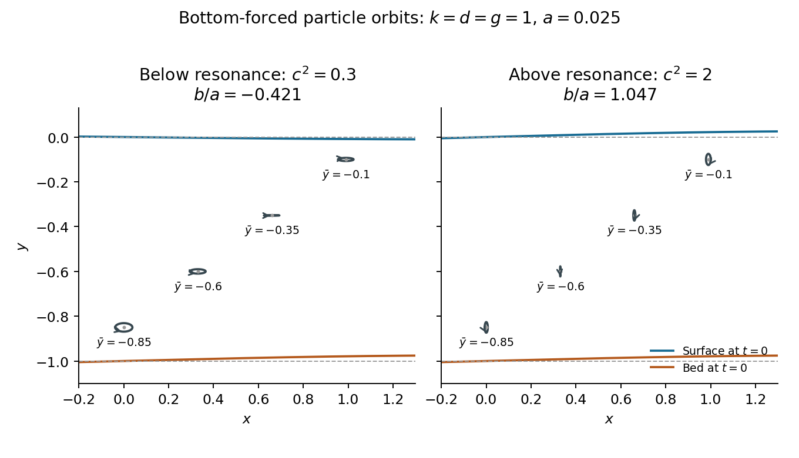

<h1 id="3/c/solution">Solution</h1>

↑ **Parent:** [C](../c.md)

Consider the nonresonant traveling forced solution, with $k>0$ and $c\ne0$. Put $x=\bar x+\xi$, $y=\bar y+\upsilon$, where $(\bar x,\bar y)$ is the mean position of a [fluid element](../../../../fluid-element.md). At [linear order](../../../../linear-order.md), evaluate the [velocity field](../../../../velocity-field.md) at this mean position: substituting $\xi,\upsilon$ into its spatial arguments would change the already first-order [velocity](../../../../velocity.md) only at second order. With $\Theta=k(\bar x-ct)$, differentiation of the [velocity potential](../../../../velocity-potential.md) gives

$$
\begin{aligned}
\dot\xi&=b\left[\frac gc\cosh(k\bar y)+kc\sinh(k\bar y)\right]\sin\Theta,\\
\dot\upsilon&=-b\left[\frac gc\sinh(k\bar y)+kc\cosh(k\bar y)\right]\cos\Theta.
\end{aligned}
$$

Since $\dot\Theta=-kc$, integration, with zero mean displacements, yields

$$
\begin{aligned}
\xi&=A(\bar y)\cos\Theta,&A(\bar y)&=b\left[\frac g{kc^2}\cosh(k\bar y)+\sinh(k\bar y)\right],\\
\upsilon&=B(\bar y)\sin\Theta,&B(\bar y)&=b\left[\frac g{kc^2}\sinh(k\bar y)+\cosh(k\bar y)\right].
\end{aligned}
$$

If both coefficients are nonzero, eliminating the [wave phase](../../../../phase-waves.md) proves that the [pathline](../../../../pathline.md) is an [ellipse](../../../../ellipse.md):

$$
\boxed{\frac{(x-\bar x)^2}{A(\bar y)^2}+\frac{(y-\bar y)^2}{B(\bar y)^2}=1.}
$$

Its [principal axes of an ellipse](../../../../principal-axes-of-an-ellipse.md) are horizontal and vertical, with respective [semi-axes](../../../../semi-axis.md)

$$
\boxed{|A(\bar y)|,\qquad|B(\bar y)|.}
$$

Thus the full axis lengths are $2|A|$ and $2|B|$. The signed coefficients also determine the direction of traversal. The useful checks $B(0)=b$ and $B(-d)=a$ reproduce the vertical displacements of the [free surface](../../../../free-surface.md) and bottom.

To identify the major axis without comparing the two expressions separately, use $\cosh^2s-\sinh^2s=1$:

$$
A^2-B^2=b^2\left[\left(\frac g{kc^2}\right)^2-1\right].
$$

Consequently the major axis is horizontal if $c^2<g/k$ and vertical if $c^2>g/k$; equality gives [circles](../../../../circle.md). If $A$ or $B$ vanishes at a particular depth, the first-order orbit degenerates to a line segment. These are [linearized particle orbits of a bottom-forced gravity wave](../../../../linearized-particle-orbits-of-a-bottom-forced-gravity-wave.md), not exact closed trajectories at all orders: a higher-order calculation may introduce a mean drift.

**[Figure 2](#3/c/image-first-order-particle-orbits-above-a-traveling-corrugated-bed). First-order particle orbits above a traveling corrugated bed**. Examples with $k=d=g=1$ and $a=0.025$ compare $c^2=0.3$ below resonance and $c^2=2$ above resonance. The surface reverses phase in the first case. Orbit sizes are shown without magnification, with equal horizontal and vertical scales. Arrows indicate traversal as time increases; dashed lines indicate the mean surface and bottom.

## ↑ Ancestors (12)

1. [C](../c.md)
2. [3](../../3.md)
3. [2017](../../../2017-split.md)
4. [Past exam of the fluids and waves course of the University of Oxford](../../../split.md)
5. [Fluids and waves course of the University of Oxford](../../../../fluids-and-waves-course-of-the-university-of-oxford.md)
6. [Year 2 of the mathematics course of the University of Oxford](../../../../year-2-of-the-mathematics-course-of-the-university-of-oxford.md)
7. [Mathematics course of the University of Oxford](../../../../mathematics-course-of-the-university-of-oxford.md)
8. [Undergraduate course of the University of Oxford](../../../../undergraduate-course-of-the-university-of-oxford.md)
9. [Course of the University of Oxford](../../../../course-of-the-university-of-oxford.md)
10. [University of Oxford](../../../../university-of-oxford-split.md)
11. [List of universities](../../../../list-of-universities.md)
12. [Codex Wiki](../../../../split.md)
