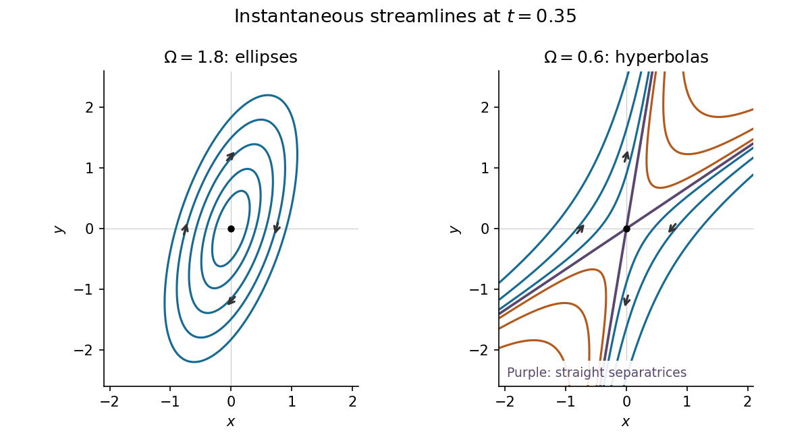
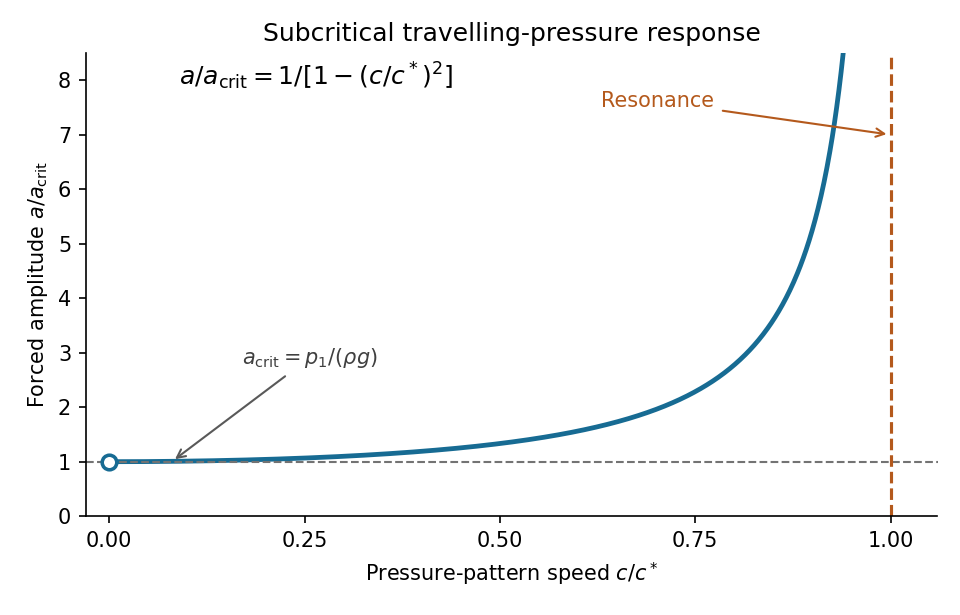

# 2021

↑ **Parent:** [Past exam of the fluids and waves course of the University of Oxford](../past-exam-of-the-fluids-and-waves-course-of-the-university-of-oxford.md)

Solutions to all three questions of the [University of Oxford](../university-of-oxford.md) Part A fluids and waves paper, sat on 24 June 2021. Source: [original released PDF, bundle pages 236–238; paper pages 1–3](https://www.whatdotheyknow.com/request/bsc_mathematics_part_a_examinati/response/2820674/attach/3/FOI%20202410%20944%20Data.pdf#page=236).

**Table of contents**

- [1](#1)
  - [a](#1/a)
    - [i](#1/a/i)
      - [Solution](#1/a/i/solution)
    - [ii](#1/a/ii)
      - [Solution](#1/a/ii/solution)
    - [iii](#1/a/iii)
      - [Solution](#1/a/iii/solution)
  - [b](#1/b)
    - [i](#1/b/i)
      - [Solution](#1/b/i/solution)
    - [ii](#1/b/ii)
      - [Solution](#1/b/ii/solution)
    - [iii](#1/b/iii)
      - [Solution](#1/b/iii/solution)
- [2](#2)
  - [a](#2/a)
    - [i](#2/a/i)
      - [Solution](#2/a/i/solution)
    - [ii](#2/a/ii)
      - [Solution](#2/a/ii/solution)
    - [iii](#2/a/iii)
      - [Solution](#2/a/iii/solution)
  - [b](#2/b)
    - [i](#2/b/i)
      - [Solution](#2/b/i/solution)
    - [ii](#2/b/ii)
      - [Solution](#2/b/ii/solution)
  - [c](#2/c)
    - [i](#2/c/i)
      - [Solution](#2/c/i/solution)
    - [ii](#2/c/ii)
      - [Solution](#2/c/ii/solution)
- [3](#3)
  - [a](#3/a)
    - [Solution](#3/a/solution)
  - [b](#3/b)
    - [Solution](#3/b/solution)
    - [i](#3/b/i)
      - [Solution](#3/b/i/solution)
    - [ii](#3/b/ii)
      - [Solution](#3/b/ii/solution)

## 1

↑ **Parent:** [2021](2021.md)

<h3 id="1/a">a</h3>

↑ **Parent:** [1](#1)

<h4 id="1/a/i">i</h4>

↑ **Parent:** [A](#1/a)

<h5 id="1/a/i/solution">Solution</h5>

↑ **Parent:** [I](#1/a/i)

The [velocity](../classical-mechanics.md#velocity) of a [fluid element](../continuum-mechanics.md#fluid-element) is the [time derivative](../multivariable-calculus.md#time-derivative) of its position with its [Lagrangian coordinates](../continuum-mechanics.md#lagrangian-coordinate) $X,Y$ held fixed. Direct [differentiation](../calculus.md#differentiation) gives

$$
\begin{aligned}
\dot x&=-e^{-t}(X\cos\Omega t+Y\sin\Omega t)
+\Omega e^{-t}(Y\cos\Omega t-X\sin\Omega t)
=-x+\Omega e^{-2t}y,\\
\dot y&=e^t(Y\cos\Omega t-X\sin\Omega t)
-\Omega e^t(X\cos\Omega t+Y\sin\Omega t)
=y-\Omega e^{2t}x.
\end{aligned}
$$

Replacing the [Lagrangian coordinates](../continuum-mechanics.md#lagrangian-coordinate) by the current [Eulerian coordinates](../continuum-mechanics.md#eulerian-coordinate) therefore gives the [velocity field](../fluid-mechanics.md#velocity-field)

$$
\boxed{\mathbf u(x,y,t)=(-x+\Omega e^{-2t}y,\ y-\Omega e^{2t}x)}.
$$

The distinction between following a [fluid element](../continuum-mechanics.md#fluid-element) and differentiating at fixed [Eulerian coordinates](../continuum-mechanics.md#eulerian-coordinate) is what connects the given [deformation map](../continuum-mechanics.md#deformation-map) to this [velocity field](../fluid-mechanics.md#velocity-field).

<h4 id="1/a/ii">ii</h4>

↑ **Parent:** [A](#1/a)

<h5 id="1/a/ii/solution">Solution</h5>

↑ **Parent:** [Ii](#1/a/ii)

For a planar [incompressible flow](../fluid-mechanics.md#incompressible-flow), the [divergence](../multivariable-calculus.md#divergence) of the [velocity field](../fluid-mechanics.md#velocity-field) must vanish. Here

$$
\nabla\cdot\mathbf u=\frac{\partial u}{\partial x}+\frac{\partial v}{\partial y}=-1+1=0.
$$

Equivalently, the [Jacobian determinant](../multivariable-calculus.md#jacobian-determinant) of the [deformation map](../continuum-mechanics.md#deformation-map) is

$$
\det\frac{\partial(x,y)}{\partial(X,Y)}
=e^{-t}e^t(\cos^2\Omega t+\sin^2\Omega t)=1,
$$

so every material area is preserved. However, the out-of-plane [vorticity](../vorticity.md) is

$$
\boxed{\omega_z=\frac{\partial v}{\partial x}-\frac{\partial u}{\partial y}
=-\Omega(e^{2t}+e^{-2t})=-2\Omega\cosh(2t)}.
$$

Since $\Omega>0$, this [vorticity](../vorticity.md) never vanishes. The motion is an [incompressible flow](../fluid-mechanics.md#incompressible-flow) but is not an [irrotational flow](../vorticity.md#irrotational-flow); its local spin is clockwise.

<h4 id="1/a/iii">iii</h4>

↑ **Parent:** [A](#1/a)

<h5 id="1/a/iii/solution">Solution</h5>

↑ **Parent:** [Iii](#1/a/iii)

Adopt the [streamfunction](../fluid-mechanics.md#stream-function) convention $u=\psi_y$, $v=-\psi_x$. Integrating the first component of the [velocity field](../fluid-mechanics.md#velocity-field) in $y$ gives $\psi=-xy+\tfrac12\Omega e^{-2t}y^2+f(x,t)$. The second component then requires $f_x=\Omega e^{2t}x$. Thus, omitting an arbitrary function of time,

$$
\boxed{\psi(x,y,t)=\frac\Omega2(e^{2t}x^2+e^{-2t}y^2)-xy}.
$$

At a fixed instant, the [streamlines](../fluid-mechanics.md#streamline) are the connected curves $\psi=K$. To classify this [quadratic form](../quadratic-form.md), introduce the invertible scaled and rotated coordinates

$$
\xi=e^t x,\quad \upsilon=e^{-t}y,\qquad
s=\frac{\xi+\upsilon}{\sqrt2},\quad d=\frac{\xi-\upsilon}{\sqrt2}.
$$

Then

$$
\boxed{2\psi=(\Omega-1)s^2+(\Omega+1)d^2}.
$$

For $\Omega>1$, both coefficients are positive. Every $K>0$ therefore gives an [ellipse](../euclidean-geometry.md#ellipse), and $K=0$ is the [stagnation point](../fluid-mechanics.md#stagnation-point) at the origin. For $0<\Omega<1$, the [quadratic form](../quadratic-form.md) is an [indefinite quadratic form](../quadratic-form.md#indefinite-quadratic-form): each $K\ne0$ gives a [hyperbola](../euclidean-geometry.md#hyperbola). The level $K=0$ consists of the straight [separatrices](../dynamical-systems.md#separatrix)

$$
d=\pm\sqrt{\frac{1-\Omega}{1+\Omega}}\,s,
$$

whose rays approach or leave the origin; the origin itself is a [stagnation point](../fluid-mechanics.md#stagnation-point). At the transition $\Omega=1$, $\psi=d^2$, so the nonstationary [streamlines](../fluid-mechanics.md#streamline) are parallel straight lines and $d=0$ is a line of [stagnation points](../fluid-mechanics.md#stagnation-point). These are instantaneous [streamlines](../fluid-mechanics.md#streamline); the time dependence means that they need not coincide with [pathlines](../fluid-mechanics.md#pathline).

**[Figure 1](#1/a/iii/image-instantaneous-elliptical-and-hyperbolic-streamlines-at-the-same-positive-time). Instantaneous elliptical and hyperbolic streamlines at the same positive time**.

<h3 id="1/b">b</h3>

↑ **Parent:** [1](#1)

<h4 id="1/b/i">i</h4>

↑ **Parent:** [B](#1/b)

<h5 id="1/b/i/solution">Solution</h5>

↑ **Parent:** [I](#1/b/i)

Use $w=\phi+i\psi$ for the [complex potential of a two-dimensional potential flow](../fluid-mechanics.md#complex-potential-of-a-two-dimensional-potential-flow), so its [complex velocity](../fluid-mechanics.md#complex-velocity) is $q=w'=u-iv$. The incident [uniform flow](../fluid-mechanics.md#uniform-flow) and [line source](../fluid-mechanics.md#line-source) have

$$
f(z)=Uz+\log(z-b).
$$

The coefficient of the [complex logarithm](../analysis.md#complex-logarithm) is one because a [line source](../fluid-mechanics.md#line-source) of strength $Q$ has [complex potential of a two-dimensional potential flow](../fluid-mechanics.md#complex-potential-of-a-two-dimensional-potential-flow) $(Q/(2\pi))\log(z-b)$, and here $Q=2\pi$. Applying the [Milne-Thomson circle theorem](../fluid-mechanics.md#milne-thomson-circle-theorem) to the unit [circle](../topology.md#circle) gives

$$
w(z)=f(z)+\overline{f(1/\bar z)}
=Uz+\log(z-b)+\frac Uz+\log(1/z-b).
$$

Since $1/z-b=-b(z-1/b)/z$, locally consistent branches of the [complex logarithm](../analysis.md#complex-logarithm) give

$$
\boxed{w(z)=Uz+\frac Uz+\log(z-b)
+\log(z-1/b)-\log z+C}.
$$

Changes of branch only alter the constant in a local expression; $w'$ is single valued away from its singularities. The added terms represent a [two-dimensional potential doublet](../fluid-mechanics.md#two-dimensional-potential-doublet) at the origin, an image [line source](../fluid-mechanics.md#line-source) at $1/b$, and a compensating [line sink](../fluid-mechanics.md#line-sink) at the origin. The image [line source](../fluid-mechanics.md#line-source) and [line sink](../fluid-mechanics.md#line-sink) have equal and opposite strengths, so no net [volume flux](../fluid-mechanics.md#volumetric-flow-rate) enters the [cylinder](../geometry-and-topology.md#cylinder-geometry).

On $|z|=1$, the [Milne-Thomson circle theorem](../fluid-mechanics.md#milne-thomson-circle-theorem) makes $w=f(z)+\overline{f(z)}$ up to a constant. Consequently the [streamfunction](../fluid-mechanics.md#stream-function) is constant there, establishing the [no-penetration boundary condition](../viscous-fluid-flow.md#no-penetration-boundary-condition). All [line source](../fluid-mechanics.md#line-source) strengths are real, and the [two-dimensional potential doublet](../fluid-mechanics.md#two-dimensional-potential-doublet) has zero [circulation](../vorticity.md#circulation-physics), so the [circulation](../vorticity.md#circulation-physics) around the [cylinder](../geometry-and-topology.md#cylinder-geometry) is zero. There is no additional [line vortex](../vorticity.md#line-vortex) term.

<h4 id="1/b/ii">ii</h4>

↑ **Parent:** [B](#1/b)

<h5 id="1/b/ii/solution">Solution</h5>

↑ **Parent:** [Ii](#1/b/ii)

Let $F_x,F_y$ denote the [force per unit length](../force.md#force-per-unit-length) exerted by the fluid on the [cylinder](../geometry-and-topology.md#cylinder-geometry), and let $\rho$ be the constant [mass density](../fluid-mechanics.md#density). For a counterclockwise contour $C$ around the unit [circle](../topology.md#circle), the [Blasius force theorem](../fluid-mechanics.md#blasius-force-theorem) gives

$$
F_x-iF_y=\frac{i\rho}{2}\oint_C q(z)^2\,dz,
\qquad
q(z)=U-\frac U{z^2}+\frac1{z-b}+\frac1{z-a}-\frac1z,
\quad a=\frac1b.
$$

An efficient use of the [residue theorem](../analysis.md#residue-theorem) finds the sum of the enclosed [residues](../analysis.md#residue) by subtracting the external [pole](../isolated-singularity.md#pole) at $b$ from the sum of all finite [residues](../analysis.md#residue). At large $z$,

$$
q(z)=U+\frac1z+O(z^{-2}),\qquad
q(z)^2=U^2+\frac{2U}{z}+O(z^{-2}).
$$

The sum of all finite [residues](../analysis.md#residue) of $q^2$ is therefore $2U$. At $b$, write $q=(z-b)^{-1}+H(z)$, with $H$ a [holomorphic function](../holomorphic-function.md) near $b$. Then

$$
\operatorname{Res}_{z=b}q^2=2H(b),\qquad
H(b)=U-\frac U{b^2}+\frac1{b-a}-\frac1b.
$$

Thus

$$
\oint_Cq^2\,dz=2\pi i\,[2U-2H(b)],
\qquad
F_x-iF_y=2\pi\rho[H(b)-U].
$$

Using $a=1/b$ and $1/(b-a)-1/b=1/[b(b^2-1)]$ gives

$$
\boxed{F_x=2\pi\rho\left(\frac1{b(b^2-1)}-\frac U{b^2}\right),
\qquad F_y=0}.
$$

The vanishing vertical [force](../force.md) also follows from [reflection symmetry](../physics.md#reflection-symmetry) about the real axis. This [force on a unit cylinder due to a uniform flow and an external source](../fluid-mechanics.md#force-on-a-unit-cylinder-due-to-a-uniform-flow-and-an-external-source) uses the counterclockwise orientation in the [Blasius force theorem](../fluid-mechanics.md#blasius-force-theorem) to fix the sign of the horizontal [force](../force.md).

<h4 id="1/b/iii">iii</h4>

↑ **Parent:** [B](#1/b)

<h5 id="1/b/iii/solution">Solution</h5>

↑ **Parent:** [Iii](#1/b/iii)

Since $b>1$, the denominator in

$$
F_x=\frac{2\pi\rho}{b^2(b^2-1)}\,[b-U(b^2-1)]
$$

is positive. The positive root of $Ub^2-b-U=0$ is

$$
\boxed{b_* =\frac{1+\sqrt{1+4U^2}}{2U}>1}.
$$

The other root is negative, so the horizontal [force](../force.md) points in the positive $x$ direction for $1<b<b_*$, vanishes at $b=b_*$, and points in the negative $x$ direction for $b>b_*$. In particular, the nearby [line source](../fluid-mechanics.md#line-source) pulls the [cylinder](../geometry-and-topology.md#cylinder-geometry) towards itself as $b\downarrow1$, while at large $b$ the horizontal [force](../force.md) is $F_x\sim-2\pi\rho U/b^2$.

## 2

↑ **Parent:** [2021](2021.md)

<h3 id="2/a">a</h3>

↑ **Parent:** [2](#2)

<h4 id="2/a/i">i</h4>

↑ **Parent:** [A](#2/a)

<h5 id="2/a/i/solution">Solution</h5>

↑ **Parent:** [I](#2/a/i)

The [Joukowski map](../geometry-and-topology.md#joukowski-map) is a [holomorphic function](../holomorphic-function.md) for $z\ne0$, with

$$
g'(z)=1-\frac1{z^2}.
$$

A [holomorphic function](../holomorphic-function.md) is a local [conformal map](../geometry-and-topology.md#conformal-map) wherever its [derivative](../calculus.md#derivative) is nonzero. Hence the two finite nonzero critical points are

$$
\boxed{z=1,\qquad z=-1}.
$$

They lie on the boundary of the fluid region. At $z=0$ the displayed formula has a [pole](../isolated-singularity.md#pole) and is undefined as a map to the finite [complex plane](../complex-analysis.md#complex-plane); zero is outside the fluid region. Thus $g$ is locally [conformal](../geometry-and-topology.md#conformal-map) everywhere in the fluid.

<h4 id="2/a/ii">ii</h4>

↑ **Parent:** [A](#2/a)

<h5 id="2/a/ii/solution">Solution</h5>

↑ **Parent:** [Ii](#2/a/ii)

For $z=x+iy$,

$$
\operatorname{Im}g(z)=y\left(1-\frac1{x^2+y^2}\right).
$$

Both factors are positive in the fluid region, so its image is contained in the [upper half-plane](../complex-analysis.md#upper-half-plane-complex-analysis). The boundary correspondence is also explicit: on the upper unit [semicircle](../topology.md#semicircle), $z=e^{i\theta}$ gives $g(z)=2\cos\theta\in[-2,2]$, while the real rays $x>1$ and $x<-1$ map onto the rays $\zeta>2$ and $\zeta<-2$.

To prove the image is the whole [upper half-plane](../complex-analysis.md#upper-half-plane-complex-analysis), fix any $\operatorname{Im}\zeta>0$. The equation $g(z)=\zeta$ is

$$
z^2-\zeta z+1=0.
$$

Its roots have product one. Neither root can have unit modulus, since that would make $\zeta=z+1/z$ real. Exactly one root therefore has modulus greater than one. For that root the formula for $\operatorname{Im}g$ forces $y>0$, so it belongs to the fluid region. Moreover, if $g(z_1)=g(z_2)$, then

$$
(z_1-z_2)\left(1-\frac1{z_1z_2}\right)=0.
$$

Two distinct roots in the fluid region would require $z_1z_2=1$, impossible when both moduli exceed one. Thus the [Joukowski map of the upper exterior of a unit disk](../geometry-and-topology.md#joukowski-map-of-the-upper-exterior-of-a-unit-disk) is a [bijection](../function.md#bijection) from the fluid region onto the [upper half-plane](../complex-analysis.md#upper-half-plane-complex-analysis).

<h4 id="2/a/iii">iii</h4>

↑ **Parent:** [A](#2/a)

<h5 id="2/a/iii/solution">Solution</h5>

↑ **Parent:** [Iii](#2/a/iii)

The [quadratic formula](../polynomial.md#quadratic-formula) gives two algebraic possibilities. To select one consistent [holomorphic square root](../complex-analysis.md#holomorphic-square-root), set

$$
S(\zeta)=\sqrt{\zeta-2}\,\sqrt{\zeta+2},\qquad \operatorname{Im}\zeta>0,
$$

where each factor is the [principal square root](../analysis.md#principal-square-root-of-a-complex-number). Both arguments lie in the [upper half-plane](../complex-analysis.md#upper-half-plane-complex-analysis), so neither crosses its [branch cut](../analysis.md#branch-cut). This choice satisfies $S(\zeta)^2=\zeta^2-4$ and $S(\zeta)\sim\zeta$ at large $\zeta$ in the [upper half-plane](../complex-analysis.md#upper-half-plane-complex-analysis). The required [inverse function](../function.md#inverse-function) is

$$
\boxed{z=g^{-1}(\zeta)=\frac{\zeta+S(\zeta)}2
=\frac{\zeta+\sqrt{\zeta-2}\sqrt{\zeta+2}}2}.
$$

For $\zeta=iR$, $R>0$, this gives $z=i(R+\sqrt{R^2+4})/2$, whose modulus exceeds one. As $\zeta$ varies continuously in the [upper half-plane](../complex-analysis.md#upper-half-plane-complex-analysis), this root cannot cross $|z|=1$, since that would make $\zeta$ real. Hence the selected root always lies in the fluid region. The other root is its reciprocal and lies inside the unit [disk](../topology.md#disk-mathematics). Simply writing the [principal square root](../analysis.md#principal-square-root-of-a-complex-number) of $\zeta^2-4$ would not specify this branch correctly throughout the [upper half-plane](../complex-analysis.md#upper-half-plane-complex-analysis).

<h3 id="2/b">b</h3>

↑ **Parent:** [2](#2)

<h4 id="2/b/i">i</h4>

↑ **Parent:** [B](#2/b)

<h5 id="2/b/i/solution">Solution</h5>

↑ **Parent:** [I](#2/b/i)

The [line vortex](../vorticity.md#line-vortex) is mapped to

$$
\boxed{\zeta_0=g(c)=c+\frac1c}.
$$

Its [imaginary part](../complex-analysis.md#imaginary-part) is positive because $c$ lies in the fluid region. A [conformal map](../geometry-and-topology.md#conformal-map) preserves the [circulation](../vorticity.md#circulation-physics) of the local [line vortex](../vorticity.md#line-vortex), so its strength in the mapped [complex plane](../complex-analysis.md#complex-plane) is still $\Gamma$.

<h4 id="2/b/ii">ii</h4>

↑ **Parent:** [B](#2/b)

<h5 id="2/b/ii/solution">Solution</h5>

↑ **Parent:** [Ii](#2/b/ii)

Take positive $\Gamma$ to mean counterclockwise [circulation](../vorticity.md#circulation-physics). A [line vortex](../vorticity.md#line-vortex) at $\zeta_0$ has [complex potential of a two-dimensional potential flow](../fluid-mechanics.md#complex-potential-of-a-two-dimensional-potential-flow) $\Gamma\log(\zeta-\zeta_0)/(2\pi i)$. The [method of images](../mathematics.md#method-of-images) imposes the [no-penetration boundary condition](../viscous-fluid-flow.md#no-penetration-boundary-condition) on the real axis by placing an image [line vortex](../vorticity.md#line-vortex) of strength $-\Gamma$ at $\bar\zeta_0$. Thus

$$
\boxed{W(\zeta)=\frac{\Gamma}{2\pi i}
\log\!\left(\frac{\zeta-\zeta_0}{\zeta-\bar\zeta_0}\right)+C}.
$$

For real $\zeta$, the numerator and denominator have equal modulus, so the [streamfunction](../fluid-mechanics.md#stream-function) is

$$
\operatorname{Im}W=-\frac\Gamma{2\pi}
\log\left|\frac{\zeta-\zeta_0}{\zeta-\bar\zeta_0}\right|
=\text{constant}.
$$

The real axis is therefore a [streamline](../fluid-mechanics.md#streamline). The image [line vortex](../vorticity.md#line-vortex) lies outside the mapped fluid region, while the [complex velocity](../fluid-mechanics.md#complex-velocity)

$$
W'(\zeta)=\frac\Gamma{2\pi i}
\left(\frac1{\zeta-\zeta_0}-\frac1{\zeta-\bar\zeta_0}\right)
$$

decays as $|\zeta|\to\infty$. This selects the flow due to the [line vortex](../vorticity.md#line-vortex) and the boundary, without superposing an imposed background [velocity field](../fluid-mechanics.md#velocity-field).

<h3 id="2/c">c</h3>

↑ **Parent:** [2](#2)

<h4 id="2/c/i">i</h4>

↑ **Parent:** [C](#2/c)

<h5 id="2/c/i/solution">Solution</h5>

↑ **Parent:** [I](#2/c/i)

The physical [complex potential of a two-dimensional potential flow](../fluid-mechanics.md#complex-potential-of-a-two-dimensional-potential-flow) is $w(z)=W(g(z))$. Applying the [chain rule](../calculus.md#chain-rule) gives the [complex velocity](../fluid-mechanics.md#complex-velocity)

$$
\boxed{u-iv=w'(z)=\frac\Gamma{2\pi i}
\left(1-\frac1{z^2}\right)
\left[\frac1{z+z^{-1}-c-c^{-1}}
-\frac1{z+z^{-1}-\bar c-\bar c^{-1}}\right]}.
$$

The physical [velocity](../classical-mechanics.md#velocity) is $(\operatorname{Re}w',-\operatorname{Im}w')$. A useful equivalent expression follows from

$$
g(z)-g(c)=\frac{(z-c)(z-c^{-1})}{z}.
$$

Factoring the image expression in the same way makes the $-1/z$ terms cancel, leaving

$$
\boxed{u-iv=\frac\Gamma{2\pi i}
\left[\frac1{z-c}+\frac1{z-c^{-1}}
-\frac1{z-\bar c}-\frac1{z-\bar c^{-1}}\right]}.
$$

This represents the physical [line vortex](../vorticity.md#line-vortex) at $c$, an image [line vortex](../vorticity.md#line-vortex) of the same strength at $c^{-1}$, and image [point vortices](../vorticity.md#line-vortex) of opposite strength at $\bar c$ and $\bar c^{-1}$. All three image locations are outside the fluid region. Both boundary pieces inherit the constant [streamfunction](../fluid-mechanics.md#stream-function) of the real axis in the mapped [complex plane](../complex-analysis.md#complex-plane).

<h4 id="2/c/ii">ii</h4>

↑ **Parent:** [C](#2/c)

<h5 id="2/c/ii/solution">Solution</h5>

↑ **Parent:** [Ii](#2/c/ii)

A free [point vortex](../vorticity.md#line-vortex) is advected by the regular part of the [velocity field](../fluid-mechanics.md#velocity-field) at its position. Its own singular [complex velocity](../fluid-mechanics.md#complex-velocity) $\Gamma/[2\pi i(z-c)]$ must first be subtracted. The image expression therefore gives

$$
\boxed{\dot x_c-i\dot y_c
=\lim_{z\to c}\left[w'(z)-\frac\Gamma{2\pi i(z-c)}\right]
=\frac\Gamma{2\pi i}
\left[\frac1{c-c^{-1}}-\frac1{c-\bar c}
-\frac1{c-\bar c^{-1}}\right]}.
$$

Equivalently, $\dot c$ is the [complex conjugate](../complex-analysis.md#complex-conjugate) of the boxed expression. This is the instantaneous [velocity](../classical-mechanics.md#velocity), evaluated with the current value of $c$.

To see why mapping the image [velocity](../classical-mechanics.md#velocity) alone would miss a term, expand the mapped physical singularity:

$$
\frac{g'(z)}{g(z)-g(c)}
=\frac1{z-c}+\frac{g''(c)}{2g'(c)}+O(z-c).
$$

Thus the same [point-vortex drift under a conformal map](../vorticity.md#point-vortex-drift-under-a-conformal-map) can be written

$$
\dot x_c-i\dot y_c
=\frac\Gamma{2\pi i}
\left[\frac{g''(c)}{2g'(c)}
-\frac{g'(c)}{g(c)-\overline{g(c)}}\right].
$$

The finite term involving $g''$ is part of the physical regular [velocity field](../fluid-mechanics.md#velocity-field).

If $c=id$ with $d>1$, direct substitution into the image expression gives

$$
\begin{aligned}
\dot x_c-i\dot y_c
&=\frac\Gamma{2\pi}
\left[-\frac d{d^2+1}+\frac1{2d}+\frac d{d^2-1}\right]\\
&=\boxed{\frac\Gamma{2\pi}
\left[\frac1{2d}+\frac{2d}{d^4-1}\right]}.
\end{aligned}
$$

The bracket is strictly positive, and the result is real. Hence a positive [line vortex](../vorticity.md#line-vortex) initially moves horizontally to the right, a negative [line vortex](../vorticity.md#line-vortex) moves to the left, and the initial vertical [velocity](../classical-mechanics.md#velocity) is zero. As $d\to\infty$, the leading term $\Gamma/(4\pi d)$ is the familiar drift of a [point vortex](../vorticity.md#line-vortex) above a straight wall.

## 3

↑ **Parent:** [2021](2021.md)

<h3 id="3/a">a</h3>

↑ **Parent:** [3](#3)

<h4 id="3/a/solution">Solution</h4>

↑ **Parent:** [A](#3/a)

For an [irrotational flow](../vorticity.md#irrotational-flow), write $\mathbf u=\nabla\phi$. The [incompressible flow](../fluid-mechanics.md#incompressible-flow) condition then gives the [Laplace equation](../partial-differential-equation.md#laplace-equation)

$$
\boxed{\phi_{xx}+\phi_{yy}=0,\qquad -h<y<\eta(x,t)}.
$$

At leading order in a small disturbance this equation holds on $-h<y<0$. Including [gravity](../physics.md#gravity), the [Unsteady Bernoulli equation](../euler-equations-for-an-inviscid-fluid.md#unsteady-bernoulli-equation) is

$$
\phi_t+\frac12|\nabla\phi|^2+\frac p\rho+gy=B(t).
$$

Choose the time-dependent additive freedom in the [velocity potential](../fluid-mechanics.md#velocity-potential) so that $B(t)=p_0/\rho$. Neglecting [surface tension](../surface-tension.md), [pressure continuity](../fluid-mechanics.md#pressure-continuity) at the [free surface](../fluid-mechanics.md#free-surface) gives the exact dynamic condition

$$
\phi_t(x,\eta,t)+\frac12|\nabla\phi(x,\eta,t)|^2
+\frac{p_1}{\rho}\cos(x-ct)+g\eta=0.
$$

The [free surface](../fluid-mechanics.md#free-surface) is a material boundary: applying the [material derivative](../continuum-mechanics.md#material-derivative) to $y-\eta(x,t)=0$ yields the [kinematic boundary condition for a free-surface graph](../fluid-mechanics.md#kinematic-boundary-condition-for-a-free-surface-graph)

$$
\eta_t+\phi_x(x,\eta,t)\eta_x=\phi_y(x,\eta,t).
$$

For a small disturbance, the [Taylor expansion](../calculus.md#taylor-expansion) from $y=\eta$ to $y=0$ changes the first-order [velocity potential](../fluid-mechanics.md#velocity-potential) and its [partial derivatives](../multivariable-calculus.md#partial-derivative) only at second order. Both $|\nabla\phi|^2$ and $\phi_x\eta_x$ are also second-order terms. The [linearized free-surface boundary conditions](../fluid-mechanics.md#linearized-free-surface-boundary-conditions) are therefore

$$
\boxed{\phi_t+\frac{p_1}{\rho}\cos(x-ct)+g\eta=0,
\qquad \phi_y=\eta_t\quad (y=0)}.
$$

The fixed bed has the [no-penetration boundary condition](../viscous-fluid-flow.md#no-penetration-boundary-condition)

$$
\boxed{\phi_y=0\quad(y=-h)}.
$$

The required approximation is small [surface elevation](../fluid-mechanics.md#surface-elevation), small [wave steepness](../fluid-mechanics.md#wave-steepness), and small [velocity](../classical-mechanics.md#velocity) perturbations. The stated $p_1\ll p_0$ alone does not ensure this approximation near [resonance](../dynamical-systems.md#resonance).

<h3 id="3/b">b</h3>

↑ **Parent:** [3](#3)

<h4 id="3/b/solution">Solution</h4>

↑ **Parent:** [B](#3/b)

Seek the travelling forced component of the [surface elevation](../fluid-mechanics.md#surface-elevation) in the form $\eta=A\cos\chi$, where $\chi=x-ct$ and $A$ is a signed coefficient. The forcing has [wavenumber](../wave-equation.md#wavenumber) one. [Separation of variables](../partial-differential-equation.md#separation-of-variables) in the [Laplace equation](../partial-differential-equation.md#laplace-equation), followed by the bed [no-penetration boundary condition](../viscous-fluid-flow.md#no-penetration-boundary-condition), gives

$$
\phi=B\cosh(y+h)\sin\chi.
$$

Since $\eta_t=Ac\sin\chi$, the surface [kinematic boundary condition](../fluid-mechanics.md#kinematic-boundary-condition) requires $B\sinh h=Ac$, so

$$
\boxed{\phi=\frac{Ac}{\sinh h}\cosh(y+h)\sin(x-ct)}.
$$

At $y=0$, $\phi_t=-Ac^2\coth h\cos\chi$. The dynamic member of the [linearized free-surface boundary conditions](../fluid-mechanics.md#linearized-free-surface-boundary-conditions) therefore becomes

$$
A(g-c^2\coth h)+\frac{p_1}{\rho}=0.
$$

Consequently the signed response and the nonnegative [amplitude](../wave.md#wave-amplitude) are

$$
\boxed{A=-\frac{p_1}{\rho(g-c^2\coth h)},\qquad
a(c)=|A|=\frac{p_1}{\rho\,|g-c^2\coth h|}}.
$$

The [travelling-pressure response of finite-depth surface gravity waves](../fluid-mechanics.md#travelling-pressure-response-of-finite-depth-surface-gravity-waves) is opposite in phase to the imposed [pressure](../pressure.md) below the resonant speed and in phase above it. These expressions describe the travelling forced component; freely propagating [surface gravity waves](../fluid-mechanics.md#surface-gravity-wave) can be superposed to meet additional [initial conditions](../differential-equation.md#initial-condition).

<h4 id="3/b/i">i</h4>

↑ **Parent:** [B](#3/b)

<h5 id="3/b/i/solution">Solution</h5>

↑ **Parent:** [I](#3/b/i)

The denominator of the travelling response vanishes at

$$
\boxed{c^*=\sqrt{g\tanh h}}.
$$

For the positive speeds in the paper, a finite travelling response exists whenever $c\ne c^*$. At $c=c^*$, the dynamic condition would reduce to $p_1/\rho=0$, which is impossible. The finite-depth [dispersion relation](../dispersion-relation.md) of a [surface gravity wave](../fluid-mechanics.md#surface-gravity-wave) with [wavenumber](../wave-equation.md#wavenumber) $k$ is $\omega^2=gk\tanh(kh)$. At $k=1$, its [phase speed](../dispersion-relation.md#phase-speed) $\omega/k$ equals $c^*$: the moving [pressure](../pressure.md) pattern drives a natural [surface gravity wave](../fluid-mechanics.md#surface-gravity-wave) at its own speed, producing [resonance](../dynamical-systems.md#resonance).

The restriction concerns a bounded travelling response. To distinguish this from existence of a solution of an [initial value problem](../differential-equation.md#initial-value-problem), set $T=\tanh h$, $P=p_1/\rho$, and $\omega_*^2=gT$. If

$$
\eta(x,t)=\operatorname{Re}(H(t)e^{ix}),\qquad
\phi(x,y,t)=\operatorname{Re}\!\left(
\frac{\dot H(t)}{\sinh h}\cosh(y+h)e^{ix}\right),
$$

the [linearized free-surface boundary conditions](../fluid-mechanics.md#linearized-free-surface-boundary-conditions) reduce to the [forced harmonic oscillator](../analysis.md#forced-harmonic-oscillator)

$$
\boxed{\ddot H+\omega_*^2H=-PT\,e^{-ict}}.
$$

For example, if the forcing is switched on at $t=0$ from a flat surface with zero initial [velocity](../classical-mechanics.md#velocity), then, for $c\ne\omega_*$,

$$
H(t)=\frac{PT}{\omega_*^2-c^2}
\left[\cos(\omega_*t)-i\frac c{\omega_*}\sin(\omega_*t)-e^{-ict}\right].
$$

This satisfies $H(0)=\dot H(0)=0$ and contains both free oscillations and the forced component. At $c=\omega_*$ a solution of the [initial value problem](../differential-equation.md#initial-value-problem) still exists, but its [particular solution](../linear-ordinary-differential-equation.md#particular-solution) contains

$$
H_{\rm sec}(t)=-\frac{iPT}{2\omega_*}\,t e^{-i\omega_*t},
$$

which grows linearly with time. Thus the ideal [inviscid flow](../fluid-mechanics.md#inviscid-flow) model predicts resonant growth rather than a finite constant [amplitude](../wave.md#wave-amplitude). Additional free oscillations can set the [initial conditions](../differential-equation.md#initial-condition) but cannot remove that secular growth.

<h4 id="3/b/ii">ii</h4>

↑ **Parent:** [B](#3/b)

<h5 id="3/b/ii/solution">Solution</h5>

↑ **Parent:** [Ii](#3/b/ii)

For $0<c<c^*$, the nonnegative [amplitude](../wave.md#wave-amplitude) is

$$
a(c)=\frac{p_1\tanh h}{\rho[(c^*)^2-c^2]}
=\frac{p_1}{\rho g}\frac1{1-(c/c^*)^2}.
$$

Its first two [derivatives](../calculus.md#derivative) are positive in this interval:

$$
\frac{da}{dc}=\frac{2p_1\tanh h\,c}
{\rho[(c^*)^2-c^2]^2}>0,\qquad
\frac{d^2a}{dc^2}=\frac{2p_1\tanh h\,[(c^*)^2+3c^2]}
{\rho[(c^*)^2-c^2]^3}>0.
$$

The graph is increasing and convex, starts with a horizontal tangent at the limiting value $a(0)=p_1/(\rho g)$, and has a vertical [asymptote](../topology.md#asymptote) at $c=c^*$. Therefore the [hydrostatic lower bound for a travelling-pressure response](../fluid-mechanics.md#hydrostatic-lower-bound-for-a-travelling-pressure-response) is

$$
\boxed{a_{\rm crit}=\frac{p_1}{\rho g},\qquad a(c)>a_{\rm crit}\quad(0<c<c^*)}.
$$

Because the paper assumes $c>0$, this is an [infimum](../real-analysis.md#infimum), approached as $c\downarrow0$, rather than an attained [minimum](../set.md#minimum-of-a-subset-of-a-total-order). If the stationary limit $c=0$ is admitted, equality holds: the [hydrostatic equilibrium](../statistical-physics.md#hydrostatic-equilibrium) condition is $\rho g\eta=-p_1\cos x$. Near resonance,

$$
a(c)\sim\frac{p_1}{\rho g}\frac{c^*}{2(c^*-c)}.
$$

The divergence describes the linear model; sufficiently close to $c^*$ the small-disturbance assumptions fail. The lower bound and sketch refer to the travelling forced component, since adding free oscillations can change the instantaneous [surface elevation](../fluid-mechanics.md#surface-elevation).

**[Figure 2](#3/b/ii/image-subcritical-travelling-wave-amplitude-rises-from-its-hydrostatic-lower-bound-and-diverges-at-resonance). Subcritical travelling-wave amplitude rises from its hydrostatic lower bound and diverges at resonance**.

## ↑ Ancestors (9)

1. [Past exam of the fluids and waves course of the University of Oxford](../past-exam-of-the-fluids-and-waves-course-of-the-university-of-oxford.md)
2. [Fluids and waves course of the University of Oxford](../university-of-oxford.md#fluids-and-waves-course-of-the-university-of-oxford)
3. [Year 2 of the mathematics course of the University of Oxford](../university-of-oxford.md#year-2-of-the-mathematics-course-of-the-university-of-oxford)
4. [Mathematics course of the University of Oxford](../university-of-oxford.md#mathematics-course-of-the-university-of-oxford)
5. [Undergraduate course of the University of Oxford](../university-of-oxford.md#undergraduate-course-of-the-university-of-oxford)
6. [Course of the University of Oxford](../university-of-oxford.md#course-of-the-university-of-oxford)
7. [University of Oxford](../university-of-oxford.md)
8. [List of universities](../README.md#list-of-universities)
9. [Codex Wiki](../README.md)
