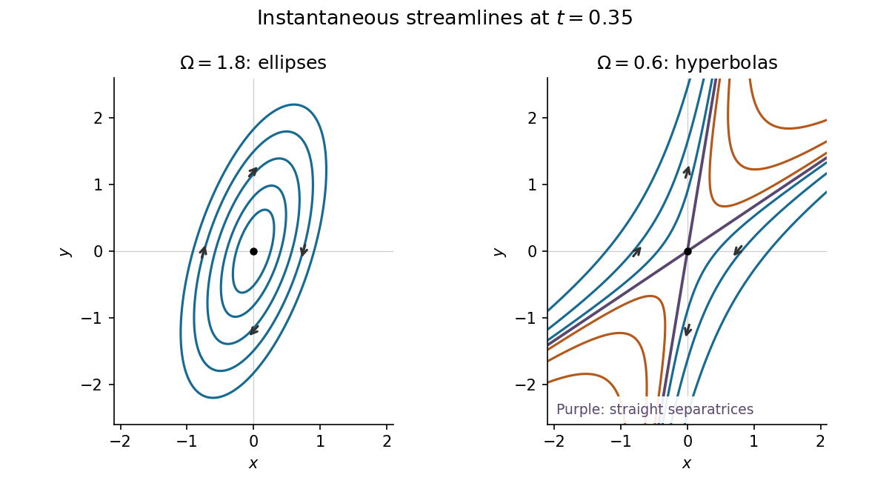

<h1 id="1/a/iii/solution">Solution</h1>

↑ **Parent:** [Iii](../iii.md)

Adopt the [streamfunction](../../../../../stream-function.md) convention $u=\psi_y$, $v=-\psi_x$. Integrating the first component of the [velocity field](../../../../../velocity-field.md) in $y$ gives $\psi=-xy+\tfrac12\Omega e^{-2t}y^2+f(x,t)$. The second component then requires $f_x=\Omega e^{2t}x$. Thus, omitting an arbitrary function of time,

$$
\boxed{\psi(x,y,t)=\frac\Omega2(e^{2t}x^2+e^{-2t}y^2)-xy}.
$$

At a fixed instant, the [streamlines](../../../../../streamline.md) are the connected curves $\psi=K$. To classify this [quadratic form](../../../../../quadratic-form-split.md), introduce the invertible scaled and rotated coordinates

$$
\xi=e^t x,\quad \upsilon=e^{-t}y,\qquad
s=\frac{\xi+\upsilon}{\sqrt2},\quad d=\frac{\xi-\upsilon}{\sqrt2}.
$$

Then

$$
\boxed{2\psi=(\Omega-1)s^2+(\Omega+1)d^2}.
$$

For $\Omega>1$, both coefficients are positive. Every $K>0$ therefore gives an [ellipse](../../../../../ellipse.md), and $K=0$ is the [stagnation point](../../../../../stagnation-point.md) at the origin. For $0<\Omega<1$, the [quadratic form](../../../../../quadratic-form-split.md) is an [indefinite quadratic form](../../../../../indefinite-quadratic-form.md): each $K\ne0$ gives a [hyperbola](../../../../../hyperbola.md). The level $K=0$ consists of the straight [separatrices](../../../../../separatrix.md)

$$
d=\pm\sqrt{\frac{1-\Omega}{1+\Omega}}\,s,
$$

whose rays approach or leave the origin; the origin itself is a [stagnation point](../../../../../stagnation-point.md). At the transition $\Omega=1$, $\psi=d^2$, so the nonstationary [streamlines](../../../../../streamline.md) are parallel straight lines and $d=0$ is a line of [stagnation points](../../../../../stagnation-point.md). These are instantaneous [streamlines](../../../../../streamline.md); the time dependence means that they need not coincide with [pathlines](../../../../../pathline.md).

**[Figure 1](#1/a/iii/image-instantaneous-elliptical-and-hyperbolic-streamlines-at-the-same-positive-time). Instantaneous elliptical and hyperbolic streamlines at the same positive time**.

## ↑ Ancestors (13)

1. [Iii](../iii.md)
2. [A](../../a.md)
3. [1](../../../1.md)
4. [2021](../../../../2021-split.md)
5. [Past exam of the fluids and waves course of the University of Oxford](../../../../split.md)
6. [Fluids and waves course of the University of Oxford](../../../../../fluids-and-waves-course-of-the-university-of-oxford.md)
7. [Year 2 of the mathematics course of the University of Oxford](../../../../../year-2-of-the-mathematics-course-of-the-university-of-oxford.md)
8. [Mathematics course of the University of Oxford](../../../../../mathematics-course-of-the-university-of-oxford.md)
9. [Undergraduate course of the University of Oxford](../../../../../undergraduate-course-of-the-university-of-oxford.md)
10. [Course of the University of Oxford](../../../../../course-of-the-university-of-oxford.md)
11. [University of Oxford](../../../../../university-of-oxford-split.md)
12. [List of universities](../../../../../list-of-universities.md)
13. [Codex Wiki](../../../../../split.md)
