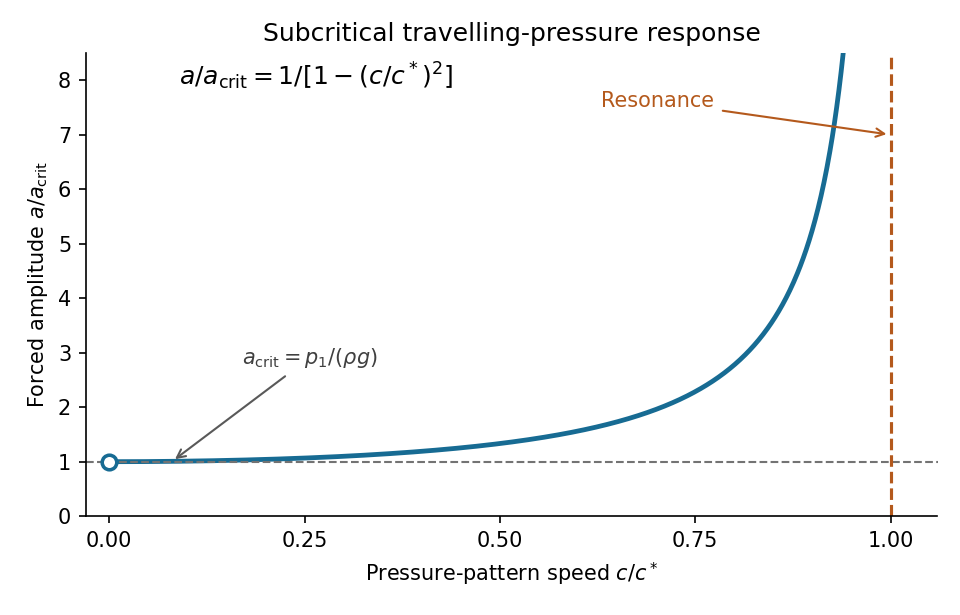

<h1 id="3/b/ii/solution">Solution</h1>

↑ **Parent:** [Ii](../ii.md)

For $0<c<c^*$, the nonnegative [amplitude](../../../../../wave-amplitude.md) is

$$
a(c)=\frac{p_1\tanh h}{\rho[(c^*)^2-c^2]}
=\frac{p_1}{\rho g}\frac1{1-(c/c^*)^2}.
$$

Its first two [derivatives](../../../../../derivative.md) are positive in this interval:

$$
\frac{da}{dc}=\frac{2p_1\tanh h\,c}
{\rho[(c^*)^2-c^2]^2}>0,\qquad
\frac{d^2a}{dc^2}=\frac{2p_1\tanh h\,[(c^*)^2+3c^2]}
{\rho[(c^*)^2-c^2]^3}>0.
$$

The graph is increasing and convex, starts with a horizontal tangent at the limiting value $a(0)=p_1/(\rho g)$, and has a vertical [asymptote](../../../../../asymptote.md) at $c=c^*$. Therefore the [hydrostatic lower bound for a travelling-pressure response](../../../../../hydrostatic-lower-bound-for-a-travelling-pressure-response.md) is

$$
\boxed{a_{\rm crit}=\frac{p_1}{\rho g},\qquad a(c)>a_{\rm crit}\quad(0<c<c^*)}.
$$

Because the paper assumes $c>0$, this is an [infimum](../../../../../infimum.md), approached as $c\downarrow0$, rather than an attained [minimum](../../../../../minimum-of-a-subset-of-a-total-order.md). If the stationary limit $c=0$ is admitted, equality holds: the [hydrostatic equilibrium](../../../../../hydrostatic-equilibrium.md) condition is $\rho g\eta=-p_1\cos x$. Near resonance,

$$
a(c)\sim\frac{p_1}{\rho g}\frac{c^*}{2(c^*-c)}.
$$

The divergence describes the linear model; sufficiently close to $c^*$ the small-disturbance assumptions fail. The lower bound and sketch refer to the travelling forced component, since adding free oscillations can change the instantaneous [surface elevation](../../../../../surface-elevation.md).

**[Figure 2](#3/b/ii/image-subcritical-travelling-wave-amplitude-rises-from-its-hydrostatic-lower-bound-and-diverges-at-resonance). Subcritical travelling-wave amplitude rises from its hydrostatic lower bound and diverges at resonance**.

## ↑ Ancestors (13)

1. [Ii](../ii.md)
2. [B](../../b.md)
3. [3](../../../3.md)
4. [2021](../../../../2021-split.md)
5. [Past exam of the fluids and waves course of the University of Oxford](../../../../split.md)
6. [Fluids and waves course of the University of Oxford](../../../../../fluids-and-waves-course-of-the-university-of-oxford.md)
7. [Year 2 of the mathematics course of the University of Oxford](../../../../../year-2-of-the-mathematics-course-of-the-university-of-oxford.md)
8. [Mathematics course of the University of Oxford](../../../../../mathematics-course-of-the-university-of-oxford.md)
9. [Undergraduate course of the University of Oxford](../../../../../undergraduate-course-of-the-university-of-oxford.md)
10. [Course of the University of Oxford](../../../../../course-of-the-university-of-oxford.md)
11. [University of Oxford](../../../../../university-of-oxford-split.md)
12. [List of universities](../../../../../list-of-universities.md)
13. [Codex Wiki](../../../../../split.md)
