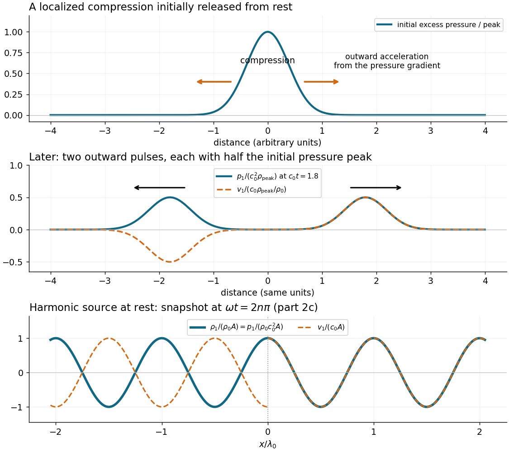
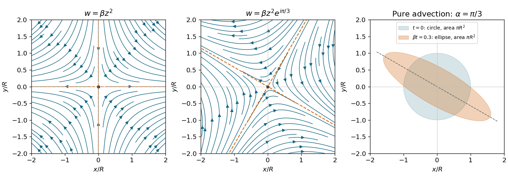

# 2021

↑ **Parent:** [Past exam of the fluids course of the University of Oxford](../past-exam-of-the-fluids-course-of-the-university-of-oxford.md)

Source paper: [https://www.whatdotheyknow.com/request/oxford_physics_past_papers_2/response/2340696/attach/9/Physics%20Papers%202020.pdf?cookie_passthrough=1](https://www.whatdotheyknow.com/request/oxford_physics_past_papers_2/response/2340696/attach/9/Physics%20Papers%202020.pdf?cookie_passthrough=1)

The cover dates this paper to 11 June 2021 despite the attachment filename. Solutions identify a false printed [biharmonic equation](../multivariable-calculus.md#biharmonic-equation) identity, retain the stipulated drop [curvature](../differential-geometry.md#curvature) approximation explicitly, and state the conditions needed for the final [Joukowski map](../geometry-and-topology.md#joukowski-map).

**Table of contents**

- [1](#1)
  - [a](#1/a)
    - [Solution](#1/a/solution)
  - [b](#1/b)
    - [Solution](#1/b/solution)
  - [c](#1/c)
    - [Solution](#1/c/solution)
  - [d](#1/d)
    - [Solution](#1/d/solution)
  - [e](#1/e)
    - [Solution](#1/e/solution)
- [2](#2)
  - [a](#2/a)
    - [Solution](#2/a/solution)
  - [b](#2/b)
    - [Solution](#2/b/solution)
  - [c](#2/c)
    - [Solution](#2/c/solution)
  - [d](#2/d)
    - [Solution](#2/d/solution)
- [3](#3)
  - [a](#3/a)
    - [Solution](#3/a/solution)
  - [b](#3/b)
    - [Solution](#3/b/solution)
  - [c](#3/c)
    - [Solution](#3/c/solution)
- [4](#4)
  - [a](#4/a)
    - [Solution](#4/a/solution)
  - [b](#4/b)
    - [i](#4/b/i)
      - [Solution](#4/b/i/solution)
    - [ii](#4/b/ii)
      - [Solution](#4/b/ii/solution)
  - [c](#4/c)
    - [Solution](#4/c/solution)
  - [d](#4/d)
    - [Solution](#4/d/solution)

## 1

↑ **Parent:** [2021](2021.md)

<h3 id="1/a">a</h3>

↑ **Parent:** [1](#1)

<h4 id="1/a/solution">Solution</h4>

↑ **Parent:** [A](#1/a)

The [Reynolds number](../dynamic-viscosity.md#reynolds-number) compares [convective acceleration](../continuum-mechanics.md#convective-acceleration) with viscous [acceleration](../classical-mechanics.md#acceleration) in the [Navier-Stokes equation](../viscous-fluid-flow.md#navier-stokes-equation):

$$
\mathrm{Re}=\frac{UL}{\nu}=\frac{\rho UL}{\mu}.
$$

At large [Reynolds number](../dynamic-viscosity.md#reynolds-number), [inertia](../classical-mechanics.md#inertia) dominates in the bulk; [viscous boundary layers](../viscous-fluid-flow.md#viscous-boundary-layer) can still control wall [shear stress](../viscous-fluid-flow.md#shear-stress), separation and [drag](../fluid-mechanics.md#drag-physics). [Turbulence](../turbulence.md) is possible but does not follow from large [Reynolds number](../dynamic-viscosity.md#reynolds-number) alone. At small [Reynolds number](../dynamic-viscosity.md#reynolds-number), [viscous stress](../dynamic-viscosity.md#viscous-stress-tensor) balances the [pressure gradient](../fluid-mechanics.md#pressure-gradient) and applied [body forces](../fluid-mechanics.md#body-force). In the [quasi-steady Stokes approximation](../stokes-flow.md#quasi-steady-stokes-approximation), the [velocity field](../fluid-mechanics.md#velocity-field) responds instantaneously to the boundary motion and has [kinematic reversibility of Stokes flow](../stokes-flow.md#kinematic-reversibility-of-stokes-flow). Small [Reynolds number](../dynamic-viscosity.md#reynolds-number) alone does not suppress rapid local [acceleration](../classical-mechanics.md#acceleration).

For a swimmer, take a characteristic [length](../physics.md#length) $L\sim1\,\mathrm m$ and [speed](../classical-mechanics.md#speed) $U\sim1\,\mathrm{m\,s^{-1}}$. The supplied [kinematic viscosity](../dynamic-viscosity.md#kinematic-viscosity) gives

$$
\boxed{\mathrm{Re}\sim\frac{1\times1}{10^{-6}}=10^6\gg1.}
$$

Human swimming is therefore an [inertia](../classical-mechanics.md#inertia)-dominated [fluid flow](../fluid-mechanics.md#fluid-flow), rather than [Stokes flow](../stokes-flow.md).

<h3 id="1/b">b</h3>

↑ **Parent:** [1](#1)

<h4 id="1/b/solution">Solution</h4>

↑ **Parent:** [B](#1/b)

The [divergence](../multivariable-calculus.md#divergence) in [polar coordinates](../multivariable-calculus.md#polar-coordinates) and the given [streamfunction](../fluid-mechanics.md#stream-function) convention yield

$$
\nabla\cdot\mathbf v
=\frac1r\partial_r(rv_r)+\frac1r\partial_\theta v_\theta
=\frac1r\left(\partial_r\partial_\theta\psi-\partial_\theta\partial_r\psi\right)=0.
$$

Thus the [incompressibility condition](../fluid-mechanics.md#incompressible-flow) holds wherever the mixed [partial derivatives](../multivariable-calculus.md#partial-derivative) commute. The vertical [vorticity](../vorticity.md) is

$$
\zeta=\frac1r\left[\partial_r(rv_\theta)-\partial_\theta v_r\right]
=-\left(\partial_r^2+\frac1r\partial_r+\frac1{r^2}\partial_\theta^2\right)\psi
=-\nabla^2\psi.
$$

Neglecting both inertial terms in the [Navier-Stokes equation](../viscous-fluid-flow.md#navier-stokes-equation), for constant [dynamic viscosity](../dynamic-viscosity.md) and [mass density](../fluid-mechanics.md#density), gives the [Stokes equation](../stokes-flow.md#stokes-equation):

$$
0=-\nabla p+\mu\nabla^2\mathbf v-\rho g\widehat{\mathbf z}.
$$

Its [curl](../multivariable-calculus.md#curl) eliminates the [pressure gradient](../fluid-mechanics.md#pressure-gradient) and the uniform gravitational [body force](../fluid-mechanics.md#body-force), so $\mu\nabla^2\zeta=0$. Hence the [biharmonic streamfunction](../stokes-flow.md#biharmonic-stream-function-for-planar-stokes-flow) satisfies

$$
\boxed{\nabla^4\psi\approx0.}
$$

This conclusion requires the [quasi-steady Stokes approximation](../stokes-flow.md#quasi-steady-stokes-approximation). If local [acceleration](../classical-mechanics.md#acceleration) were retained, the corresponding planar [vorticity equation](../mathematical-physics.md#vorticity-equation) would instead be $\partial_t\nabla^2\psi=\nu\nabla^4\psi$.

<h3 id="1/c">c</h3>

↑ **Parent:** [1](#1)

<h4 id="1/c/solution">Solution</h4>

↑ **Parent:** [C](#1/c)

Write $\omega_h=\dot\alpha$, positive on opening. The [no-slip boundary condition](../viscous-fluid-flow.md#no-slip-boundary-condition) equates the fluid [velocity](../classical-mechanics.md#velocity) with each plate's [velocity](../classical-mechanics.md#velocity):

$$
\begin{aligned}
v_r(r,0)&=v_\theta(r,0)=0,\\
v_r(r,\alpha)&=0,\qquad v_\theta(r,\alpha)=r\omega_h.
\end{aligned}
$$

The upper condition is a moving-wall [no-penetration boundary condition](../viscous-fluid-flow.md#no-penetration-boundary-condition), not zero normal [velocity](../classical-mechanics.md#velocity) in the laboratory frame. At the hinge the [velocity](../classical-mechanics.md#velocity) tends to zero. With the arbitrary constant of the [streamfunction](../fluid-mechanics.md#stream-function) chosen so that $\psi(r,0)=0$, these conditions become

$$
\psi_\theta(r,0)=\psi_\theta(r,\alpha)=0,\qquad
\psi(r,\alpha)=-\frac12\omega_h r^2.
$$

A changing angle cannot give a literally [steady flow](../fluid-mechanics.md#steady-flow) in fixed coordinates. We interpret the stated steadiness as the [quasi-steady Stokes approximation](../stokes-flow.md#quasi-steady-stokes-approximation) at each instantaneous $\alpha$.

**The printed expression is not biharmonic.** To test it without reproducing the source formula, write its bracket as $G_p(\theta)$ and its [streamfunction](../fluid-mechanics.md#stream-function) as $\psi_p=-\Omega r^2G_p/2$. For any angular function $G$, the [Laplacian](../multivariable-calculus.md#laplacian) gives

$$
\nabla^4(r^2G)=\frac{G^{(4)}+4G''}{r^2}.
$$

At the concrete angle $\alpha=\pi/4$, differentiation of the printed bracket gives

$$
G_p^{(4)}+4G_p''
=\frac{-16\pi\cos2\theta+32\sin2\theta}{\pi^2/4-1}.
$$

For example, at the interior point $\theta=\pi/8$,

$$
\boxed{\nabla^4\psi_p
=\frac{4\sqrt2(\pi-2)\Omega}{(\pi^2/4-1)r^2}\ne0\quad(\Omega\ne0).}
$$

The printed bracket does satisfy $G_p(0)=G_p'(0)=G_p'(\alpha)=0$ and $G_p(\alpha)=1$, so its boundary [velocities](../classical-mechanics.md#velocity) would require $\Omega=\omega_h$. Satisfying these [boundary conditions](../differential-equation.md#boundary-condition) does not cure its nonzero [biharmonic operator](../multivariable-calculus.md#biharmonic-operator). The stated series is likewise not a general biharmonic basis: its $r^2\theta\sin2\theta$ term already fails the displayed test. The [separated polar solutions of the biharmonic equation](../multivariable-calculus.md#separated-polar-solutions-of-the-biharmonic-equation) contain additional radial powers; for the required $r^2$ dependence, the angular basis is $1,\theta,\sin2\theta,\cos2\theta$.

The corrected [slowly opening Stokes wedge](../stokes-flow.md#slowly-opening-stokes-wedge) [similarity solution](../partial-differential-equation.md#similarity-solution) follows by setting $\psi=-\omega_h r^2G(\theta)/2$. The [biharmonic equation](../multivariable-calculus.md#biharmonic-equation) gives $G^{(4)}+4G''=0$. The two lower-wall conditions reduce its general solution to

$$
G=A(\cos2\theta-1)+B(\sin2\theta-2\theta).
$$

The upper-wall condition $G'(\alpha)=0$ fixes the ratio of $A$ and $B$, and $G(\alpha)=1$ fixes their scale. An expression that also remains finite at $\alpha=\pi/2$ is

$$
\boxed{G(\theta)=
\frac{\sin\alpha(1-\cos2\theta)+\cos\alpha(\sin2\theta-2\theta)}
{2(\sin\alpha-\alpha\cos\alpha)},\qquad
\psi=-\frac12\dot\alpha r^2G(\theta).}
$$

For $0<\alpha<\pi$, its denominator is positive: the [derivative](../calculus.md#derivative) of $\sin\alpha-\alpha\cos\alpha$ is $\alpha\sin\alpha>0$. Direct differentiation verifies all four [boundary conditions](../differential-equation.md#boundary-condition) and the [biharmonic equation](../multivariable-calculus.md#biharmonic-equation). The resulting [velocity](../classical-mechanics.md#velocity) components are $v_r=-\dot\alpha rG'/2$ and $v_\theta=\dot\alpha rG$.

For a fixed angle of order one, $U(r)\sim|\dot\alpha|r$, so the local [Reynolds number](../dynamic-viscosity.md#reynolds-number) is $\mathrm{Re}_r\sim|\dot\alpha|r^2/\nu$. One breakdown [length](../physics.md#length) is therefore

$$
\boxed{l_1\sim\sqrt{\frac{\nu}{|\dot\alpha|}}.}
$$

A second is the geometric [length](../physics.md#length) $l_2\sim\min(L,W)$, where $L$ is the distance to the radial ends and $W$ the spanwise width. At $r\sim l_2$, matching to the surrounding bath or three-dimensional end flow matters. Thus $r\ll\min(l_1,l_2)$ is required for this local two-dimensional [Stokes flow](../stokes-flow.md), with angle-dependent factors in the inertial estimate. Ideal infinite plates remove the geometric cutoff but not the inertial one.

There is also a temporal restriction: the relevant [viscous diffusion time](../viscous-fluid-flow.md#viscous-diffusion-time) must be short compared with the time $T_s$ over which the shape and its [velocity field](../fluid-mechanics.md#velocity-field) change appreciably. Using $r$ as a conservative diffusion [length](../physics.md#length) gives $r\ll\sqrt{\nu T_s}$. For order-one angles and constant $\dot\alpha$, $T_s\sim|\dot\alpha|^{-1}$ gives the same scale as $l_1$; narrow angles require using their actual gap and angular factors rather than extrapolating this order-one-angle estimate.

<h3 id="1/d">d</h3>

↑ **Parent:** [1](#1)

<h4 id="1/d/solution">Solution</h4>

↑ **Parent:** [D](#1/d)

Take outward radial [volume flux per unit width](../fluid-mechanics.md#volume-flux-per-unit-width) as positive. The [streamfunction in polar coordinates](../fluid-mechanics.md#streamfunction-in-polar-coordinates) immediately gives

$$
q(r)=\int_0^\alpha v_r(r,\theta)r\,d\theta
=\psi(r,\alpha)-\psi(r,0)
=\boxed{-\frac12r^2\dot\alpha.}
$$

For spanwise width $W$, the [volumetric flow rate](../fluid-mechanics.md#volumetric-flow-rate) is $Q=Wq$. The wedge inside radius $r$ has cross-sectional [area](../differential-geometry.md#surface-area) $\alpha r^2/2$, whose rate of increase is $r^2\dot\alpha/2$. Opening therefore draws in exactly the [volume](../geometry-and-topology.md#volume) needed to fill the expanding wedge; closing expels it. This is also a direct check of [conservation of mass](../continuum-mechanics.md#mass-conservation) for the moving [control volume](../fluid-mechanics.md#control-volume). It follows from the wall [boundary conditions](../differential-equation.md#boundary-condition) and remains true even though the printed interior [streamfunction](../fluid-mechanics.md#stream-function) is erroneous.

<h3 id="1/e">e</h3>

↑ **Parent:** [1](#1)

<h4 id="1/e/solution">Solution</h4>

↑ **Parent:** [E](#1/e)

Given an admissible [velocity field](../fluid-mechanics.md#velocity-field), recover the [pressure gradient](../fluid-mechanics.md#pressure-gradient) from the [Stokes equation](../stokes-flow.md#stokes-equation), $\nabla p=\mu\nabla^2\mathbf v$, and integrate it, fixing the additive constant by matching to the bath [pressure](../pressure.md) near the open ends. The [biharmonic equation](../multivariable-calculus.md#biharmonic-equation) ensures the compatibility of this integration. For a freely moving hinge, the laboratory [velocity field](../fluid-mechanics.md#velocity-field) also contains the unknown rigid translation and rotation. Solve the interior and exterior [Stokes flows](../stokes-flow.md) with these wall [velocities](../classical-mechanics.md#velocity), then impose zero total external [force](../force.md) and [torque](../momentum.md#torque) on the complete apparatus if its motor supplies only internal actuation. The pinned solution alone cannot determine that free motion.

At a fixed angle, the actuation [velocity](../classical-mechanics.md#velocity) scale is $U\sim L|\dot\alpha|$. The [Stokes equation](../stokes-flow.md#stokes-equation) gives $\Delta p\sim\mu U/L\sim\mu|\dot\alpha|$. Integrating normal [traction](../continuum-mechanics.md#traction) over a plate of [length](../physics.md#length) $L$ gives a [force](../force.md) per unit width of scale

$$
\boxed{F=\mu L\dot\alpha\,C(\alpha),}
$$

with a dimensionless signed coefficient depending on geometry and exterior matching. Normal [viscous stress](../dynamic-viscosity.md#viscous-stress-tensor) has the same dimensional scale and is included in $C$. The [force](../force.md) reverses when the actuation reverses. A narrow gap can make $|C|$ large.

More specifically, the corrected local [streamfunction](../fluid-mechanics.md#stream-function) gives, up to a reference [pressure](../pressure.md),

$$
p=\mu\dot\alpha\,K(\alpha)\log(r/r_*)+\text{constant},\qquad
K(\alpha)=\frac{2\cos\alpha}{\sin\alpha-\alpha\cos\alpha}.
$$

Indeed, inserting $\mathbf v=(-\dot\alpha rG'/2,\dot\alpha rG)$ into the vector [Laplacian](../multivariable-calculus.md#laplacian) gives $p_r=-\mu\dot\alpha(G'''+4G')/(2r)=\mu\dot\alpha K/r$ and $p_\theta=0$. For $\alpha<\pi/2$, opening produces reduced [pressure](../pressure.md) toward the hinge when matched at $r_*\sim L$. The logarithmic singularity is integrable: $\int_0^L\log(L/r)\,dr=L$, consistent with the stated [force](../force.md) scale. A real hinge regularizes the singularity; the local formula is not a full end-matched solution.

The [scallop theorem](../stokes-flow.md#scallop-theorem) applies to a single periodically actuated hinge in a stationary [Newtonian fluid](../viscous-fluid-flow.md#newtonian-fluid) with negligible fluid and body [inertia](../classical-mechanics.md#inertia). At each shape, [Linearity of Stokes flow](../stokes-flow.md#linearity-of-stokes-flow) makes its rigid [velocity](../classical-mechanics.md#velocity) proportional to $\dot\alpha$. Closing retraces the sequence of shapes and reverses the corresponding motion, irrespective of different opening and closing rates. The hinge may move during each half-cycle, but

$$
\boxed{\text{net rigid displacement and rotation over a reciprocal cycle}=0.}
$$

A motor can generate instantaneous [forces](../force.md) and consume [energy](../energy.md) through [viscous dissipation](../stokes-flow.md#viscous-dissipation) without producing sustained swimming. Additional independently controlled shape changes, appreciable [inertia](../classical-mechanics.md#inertia), or a fluid with memory would require a different analysis.

## 2

↑ **Parent:** [2021](2021.md)

<h3 id="2/a">a</h3>

↑ **Parent:** [2](#2)

<h4 id="2/a/solution">Solution</h4>

↑ **Parent:** [A](#2/a)

Compressing a small region raises its [mass density](../fluid-mechanics.md#density) and, for positive compressibility, its [pressure](../pressure.md). The outward [pressure gradient force](../fluid-mechanics.md#pressure-gradient-force) accelerates neighbouring [fluid elements](../continuum-mechanics.md#fluid-element). Their outward motion compresses fluid farther away, carrying the disturbance outward. The original compressed region relaxes; [inertia](../classical-mechanics.md#inertia) allows the fluid motion to continue beyond zero excess [pressure](../pressure.md), producing a rarefaction and a restoring [pressure gradient force](../fluid-mechanics.md#pressure-gradient-force). Elastic compression and [inertia](../classical-mechanics.md#inertia) therefore support a propagating [longitudinal wave](../wave.md#longitudinal-wave).

In a local planar description with [acoustic displacement](../linear-acoustics.md#acoustic-displacement) $\xi(x,t)$,

$$
\rho_1=-\rho_0\partial_x\xi,\qquad
p_1=c_0^2\rho_1,\qquad
\rho_0\partial_t^2\xi=-\partial_xp_1,
$$

so $\xi_{tt}=c_0^2\xi_{xx}$. The [speed of sound](../compressible-flow.md#speed-of-sound) is a propagation [speed](../classical-mechanics.md#speed), whereas the [acoustic particle velocity](../linear-acoustics.md#acoustic-particle-velocity) is the small back-and-forth motion of the medium. In [linear acoustics](../linear-acoustics.md), [energy](../energy.md) travels with the disturbance without first-order net transport of the fluid over a [wave period](../wave.md#wave-period).

**[Figure 1](#2/a/image-compression-drives-outward-motion-outgoing-sound-has-opposite-velocity-signs-on-the-two-sides). Compression drives outward motion; outgoing sound has opposite velocity signs on the two sides**. Original one-dimensional model. The upper panel shows an initially compressed region and the initial acceleration caused by its pressure gradient. The middle panel shows its later split into outgoing pulses. The lower panel shows the normalized harmonic fields required in part 2(c), with no reflected waves.

<h3 id="2/b">b</h3>

↑ **Parent:** [2](#2)

<h4 id="2/b/solution">Solution</h4>

↑ **Parent:** [B](#2/b)

For one-dimensional [inviscid flow](../fluid-mechanics.md#inviscid-flow), [conservation of mass](../continuum-mechanics.md#mass-conservation) and the [Euler equation](../euler-equations-for-an-inviscid-fluid.md) are

$$
\partial_t\rho+\partial_x(\rho u)=0,\qquad
\partial_tu+u\partial_xu=-\rho^{-1}\partial_xp.
$$

Substitute $u=U_0+v_1$ and the stated background-plus-perturbation expressions. Dropping products of perturbations gives the [linearization](../algebra.md#linearization)

$$
D_0\rho_1+\rho_0\partial_xv_1=0,\qquad
\rho_0D_0v_1=-\partial_xp_1,\qquad D_0=\partial_t+U_0\partial_x.
$$

The [Taylor expansion](../calculus.md#taylor-expansion) of the [equation of state](../pressure.md#equation-of-state) gives

$$
p_0\left(1+\frac{\rho_1}{\rho_0}\right)^\gamma
=p_0+\frac{\gamma p_0}{\rho_0}\rho_1+O(\rho_1^2),\qquad
\boxed{p_1=c_0^2\rho_1,\quad c_0^2=\left.\frac{dp}{d\rho}\right|_{\rho_0}=\frac{\gamma p_0}{\rho_0}.}
$$

Since the background coefficients are constant, $D_0$ commutes with $\partial_x$. Applying $D_0$ to the linearized [continuity equation](../mathematical-physics.md#continuity-equation) and using the linearized [Euler equation](../euler-equations-for-an-inviscid-fluid.md) therefore yields

$$
D_0^2\rho_1=-\rho_0\partial_xD_0v_1=\partial_x^2p_1,
\qquad
\boxed{(\partial_t+U_0\partial_x)^2\rho_1=c_0^2\partial_x^2\rho_1.}
$$

This is the [convected acoustic wave equation](../linear-acoustics.md#convected-acoustic-wave-equation): in the coordinate $x-U_0t$, it becomes the ordinary [one-dimensional wave equation](../wave-equation.md#one-dimensional-wave-equation). Positive $c_0^2$ is required for propagating [sound waves](../fluid-mechanics.md#acoustic-wave).

<h3 id="2/c">c</h3>

↑ **Parent:** [2](#2)

<h4 id="2/c/solution">Solution</h4>

↑ **Parent:** [C](#2/c)

Use a [plane wave](../wave-function.md#plane-wave) proportional to $e^{i(kx-\omega t)}$. Substitution into the [convected acoustic wave equation](../linear-acoustics.md#convected-acoustic-wave-equation) gives the [dispersion relation](../dispersion-relation.md)

$$
\boxed{(\omega-U_0k)^2=c_0^2k^2,\qquad \omega=(U_0\pm c_0)k.}
$$

The two branches have signed [phase velocities](../dispersion-relation.md#phase-velocity) and [group velocities](../dispersion-relation.md#group-velocity) $U_0\pm c_0$. On a branch with $\omega-U_0k=s c_0k$, $s=\pm1$, the linearized [Euler equation](../euler-equations-for-an-inviscid-fluid.md) gives

$$
p_1=c_0^2\rho_1,\qquad v_1=s\frac{c_0}{\rho_0}\rho_1.
$$

In [subsonic flow](../compressible-flow.md#subsonic-flow) with $0\leq U_0<c_0$, the absence of [wave reflection](../wave.md#wave-reflection) selects the outgoing branch on each side:

$$
\rho_1(x,t)=\rho_0\operatorname{Re}\left[Ae^{i(k_\pm x-\omega t)}\right],\qquad
k_+=\frac{\omega}{U_0+c_0}\ (x>0),\quad
k_-=\frac{\omega}{U_0-c_0}\ (x<0).
$$

For $U_0=0$, take $A$ real and positive by choosing the source [phase](../wave.md#phase-waves), and put $k_0=\omega/c_0$. At $\omega t=2n\pi$, the requested spatial profiles are

$$
\boxed{\rho_1=\rho_0A\cos(k_0x),\qquad
p_1=\rho_0c_0^2A\cos(k_0x),\qquad
v_1=c_0A\operatorname{sgn}(x)\cos(k_0x)\quad(x\ne0).}
$$

For complex $A$, retain $\operatorname{Re}[Ae^{ik_0|x|}]$ instead. The normalized [sound pressure](../linear-acoustics.md#sound-pressure) and [acoustic density perturbation](../linear-acoustics.md#acoustic-density-perturbation) lie on the same even cosine curve. The [acoustic particle velocity](../linear-acoustics.md#acoustic-particle-velocity) follows that curve on the right and its negative on the left, as in the figure in part 2(a). Compressed fluid moves away from the source on both sides. These are two outgoing [travelling waves](../analysis.md#travelling-wave), not a [standing wave](../mathematical-physics.md#standing-wave). The ideal point [loudspeaker](../physics.md#loudspeaker) supplies the discontinuity of [velocity](../classical-mechanics.md#velocity) at $x=0$; the source-free equations apply on either side of it.

<h3 id="2/d">d</h3>

↑ **Parent:** [2](#2)

<h4 id="2/d/solution">Solution</h4>

↑ **Parent:** [D](#2/d)

Take the wind to blow toward positive $x$, so $U_0\geq0$. In [subsonic flow](../compressible-flow.md#subsonic-flow), both stationary observers record the source [angular frequency](../lagrangian-mechanics.md#angular-frequency) $\omega$ and, for the imposed density boundary data, the same [acoustic density perturbation](../linear-acoustics.md#acoustic-density-perturbation) amplitude $\rho_0|A|$. Their spatial records distinguish the [wavelengths](../wave-equation.md#wavelength) and directions:

$$
\boxed{\lambda_{\mathrm{down}}=\frac{2\pi(c_0+U_0)}{\omega},\qquad
\lambda_{\mathrm{up}}=\frac{2\pi(c_0-U_0)}{\omega}.}
$$

The downstream pattern moves at $c_0+U_0$ and the upstream pattern at signed [velocity](../classical-mechanics.md#velocity) $U_0-c_0$. Thus the downstream observer sees longer [wavelengths](../wave-equation.md#wavelength) while the upstream observer sees shorter ones. The interval containing multiple [wavelengths](../wave-equation.md#wavelength) lets each measure the spatial spacing and its direction of travel. The arrival delays at $\pm L$ are $L/(c_0+U_0)$ and $L/(c_0-U_0)$ respectively; after arrival their temporal traces differ by these propagation [phases](../wave.md#phase-waves), not by temporal [frequency](../wave.md#frequency).

In [supersonic flow](../compressible-flow.md#supersonic-flow), both [characteristic curves](../transport-equation.md#characteristic-curve) have positive slopes $dx/dt=U_0\pm c_0$. With an initially undisturbed upstream region, **the observer at $-L$ sees no source-generated disturbance**. The observer at $+L$ can see two downstream [travelling waves](../analysis.md#travelling-wave), with

$$
k_+=\frac{\omega}{U_0+c_0},\qquad k_-=\frac{\omega}{U_0-c_0},\qquad
\rho_1=\rho_0\operatorname{Re}\left[e^{-i\omega t}\left(A_+e^{ik_+x}+A_-e^{ik_-x}\right)\right].
$$

The faster signal arrives first, at $L/(U_0+c_0)$; the slower one arrives at $L/(U_0-c_0)$. Once both are present, their different [wavenumbers](../wave-equation.md#wavenumber) can produce spatial modulation, while the time dependence at a fixed position remains harmonic with [angular frequency](../lagrangian-mechanics.md#angular-frequency) $\omega$.

There is a qualification to the source data: the single prescribed value of $\rho_1(0^+,t)$ fixes only $A_++A_-=A$. It does not determine the two [complex amplitudes](../wave.md#complex-amplitude) separately. A second source condition, such as its downstream [acoustic particle velocity](../linear-acoustics.md#acoustic-particle-velocity) with amplitude $c_0(A_+-A_-)$, or a specified mass/force source model, is needed. Consequently two downstream branches are allowed; the stated density data alone do not require both to have nonzero amplitude. Extending a formally upstream-going subsonic formula into $x<0$ when $U_0>c_0$ would impose a signal arriving from upstream infinity and violate the causal source interpretation.

As $U_0\to c_0$, one laboratory [phase velocity](../dispersion-relation.md#phase-velocity) tends to zero. Its [wavelength](../wave-equation.md#wavelength) tends to zero, its [wavenumber](../wave-equation.md#wavenumber) diverges, and its arrival time diverges; a finite-time experiment never attains the assumed established upstream field at fixed $L$. Finite source size, [viscosity](../dynamic-viscosity.md), thermal losses and eventually molecular scales invalidate this singular [inviscid flow](../fluid-mechanics.md#inviscid-flow) limit. With effective acoustic diffusivity $\nu_a$, a loss estimate is $\nu_a k^2/\omega\sim\nu_a\omega/(U_0-c_0)^2$, which diverges. Moreover the finite-amplitude change in the characteristic [speed](../classical-mechanics.md#speed) is of order $c_0|A|$, so uniform [linearization](../algebra.md#linearization) requires $|U_0-c_0|\gg c_0|A|$. At exactly sonic background [speed](../classical-mechanics.md#speed), the zero-speed branch cannot support a nonzero-$\omega$ harmonic solution. [Nonlinear acoustics](../fluid-mechanics.md#nonlinear-acoustics) and losses must resolve the near-sonic regime; an unlimited spatial compression of the ideal wave is not physical.

## 3

↑ **Parent:** [2021](2021.md)

<h3 id="3/a">a</h3>

↑ **Parent:** [3](#3)

<h4 id="3/a/solution">Solution</h4>

↑ **Parent:** [A](#3/a)

Let $H$ be the typical thickness, $\ell_r$ the radial variation [length](../physics.md#length), $U$ the horizontal [speed](../classical-mechanics.md#speed), and $W$ the vertical [speed](../classical-mechanics.md#speed). For a thin smooth profile, $\varepsilon=H/\ell_r\ll1$. The axisymmetric [continuity equation](../mathematical-physics.md#continuity-equation) is

$$
\frac1r\partial_r(rv_r)+\partial_zv_z=0.
$$

Away from singular boundary regions, balancing its terms gives $U/\ell_r\sim W/H$, hence $\boxed{W/U\sim\varepsilon\ll1}$. Near $r=0$, regularity gives $v_r=O(r)$ and the same conclusion follows without a divergent $v_r/r$ term.

Vertical viscous [derivatives](../calculus.md#derivative) dominate horizontal ones by $\varepsilon^{-2}$. The ratio of [convective acceleration](../continuum-mechanics.md#convective-acceleration) to vertical viscous [acceleration](../classical-mechanics.md#acceleration) is

$$
\frac{U^2/\ell_r}{\nu U/H^2}=\frac{UH^2}{\nu\ell_r}.
$$

For thickness-evolution time $T$, the local inertial ratio is $H^2/(\nu T)$. When both ratios are small, [lubrication theory](../viscous-fluid-flow.md#lubrication-theory) reduces the [Navier-Stokes equation](../viscous-fluid-flow.md#navier-stokes-equation) to

$$
\boxed{0\approx\mu\partial_z^2\mathbf v-\nabla p-\rho g\widehat{\mathbf z}.}
$$

Thinness must therefore accompany a slow enough motion; it is not a justification for dropping arbitrarily rapid imposed [acceleration](../classical-mechanics.md#acceleration). The small vertical [velocity](../classical-mechanics.md#velocity) also makes the leading vertical balance [hydrostatic balance](../fluid-mechanics.md#hydrostatic-balance), $p_z=-\rho g$. The neglected normal viscous [stress](../continuum-mechanics.md#stress) at the interface is smaller than the characteristic lubrication [pressure](../pressure.md) by order $\varepsilon^2$.

Use the source's [curvature](../differential-geometry.md#curvature) sign: $p_{\mathrm{air}}-p_{\mathrm{liquid}}=-\gamma\kappa$. The [Young–Laplace equation](../surface-tension.md#young-laplace-equation) and atmospheric [pressure](../pressure.md) $p_0$ thus give $p(r,h,t)=p_0+\gamma\kappa$. Integrating the [hydrostatic balance](../fluid-mechanics.md#hydrostatic-balance) yields

$$
\boxed{p(r,z,t)=p_0+\gamma\kappa(r,t)+\rho g[h(r,t)-z].}
$$

Consequently $p_r=\gamma\kappa_r+\rho gh_r$, independent of $z$ at this order. The radial [Stokes equation](../stokes-flow.md#stokes-equation) and [boundary conditions](../differential-equation.md#boundary-condition) are

$$
\mu\partial_z^2v_r=p_r,\qquad
v_r(r,0,t)=0,\qquad \partial_zv_r(r,h,t)=0.
$$

The first is the [no-slip boundary condition](../viscous-fluid-flow.md#no-slip-boundary-condition); the second is the leading [stress-free boundary condition](../viscous-fluid-flow.md#stress-free-boundary-condition), since the atmosphere has negligible [dynamic viscosity](../dynamic-viscosity.md) and the [surface tension](../surface-tension.md) is constant. Integrating twice gives

$$
\boxed{\mathbf v_h\approx
\left(\rho gh_r+\gamma\kappa_r\right)\frac{z(z-2h)}{2\mu}\widehat{\mathbf r}.}
$$

This is the horizontal [velocity](../classical-mechanics.md#velocity) only. A smaller vertical [velocity](../classical-mechanics.md#velocity) is generally required by the [continuity equation](../mathematical-physics.md#continuity-equation).

<h3 id="3/b">b</h3>

↑ **Parent:** [3](#3)

<h4 id="3/b/solution">Solution</h4>

↑ **Parent:** [B](#3/b)

Integrating the radial [velocity](../classical-mechanics.md#velocity) over the thickness gives the radial [volume flux per unit width](../fluid-mechanics.md#volume-flux-per-unit-width):

$$
q_r=\int_0^h v_r\,dz
=\frac{\rho gh_r+\gamma\kappa_r}{2\mu}
\left[\frac{h^3}{3}-h^3\right]
=-\frac{h^3}{3\mu}\left(\rho gh_r+\gamma\kappa_r\right).
$$

The full [volumetric flow rate](../fluid-mechanics.md#volumetric-flow-rate) across a cylindrical surface, positive outward, is

$$
\boxed{Q(r,t)=2\pi r q_r=-\frac{2\pi r h^3}{3\mu}\left(\rho gh_r+\gamma\kappa_r\right).}
$$

An annulus of radial thickness $dr$ contains [volume](../geometry-and-topology.md#volume) $2\pi rh\,dr$ to leading order. Its rate of gain equals incoming minus outgoing [volume flux](../fluid-mechanics.md#volumetric-flow-rate), so

$$
2\pi r h_t\,dr=Q(r,t)-Q(r+dr,t)=-Q_r\,dr+o(dr).
$$

Dividing and taking $dr\to0$ yields the axisymmetric [thin-film equation](../viscous-fluid-flow.md#thin-film-equation):

$$
\boxed{h_t=\frac1r\partial_r\left[\frac{rh^3}{3\mu}\left(\rho gh_r+\gamma\kappa_r\right)\right].}
$$

The equation assumes no evaporation or injection through the boundaries. Integrating it over the whole drop also verifies [conservation of mass](../continuum-mechanics.md#mass-conservation) when the edge carries zero [volume flux](../fluid-mechanics.md#volumetric-flow-rate).

<h3 id="3/c">c</h3>

↑ **Parent:** [3](#3)

<h4 id="3/c/solution">Solution</h4>

↑ **Parent:** [C](#3/c)

The [gravity-capillary drop with a meridional curvature approximation](../viscous-fluid-flow.md#gravity-capillary-drop-with-a-meridional-curvature-approximation) uses the stipulated $\kappa=-h''$ for this calculation. At equilibrium the [thin-film equation](../viscous-fluid-flow.md#thin-film-equation) gives

$$
rh^3(\rho gh'-\gamma h''')=C.
$$

Regularity at $r=0$ forces $C=0$. In the wetted interior $h>0$, the equilibrium [pressure gradient](../fluid-mechanics.md#pressure-gradient) therefore vanishes, giving

$$
h'''-\frac{h'}{l^2}=0,\qquad
\boxed{l=\sqrt{\frac{\gamma}{\rho g}}.}
$$

This is the [capillary length](../surface-tension.md#capillary-length). Integrating the constant-coefficient [ordinary differential equation](../differential-equation.md#ordinary-differential-equation) gives

$$
h=C_0+C_1\cosh(r/l)+C_2\sinh(r/l).
$$

The central [boundary condition](../differential-equation.md#boundary-condition) $h'(0)=0$ sets $C_2=0$, and contact at $r=R$ gives $C_0=-C_1\cosh(R/l)$. Write $C_1=-\alpha l$. The prescribed [contact angle](../surface-tension.md#contact-angle) fixes

$$
h'(R)=-\alpha\sinh(R/l)=-\tan\theta_c,
\qquad
\boxed{\alpha=\frac{\tan\theta_c}{\sinh(R/l)},\quad
h(r)=\alpha l[\cosh(R/l)-\cosh(r/l)].}
$$

Here $\alpha$ is the dimensionless coefficient of this drop solution, unrelated to the hinge angle in question 1.

The axisymmetric [volume integral](../multivariable-calculus.md#volume-integral) is $V=2\pi\int_0^Rrh(r)\,dr$. Substituting $\xi=r/l$ gives

$$
\boxed{1=\frac{2\pi l^3\alpha}{V}\int_0^{R/l}[\cosh(R/l)-\cosh\xi]\xi\,d\xi.}
$$

For numerical evaluation, with $s=R/l$, the integral is

$$
I(s)=\frac{s^2}{2}\cosh s-s\sinh s+\cosh s-1.
$$

Together with $\alpha=\tan\theta_c/\sinh s$, this determines $R$ for fixed $V$ and $\theta_c$.

The [Bond number](../surface-tension.md#bond-number) $R^2/l^2=\rho gR^2/\gamma$ distinguishes the dominant balances. For $R\ll l$, [surface tension](../surface-tension.md) dominates [gravity](../physics.md#gravity) and the surface is nearly a small-slope constant-[curvature](../differential-geometry.md#curvature) cap:

$$
h(r)\approx\frac{\tan\theta_c}{2R}(R^2-r^2),\qquad
V\approx\frac{\pi\tan\theta_c}{4}R^3.
$$

For $R\gg l$, [gravity](../physics.md#gravity) flattens the interior, while [surface tension](../surface-tension.md) bends the edge over the [capillary length](../surface-tension.md#capillary-length). The stipulated model gives

$$
h(0)\approx l\tan\theta_c,\qquad
V\approx\pi R^2l\tan\theta_c,
$$

up to relative corrections of order $l/R$. The [contact angle](../surface-tension.md#contact-angle) fixes the edge slope and therefore the height scale; [conservation of mass](../continuum-mechanics.md#mass-conservation) then fixes the lateral extent. Consistency of [lubrication theory](../viscous-fluid-flow.md#lubrication-theory) requires small slopes, in particular $\tan\theta_c\ll1$.

**The stated approximation differs from [axisymmetric free-surface curvature](../surface-tension.md#axisymmetric-free-surface-curvature).** For an axisymmetric graph with the same sign convention, the sum of principal [curvatures](../differential-geometry.md#curvature) is

$$
\kappa=-\frac1r\frac{d}{dr}\left(\frac{rh'}{\sqrt{1+h'^2}}\right)
\approx-\left(h''+\frac{h'}r\right).
$$

The omitted $h'/r$ term is generally of the same order as $h''$. For example, $h=H(1-r^2/R^2)$ gives stipulated $\kappa=2H/R^2$ but axisymmetric small-slope $\kappa=4H/R^2$. Thus the required hyperbolic-cosine profile solves the explicitly prescribed reduced model, not the full axisymmetric capillary equilibrium. Keeping both small-slope terms instead gives

$$
h(r)=\frac{l\tan\theta_c}{I_1(R/l)}[I_0(R/l)-I_0(r/l)],
$$

where $I_0,I_1$ are [modified Bessel functions](../bessel-function.md#modified-bessel-function). The qualitative [capillary length](../surface-tension.md#capillary-length) and [Bond number](../surface-tension.md#bond-number) balances remain valid.

## 4

↑ **Parent:** [2021](2021.md)

<h3 id="4/a">a</h3>

↑ **Parent:** [4](#4)

<h4 id="4/a/solution">Solution</h4>

↑ **Parent:** [A](#4/a)

For the [simple shear flow](../viscous-fluid-flow.md#simple-shear-flow), the vertical [vorticity](../vorticity.md) is

$$
\zeta=\partial_xv_y-\partial_yv_x=\boxed{-\beta}.
$$

For $\beta\ne0$, this is not an [irrotational flow](../vorticity.md#irrotational-flow). A [complex potential of a two-dimensional potential flow](../fluid-mechanics.md#complex-potential-of-a-two-dimensional-potential-flow) $w=\phi+i\psi$, analytic in the flow region, has [complex velocity](../fluid-mechanics.md#complex-velocity) $w'=v_x-iv_y$. The [Cauchy-Riemann equations](../analysis.md#cauchy-riemann-equations) imply both [incompressibility](../fluid-mechanics.md#incompressible-flow) and zero [vorticity](../vorticity.md), so this shear has no such [complex potential](../fluid-mechanics.md#complex-potential-of-a-two-dimensional-potential-flow). It does have a [Cartesian streamfunction](../fluid-mechanics.md#cartesian-streamfunction), $\psi=\beta y^2/2$. In the degenerate case $\beta=0$, the resting fluid has a constant [complex potential](../fluid-mechanics.md#complex-potential-of-a-two-dimensional-potential-flow).

<h3 id="4/b">b</h3>

↑ **Parent:** [4](#4)

<h4 id="4/b/i">i</h4>

↑ **Parent:** [B](#4/b)

<h5 id="4/b/i/solution">Solution</h5>

↑ **Parent:** [I](#4/b/i)

Using $w=\phi+i\psi$ and the [complex velocity](../fluid-mechanics.md#complex-velocity) convention $w'=v_x-iv_y$,

$$
w=\beta(x^2-y^2)+2i\beta xy,
\qquad
\boxed{\psi=2\beta xy,\quad v_x=2\beta x,\quad v_y=-2\beta y.}
$$

The [streamlines](../fluid-mechanics.md#streamline) are $xy=\psi/(2\beta)$, a family of rectangular [hyperbolas](../euclidean-geometry.md#hyperbola) whose asymptotes are the coordinate axes. The origin is a [stagnation point](../fluid-mechanics.md#stagnation-point). Fluid moves inward along the $y$ axis and outward along the $x$ axis, with the same directions approached by the neighbouring [streamlines](../fluid-mechanics.md#streamline). This is a planar extensional [incompressible flow](../fluid-mechanics.md#incompressible-flow), illustrated in the left panel below.

**[Figure 2](#4/b/i/image-quadratic-complex-potentials-give-hyperbolic-streamlines-and-area-preserving-dye-deformation). Quadratic complex potentials give hyperbolic streamlines and area-preserving dye deformation**. Original streamlines for zero phase and phase $\pi/3$, with arrows from the analytic velocity fields. The principal extension axis rotates by $-\alpha/2$. The right panel compares a unit dye circle with its image at $\beta t=0.3$ for $\alpha=\pi/3$; the ellipse has the same area.

<h4 id="4/b/ii">ii</h4>

↑ **Parent:** [B](#4/b)

<h5 id="4/b/ii/solution">Solution</h5>

↑ **Parent:** [Ii](#4/b/ii)

Taking the imaginary part of the [complex potential](../fluid-mechanics.md#complex-potential-of-a-two-dimensional-potential-flow) gives the [streamfunction](../fluid-mechanics.md#stream-function)

$$
\boxed{\psi=\beta[(x^2-y^2)\sin\alpha+2xy\cos\alpha]
=\beta r^2\sin(2\theta+\alpha).}
$$

The corresponding [velocity field](../fluid-mechanics.md#velocity-field) is

$$
\begin{pmatrix}v_x\\v_y\end{pmatrix}
=2\beta
\begin{pmatrix}\cos\alpha&-\sin\alpha\\-\sin\alpha&-\cos\alpha\end{pmatrix}
\begin{pmatrix}x\\y\end{pmatrix}.
$$

Put $\zeta=z e^{i\alpha/2}=\xi+i\eta$. Then $w=\beta\zeta^2$ and $\psi=2\beta\xi\eta$. Thus the [streamlines](../fluid-mechanics.md#streamline) are the previous rectangular [hyperbolas](../euclidean-geometry.md#hyperbola) rotated clockwise by $\alpha/2$. Their separatrices have angles $\theta=-\alpha/2+n\pi/2$; the extension axis is $\theta=-\alpha/2$ and the compression axis is perpendicular to it. The middle panel of the figure shows this rotation.

For pure [advection](../fluid-mechanics.md#advection), a marked [fluid element](../continuum-mechanics.md#fluid-element) obeys

$$
\dot\xi=2\beta\xi,\qquad \dot\eta=-2\beta\eta,
\qquad
\xi(t)=e^{2\beta t}\xi(0),\quad \eta(t)=e^{-2\beta t}\eta(0).
$$

Consequently the dye circle becomes an [ellipse](../euclidean-geometry.md#ellipse) with semiaxes $Re^{2\beta t}$ and $Re^{-2\beta t}$. Its [area](../differential-geometry.md#surface-area) is

$$
\boxed{\mathcal A(t)=\pi(Re^{2\beta t})(Re^{-2\beta t})=\pi R^2.}
$$

Stretching in one principal direction exactly compensates compression in the other. Equivalently the flow-map [Jacobian determinant](../multivariable-calculus.md#jacobian-determinant) is one, as required by [incompressibility](../fluid-mechanics.md#incompressible-flow). Negligible [diffusion](../thermodynamics.md#diffusion) is needed to regard the sharp dye boundary as a [material curve](../fluid-mechanics.md#material-curve).

<h3 id="4/c">c</h3>

↑ **Parent:** [4](#4)

<h4 id="4/c/solution">Solution</h4>

↑ **Parent:** [C](#4/c)

The coefficient of the growing term is fixed by the far-field [complex potential](../fluid-mechanics.md#complex-potential-of-a-two-dimensional-potential-flow): $A=\beta e^{i\alpha}$. On $z=ae^{i\theta}$, the [no-penetration boundary condition](../viscous-fluid-flow.md#no-penetration-boundary-condition) makes the cylinder a [streamline](../fluid-mechanics.md#streamline), so the imaginary part of $Aa^2e^{2i\theta}+Ba^{-2}e^{-2i\theta}$ must be constant. Choosing the two terms to be complex conjugates makes that constant zero, giving

$$
\boxed{A=\beta e^{i\alpha},\qquad B=a^4\overline A=\beta a^4e^{-i\alpha},\qquad
w=\beta\left(e^{i\alpha}z^2+e^{-i\alpha}\frac{a^4}{z^2}\right).}
$$

This is the zero-[circulation](../vorticity.md#circulation-physics) solution, also obtained by the [Milne-Thomson circle theorem](../fluid-mechanics.md#milne-thomson-circle-theorem). Impermeability and the leading far field alone permit an additional circulation term $-i\Gamma\log z/(2\pi)$; the requested algebraic form implicitly selects $\Gamma=0$. No [no-slip boundary condition](../viscous-fluid-flow.md#no-slip-boundary-condition) is imposed on an [inviscid flow](../fluid-mechanics.md#inviscid-flow).

The [streamfunction in polar coordinates](../fluid-mechanics.md#streamfunction-in-polar-coordinates) is

$$
\psi=\beta\left(r^2-\frac{a^4}{r^2}\right)\sin(2\theta+\alpha).
$$

It gives $v_r(a,\theta)=0$ and

$$
v_\theta(a,\theta)=-\left.\partial_r\psi\right|_{a}
=-4a\beta\sin(2\theta+\alpha),\qquad
\boxed{|v_\theta|=4a\beta|\sin(2\theta+\alpha)|.}
$$

The liquid still exerts normal [pressure](../pressure.md) on each surface element even though tangential viscous [traction](../continuum-mechanics.md#traction) is absent. For this [steady flow](../fluid-mechanics.md#steady-flow) with zero [vorticity](../vorticity.md), the [Bernoulli equation](../euler-equations-for-an-inviscid-fluid.md#bernoulli-equation) has one constant $C$ throughout the connected fluid region:

$$
p(a,\theta)=C-\frac12\rho|\mathbf v|^2
=C-8\rho a^2\beta^2\sin^2(2\theta+\alpha).
$$

There is no finite uniform far-field [pressure](../pressure.md) to substitute for $C$, because this straining [velocity field](../fluid-mechanics.md#velocity-field) grows with radius. Taking $\mathbf n=(\cos\theta,\sin\theta)$ outward from the cylinder, the fluid [force](../force.md) per unit axial width is

$$
\mathbf F=-a\int_0^{2\pi}p(a,\theta)\mathbf n\,d\theta=\boxed{\mathbf0}.
$$

Indeed $p(\theta+\pi)=p(\theta)$ while $\mathbf n(\theta+\pi)=-\mathbf n(\theta)$: diametrically opposite elements cancel exactly. Zero resultant [force](../force.md) does not mean zero local [pressure](../pressure.md) or zero deformation tendency.

<h3 id="4/d">d</h3>

↑ **Parent:** [4](#4)

<h4 id="4/d/solution">Solution</h4>

↑ **Parent:** [D](#4/d)

Use the [Joukowski map](../geometry-and-topology.md#joukowski-map) with $|c|<a$, in particular its intended range $0\leq c<a/2$. On the original circle,

$$
X=\left(a+\frac{c^2}{a}\right)\cos\theta,\qquad
Y=\left(a-\frac{c^2}{a}\right)\sin\theta.
$$

Define the exterior inverse

$$
f(Z)=\frac{Z+\sqrt{Z^2-4c^2}}2,
$$

where the [holomorphic square root](../complex-analysis.md#holomorphic-square-root) is chosen so that $\sqrt{Z^2-4c^2}\sim Z$ at infinity. Then $f(Z)\sim Z$ is the branch mapping the exterior of the [ellipse](../euclidean-geometry.md#ellipse) to $|z|>a$. Composition of the zero-[circulation](../vorticity.md#circulation-physics) [complex potential](../fluid-mechanics.md#complex-potential-of-a-two-dimensional-potential-flow) from part 4(c) with this inverse gives

$$
\boxed{W(Z)=\beta e^{i\alpha}f(Z)^2
+\frac{\beta a^4e^{-i\alpha}}{f(Z)^2}.}
$$

The [ellipse](../euclidean-geometry.md#ellipse) is a [streamline](../fluid-mechanics.md#streamline) because its inverse image is the circle, and $W(Z)\sim\beta e^{i\alpha}Z^2$ at infinity. An additive constant in the [complex potential](../fluid-mechanics.md#complex-potential-of-a-two-dimensional-potential-flow) has no effect on the [velocity](../classical-mechanics.md#velocity).

The transformed [complex velocity](../fluid-mechanics.md#complex-velocity) obeys the [chain rule](../calculus.md#chain-rule):

$$
\frac{dW}{dZ}=\frac{dw/dz}{dZ/dz}
=\frac{2\beta e^{i\alpha}z-2\beta a^4e^{-i\alpha}z^{-3}}{1-c^2/z^2}.
$$

Since $|c|<a$, the denominator is nonzero on and outside $|z|=a$. The four [stagnation points](../fluid-mechanics.md#stagnation-point) therefore come from

$$
z^4=a^4e^{-2i\alpha},\qquad
z_n=ae^{i\theta_n},\qquad \theta_n=-\frac\alpha2+\frac{n\pi}2,\quad n=0,1,2,3.
$$

Their physical locations are

$$
\boxed{Z_n=\left(a+\frac{c^2}{a}\right)\cos\theta_n
+i\left(a-\frac{c^2}{a}\right)\sin\theta_n,\qquad n=0,1,2,3.}
$$

They all lie on the [ellipse](../euclidean-geometry.md#ellipse), and their positions are independent of $\beta>0$, which only sets the overall [speed](../classical-mechanics.md#speed) scale.

The printed restriction that $c$ is real and $c<a/2$ is insufficient literally: $c=-2a$ satisfies it but makes $dZ/dz=0$ at $z=2a$ in the exterior, so there is no exterior [conformal map](../geometry-and-topology.md#conformal-map) of the claimed type; the stated minor semiaxis would also be negative. The intended positive-parameter range, or more generally $|c|<a$, is needed for the above solution. The reference to a sphere in the source is a wording slip: the geometry is two-dimensional flow around the mapped cylinder's elliptical cross-section.

## ↑ Ancestors (9)

1. [Past exam of the fluids course of the University of Oxford](../past-exam-of-the-fluids-course-of-the-university-of-oxford.md)
2. [Fluids course of the University of Oxford](../university-of-oxford.md#fluids-course-of-the-university-of-oxford)
3. [Year 3 of the physics course of the University of Oxford](../university-of-oxford.md#year-3-of-the-physics-course-of-the-university-of-oxford)
4. [Physics course of the University of Oxford](../university-of-oxford.md#physics-course-of-the-university-of-oxford)
5. [Undergraduate course of the University of Oxford](../university-of-oxford.md#undergraduate-course-of-the-university-of-oxford)
6. [Course of the University of Oxford](../university-of-oxford.md#course-of-the-university-of-oxford)
7. [University of Oxford](../university-of-oxford.md)
8. [List of universities](../README.md#list-of-universities)
9. [Codex Wiki](../README.md)
