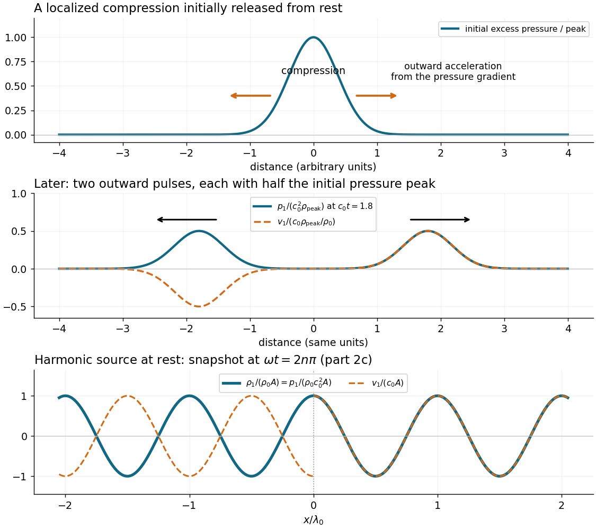

<h1 id="2/a/solution">Solution</h1>

↑ **Parent:** [A](../a.md)

Compressing a small region raises its [mass density](../../../../density.md) and, for positive compressibility, its [pressure](../../../../pressure-split.md). The outward [pressure gradient force](../../../../pressure-gradient-force.md) accelerates neighbouring [fluid elements](../../../../fluid-element.md). Their outward motion compresses fluid farther away, carrying the disturbance outward. The original compressed region relaxes; [inertia](../../../../inertia.md) allows the fluid motion to continue beyond zero excess [pressure](../../../../pressure-split.md), producing a rarefaction and a restoring [pressure gradient force](../../../../pressure-gradient-force.md). Elastic compression and [inertia](../../../../inertia.md) therefore support a propagating [longitudinal wave](../../../../longitudinal-wave.md).

In a local planar description with [acoustic displacement](../../../../acoustic-displacement.md) $\xi(x,t)$,

$$
\rho_1=-\rho_0\partial_x\xi,\qquad
p_1=c_0^2\rho_1,\qquad
\rho_0\partial_t^2\xi=-\partial_xp_1,
$$

so $\xi_{tt}=c_0^2\xi_{xx}$. The [speed of sound](../../../../speed-of-sound.md) is a propagation [speed](../../../../speed.md), whereas the [acoustic particle velocity](../../../../acoustic-particle-velocity.md) is the small back-and-forth motion of the medium. In [linear acoustics](../../../../linear-acoustics-split.md), [energy](../../../../energy-split.md) travels with the disturbance without first-order net transport of the fluid over a [wave period](../../../../wave-period.md).

**[Figure 1](#2/a/image-compression-drives-outward-motion-outgoing-sound-has-opposite-velocity-signs-on-the-two-sides). Compression drives outward motion; outgoing sound has opposite velocity signs on the two sides**. Original one-dimensional model. The upper panel shows an initially compressed region and the initial acceleration caused by its pressure gradient. The middle panel shows its later split into outgoing pulses. The lower panel shows the normalized harmonic fields required in part 2(c), with no reflected waves.

## ↑ Ancestors (12)

1. [A](../a.md)
2. [2](../../2.md)
3. [2021](../../../2021-split.md)
4. [Past exam of the fluids course of the University of Oxford](../../../split.md)
5. [Fluids course of the University of Oxford](../../../../fluids-course-of-the-university-of-oxford.md)
6. [Year 3 of the physics course of the University of Oxford](../../../../year-3-of-the-physics-course-of-the-university-of-oxford.md)
7. [Physics course of the University of Oxford](../../../../physics-course-of-the-university-of-oxford.md)
8. [Undergraduate course of the University of Oxford](../../../../undergraduate-course-of-the-university-of-oxford.md)
9. [Course of the University of Oxford](../../../../course-of-the-university-of-oxford.md)
10. [University of Oxford](../../../../university-of-oxford-split.md)
11. [List of universities](../../../../list-of-universities.md)
12. [Codex Wiki](../../../../split.md)
