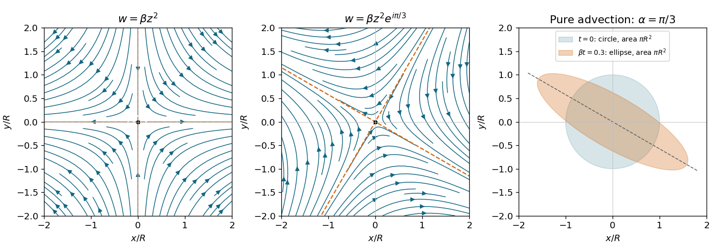

<h1 id="4/b/i/solution">Solution</h1>

↑ **Parent:** [I](../i.md)

Using $w=\phi+i\psi$ and the [complex velocity](../../../../../complex-velocity.md) convention $w'=v_x-iv_y$,

$$
w=\beta(x^2-y^2)+2i\beta xy,
\qquad
\boxed{\psi=2\beta xy,\quad v_x=2\beta x,\quad v_y=-2\beta y.}
$$

The [streamlines](../../../../../streamline.md) are $xy=\psi/(2\beta)$, a family of rectangular [hyperbolas](../../../../../hyperbola.md) whose asymptotes are the coordinate axes. The origin is a [stagnation point](../../../../../stagnation-point.md). Fluid moves inward along the $y$ axis and outward along the $x$ axis, with the same directions approached by the neighbouring [streamlines](../../../../../streamline.md). This is a planar extensional [incompressible flow](../../../../../incompressible-flow.md), illustrated in the left panel below.

**[Figure 2](#4/b/i/image-quadratic-complex-potentials-give-hyperbolic-streamlines-and-area-preserving-dye-deformation). Quadratic complex potentials give hyperbolic streamlines and area-preserving dye deformation**. Original streamlines for zero phase and phase $\pi/3$, with arrows from the analytic velocity fields. The principal extension axis rotates by $-\alpha/2$. The right panel compares a unit dye circle with its image at $\beta t=0.3$ for $\alpha=\pi/3$; the ellipse has the same area.

## ↑ Ancestors (13)

1. [I](../i.md)
2. [B](../../b.md)
3. [4](../../../4.md)
4. [2021](../../../../2021-split.md)
5. [Past exam of the fluids course of the University of Oxford](../../../../split.md)
6. [Fluids course of the University of Oxford](../../../../../fluids-course-of-the-university-of-oxford.md)
7. [Year 3 of the physics course of the University of Oxford](../../../../../year-3-of-the-physics-course-of-the-university-of-oxford.md)
8. [Physics course of the University of Oxford](../../../../../physics-course-of-the-university-of-oxford.md)
9. [Undergraduate course of the University of Oxford](../../../../../undergraduate-course-of-the-university-of-oxford.md)
10. [Course of the University of Oxford](../../../../../course-of-the-university-of-oxford.md)
11. [University of Oxford](../../../../../university-of-oxford-split.md)
12. [List of universities](../../../../../list-of-universities.md)
13. [Codex Wiki](../../../../../split.md)
