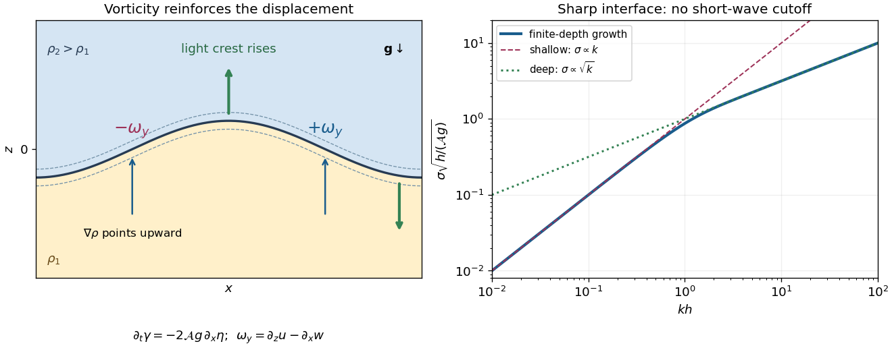

# 2022

↑ **Parent:** [Past exam of the fluids course of the University of Oxford](../past-exam-of-the-fluids-course-of-the-university-of-oxford.md)

Source: [https://www.whatdotheyknow.com/request/oxford_physics_past_papers_2/response/2340696/attach/10/Physics%20Papers%202021.pdf?cookie_passthrough=1](https://www.whatdotheyknow.com/request/oxford_physics_past_papers_2/response/2340696/attach/10/Physics%20Papers%202021.pdf?cookie_passthrough=1)

Source bundle pages 123–128. The paper cover establishes 2022; the attachment filename uses 2021. Solutions use the symbols of the source, with corrections and approximation limits identified where needed.

**Table of contents**

- [1](#1)
  - [a](#1/a)
    - [Solution](#1/a/solution)
  - [b](#1/b)
    - [Solution](#1/b/solution)
  - [c](#1/c)
    - [Solution](#1/c/solution)
  - [d](#1/d)
    - [Solution](#1/d/solution)
- [2](#2)
  - [a](#2/a)
    - [Solution](#2/a/solution)
  - [b](#2/b)
    - [Solution](#2/b/solution)
  - [c](#2/c)
    - [Solution](#2/c/solution)
  - [d](#2/d)
    - [Solution](#2/d/solution)
  - [e](#2/e)
    - [Solution](#2/e/solution)
- [3](#3)
  - [a](#3/a)
    - [Solution](#3/a/solution)
  - [b](#3/b)
    - [Solution](#3/b/solution)
  - [c](#3/c)
    - [Solution](#3/c/solution)
- [4](#4)
  - [a](#4/a)
    - [Solution](#4/a/solution)
  - [b](#4/b)
    - [Solution](#4/b/solution)
  - [c](#4/c)
    - [Solution](#4/c/solution)
  - [d](#4/d)
    - [Solution](#4/d/solution)

## 1

↑ **Parent:** [2022](2022.md)

<h3 id="1/a">a</h3>

↑ **Parent:** [1](#1)

<h4 id="1/a/solution">Solution</h4>

↑ **Parent:** [A](#1/a)

Take $x$ along a horizontal gap and $s$ perpendicular to its plates, with $0<s<b$. Assume a [Newtonian fluid](../viscous-fluid-flow.md#newtonian-fluid), stationary plates, a [steady flow](../fluid-mechanics.md#steady-flow), a [laminar flow](../fluid-mechanics.md#laminar-flow) and a [fully developed flow](../viscous-fluid-flow.md#fully-developed-flow) away from the entrances and side edges. The [no-slip boundary condition](../viscous-fluid-flow.md#no-slip-boundary-condition) holds on both plates. Any transverse [gravity](../physics.md#gravity) is absorbed in the [hydrostatic pressure](../fluid-mechanics.md#hydrostatic-pressure); there is no imposed transverse through-flow. Translational symmetry and the [no-penetration boundary condition](../viscous-fluid-flow.md#no-penetration-boundary-condition) then give $\mathbf u=(u(s),0,0)$. The [Navier-Stokes equation](../viscous-fluid-flow.md#navier-stokes-equation) reduces to

$$
0=-\frac{dp}{dx}+\eta\frac{d^2u}{ds^2},\qquad
\frac{dp}{dx}=-\frac{\Delta p}{L},\qquad u(0)=u(b)=0.
$$

Twice integrating gives the [plane Poiseuille flow](../viscous-fluid-flow.md#plane-poiseuille-flow):

$$
\boxed{u_x(s)=\frac{\Delta p}{2\eta L}s(b-s),\qquad u_s=u_{\mathrm{span}}=0.}
$$

The [volumetric flow rate](../fluid-mechanics.md#volumetric-flow-rate) through one gap is

$$
Q_{\mathrm{gap}}=w\int_0^b u_x(s)\,ds
=\frac{wb^3\Delta p}{12\eta L}.
$$

There are $n-1$ internal gaps. Their total cross-sectional area is $(n-1)wb$, because the plate thickness is negligible, so the [Darcy velocity](../porous-media-flow.md#darcy-velocity) is

$$
\boxed{q=\frac{(n-1)Q_{\mathrm{gap}}}{(n-1)wb}
=\frac{b^2}{12\eta}\frac{\Delta p}{L},\qquad \Pi_0=\frac{b^2}{12}.}
$$

Thus the [permeability of a porous medium](../porous-media-flow.md#permeability-of-a-porous-medium) has the dimensions of squared [length](../physics.md#length). If finite plate thickness were included, the [Darcy velocity](../porous-media-flow.md#darcy-velocity) averaged over the whole manifold would also contain its [porosity](../porous-media-flow.md#porosity).

Both the local [acceleration](../classical-mechanics.md#acceleration) and the [convective acceleration](../continuum-mechanics.md#convective-acceleration) vanish: $\partial_t\mathbf u=0$ and $(\mathbf u\cdot\nabla)\mathbf u=u_x\partial_x\mathbf u=0$. The dominant balance is therefore between the [pressure gradient](../fluid-mechanics.md#pressure-gradient) and [viscous stress](../dynamic-viscosity.md#viscous-stress-tensor), with no [inertia](../classical-mechanics.md#inertia) contribution in this fully developed solution. This exact cancellation does not guarantee that arbitrary large-[Reynolds number](../dynamic-viscosity.md#reynolds-number) realizations remain [laminar flows](../fluid-mechanics.md#laminar-flow); entrances, disturbances and [turbulence](../turbulence.md) can invalidate the assumptions.

<h3 id="1/b">b</h3>

↑ **Parent:** [1](#1)

<h4 id="1/b/solution">Solution</h4>

↑ **Parent:** [B](#1/b)

Use a fixed representative volume $V$ containing many pores. Let $\varphi$ be the [porosity](../porous-media-flow.md#porosity) and let $\mathbf q$ be the [Darcy velocity](../porous-media-flow.md#darcy-velocity), defined per unit total area. The [conservation of mass](../continuum-mechanics.md#mass-conservation) is

$$
\frac{d}{dt}\int_V\varphi\rho\,dV
=-\int_{\partial V}\rho\mathbf q\cdot\mathbf n\,dS.
$$

The solid matrix is rigid and fixed, and the liquid is fully saturating and has constant [mass density](../fluid-mechanics.md#density), so the stored mass on the left is constant. Microscopic internal liquid-solid boundaries contribute no through-flux by the [no-penetration boundary condition](../viscous-fluid-flow.md#no-penetration-boundary-condition). Applying the [divergence theorem](../multivariable-calculus.md#divergence-theorem) to the external flux gives

$$
\int_V\nabla\cdot(\rho\mathbf q)\,dV=0.
$$

Since the representative volume is arbitrary, the macroscopic [continuity equation](../mathematical-physics.md#continuity-equation) is

$$
\boxed{\nabla\cdot(\rho\mathbf q)=0,\qquad \nabla\cdot\mathbf q=0\quad\text{for constant }\rho.}
$$

There is no extra factor of $\varphi$ in the flux: that factor is already incorporated in the definition of the [Darcy velocity](../porous-media-flow.md#darcy-velocity). A compressible liquid or deformable matrix would require retaining the storage term.

<h3 id="1/c">c</h3>

↑ **Parent:** [1](#1)

<h4 id="1/c/solution">Solution</h4>

↑ **Parent:** [C](#1/c)

Under spherical symmetry, the [continuity equation](../mathematical-physics.md#continuity-equation) and [Darcy's law](../porous-media-flow.md#darcy-law) give

$$
\frac1{r^2}\frac{d}{dr}(r^2q_r)=0,\qquad
q_r=-\frac{\Pi_1}{\eta}\frac{dp}{dr}.
$$

Hence $q_r=C/r^2$, and integrating the [pressure gradient](../fluid-mechanics.md#pressure-gradient) from infinity gives

$$
p(r)-p_0=\frac{\eta C}{\Pi_1r}.
$$

The [boundary condition](../differential-equation.md#boundary-condition) at $r=a$ fixes $C=\Pi_1a\Delta p/\eta$. Therefore [spherical Darcy injection](../porous-media-flow.md#spherical-darcy-injection) has

$$
\boxed{p(r)=p_0+\frac{a\Delta p}{r},\qquad
q_r(r)=\frac{\Pi_1a\Delta p}{\eta r^2},\qquad
Q=4\pi r^2q_r=\frac{4\pi\Pi_1a\Delta p}{\eta}.}
$$

Here $q_r$ is the superficial [Darcy velocity](../porous-media-flow.md#darcy-velocity), not the pore [velocity](../classical-mechanics.md#velocity) $q_r/\varphi$.

For the comparison, assume geometrically similar pore networks, equal [porosity](../porous-media-flow.md#porosity), the same source radius and far boundary geometry, and equal pump efficiency. [Dimensional analysis](../mathematical-physics.md#dimensional-analysis) then gives $\Pi_1=C_{\mathrm{geom}}d^2$ with the same dimensionless factor. Consequently

$$
\frac{\Pi_{1A}}{\Pi_{1B}}=4,\qquad
\frac{(\Pi_1/\eta)_A}{(\Pi_1/\eta)_B}=2.
$$

At a fixed desired [volumetric flow rate](../fluid-mechanics.md#volumetric-flow-rate), the required excess [pressure](../pressure.md) and pumping [power](../energy.md#power) are

$$
\Delta p=\frac{\eta Q}{4\pi\Pi_1a},\qquad
\mathcal P=Q\Delta p=\frac{\eta Q^2}{4\pi\Pi_1a}.
$$

**Aquifer A requires half the pumping power** at equal throughput, or half the [energy](../energy.md) to inject the same volume over the same time. This compares the excess [pressure-volume work](../energy.md#pressure-volume-work) dissipated by the [Darcy flow](../porous-media-flow.md#darcy-flow); any different baseline compression or other plant costs need separate accounting.

The imposed comparison matters. At fixed $\Delta p$, A takes twice the [volumetric flow rate](../fluid-mechanics.md#volumetric-flow-rate) and twice the instantaneous [power](../energy.md#power), but the same excess [energy](../energy.md) per injected volume. The pore spacing alone does not determine [permeability of a porous medium](../porous-media-flow.md#permeability-of-a-porous-medium) if network geometry or [porosity](../porous-media-flow.md#porosity) changes; without the geometric assumptions the preference cannot be inferred from $d$ alone.

<h3 id="1/d">d</h3>

↑ **Parent:** [1](#1)

<h4 id="1/d/solution">Solution</h4>

↑ **Parent:** [D](#1/d)

For the common constant [mass density](../fluid-mechanics.md#density), the background [hydrostatic pressure](../fluid-mechanics.md#hydrostatic-pressure) satisfies $dp_0/dz=-\rho g$. Define the excess [pressure](../pressure.md) $P=p-p_0(z)$. In [Darcy's law](../porous-media-flow.md#darcy-law), the background [pressure gradient](../fluid-mechanics.md#pressure-gradient) cancels [gravity](../physics.md#gravity):

$$
\mathbf q=-\frac{\Pi_1}{\eta}(\nabla p+\rho g\hat{\mathbf z})
=-\frac{\Pi_1}{\eta}\nabla P,\qquad \nabla^2P=0.
$$

If the source imposes the same excess [pressure](../pressure.md) relative to the local [hydrostatic pressure](../fluid-mechanics.md#hydrostatic-pressure) everywhere on its spherical surface, $P(a)=\Delta p$, the [spherical Darcy injection](../porous-media-flow.md#spherical-darcy-injection) result survives exactly:

$$
\boxed{p(\mathbf x)=p_0(z)+\frac{a\Delta p}{r},\qquad
\mathbf q=\frac{\Pi_1a\Delta p}{\eta r^2}\hat{\mathbf r}.}
$$

It is important to specify what is maintained on the source. A literally uniform absolute [pressure](../pressure.md) $p_s=p_0(0)+\Delta p$ on a finite sphere centered at $z=0$ instead gives $P(a,\theta)=\Delta p+\rho ga\cos\theta$, where $\theta$ is measured from the upward vertical. The decaying [harmonic function](../partial-differential-equation.md#harmonic-function) outside the sphere is then

$$
P=\frac{a\Delta p}{r}+\frac{\rho ga^3\cos\theta}{r^2},
$$

and therefore

$$
q_r=\frac{\Pi_1}{\eta}\left(\frac{a\Delta p}{r^2}+\frac{2\rho ga^3\cos\theta}{r^3}\right),\qquad
q_\theta=\frac{\Pi_1\rho ga^3\sin\theta}{\eta r^3}.
$$

This supplies a concrete exception to an unqualified claim that [gravity](../physics.md#gravity) leaves the radial flow unchanged. The additional dipolar contribution has zero net [volumetric flow rate](../fluid-mechanics.md#volumetric-flow-rate), so $Q=4\pi\Pi_1a\Delta p/\eta$ still holds. Equal injected and resident [mass densities](../fluid-mechanics.md#density) are essential to the background cancellation.

## 2

↑ **Parent:** [2022](2022.md)

<h3 id="2/a">a</h3>

↑ **Parent:** [2](#2)

<h4 id="2/a/solution">Solution</h4>

↑ **Parent:** [A](#2/a)

At a fixed point beside a river, the [Eulerian coordinate](../continuum-mechanics.md#eulerian-coordinate) description measures $\mathbf u(\mathbf x,t)$. Its local [acceleration](../classical-mechanics.md#acceleration) $\partial_t\mathbf u$ measures change at that fixed point. Following a floating parcel gives a [Lagrangian trajectory](../continuum-mechanics.md#lagrangian-trajectory) $\mathbf X(t)$ satisfying $\dot{\mathbf X}=\mathbf u(\mathbf X,t)$. The [chain rule](../calculus.md#chain-rule) gives its physical [material acceleration](../continuum-mechanics.md#material-acceleration):

$$
\boxed{\ddot{\mathbf X}=\frac{D\mathbf u}{Dt}
=\partial_t\mathbf u+(\mathbf u\cdot\nabla)\mathbf u.}
$$

The extra term is the [convective acceleration](../continuum-mechanics.md#convective-acceleration). For a river that narrows steadily, an observer at one fixed position measures a constant [velocity](../classical-mechanics.md#velocity), yet a parcel speeds up as it reaches the narrowing. A parcel following a steady bend also experiences a [centripetal acceleration](../classical-mechanics.md#centripetal-acceleration) even when its speed is constant. An Eulerian calculation of the physical [acceleration](../classical-mechanics.md#acceleration) must include the same [convective acceleration](../continuum-mechanics.md#convective-acceleration); the two descriptions do not predict different forces.

<h3 id="2/b">b</h3>

↑ **Parent:** [2](#2)

<h4 id="2/b/solution">Solution</h4>

↑ **Parent:** [B](#2/b)

Choose the [stream function](../fluid-mechanics.md#stream-function) convention $u=-\psi_y$, $v=\psi_x$, so that this is an incoming [stagnation point](../fluid-mechanics.md#stagnation-point) flow rather than the reversed flow. The [velocity field](../fluid-mechanics.md#velocity-field) is

$$
u=Ax,\qquad v=-Ay.
$$

At the plate $v(x,0)=0$, satisfying the [no-penetration boundary condition](../viscous-fluid-flow.md#no-penetration-boundary-condition). The nonzero tangential [velocity](../classical-mechanics.md#velocity) $u(x,0)=Ax$ is permitted for an [inviscid flow](../fluid-mechanics.md#inviscid-flow); the [no-slip boundary condition](../viscous-fluid-flow.md#no-slip-boundary-condition) is not imposed on the [Euler equations for an inviscid fluid](../euler-equations-for-an-inviscid-fluid.md).

The steady [convective acceleration](../continuum-mechanics.md#convective-acceleration) is $(A^2x,A^2y)$. Thus the [Euler equations for an inviscid fluid](../euler-equations-for-an-inviscid-fluid.md) require

$$
p_x=-\rho A^2x,\qquad p_y=-\rho A^2y-\rho g.
$$

Integrating gives

$$
\boxed{p_\infty(x,y)=p_0-\frac{\rho A^2}{2}(x^2+y^2)-\rho gy.}
$$

**The printed formula omits $\rho$ from its quadratic term.** The source uses physical [pressure](../pressure.md), not [pressure](../pressure.md) divided by [mass density](../fluid-mechanics.md#density), as is clear from its $\rho gy$ term and its [Navier-Stokes equation](../viscous-fluid-flow.md#navier-stokes-equation). The omitted factor is also required by [dimensional analysis](../mathematical-physics.md#dimensional-analysis). For a concrete substitution check, the printed expression gives $-p_x/\rho=A^2x/\rho$ rather than the required $A^2x$ when $\rho\ne1$ in the chosen numerical units.

<h3 id="2/c">c</h3>

↑ **Parent:** [2](#2)

<h4 id="2/c/solution">Solution</h4>

↑ **Parent:** [C](#2/c)

A stationary viscous wall imposes the [no-slip boundary condition](../viscous-fluid-flow.md#no-slip-boundary-condition), $u=v=0$, whereas the outer [inviscid flow](../fluid-mechanics.md#inviscid-flow) has $u=Ax$. At large [Reynolds number](../dynamic-viscosity.md#reynolds-number), the transition is confined to a thin [viscous boundary layer](../viscous-fluid-flow.md#viscous-boundary-layer), where normal [velocity gradients](../continuum-mechanics.md#velocity-gradient) amplify the otherwise small viscous term.

Take a horizontal scale $L$, an outer speed $U=AL$, and a [boundary layer thickness](../continuum-mechanics.md#boundary-layer-thickness) $\delta\ll L$. The [continuity equation](../mathematical-physics.md#continuity-equation) gives $v=O(U\delta/L)$. Write $\epsilon=\delta/L$ and $\mathrm{Re}_L=UL/\nu$. The tangential [Navier-Stokes equation](../viscous-fluid-flow.md#navier-stokes-equation) has scales

$$
u u_x+v u_y=O(U^2/L),\qquad
\nu u_{yy}=O(\nu U/\delta^2),\qquad
\frac{\nu u_{xx}}{\nu u_{yy}}=O(\epsilon^2).
$$

Balancing [convective acceleration](../continuum-mechanics.md#convective-acceleration) with normal viscous diffusion gives $\epsilon=O(\mathrm{Re}_L^{-1/2})$. The leading tangential equation and [incompressible flow](../fluid-mechanics.md#incompressible-flow) constraint are

$$
\boxed{u u_x+v u_y=-\frac1\rho\frac{\partial p_\infty}{\partial x}+\nu u_{yy},\qquad
u_x+v_y=0.}
$$

Here and below $\nu$ is the [kinematic viscosity](../dynamic-viscosity.md#kinematic-viscosity), while $u$ is the horizontal [velocity](../classical-mechanics.md#velocity).

For the normal equation, first remove the [hydrostatic pressure](../fluid-mechanics.md#hydrostatic-pressure) by writing $P=p+\rho gy$. Normal [inertia](../classical-mechanics.md#inertia) and normal viscous terms are $O(\rho U^2\delta/L^2)$, so the change of $P$ across the layer is only $O(\rho U^2\epsilon^2)$. Matching to the outer [pressure](../pressure.md) therefore makes the leading $O(\rho U^2)$ excess [pressure](../pressure.md) independent of $y$:

$$
P(x,y)=P_e(x)+O(\rho U^2\epsilon^2),\qquad
p_y=-\rho g+O(\rho U^2\delta/L^2).
$$

The outer expression similarly has $(p_\infty)_y=-\rho g-\rho A^2y$. Thus the printed condition

$$
\boxed{p_y=(p_\infty)_y}
$$

is a **leading-order [boundary layer](../continuum-mechanics.md#boundary-layer) matching statement**, with the smaller normal dynamic terms discarded on both sides. It is not an exact identity at the next order. In particular, retaining the outer $-\rho A^2y$ while dropping normal [inertia](../classical-mechanics.md#inertia) and normal viscous terms inconsistently mixes orders. The tangential driving term is unambiguous: $-(p_\infty)_x/\rho=A^2x$.

<h3 id="2/d">d</h3>

↑ **Parent:** [2](#2)

<h4 id="2/d/solution">Solution</h4>

↑ **Parent:** [D](#2/d)

Use the same [stream function](../fluid-mechanics.md#stream-function) convention and denote differentiation with respect to the [dimensionless variable](../mathematics.md#dimensionless-variable) $\eta=y/\delta$ by a prime. The proposed [similarity solution](../partial-differential-equation.md#similarity-solution) gives

$$
u=Ax f'(\eta),\qquad v=-A\delta f(\eta).
$$

Its [continuity equation](../mathematical-physics.md#continuity-equation) holds identically. Substitution in the tangential [Prandtl boundary-layer equation](../viscous-fluid-flow.md#prandtl-boundary-layer-equation) gives

$$
A^2x\bigl((f')^2-ff''\bigr)
=\frac{\nu Ax}{\delta^2}f'''+A^2x.
$$

Choose the constant scale $\delta=\sqrt{\nu/A}$. The [Hiemenz flow](../viscous-fluid-flow.md#hiemenz-flow) equation and its [boundary conditions](../differential-equation.md#boundary-condition) are

$$
\boxed{f'''+ff''-(f')^2=-1,\qquad
f(0)=0,\quad f'(0)=0,\quad f'(\infty)=1.}
$$

The first two conditions impose the [no-penetration boundary condition](../viscous-fluid-flow.md#no-penetration-boundary-condition) and [no-slip boundary condition](../viscous-fluid-flow.md#no-slip-boundary-condition). The last matches the tangential outer [velocity](../classical-mechanics.md#velocity). One also has $f''\to0$ and $f(\eta)/\eta\to1$. It is too strong to impose $f-\eta\to0$: the [displacement thickness](../continuum-mechanics.md#displacement-thickness) generally permits a constant offset, $f\sim\eta-B$.

The normal [Navier-Stokes equation](../viscous-fluid-flow.md#navier-stokes-equation) makes the approximation in part (c) explicit. With this [similarity solution](../partial-differential-equation.md#similarity-solution), it gives

$$
p_y=-\rho g-\rho A^2\delta\bigl(ff'+f''\bigr).
$$

At the wall this differs from $(p_\infty)_y=-\rho g$ by $-\rho A^2\delta f''(0)$. This is a concrete next-order counterexample to interpreting the printed normal [pressure gradient](../fluid-mechanics.md#pressure-gradient) equality exactly; the tangential [Hiemenz flow](../viscous-fluid-flow.md#hiemenz-flow) equation remains valid at its stated order.

<h3 id="2/e">e</h3>

↑ **Parent:** [2](#2)

<h4 id="2/e/solution">Solution</h4>

↑ **Parent:** [E](#2/e)

The [Hiemenz flow](../viscous-fluid-flow.md#hiemenz-flow) profile changes on $\eta=O(1)$, so its [boundary layer thickness](../continuum-mechanics.md#boundary-layer-thickness) is

$$
\boxed{\delta_{\mathrm{BL}}\sim\sqrt{\frac\nu A}.}
$$

A specified edge convention, such as $u/(Ax)=0.99$, introduces an order-one numerical multiplier requiring the profile to be solved. Scaling alone does not determine that multiplier. The result has no separate dependence on $x$, $y$, $\rho$ or $p_0$ at fixed [kinematic viscosity](../dynamic-viscosity.md#kinematic-viscosity). At fixed [dynamic viscosity](../dynamic-viscosity.md), it is $\sqrt{\eta/(\rho A)}$.

The [viscous diffusion time](../viscous-fluid-flow.md#viscous-diffusion-time) across a thickness $\delta$ is $\delta^2/\nu$; the imposed strain has time scale $A^{-1}$. Their balance sets the thickness. Increasing [kinematic viscosity](../dynamic-viscosity.md#kinematic-viscosity) spreads the layer, while increasing the imposed [velocity gradient](../continuum-mechanics.md#velocity-gradient) presses the layer toward the wall. The outward tangential [velocity](../classical-mechanics.md#velocity) increases as $Ax$, so the decreasing travel time per unit distance offsets the usual downstream broadening.

For a conventional estimate of transition to [turbulence](../turbulence.md), form the local horizontal [Reynolds number](../dynamic-viscosity.md#reynolds-number):

$$
\mathrm{Re}_x=\frac{(Ax)x}{\nu}=\frac{Ax^2}{\nu}.
$$

If transition is assumed to occur at an empirical value $\mathrm{Re}_{\mathrm{crit}}$, then

$$
\boxed{l\sim\sqrt{\frac{\mathrm{Re}_{\mathrm{crit}}\nu}{A}}.}
$$

A rough borrowed threshold of order $10^5$–$10^6$ would give $l$ of order $10^2$–$10^3\sqrt{\nu/A}$. This is a heuristic estimate, not a universal stability prediction: the accelerating outer flow and favorable [pressure gradient](../fluid-mechanics.md#pressure-gradient) can delay transition, and disturbance amplitudes and wall roughness matter. Simply setting $\mathrm{Re}_x\sim1$ locates failure of the thin-layer approximation near the [stagnation point](../fluid-mechanics.md#stagnation-point), not onset of [turbulence](../turbulence.md).

## 3

↑ **Parent:** [2022](2022.md)

<h3 id="3/a">a</h3>

↑ **Parent:** [3](#3)

<h4 id="3/a/solution">Solution</h4>

↑ **Parent:** [A](#3/a)

Each layer has constant [mass density](../fluid-mechanics.md#density), initially negligible [velocity](../classical-mechanics.md#velocity) and hence zero [vorticity](../vorticity.md). Its [Euler equations for an inviscid fluid](../euler-equations-for-an-inviscid-fluid.md) have a conservative gravitational body force, so [Kelvin's circulation theorem](../vorticity.md#kelvin-s-circulation-theorem) preserves zero bulk [vorticity](../vorticity.md). In a simply connected layer, the [irrotational flow](../vorticity.md#irrotational-flow) therefore has $\mathbf v_i=\nabla\phi_i$. The [incompressible flow](../fluid-mechanics.md#incompressible-flow) condition gives

$$
\boxed{\nabla^2\phi_i=0.}
$$

This applies while the ideal layerwise solution is smooth. It allows an interfacial [vortex sheet](../fluid-mechanics.md#vortex-sheet); it does not assert that the whole two-fluid flow has zero [vorticity](../vorticity.md) or that a smooth interface must exist for arbitrarily long times.

The rigid wall [no-penetration boundary conditions](../viscous-fluid-flow.md#no-penetration-boundary-condition) are

$$
\partial_z\phi_1(r,-h,t)=0,\qquad
\partial_z\phi_2(r,h,t)=0,\qquad
\partial_r\phi_i(a,z,t)=0,
$$

with boundedness and $\partial_r\phi_i=0$ at $r=0$ for regular axisymmetric fields. For a small interface displacement and small slope, linearization of the [kinematic boundary condition](../fluid-mechanics.md#kinematic-boundary-condition) about $z=0$ gives

$$
\boxed{\eta_t=\partial_z\phi_1(r,0,t)=\partial_z\phi_2(r,0,t).}
$$

The small-slope condition is an additional requirement for high-[wavenumber](../wave-equation.md#wavenumber) modes: $|\alpha\eta|\ll1$, not just $|\eta|\ll h,a$.

Choose the unperturbed [hydrostatic pressures](../fluid-mechanics.md#hydrostatic-pressure) as $\bar p_i(z)=p_*-\rho_i gz$. The linearized [Bernoulli equation](../euler-equations-for-an-inviscid-fluid.md#bernoulli-equation) gives the [pressure](../pressure.md) perturbation $p_i'=-\rho_i\partial_t\phi_i$, after absorbing spatially constant gauges into $\phi_i$. Since [surface tension](../surface-tension.md) and viscous [normal stress](../continuum-mechanics.md#normal-stress) vanish, [pressure](../pressure.md) continuity on $z=\eta$ gives

$$
-\rho_1\partial_t\phi_1-\rho_1g\eta
=-\rho_2\partial_t\phi_2-\rho_2g\eta,
$$

or

$$
\boxed{\rho_1\partial_t\phi_1-\rho_2\partial_t\phi_2
=(\rho_2-\rho_1)g\eta\quad\text{at }z=0.}
$$

The initial [velocity](../classical-mechanics.md#velocity) is zero, so $\eta_t(r,0)=0$. Separate [conservation of mass](../continuum-mechanics.md#mass-conservation) in each closed layer also requires $\int_0^a\eta(r,t)r\,dr=0$ relative to the initially horizontal interface.

<h3 id="3/b">b</h3>

↑ **Parent:** [3](#3)

<h4 id="3/b/solution">Solution</h4>

↑ **Parent:** [B](#3/b)

Write $\eta=H e^{\sigma t}J_0(\alpha r)$ using the [Bessel function of the first kind](../bessel-function.md#bessel-function-of-the-first-kind). The wall [boundary conditions](../differential-equation.md#boundary-condition) at $z=\pm h$ select

$$
\phi_1=C_1\cosh[\alpha(z+h)]J_0(\alpha r)e^{\sigma t},\qquad
\phi_2=C_2\cosh[\alpha(h-z)]J_0(\alpha r)e^{\sigma t}.
$$

Because $J_0'(s)=-J_1(s)$, the sidewall [no-penetration boundary condition](../viscous-fluid-flow.md#no-penetration-boundary-condition) requires

$$
\boxed{J_1(\alpha_na)=0,\qquad \alpha_n=\frac{j_{1,n}}a,\quad n=1,2,\ldots,}
$$

where $j_{1,n}$ are the positive zeros of $J_1$. These radial [eigenfunctions](../linear-operator-theory.md#eigenfunction) automatically preserve layer volume because

$$
\int_0^a rJ_0(\alpha_nr)\,dr=\frac{aJ_1(\alpha_na)}{\alpha_n}=0.
$$

The constant radial mode $\alpha=0$ cannot change the interface height in a closed tank: the [Laplace equation](../partial-differential-equation.md#laplace-equation) and the impermeable lids then give zero vertical [velocity](../classical-mechanics.md#velocity), and a uniform displacement would change each layer's volume.

The [kinematic boundary condition](../fluid-mechanics.md#kinematic-boundary-condition) fixes

$$
C_1=\frac{\sigma H}{\alpha\sinh(\alpha h)},\qquad
C_2=-\frac{\sigma H}{\alpha\sinh(\alpha h)}.
$$

Thus the interface values are $\phi_1(0)=\sigma\eta\coth(\alpha h)/\alpha$ and $\phi_2(0)=-\sigma\eta\coth(\alpha h)/\alpha$. Substitution in the [normal stress](../continuum-mechanics.md#normal-stress) condition gives the [finite-depth Rayleigh-Taylor dispersion relation](../continuum-mechanics.md#finite-depth-rayleigh-taylor-dispersion-relation):

$$
\frac{(\rho_1+\rho_2)\sigma_n^2}{\alpha_n}\coth(\alpha_nh)
=(\rho_2-\rho_1)g,
$$

so

$$
\boxed{\sigma_{n,\pm}=\pm\sqrt{\mathcal A g\alpha_n\tanh(\alpha_nh)},\qquad
\mathcal A=\frac{\rho_2-\rho_1}{\rho_2+\rho_1}>0.}
$$

Here $\mathcal A$ is the [Atwood number](../continuum-mechanics.md#atwood-number). Every allowed mode has a positive [growth rate](../dispersion-relation.md#growth-rate) and is subject to [Rayleigh-Taylor instability](../continuum-mechanics.md#rayleigh-taylor-instability). Since $d[\alpha\tanh(\alpha h)]/d\alpha=\tanh(\alpha h)+\alpha h\operatorname{sech}^2(\alpha h)>0$, shorter radial scales grow faster. The limits are

$$
\sigma_{n,+}\sim\sqrt{\mathcal A gh}\,\alpha_n\quad(\alpha_nh\ll1),\qquad
\sigma_{n,+}\sim\sqrt{\mathcal A g\alpha_n}\quad(\alpha_nh\gg1).
$$

There is no fastest finite [wavenumber](../wave-equation.md#wavenumber) in the ideal sharp-interface model without [surface tension](../surface-tension.md), [viscosity](../dynamic-viscosity.md) or [diffusion](../thermodynamics.md#diffusion). The zero-initial-[velocity](../classical-mechanics.md#velocity) condition uses both exponential branches: an initial mode $H J_0(\alpha_nr)$ evolves as $H\cosh(\sigma_{n,+}t)J_0(\alpha_nr)$. If the [mass density](../fluid-mechanics.md#density) ordering were reversed the same calculation would give oscillatory stable modes; equal [mass densities](../fluid-mechanics.md#density) give neutral modes.

<h3 id="3/c">c</h3>

↑ **Parent:** [3](#3)

<h4 id="3/c/solution">Solution</h4>

↑ **Parent:** [C](#3/c)

For an [inviscid flow](../fluid-mechanics.md#inviscid-flow), the force per unit volume is $\mathbf F=-\nabla p-\rho g\hat{\mathbf z}$. The gravitational [acceleration](../classical-mechanics.md#acceleration) has zero [curl](../multivariable-calculus.md#curl). Using the [curl](../multivariable-calculus.md#curl) product rule,

$$
\nabla\times\left(-\frac1\rho\nabla p\right)
=-\nabla(\rho^{-1})\times\nabla p
=\frac{\nabla\rho\times\nabla p}{\rho^2}.
$$

The supplied two-dimensional [vorticity equation](../mathematical-physics.md#vorticity-equation) therefore becomes

$$
\boxed{\partial_t\boldsymbol\omega+\mathbf v\cdot\nabla\boldsymbol\omega
=\frac{\nabla\rho\times\nabla p}{\rho^2}.}
$$

The out-of-plane [vorticity](../vorticity.md) has no stretching term in this two-dimensional setting. The source is [baroclinic vorticity generation](../mathematical-physics.md#baroclinic-vorticity-generation): differently directed [mass density](../fluid-mechanics.md#density) and [pressure gradients](../fluid-mechanics.md#pressure-gradient) generate rotation even from zero initial [vorticity](../vorticity.md).

For an explicit sign check, set $\omega_y=\partial_z u-\partial_x w$, with $z$ upward. A thin smoothed interface has $\rho\simeq\bar\rho(z-\eta(x,t))$, with $\bar\rho'>0$. If $P(x,t)$ denotes the total [pressure](../pressure.md) evaluated on the interface, then within the thin layer $p_x+\eta_xp_z\simeq P_x$ and

$$
\frac{(\nabla\rho\times\nabla p)_y}{\rho^2}
\simeq\frac{\bar\rho'}{\rho^2}P_x.
$$

Integrating through that layer and taking its thickness to zero gives the [vortex sheet](../fluid-mechanics.md#vortex-sheet) strength $\gamma=u_2-u_1$ and its linear evolution:

$$
\partial_t\gamma=\left(\frac1{\rho_1}-\frac1{\rho_2}\right)P_x.
$$

For a growing Fourier mode, the potentials from the preceding calculation with $\alpha$ replaced by $k$ give

$$
P-p_*=-\frac{2\rho_1\rho_2}{\rho_1+\rho_2}g\eta,\qquad
\boxed{\partial_t\gamma=-2\mathcal A g\eta_x.}
$$

Thus the right-hand descending slope of a light-fluid crest produces positive $\omega_y$, while the left-hand ascending slope produces negative $\omega_y$. Their induced [velocity](../classical-mechanics.md#velocity) raises the light-fluid crest and lowers the heavy-fluid trough, increasing the slope and generating more [vorticity](../vorticity.md). This is the positive feedback underlying [Rayleigh-Taylor instability](../continuum-mechanics.md#rayleigh-taylor-instability).

**[Figure 1](#3/c/image-baroclinic-feedback-and-finite-depth-growth-of-an-unstable-density-interface). Baroclinic feedback and finite-depth growth of an unstable density interface**.

One can close this mechanism quantitatively. For $\eta=H(t)\cos(kx)$, the [kinematic boundary conditions](../fluid-mechanics.md#kinematic-boundary-condition) give $\gamma=2\dot H\coth(kh)\sin(kx)$. Combining with the sheet-generation equation gives

$$
\ddot H=\mathcal A gk\tanh(kh)H.
$$

For $kh\ll1$, the lids confine motion throughout both layers and horizontal redistribution is slow, yielding $\sigma\sim\sqrt{\mathcal A gh}\,k$. For $kh\gg1$, motion is localized within depth $k^{-1}$ on each side. Less fluid must accelerate at shorter [wavelength](../wave-equation.md#wavelength), giving $\sigma\sim\sqrt{\mathcal A gk}$. Since $k_n=n\pi/b$, the ideal [growth rate](../dispersion-relation.md#growth-rate) increases with $n$ with no short-wave cutoff.

The sharp-interface result requires $k\delta\ll1$ for the smoothed layer. When $k\delta$ becomes order one, it no longer applies. A smooth adverse [mass density](../fluid-mechanics.md#density) gradient has a local overturning time of order $[g\bar\rho'/\bar\rho]^{-1/2}$ rather than the unbounded sharp-interface rate. Finite molecular [diffusion](../thermodynamics.md#diffusion) also relaxes small-scale [mass density](../fluid-mechanics.md#density) perturbations on a time of order $(Dk^2)^{-1}$, and [viscosity](../dynamic-viscosity.md), if included, damps small-scale [velocity](../classical-mechanics.md#velocity). Weak [diffusion](../thermodynamics.md#diffusion) motivates the thin-layer picture; it does not justify extrapolating the discontinuous [dispersion relation](../dispersion-relation.md) to arbitrary $n$.

## 4

↑ **Parent:** [2022](2022.md)

<h3 id="4/a">a</h3>

↑ **Parent:** [4](#4)

<h4 id="4/a/solution">Solution</h4>

↑ **Parent:** [A](#4/a)

A small [Reynolds number](../dynamic-viscosity.md#reynolds-number), $\mathrm{Re}=\rho UL/\eta\ll1$, means that [inertia](../classical-mechanics.md#inertia) is small compared with viscous forces. It can arise from small speed, small length or large [dynamic viscosity](../dynamic-viscosity.md). Examples are the locomotion of a [microswimmer](../stokes-flow.md#microswimmer) and the slow [sedimentation](../suspension-chemistry.md#sedimentation) of a small particle in a viscous liquid.

To neglect local [acceleration](../classical-mechanics.md#acceleration) as well, an externally imposed time scale $T$ must satisfy $\rho L^2/(\eta T)=L^2/(\nu T)\ll1$. This holds for a [steady flow](../fluid-mechanics.md#steady-flow) or a sufficiently slowly varying [quasi-steady Stokes approximation](../stokes-flow.md#quasi-steady-stokes-approximation). Small [Reynolds number](../dynamic-viscosity.md#reynolds-number) alone is insufficient for that extra step. For an [incompressible flow](../fluid-mechanics.md#incompressible-flow) with constant material coefficients and uniform [gravity](../physics.md#gravity), the [Navier-Stokes equation](../viscous-fluid-flow.md#navier-stokes-equation) then reduces to the [Stokes equation](../stokes-flow.md#stokes-equation):

$$
0=-\nabla p-\rho g\hat{\mathbf z}+\eta\nabla^2\mathbf u,\qquad \nabla\cdot\mathbf u=0.
$$

Taking the [divergence](../multivariable-calculus.md#divergence) and using commuting spatial [derivatives](../calculus.md#derivative) gives

$$
0=-\nabla^2p+\eta\nabla^2(\nabla\cdot\mathbf u),\qquad
\boxed{\nabla^2p\simeq0.}
$$

Taking the [curl](../multivariable-calculus.md#curl), which annihilates the [pressure gradient](../fluid-mechanics.md#pressure-gradient) and uniform gravitational force, gives

$$
0=\eta\nabla^2(\nabla\times\mathbf u),\qquad
\boxed{\nabla^2\boldsymbol\omega\simeq0.}
$$

These are the [Harmonic pressure and vorticity in Stokes flow](../stokes-flow.md#harmonic-pressure-and-vorticity-in-stokes-flow) results.

A concrete counterexample to inferring both solely from small [Reynolds number](../dynamic-viscosity.md#reynolds-number) is [Stokes' second problem](../viscous-fluid-flow.md#stokes-second-problem): an oscillating plate with arbitrarily small [velocity](../classical-mechanics.md#velocity) amplitude has negligible [inertia](../classical-mechanics.md#inertia), but $\partial_t\boldsymbol\omega=\nu\nabla^2\boldsymbol\omega$ is nonzero. Its [vorticity](../vorticity.md) is not a [harmonic function](../partial-differential-equation.md#harmonic-function). The quasi-steady qualification is therefore necessary.

<h3 id="4/b">b</h3>

↑ **Parent:** [4](#4)

<h4 id="4/b/solution">Solution</h4>

↑ **Parent:** [B](#4/b)

For an axisymmetric field without azimuthal motion, the [divergence](../multivariable-calculus.md#divergence) in [spherical coordinates](../multivariable-calculus.md#spherical-coordinate-system) is

$$
\nabla\cdot\mathbf v=\frac1{r^2}\partial_r(r^2v_r)
+\frac1{r\sin\theta}\partial_\theta(\sin\theta v_\theta).
$$

Substituting the given axisymmetric [stream function](../fluid-mechanics.md#stream-function) representation gives

$$
\nabla\cdot\mathbf v
=\frac1{r^2\sin\theta}\left(\partial_r\partial_\theta\Psi
-\partial_\theta\partial_r\Psi\right)=0.
$$

Thus [incompressible flow](../fluid-mechanics.md#incompressible-flow) is automatic.

The [velocity](../classical-mechanics.md#velocity) components are laboratory-frame components resolved about the instantaneous bubble center. The center itself translates with $U\hat{\mathbf z}=U\cos\theta\hat{\mathbf r}-U\sin\theta\hat{\boldsymbol\theta}$. The [kinematic boundary condition](../fluid-mechanics.md#kinematic-boundary-condition) for a spherical interface gives

$$
\boxed{v_r(a,\theta)=U\cos\theta.}
$$

For negligible internal [dynamic viscosity](../dynamic-viscosity.md), continuity of tangential [traction](../continuum-mechanics.md#traction) imposes zero tangential [shear stress](../viscous-fluid-flow.md#shear-stress), rather than a prescribed tangential [velocity](../classical-mechanics.md#velocity). In terms of the [strain-rate tensor](../viscous-fluid-flow.md#strain-rate-tensor),

$$
\boxed{e_{r\theta}(a,\theta)=0,\qquad
\left[\partial_rv_\theta-\frac{v_\theta}{r}
+\frac1r\partial_\theta v_r\right]_{r=a}=0.}
$$

Equivalently, $\partial_rv_\theta(a)=v_\theta(a)/a+U\sin\theta/a$. Axisymmetry gives $v_\phi=0$, and the far-field [boundary condition](../differential-equation.md#boundary-condition) is $\mathbf v\to0$. There is no [no-slip boundary condition](../viscous-fluid-flow.md#no-slip-boundary-condition) $v_\theta=-U\sin\theta$ on a clean bubble; the liquid can slip tangentially relative to the translating interface.

These are the conditions of the prescribed-sphere [clean-bubble Stokes drag](../stokes-flow.md#clean-bubble-stokes-drag) model. A genuinely free bubble also requires a [normal stress](../continuum-mechanics.md#normal-stress) balance. If one additionally insists on spatially uniform gas [pressure](../pressure.md), while removing both [surface tension](../surface-tension.md) and the variation of [hydrostatic pressure](../fluid-mechanics.md#hydrostatic-pressure), that extra condition is incompatible with the translating spherical solution in part (c). The approximation must therefore be understood as computing drag on an imposed spherical interface, or as retaining the normal balancing effects when checking a free bubble.

<h3 id="4/c">c</h3>

↑ **Parent:** [4](#4)

<h4 id="4/c/solution">Solution</h4>

↑ **Parent:** [C](#4/c)

Differentiating the axisymmetric [stream function](../fluid-mechanics.md#stream-function) gives

$$
v_r=\frac{2C}{r}\cos\theta,\qquad
v_\theta=-\frac C r\sin\theta.
$$

The normal [kinematic boundary condition](../fluid-mechanics.md#kinematic-boundary-condition) fixes $C=Ua/2$, so

$$
\boxed{\Psi=\frac{Ua}{2}r\sin^2\theta,\qquad
v_r=\frac{Ua}{r}\cos\theta,\qquad
v_\theta=-\frac{Ua}{2r}\sin\theta.}
$$

Both [velocity](../classical-mechanics.md#velocity) components vanish at infinity, and the axisymmetric [stream function](../fluid-mechanics.md#stream-function) is regular at the polar axes. The tangential component of the [strain-rate tensor](../viscous-fluid-flow.md#strain-rate-tensor) vanishes everywhere:

$$
e_{r\theta}=\frac12\left(\frac{2C}{r^2}\sin\theta
-\frac{2C}{r^2}\sin\theta\right)=0.
$$

Thus the [stress-free boundary condition](../viscous-fluid-flow.md#stress-free-boundary-condition) is satisfied. The [vorticity](../vorticity.md) is $\omega_\phi=2C\sin\theta/r^2=Ua\sin\theta/r^2$, and the supplied dipolar [pressure](../pressure.md) is consistent with the [Stokes equation](../stokes-flow.md#stokes-equation).

Use the [Newtonian fluid stress tensor](../viscous-fluid-flow.md#newtonian-fluid-stress-tensor) $\boldsymbol\sigma=-p\mathbf I+2\eta\mathbf e$. At the bubble surface,

$$
e_{rr}=-\frac{U}{a}\cos\theta,\qquad
\sigma_{rr}=-p_0-\frac{3\eta U}{a}\cos\theta,\qquad
\sigma_{r\theta}=0.
$$

The vertical force exerted by the liquid is the integral of the vertical [traction](../continuum-mechanics.md#traction):

$$
F_z=\int_{r=a}(\sigma_{rr}\cos\theta-\sigma_{r\theta}\sin\theta)\,dS
=-\frac{3\eta U}{a}\,2\pi a^2\int_0^\pi\cos^2\theta\sin\theta\,d\theta.
$$

Since the integral is $2/3$, the [drag](../fluid-mechanics.md#drag-physics) is downward and has magnitude

$$
\boxed{F=4\pi\eta aU.}
$$

The constant [pressure](../pressure.md) integrates to zero force. The [pressure](../pressure.md) perturbation contributes $4\pi\eta aU/3$ and the normal viscous [stress](../continuum-mechanics.md#stress) contributes $8\pi\eta aU/3$; there is no tangential [traction](../continuum-mechanics.md#traction) contribution.

For the free-interface qualification in part (b), the calculated normal [traction](../continuum-mechanics.md#traction) at $\theta=0$ and $\theta=\pi$ differs by $6\eta U/a$. It cannot equal a single uniform gas [pressure](../pressure.md) if every restoring effect is discarded. Restoring the external-minus-internal variation of [hydrostatic pressure](../fluid-mechanics.md#hydrostatic-pressure) supplies a term $(\rho_w-\rho_a)ga\cos\theta$. It cancels the dynamic normal [traction](../continuum-mechanics.md#traction) at the [terminal velocity](../classical-mechanics.md#terminal-velocity) $U=(\rho_w-\rho_a)ga^2/(3\eta)$, consistent with a [spherical clean bubble without surface tension](../stokes-flow.md#spherical-clean-bubble-without-surface-tension). This distinguishes the drag calculation from the extra conditions needed for a freely rising bubble.

<h3 id="4/d">d</h3>

↑ **Parent:** [4](#4)

<h4 id="4/d/solution">Solution</h4>

↑ **Parent:** [D](#4/d)

Retain the clean-bubble approximation $\eta_a\ll\eta_w$ used in parts (b) and (c), with constant [mass densities](../fluid-mechanics.md#density) and [diffusion coefficient](../brownian-motion.md#diffusion-coefficient). For a spherical bubble,

$$
M=\frac{4\pi}{3}\rho_a a^3,\qquad
4\pi\rho_a a^2\dot a=-4\pi aD_a\rho_a.
$$

Consequently

$$
\boxed{\dot a=-\frac{D_a}{a},\qquad a^2(t)=a_0^2-2D_at,\qquad
t_{\mathrm{diss}}=\frac{a_0^2}{2D_a}.}
$$

The [buoyancy](../fluid-mechanics.md#buoyancy) minus bubble weight is $4\pi(\rho_w-\rho_a)ga^3/3$. Balancing it against the [clean-bubble Stokes drag](../stokes-flow.md#clean-bubble-stokes-drag) gives the instantaneous [terminal velocity](../classical-mechanics.md#terminal-velocity)

$$
\dot z=U(a)=\frac{(\rho_w-\rho_a)g}{3\eta_w}a^2\equiv Ka^2.
$$

Set $z=0$ at the initial position. Combining this with the dissolution equation gives $da/dz=-D_a/(Ka^3)$ and hence the [dissolution-limited bubble rise](../stokes-flow.md#dissolution-limited-bubble-rise) law

$$
\boxed{a(z)=\left[a_0^4-\frac{12\eta_wD_a}{(\rho_w-\rho_a)g}z\right]^{1/4},\qquad
z_{\mathrm{diss}}=\frac{(\rho_w-\rho_a)ga_0^4}{12\eta_wD_a}.}
$$

The expression applies until the bracket vanishes. The rise speed decreases continuously as the bubble shrinks. Equivalently, $z(t)=K(a_0^2t-D_at^2)$, providing a direct check on the elimination of time.

The phrase “constant terminal velocity” must here mean rapid adjustment to a force balance at each radius. A literally time-independent speed is incompatible with that balance because $U\propto a^2$. If instead an external mechanism maintained a fixed $U_*$, the distinct result would be $a^2(z)=a_0^2-2D_az/U_*$ and $z_{\mathrm{diss}}=U_*a_0^2/(2D_a)$. In particular, holding the initial terminal speed fixed doubles the predicted rise distance; it is not the freely rising shrinking-bubble model.

Using the supplied values and $g=9.81\,\mathrm{m\,s^{-2}}$ gives

$$
t_{\mathrm{diss}}\simeq50\,\mathrm s,\qquad
\boxed{d\gtrsim z_{\mathrm{diss}}\simeq0.82\,\mathrm m.}
$$

Equality means dissolution exactly on arrival at the surface; dissolution strictly before arrival needs a greater initial depth. This is a **formal low-[Reynolds number](../dynamic-viscosity.md#reynolds-number) estimate**. The same values predict $U(a_0)\simeq0.033\,\mathrm{m\,s^{-1}}$ and a radius-based [Reynolds number](../dynamic-viscosity.md#reynolds-number) $\rho_wU(a_0)a_0/\eta_w\simeq3.3$; the diameter-based value is about $6.5$. Neither is $\ll1$. Thus the numerical input does not consistently satisfy the [Stokes flow](../stokes-flow.md) assumption initially, and the $0.82\,\mathrm m$ result should not be presented as an accurate oceanic prediction. Within the stated ideal model, bubble compression, contaminants and changes in dissolved-gas concentration are also excluded.

## ↑ Ancestors (9)

1. [Past exam of the fluids course of the University of Oxford](../past-exam-of-the-fluids-course-of-the-university-of-oxford.md)
2. [Fluids course of the University of Oxford](../university-of-oxford.md#fluids-course-of-the-university-of-oxford)
3. [Year 3 of the physics course of the University of Oxford](../university-of-oxford.md#year-3-of-the-physics-course-of-the-university-of-oxford)
4. [Physics course of the University of Oxford](../university-of-oxford.md#physics-course-of-the-university-of-oxford)
5. [Undergraduate course of the University of Oxford](../university-of-oxford.md#undergraduate-course-of-the-university-of-oxford)
6. [Course of the University of Oxford](../university-of-oxford.md#course-of-the-university-of-oxford)
7. [University of Oxford](../university-of-oxford.md)
8. [List of universities](../README.md#list-of-universities)
9. [Codex Wiki](../README.md)
