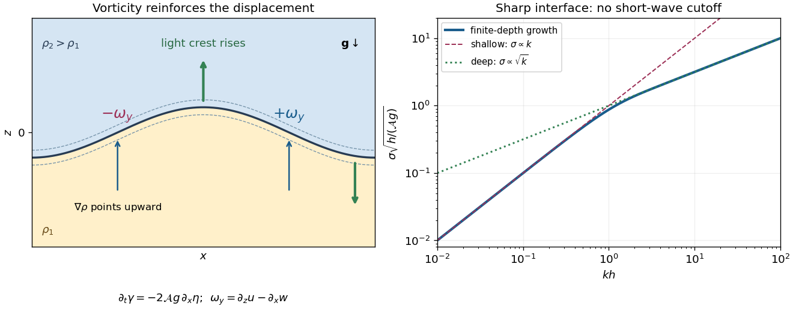

<h1 id="3/c/solution">Solution</h1>

↑ **Parent:** [C](../c.md)

For an [inviscid flow](../../../../inviscid-flow.md), the force per unit volume is $\mathbf F=-\nabla p-\rho g\hat{\mathbf z}$. The gravitational [acceleration](../../../../acceleration.md) has zero [curl](../../../../curl.md). Using the [curl](../../../../curl.md) product rule,

$$
\nabla\times\left(-\frac1\rho\nabla p\right)
=-\nabla(\rho^{-1})\times\nabla p
=\frac{\nabla\rho\times\nabla p}{\rho^2}.
$$

The supplied two-dimensional [vorticity equation](../../../../vorticity-equation.md) therefore becomes

$$
\boxed{\partial_t\boldsymbol\omega+\mathbf v\cdot\nabla\boldsymbol\omega
=\frac{\nabla\rho\times\nabla p}{\rho^2}.}
$$

The out-of-plane [vorticity](../../../../vorticity-split.md) has no stretching term in this two-dimensional setting. The source is [baroclinic vorticity generation](../../../../baroclinic-vorticity-generation.md): differently directed [mass density](../../../../density.md) and [pressure gradients](../../../../pressure-gradient.md) generate rotation even from zero initial [vorticity](../../../../vorticity-split.md).

For an explicit sign check, set $\omega_y=\partial_z u-\partial_x w$, with $z$ upward. A thin smoothed interface has $\rho\simeq\bar\rho(z-\eta(x,t))$, with $\bar\rho'>0$. If $P(x,t)$ denotes the total [pressure](../../../../pressure-split.md) evaluated on the interface, then within the thin layer $p_x+\eta_xp_z\simeq P_x$ and

$$
\frac{(\nabla\rho\times\nabla p)_y}{\rho^2}
\simeq\frac{\bar\rho'}{\rho^2}P_x.
$$

Integrating through that layer and taking its thickness to zero gives the [vortex sheet](../../../../vortex-sheet.md) strength $\gamma=u_2-u_1$ and its linear evolution:

$$
\partial_t\gamma=\left(\frac1{\rho_1}-\frac1{\rho_2}\right)P_x.
$$

For a growing Fourier mode, the potentials from the preceding calculation with $\alpha$ replaced by $k$ give

$$
P-p_*=-\frac{2\rho_1\rho_2}{\rho_1+\rho_2}g\eta,\qquad
\boxed{\partial_t\gamma=-2\mathcal A g\eta_x.}
$$

Thus the right-hand descending slope of a light-fluid crest produces positive $\omega_y$, while the left-hand ascending slope produces negative $\omega_y$. Their induced [velocity](../../../../velocity.md) raises the light-fluid crest and lowers the heavy-fluid trough, increasing the slope and generating more [vorticity](../../../../vorticity-split.md). This is the positive feedback underlying [Rayleigh-Taylor instability](../../../../rayleigh-taylor-instability.md).

**[Figure 1](#3/c/image-baroclinic-feedback-and-finite-depth-growth-of-an-unstable-density-interface). Baroclinic feedback and finite-depth growth of an unstable density interface**.

One can close this mechanism quantitatively. For $\eta=H(t)\cos(kx)$, the [kinematic boundary conditions](../../../../kinematic-boundary-condition.md) give $\gamma=2\dot H\coth(kh)\sin(kx)$. Combining with the sheet-generation equation gives

$$
\ddot H=\mathcal A gk\tanh(kh)H.
$$

For $kh\ll1$, the lids confine motion throughout both layers and horizontal redistribution is slow, yielding $\sigma\sim\sqrt{\mathcal A gh}\,k$. For $kh\gg1$, motion is localized within depth $k^{-1}$ on each side. Less fluid must accelerate at shorter [wavelength](../../../../wavelength.md), giving $\sigma\sim\sqrt{\mathcal A gk}$. Since $k_n=n\pi/b$, the ideal [growth rate](../../../../growth-rate.md) increases with $n$ with no short-wave cutoff.

The sharp-interface result requires $k\delta\ll1$ for the smoothed layer. When $k\delta$ becomes order one, it no longer applies. A smooth adverse [mass density](../../../../density.md) gradient has a local overturning time of order $[g\bar\rho'/\bar\rho]^{-1/2}$ rather than the unbounded sharp-interface rate. Finite molecular [diffusion](../../../../diffusion.md) also relaxes small-scale [mass density](../../../../density.md) perturbations on a time of order $(Dk^2)^{-1}$, and [viscosity](../../../../dynamic-viscosity-split.md), if included, damps small-scale [velocity](../../../../velocity.md). Weak [diffusion](../../../../diffusion.md) motivates the thin-layer picture; it does not justify extrapolating the discontinuous [dispersion relation](../../../../dispersion-relation-split.md) to arbitrary $n$.

## ↑ Ancestors (12)

1. [C](../c.md)
2. [3](../../3.md)
3. [2022](../../../2022-split.md)
4. [Past exam of the fluids course of the University of Oxford](../../../split.md)
5. [Fluids course of the University of Oxford](../../../../fluids-course-of-the-university-of-oxford.md)
6. [Year 3 of the physics course of the University of Oxford](../../../../year-3-of-the-physics-course-of-the-university-of-oxford.md)
7. [Physics course of the University of Oxford](../../../../physics-course-of-the-university-of-oxford.md)
8. [Undergraduate course of the University of Oxford](../../../../undergraduate-course-of-the-university-of-oxford.md)
9. [Course of the University of Oxford](../../../../course-of-the-university-of-oxford.md)
10. [University of Oxford](../../../../university-of-oxford-split.md)
11. [List of universities](../../../../list-of-universities.md)
12. [Codex Wiki](../../../../split.md)
