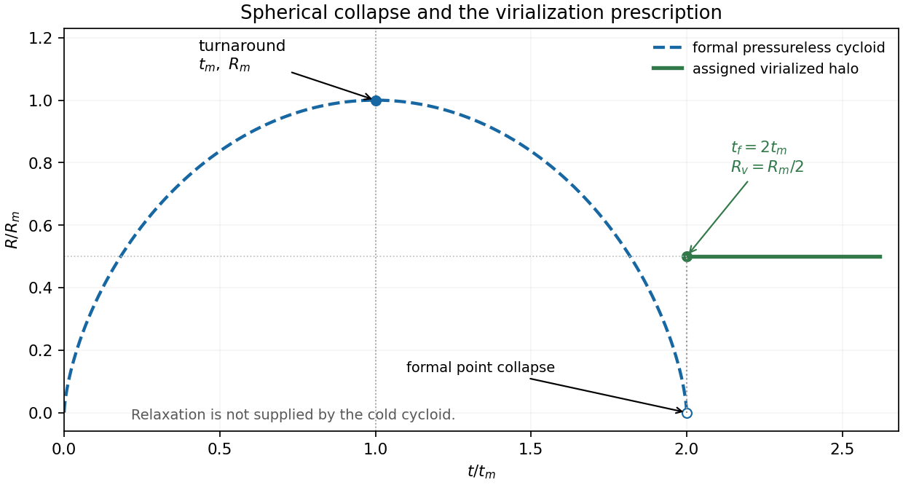

# Paper 1

↑ **Parent:** [2012](../2012.md)

Original source: [physical PDF pages 471–473; paper pages 1–3](https://www.whatdotheyknow.com/request/natural_science_tripos_physics_e_2/response/2340776/attach/2/FOI%202023%20399%20Zahid%20materials.pdf?cookie_passthrough=1). All optional notes and all three questions are answered. The [temperature](../../temperature.md) estimate in Solution 3 retains an unspecified [mean particle mass](../../ideal-gas.md#mean-particle-mass).

**Table of contents**

- [1](#1)
  - [a](#1/a)
    - [Solution](#1/a/solution)
  - [b](#1/b)
    - [Solution](#1/b/solution)
  - [c](#1/c)
    - [Solution](#1/c/solution)
  - [d](#1/d)
    - [Solution](#1/d/solution)
- [2](#2)
  - [Solution](#2/solution)
- [3](#3)
  - [Solution](#3/solution)

## 1

↑ **Parent:** [Paper 1](paper-1.md)

<h3 id="1/a">a</h3>

↑ **Parent:** [1](#1)

<h4 id="1/a/solution">Solution</h4>

↑ **Parent:** [A](#1/a)

[gas](../../thermodynamics.md#gas) heats when compression, [shocks](../../transport-equation.md#shock-wave) or absorbed radiation increase its [internal energy](../../internal-energy.md). Important sources include [accretion](../../astrophysics.md#accretion) [shocks](../../transport-equation.md#shock-wave), [stellar winds](../../stellar-astrophysics.md#stellar-wind), [supernovae](../../stellar-astrophysics.md#supernova), [photoionization](../../atomic-physics.md#photoionization), photoelectric emission from [interstellar dust](../../galaxy.md#interstellar-dust), [cosmic rays](../../galaxy.md#cosmic-ray) and [energy](../../energy.md) deposited by [active galactic nuclei](../../astrophysical-black-hole.md#active-galactic-nucleus). [photoionization](../../atomic-physics.md#photoionization) heating uses the photoelectron [energy](../../energy.md) above the [ionization](../../atomic-physics.md#ionization) threshold; compression contributes mechanical work rather than [photon](../../quantum-mechanics.md#photon) [absorption](../../radiometry.md#absorption-electromagnetic-radiation).

For specific [internal energy](../../internal-energy.md) $u$, an idealized thermal balance is

$$
\rho\frac{Du}{Dt}=-P\nabla\cdot\mathbf v+\mathcal H-\mathcal C,
\qquad
\mathcal C=n_en_H\Lambda(T,Z).
$$

Here $\mathcal H,\mathcal C$ are powers per volume and $Z$ describes abundances. The [electron-hydrogen normalization of the cooling function](../../heat.md#electron-hydrogen-normalization-of-the-cooling-function) must be specified: some conventions instead factor out $n_H^2$. For a monatomic [gas](../../thermodynamics.md#gas) with total particle [density](../../fluid-mechanics.md#density) $n$,

$$
\boxed{t_{\rm cool}=\frac{3nk_BT}{2n_en_H\Lambda}}
$$

when heating is negligible. Compare this with the dynamical time: rapid cooling permits loss of [pressure](../../pressure.md) support, whereas long cooling times allow a hot atmosphere to persist.

[collisional excitation](../../atomic-physics.md#collisional-excitation) followed by [spontaneous emission](../../atomic-physics.md#spontaneous-emission) cools partially ionized [gas](../../thermodynamics.md#gas); [radiative recombination](../../atomic-physics.md#radiative-recombination) also produces continuum cooling. [metal](../../chemical-substance.md#metal) lines enhance cooling over substantial intermediate-temperature ranges, while [thermal bremsstrahlung](../../astrophysics.md#thermal-bremsstrahlung) gives a roughly $\Lambda\propto T^{1/2}$ high-temperature tail. Atomic [hydrogen](../../chemical-substance.md#hydrogen) cooling becomes inefficient below roughly $10^4\,\mathrm K$, where [molecular line cooling](../../heat.md#molecular-line-cooling) and [interstellar dust](../../galaxy.md#interstellar-dust) can be important. [inverse Compton scattering](../../mathematical-physics.md#inverse-compton-scattering) cools hot [electrons](../../physics.md#electron) against a colder radiation field. A tabulated cooling curve assumes a composition and [ionization](../../atomic-physics.md#ionization) model; [photoionization](../../atomic-physics.md#photoionization) or nonequilibrium [ionization](../../atomic-physics.md#ionization) can change it.[2008, §§5 and 8: emission mechanisms, cooling normalization, cooling time and limits of collisional-ionization-equilibrium curves](../../physics-bibliography.md#thermal-radiation-processes-by-jelle-s-kaastra-and-others)

[X-ray](../../electromagnetic-radiation.md#x-ray) line ratios and continuum shape constrain [temperature](../../temperature.md) and [ionization](../../atomic-physics.md#ionization), while the [emission measure](../../astrophysics.md#emission-measure) constrains $\int n_en_H\,dV$. Turning that into a [density](../../fluid-mechanics.md#density) and [radiative gas cooling time](../../heat.md#optically-thin-gas-cooling-time) also requires a geometry; unresolved clumping, foreground [absorption](../../radiometry.md#absorption-electromagnetic-radiation) and multiphase [gas](../../thermodynamics.md#gas) are important controls.

<h3 id="1/b">b</h3>

↑ **Parent:** [1](#1)

<h4 id="1/b/solution">Solution</h4>

↑ **Parent:** [B](#1/b)

[inside-out collapse of a singular isothermal sphere](../../astrophysics.md#inside-out-collapse-of-a-singular-isothermal-sphere) starts from an idealized static envelope,

$$
\rho(r)=\frac{a_s^2}{2\pi Gr^2},\qquad
M(r)=\frac{2a_s^2r}{G},
$$

with constant [isothermal sound speed](../../compressible-flow.md#isothermal-sound-speed) $a_s$. Collapse begins centrally after formation of a central [mass](../../classical-mechanics.md#mass). An expansion wave moves outward through the initially static envelope at the [sound speed](../../compressible-flow.md#speed-of-sound):

$$
\boxed{r_{\rm ew}=a_st.}
$$

“Expansion” describes the outward-moving information front; the [gas](../../thermodynamics.md#gas) behind it moves inward. The exterior remains close to its original $r^{-2}$ equilibrium until the wave reaches it.

In the inner region, the central [mass](../../classical-mechanics.md#mass) dominates and [pressure](../../pressure.md) becomes less important:

$$
v_r\simeq-\sqrt{\frac{2GM_*}{r}},\qquad
\rho\simeq\frac{\dot M_*}{4\pi r^2|v_r|}\propto r^{-3/2}.
$$

The self-similar [accretion](../../astrophysics.md#accretion) scale is **$\dot M_*=m_0a_s^3/G$**, where the [dimensionless](../../physics.md#dimensionless-quantity) coefficient $m_0$ follows from the dynamical similarity solution, not from counting material swept by the front. Indeed, the initial [mass](../../classical-mechanics.md#mass) enclosed by the front grows at $2a_s^3/G$, and some of that material remains in the infalling envelope. For fixed [mean particle mass](../../ideal-gas.md#mean-particle-mass), $\dot M_*\propto T^{3/2}$. The original similarity calculation establishes the static outer and free-fall inner regimes.[1977, pp. 488–497: expansion-wave collapse after central-core formation and the two radial density asymptotes](../../physics-bibliography.md#self-similar-collapse-of-isothermal-spheres-and-star-formation-by-frank-h-shu)

The model assumes [spherical symmetry](../../geometry-and-topology.md#spherical-symmetry), isothermality and negligible [rotation](../../riemannian-geometry.md#rotation-mathematics) or magnetic stresses. An asymmetric [optically thick](../../astrophysics.md#optically-thick-medium) [spectral line](../../stellar-astrophysics.md#spectral-line) alone does not establish infall: an [optically thin](../../astrophysics.md#optically-thin-medium) systemic-velocity tracer and spatial maps help distinguish inward motion from [rotation](../../riemannian-geometry.md#rotation-mathematics), foreground [absorption](../../radiometry.md#absorption-electromagnetic-radiation) and outflow.

<h3 id="1/c">c</h3>

↑ **Parent:** [1](#1)

<h4 id="1/c/solution">Solution</h4>

↑ **Parent:** [C](#1/c)

[galactic feedback](../../galaxy.md#galactic-feedback) couples [star formation](../../stellar-astrophysics.md#star-formation) and [black-hole accretion](../../astrophysical-black-hole.md#black-hole-accretion) back to the [gas](../../thermodynamics.md#gas) supply. Stellar radiation, winds, [supernovae](../../stellar-astrophysics.md#supernova) and [cosmic rays](../../galaxy.md#cosmic-ray) inject [energy](../../energy.md) and [momentum](../../momentum.md); [active-galactic-nucleus feedback](../../astrophysical-black-hole.md#active-galactic-nucleus-feedback) adds radiation, jets and winds powered by [accretion](../../astrophysics.md#accretion). Heating, [turbulence](../../turbulence.md) or [gas](../../thermodynamics.md#gas) ejection can suppress later [star formation](../../stellar-astrophysics.md#star-formation), while compression can sometimes promote it. Negative feedback permits self-regulation rather than unrestricted [gas](../../thermodynamics.md#gas) consumption.

Define the [mass-loading factor](../../galaxy.md#mass-loading-factor) $\eta=\dot M_{\rm out}/\dot M_*$. If the launch speed scales with the [escape speed](../../energy.md#escape-velocity) and the injected [energy](../../energy.md) per stellar [mass](../../classical-mechanics.md#mass) is fixed, [conservation of energy](../../mathematical-physics.md#conservation-of-energy) suggests $\eta\propto v_{\rm esc}^{-2}$; fixed injected [momentum](../../momentum.md) instead suggests $\eta\propto v_{\rm esc}^{-1}$. Coupling efficiencies, radiative losses and recycling change these ideal scalings. Thermal [energy](../../energy.md) injected into dense [gas](../../thermodynamics.md#gas) can radiate away before driving an outflow, so an [energy](../../energy.md) budget alone does not demonstrate effective feedback.

Radio-filled [X-ray](../../electromagnetic-radiation.md#x-ray) cavities provide a mechanical diagnostic. For a cavity containing a relativistic fluid with $\gamma=4/3$, its [enthalpy](../../enthalpy.md) is $\gamma PV/(\gamma-1)\simeq4PV$; dividing by an estimated age gives a mechanical-power estimate. [Chandra X-ray Observatory](../../physics.md#chandra-x-ray-observatory) observations of the [Perseus cluster](../../large-scale-structure-of-the-universe.md#perseus-cluster) revealed fronts and ripples associated with radio bubbles, interpreted as weak [shocks](../../transport-equation.md#shock-wave) and [pressure](../../pressure.md) waves that can transport jet [energy](../../energy.md) into the cooling atmosphere.[2003, abstract: radio bubbles, weak-shock fronts, ripples and the proposed heating/cooling balance](../../physics-bibliography.md#a-deep-chandra-observation-of-the-perseus-cluster-shocks-and-ripples-by-a-c-fabian-and-others)

The test requires ambient [density](../../fluid-mechanics.md#density) and [temperature](../../temperature.md) estimates, radio/[X-ray](../../electromagnetic-radiation.md#x-ray) spatial comparison, projected cavity volumes and an age model. Brightness edges must be distinguished from [absorption](../../radiometry.md#absorption-electromagnetic-radiation) and cool rims; wave [energy](../../energy.md) is not automatically thermalized locally. These controls determine whether inferred mechanical heating can actually offset [radiative cooling](../../heat.md#radiative-cooling).

<h3 id="1/d">d</h3>

↑ **Parent:** [1](#1)

<h4 id="1/d/solution">Solution</h4>

↑ **Parent:** [D](#1/d)

[cold dark matter](../../cosmology.md#cold-dark-matter) is nonrelativistic and effectively collisionless on the scales of interest. Its small [velocity dispersion](../../galaxy.md#velocity-dispersion) limits [free streaming](../../linear-cosmological-density-perturbation.md#free-streaming), allowing small-scale gravitational wells to survive. [baryons](../../physics.md#baryon) coupled to [photons](../../quantum-mechanics.md#photon) undergo acoustic motion and damping before [recombination](../../cosmology.md#recombination-cosmology); [dark matter](../../cosmology.md#dark-matter) does not share that [photon](../../quantum-mechanics.md#photon) [pressure](../../pressure.md), and provides potential wells into which [baryons](../../physics.md#baryon) can later fall.

For a subhorizon pressureless perturbation, once a Newtonian treatment is applicable,

$$
\ddot\delta+2H\dot\delta-4\pi G\bar\rho_m\delta=0.
$$

During [radiation domination](../../linear-cosmological-density-perturbation.md#radiation-domination) the matter contribution to the background gravity is small; neglecting it gives $\delta\simeq C_1+C_2\log t$. This slow subhorizon growth is the [Mészáros effect](../../linear-cosmological-density-perturbation.md#meszaros-effect). During [matter domination](../../linear-cosmological-density-perturbation.md#matter-domination),

$$
\boxed{\delta=C_+a+C_-a^{-3/2}}
$$

in an [Einstein-de Sitter universe](../../large-scale-structure-of-the-universe.md#einstein-de-sitter-universe). Once $\delta$ approaches unity, linear theory fails and collapse, [virialization](../../classical-mechanics.md#virialization) and merging become important.

Modes entering the horizon during [radiation domination](../../linear-cosmological-density-perturbation.md#radiation-domination) therefore grow less before equality than longer modes entering later. This scale dependence is encoded in a [transfer function](../../control-theory.md#transfer-function), with a schematic linear [matter power spectrum](../../linear-cosmological-density-perturbation.md#matter-power-spectrum) $P(k,a)=A k^{n_s}T^2(k)D^2(a)$. [cold dark matter](../../cosmology.md#cold-dark-matter) supports hierarchical assembly; a sufficiently large warm- or hot-dark-matter free-streaming length suppresses small-scale structure. Superhorizon [density contrasts](../../linear-cosmological-density-perturbation.md#density-contrast) change under a [gauge transformation in cosmological perturbation theory](../../linear-cosmological-perturbation-theory.md#gauge-transformation-in-cosmological-perturbation-theory), so the subhorizon growth laws should not be applied indiscriminately outside the horizon. The original cold-dark-matter formation model explicitly connects weak [free streaming](../../linear-cosmological-density-perturbation.md#free-streaming) to the spectrum that seeds galaxies and clusters.[1984, Nature 311, pp. 517–525, abstract: collisionless cold particles, retained fluctuations and the post-recombination spectrum](../../physics-bibliography.md#formation-of-galaxies-and-large-scale-structure-with-cold-dark-matter-by-george-r-blumenthal-and-others)

## 2

↑ **Parent:** [Paper 1](paper-1.md)

<h3 id="2/solution">Solution</h3>

↑ **Parent:** [2](#2)

For the [radial epicyclic frequency](../../astrophysical-disk.md#radial-epicyclic-frequency), introduce the [effective potential](../../mathematical-physics.md#effective-potential) at fixed [specific angular momentum](../../celestial-mechanics.md#specific-angular-momentum) $l$: $\Phi_{\rm eff}=\Phi+l^2/(2r^2)$. A [circular orbit](../../classical-mechanics.md#circular-orbit) at $r_c$ satisfies $\Phi'(r_c)=l^2/r_c^3=r_c\Omega^2(r_c)$. A small radial displacement $\xi$ obeys $\ddot\xi=-\Phi_{\rm eff}''(r_c)\xi$. Differentiate at fixed $l$ before inserting the circular-orbit relation:

$$
\begin{aligned}
\kappa^2&=\frac{3l^2}{r_c^4}+\Phi''(r_c)
=3\Omega^2+\frac{d}{dr}(r\Omega^2)\\
&=\boxed{4\Omega^2+2r\Omega\Omega'
=4\Omega^2\left(1+\frac r{2\Omega}\Omega'\right)}.
\end{aligned}
$$

For a [flat rotation curve](../../galaxy.md#flat-galaxy-rotation-curve), $\Omega\propto r^{-1}$, so **$\kappa=\sqrt2\,\Omega$**.

In a perturbation proportional to $\exp[i(\int k\,dr+n\phi-\omega t)]$, $n$ is the integer azimuthal mode number, giving $|n|$ arms for a nonaxisymmetric pattern. Its angular [pattern speed](../../galaxy.md#pattern-speed) is $\Omega_p=\omega/n$ for a real [frequency](../../wave.md#frequency) and $n\ne0$; $a_0$ is the unperturbed [gas](../../thermodynamics.md#gas) [sound speed](../../compressible-flow.md#speed-of-sound), or the specified effective fluid pressure-response speed. For growing patterns the angular phase speed uses $\operatorname{Re}\omega/n$. Axisymmetric modes have $n=0$: their [pattern speed](../../galaxy.md#pattern-speed) is undefined, and one must use $(\omega-n\Omega)^2\to\omega^2$, not set the pattern-speed expression to zero.

Define the [Toomre parameter](../../gravitational-instability-of-an-astrophysical-disk.md#toomre-parameter) and [Toomre wavenumber](../../gravitational-instability-of-an-astrophysical-disk.md#toomre-wavenumber) by

$$
\boxed{k_T=\frac{\kappa^2}{2\pi G\sigma},\qquad
Q=\frac{\kappa a_0}{\pi G\sigma}.}
$$

Then $q=|k|/k_T$ gives

$$
\frac{\omega^2}{\kappa^2}
=1-q+\frac{Q^2q^2}{4}
=1-\frac1{Q^2}+\frac{Q^2}{4}
\left(q-\frac2{Q^2}\right)^2.
$$

For $a_0>0$, the minimum is negative precisely when **$Q<1$**. Thus this condition is necessary and sufficient for an exponentially growing axisymmetric mode within the given local razor-thin fluid model; $Q=1$ is marginal. It is not a guarantee against global or nonaxisymmetric instabilities, and the collisionless stellar-disk criterion has a different pressure-response normalization.

The [Toomre unstable band and fastest growth](../../gravitational-instability-of-an-astrophysical-disk.md#toomre-unstable-band-and-fastest-growth) follow by minimizing $\omega^2$:

$$
\boxed{|k|_*=\frac{\pi G\sigma}{a_0^2}
=\frac{2k_T}{Q^2},\qquad
\lambda_*=\frac{2a_0^2}{G\sigma},\qquad
\gamma_*=\kappa\sqrt{Q^{-2}-1}.}
$$

Here the growing branch has $\omega=i\gamma_*$ under the stated Fourier convention. Both signs of the radial [wave number](../../wave-equation.md#wavenumber) have the same [growth rate](../../dispersion-relation.md#growth-rate). The unstable band is $q_-<q<q_+$, where $q_\pm=2(1\pm\sqrt{1-Q^2})/Q^2$.

For the [minimum Toomre parameter in an exponential flat-rotation disk](../../gravitational-instability-of-an-astrophysical-disk.md#minimum-toomre-parameter-in-an-exponential-flat-rotation-disk) with constant $a_0$, put $x=r/r_0$:

$$
Q(r)=Q_0\frac{e^{x-1}}x,\qquad
Q_0=\frac{\sqrt2\,\Omega_0a_0}{\pi G\sigma_0}.
$$

The [logarithmic derivative](../../analytic-number-theory.md#logarithmic-derivative) is $d\log Q/dx=1-1/x$, so the unique minimum occurs at $r=r_0$. Both $Q\to\infty$ as $r\downarrow0$ and $Q\to\infty$ as $r\to\infty$. Hence inner and outer regions are stable within this idealized [rotation](../../riemannian-geometry.md#rotation-mathematics) law, even when an intermediate annulus is unstable. The whole disk is strictly stable in this local axisymmetric test if

$$
\boxed{\Omega_0>\frac{\pi G\sigma_0}{\sqrt2\,a_0}.}
$$

Equality makes the ring at $r_0$ marginal. The central conclusion uses the assumed [flat rotation curve](../../galaxy.md#flat-galaxy-rotation-curve) all the way inward; real central [rotation](../../riemannian-geometry.md#rotation-mathematics) laws need not retain that limit.

**[Figure 1](#2/image-local-disk-stability). Local disk stability**.

## 3

↑ **Parent:** [Paper 1](paper-1.md)

<h3 id="3/solution">Solution</h3>

↑ **Parent:** [3](#3)

The normalized [cycloid](../../topology.md#cycloid) has

$$
\frac{R_s}{R_m}=\frac{1-\cos\eta}{2},\qquad
\frac{t}{t_m}=\frac{\eta-\sin\eta}{\pi}.
$$

The initially expanding perturbation reaches maximum radius at $\eta=\pi$, $t=t_m$, then formally collapses to zero radius at $\eta=2\pi$, $t=2t_m$. A finite virialized object is assigned the conventional formation epoch **$t_f=2t_m$**; random motions replace the pressureless point-collapse singularity. The [cycloid](../../topology.md#cycloid) alone does not describe that relaxation.

**[Figure 2](#3/image-spherical-collapse-history). Spherical-collapse history**.

For the standard top-hat [virialization](../../classical-mechanics.md#virialization) estimate, write $U=-C_GGM^2/R$ and retain the same gravitational structure factor $C_G$ at turnaround and final equilibrium. The coherent [kinetic energy](../../energy.md#kinetic-energy) vanishes at turnaround, whereas the [virial theorem](../../classical-mechanics.md#virial-theorem) gives $2K_v+U_v=0$ in the final isolated equilibrium. [conservation of energy](../../mathematical-physics.md#conservation-of-energy) gives

$$
U_m=K_v+U_v=\frac{U_v}{2},
\qquad\boxed{R_v=R_m/2}.
$$

The final [density](../../fluid-mechanics.md#density) is eight times the turnaround [density](../../fluid-mechanics.md#density). Meanwhile $\bar\rho\propto a^{-3}\propto t^{-2}$, so $\bar\rho(t_f)=\bar\rho(t_m)/4$. The [Einstein-de Sitter virial overdensity](../../large-scale-structure-of-the-universe.md#einstein-de-sitter-virial-overdensity) follows by combining these factors with the supplied turnaround contrast:

$$
\boxed{\Delta_f=8\times4\left(\frac{3\pi}{4}\right)^2
=18\pi^2\simeq177.65\approx200,}
\qquad
\boxed{\rho_v=\Delta_f\rho_0(1+z_f)^3.}
$$

The value 200 is a convenient rounded overdensity convention, not exactly the Einstein-de Sitter result.

The [virial radius of a dark-matter halo](../../large-scale-structure-of-the-universe.md#virial-radius-of-a-dark-matter-halo) follows from $M_v=4\pi R_v^3\rho_v/3$:

$$
\boxed{R_v=
\left(\frac{3M_v}{4\pi\Delta_f\rho_0}\right)^{1/3}
\frac1{1+z_f}.}
$$

The [hydrostatic temperature of an inverse-square halo](../../classical-mechanics.md#hydrostatic-temperature-of-an-inverse-square-halo) follows from [hydrostatic equilibrium](../../statistical-physics.md#hydrostatic-equilibrium) and the [ideal gas law](../../ideal-gas.md#ideal-gas-law):

$$
\frac{dP}{dr}=-\rho_g\frac{GM(r)}{r^2},\qquad
P=\frac{\rho_gk_BT_v}{\mu}.
$$

Since $\rho_g\propto r^{-2}$ and $M(r)=M_vr/R_v$, cancellation of $\rho_g/r$ gives $2k_BT_v/\mu=GM_v/R_v$. Therefore

$$
\boxed{T_v=\frac{GM_v\mu}{2k_BR_v}
=\frac{GM_v^{2/3}\mu}{2k_B}
\left(\frac{4\pi\Delta_f\rho_0}{3}\right)^{1/3}(1+z_f).}
$$

Here $\mu$ is a dimensionful [mean particle mass](../../ideal-gas.md#mean-particle-mass), as specified in the paper; a [dimensionless](../../physics.md#dimensionless-quantity) [mean molecular weight](../../ideal-gas.md#mean-molecular-weight) would need multiplication by a particle-mass unit. The isothermal interior is a further halo idealization, not an exact continuation of the uniform top-hat profile used in the virial-overdensity estimate. Changing its gravitational structure factor in a literal [energy](../../energy.md) comparison would change the turnaround-radius relation.

The [formation redshift from halo mean density](../../large-scale-structure-of-the-universe.md#formation-redshift-from-halo-mean-density) uses the cluster data, which imply $\rho_v=3M_v/(4\pi R_v^3)=5.37148\times10^{13}M_\odot\,\mathrm{Mpc}^{-3}$. Thus, using the requested rounded convention,

$$
\boxed{1+z_f=\left(\frac{3M_v}{4\pi R_v^3\Delta_f\rho_0}\right)^{1/3}
=1.91908,\qquad z_f\simeq0.92\quad(\Delta_f=200).}
$$

Using $18\pi^2$ instead gives $z_f\simeq1.00$. In the Einstein-de Sitter time scaling the rounded-convention result is $t_f/t_0=(1+z_f)^{-3/2}\simeq0.376$. Directly from the [mass](../../classical-mechanics.md#mass) and radius,

$$
\boxed{T_v=2.34478\times10^8
\left(\frac{\mu}{m_p}\right)\mathrm K.}
$$

For the estimate, take [mean particle mass](../../ideal-gas.md#mean-particle-mass) $\mu=0.6m_p$, appropriate approximately to a [hydrogen](../../chemical-substance.md#hydrogen)-[helium](../../chemical-substance.md#helium) mixture with complete [ionization](../../atomic-physics.md#ionization). This gives **$T_v\simeq1.41\times10^8\,\mathrm K$**, or $k_BT_v\simeq12.1\,\mathrm{keV}$. The composition choice is additional input, not a value supplied by the examination; the boxed expression retains the result for any $\mu$.

## ↑ Ancestors (11)

1. [2012](../2012.md)
2. [Past exam of the formation of Structure in the Universe course of the University of Cambridge](../../past-exam-of-the-formation-of-structure-in-the-universe-course-of-the-university-of-cambridge.md)
3. [Formation of Structure in the Universe course of the University of Cambridge](../../university-of-cambridge.md#formation-of-structure-in-the-universe-course-of-the-university-of-cambridge)
4. [Physics course of the year 4 of the natural sciences course of the University of Cambridge](../../university-of-cambridge.md#physics-course-of-the-year-4-of-the-natural-sciences-course-of-the-university-of-cambridge)
5. [Year 4 of the natural sciences course of the University of Cambridge](../../university-of-cambridge.md#year-4-of-the-natural-sciences-course-of-the-university-of-cambridge)
6. [Year of the natural sciences course of the University of Cambridge](../../university-of-cambridge.md#year-of-the-natural-sciences-course-of-the-university-of-cambridge)
7. [Natural sciences course of the University of Cambridge](../../university-of-cambridge.md#natural-sciences-course-of-the-university-of-cambridge)
8. [Course of the University of Cambridge](../../university-of-cambridge.md#course-of-the-university-of-cambridge)
9. [University of Cambridge](../../university-of-cambridge.md)
10. [List of universities](../../README.md#list-of-universities)
11. [Codex Wiki](../../README.md)
