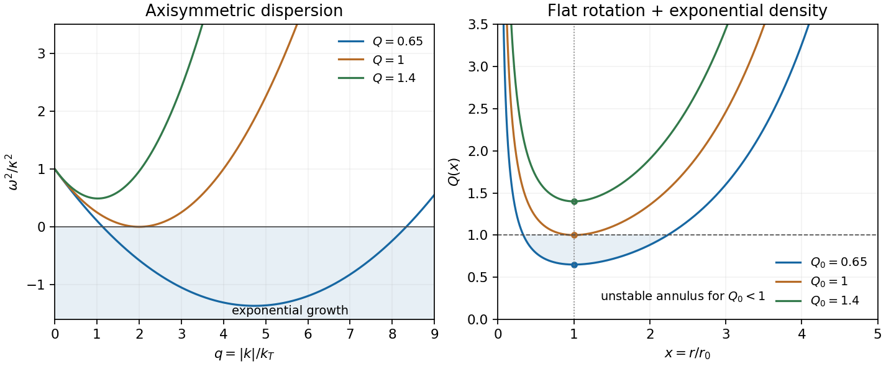

<h1 id="2/solution">Solution</h1>

↑ **Parent:** [2](../2.md)

For the [radial epicyclic frequency](../../../../radial-epicyclic-frequency.md), introduce the [effective potential](../../../../effective-potential.md) at fixed [specific angular momentum](../../../../specific-angular-momentum.md) $l$: $\Phi_{\rm eff}=\Phi+l^2/(2r^2)$. A [circular orbit](../../../../circular-orbit.md) at $r_c$ satisfies $\Phi'(r_c)=l^2/r_c^3=r_c\Omega^2(r_c)$. A small radial displacement $\xi$ obeys $\ddot\xi=-\Phi_{\rm eff}''(r_c)\xi$. Differentiate at fixed $l$ before inserting the circular-orbit relation:

$$
\begin{aligned}
\kappa^2&=\frac{3l^2}{r_c^4}+\Phi''(r_c)
=3\Omega^2+\frac{d}{dr}(r\Omega^2)\\
&=\boxed{4\Omega^2+2r\Omega\Omega'
=4\Omega^2\left(1+\frac r{2\Omega}\Omega'\right)}.
\end{aligned}
$$

For a [flat rotation curve](../../../../flat-galaxy-rotation-curve.md), $\Omega\propto r^{-1}$, so **$\kappa=\sqrt2\,\Omega$**.

In a perturbation proportional to $\exp[i(\int k\,dr+n\phi-\omega t)]$, $n$ is the integer azimuthal mode number, giving $|n|$ arms for a nonaxisymmetric pattern. Its angular [pattern speed](../../../../pattern-speed.md) is $\Omega_p=\omega/n$ for a real [frequency](../../../../frequency.md) and $n\ne0$; $a_0$ is the unperturbed [gas](../../../../gas.md) [sound speed](../../../../speed-of-sound.md), or the specified effective fluid pressure-response speed. For growing patterns the angular phase speed uses $\operatorname{Re}\omega/n$. Axisymmetric modes have $n=0$: their [pattern speed](../../../../pattern-speed.md) is undefined, and one must use $(\omega-n\Omega)^2\to\omega^2$, not set the pattern-speed expression to zero.

Define the [Toomre parameter](../../../../toomre-parameter.md) and [Toomre wavenumber](../../../../toomre-wavenumber.md) by

$$
\boxed{k_T=\frac{\kappa^2}{2\pi G\sigma},\qquad
Q=\frac{\kappa a_0}{\pi G\sigma}.}
$$

Then $q=|k|/k_T$ gives

$$
\frac{\omega^2}{\kappa^2}
=1-q+\frac{Q^2q^2}{4}
=1-\frac1{Q^2}+\frac{Q^2}{4}
\left(q-\frac2{Q^2}\right)^2.
$$

For $a_0>0$, the minimum is negative precisely when **$Q<1$**. Thus this condition is necessary and sufficient for an exponentially growing axisymmetric mode within the given local razor-thin fluid model; $Q=1$ is marginal. It is not a guarantee against global or nonaxisymmetric instabilities, and the collisionless stellar-disk criterion has a different pressure-response normalization.

The [Toomre unstable band and fastest growth](../../../../toomre-unstable-band-and-fastest-growth.md) follow by minimizing $\omega^2$:

$$
\boxed{|k|_*=\frac{\pi G\sigma}{a_0^2}
=\frac{2k_T}{Q^2},\qquad
\lambda_*=\frac{2a_0^2}{G\sigma},\qquad
\gamma_*=\kappa\sqrt{Q^{-2}-1}.}
$$

Here the growing branch has $\omega=i\gamma_*$ under the stated Fourier convention. Both signs of the radial [wave number](../../../../wavenumber.md) have the same [growth rate](../../../../growth-rate.md). The unstable band is $q_-<q<q_+$, where $q_\pm=2(1\pm\sqrt{1-Q^2})/Q^2$.

For the [minimum Toomre parameter in an exponential flat-rotation disk](../../../../minimum-toomre-parameter-in-an-exponential-flat-rotation-disk.md) with constant $a_0$, put $x=r/r_0$:

$$
Q(r)=Q_0\frac{e^{x-1}}x,\qquad
Q_0=\frac{\sqrt2\,\Omega_0a_0}{\pi G\sigma_0}.
$$

The [logarithmic derivative](../../../../logarithmic-derivative.md) is $d\log Q/dx=1-1/x$, so the unique minimum occurs at $r=r_0$. Both $Q\to\infty$ as $r\downarrow0$ and $Q\to\infty$ as $r\to\infty$. Hence inner and outer regions are stable within this idealized [rotation](../../../../rotation-mathematics.md) law, even when an intermediate annulus is unstable. The whole disk is strictly stable in this local axisymmetric test if

$$
\boxed{\Omega_0>\frac{\pi G\sigma_0}{\sqrt2\,a_0}.}
$$

Equality makes the ring at $r_0$ marginal. The central conclusion uses the assumed [flat rotation curve](../../../../flat-galaxy-rotation-curve.md) all the way inward; real central [rotation](../../../../rotation-mathematics.md) laws need not retain that limit.

**[Figure 1](#2/image-local-disk-stability). Local disk stability**.

## ↑ Ancestors (13)

1. [2](../2.md)
2. [Paper 1](../../paper-1-split.md)
3. [2012](../../split.md)
4. [Past exam of the formation of Structure in the Universe course of the University of Cambridge](../../../split.md)
5. [Formation of Structure in the Universe course of the University of Cambridge](../../../../formation-of-structure-in-the-universe-course-of-the-university-of-cambridge.md)
6. [Physics course of the year 4 of the natural sciences course of the University of Cambridge](../../../../physics-course-of-the-year-4-of-the-natural-sciences-course-of-the-university-of-cambridge.md)
7. [Year 4 of the natural sciences course of the University of Cambridge](../../../../year-4-of-the-natural-sciences-course-of-the-university-of-cambridge.md)
8. [Year of the natural sciences course of the University of Cambridge](../../../../year-of-the-natural-sciences-course-of-the-university-of-cambridge.md)
9. [Natural sciences course of the University of Cambridge](../../../../natural-sciences-course-of-the-university-of-cambridge.md)
10. [Course of the University of Cambridge](../../../../course-of-the-university-of-cambridge.md)
11. [University of Cambridge](../../../../university-of-cambridge-split.md)
12. [List of universities](../../../../list-of-universities.md)
13. [Codex Wiki](../../../../split.md)
